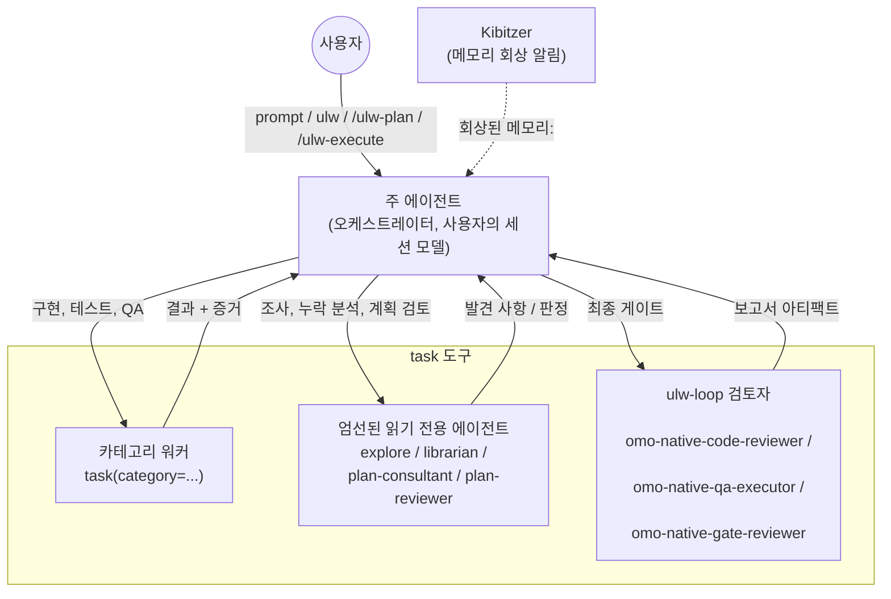
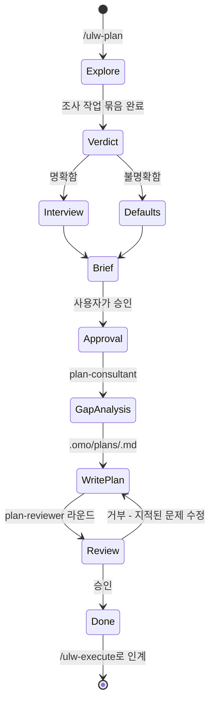

## 오케스트레이션 시스템 가이드

omo-senpi는 계획과 실행을 분리해 하나의 코딩 세션에서 여러 작업을 함께 진행할 수 있게 합니다. 사용자가 대화하는 세션의 메인
에이전트가 판단과 작업 조정을 맡고, 다른 작업은 `task` 도구로 위임합니다.

---

## 요약: 언제 무엇을 사용해야 하나요?

- **상황: 빠른 수정, 단일 파일**
  - 접근 방식: 요청을 그대로 입력
  - 동작: 메인 에이전트가 직접 처리합니다.
- **상황: 복잡하고 맥락을 길게 설명하기 어려움**
  - 접근 방식: `ulw`(또는 `ultrawork`) 입력
  - 동작: 메인 에이전트가 ultrawork 모드에서 탐색하고, 메모장에 계획을 기록하고, 작업을 위임한 뒤 증거로 검증합니다.
- **상황: 복잡한 작업을 시작하기 전에 계획을 작성하고 검토받고 싶음**
  - 접근 방식: `/ulw-plan` 후 `/ulw-execute`
  - 동작: Ultrawork Planner가 필요한 사항을 확인하고 `.omo/plans/<slug>.md`를 작성합니다. 이후 같은 세션에서
    `/ulw-execute`로 계획을 실행합니다.
- **상황: 일부 작업이 다른 작업의 완료를 기다려야 함**
  - 접근 방식: `mass-ulw`
  - 동작: 메인 에이전트가 의존성 그래프를 만들고 단계마다 `workflow` 도구를 한 번씩 실행합니다.
- **상황: 같은 모듈을 다루며 진행 중 서로 정보를 주고받아야 하는 작업 흐름이 여럿 있음**
  - 접근 방식: 팀 모드(`team_create`)
  - 동작: 메인 에이전트가 백그라운드 팀 멤버를 이끕니다. [팀 모드](05-팀-모드-가이드.md#팀-모드-가이드)를 참고하세요.

**선택 순서:**

```text
빠른 수정이나 간단한 작업인가?
  |- 예 -> 그냥 프롬프트 입력
  |- 아니요 -> 전체 맥락을 설명하기 번거로운가?
             |- 예 -> "ulw"를 입력하고 에이전트가 알아서 처리하게 함
             |- 아니요 -> 작성해서 검토할 수 있는 계획이 필요한가?
                        |- 예 -> /ulw-plan, 승인, 이후 /ulw-execute
                        |- 아니요 -> 많은 작업 사이에 실제 순서가 필요한가? mass-ulw
                                  작업 흐름이 겹치는가? 팀 모드
                                  그 외에는 "ulw"
```

---

## 아키텍처

오케스트레이터는 하나입니다. 사용자 세션의 모델에서 실행되는 메인 에이전트입니다. 세션을 다른 에이전트로 전환하지 않고 `task`로 작업을
위임합니다. 결과를 받아 계획, 할 일 목록, 검증 증거를 함께 관리합니다.



### 메인 에이전트의 조율 역할

메인 에이전트는 사용자 세션에 선택된 모델로 실행됩니다. ultrawork 지시문과 계획·실행 스킬을 사용하며, 별도의 "계획 에이전트"나
"실행 에이전트"로 전환하지 않습니다. 주요 모델에 맞춘 프롬프트 프리셋이 있고 계획·실행 프롬프트는 여러 모델 계열에서 작동하도록
작성됐습니다. 자세한 내용은 [에이전트-모델 매칭](04-에이전트-모델-매칭-가이드/01-출시-게이트가-적용된-Fable-55-준비.md#에이전트-모델-매칭-가이드)을 참고하세요.

### task를 통한 위임

각 `task` 호출에는 `category`와 `subagent_type` 중 하나만 지정합니다.

- `task(category="...")`는 **카테고리 워커**를 시작합니다. 해당 카테고리의 모델과 스킬을 적용한 새 워커 세션으로,
  구현·테스트·QA에 사용합니다. 모델은 항상 `omo.json`의 `categories.<name>.models`에서 가져옵니다.
  `category`와 `model`을 함께 전달하면 거부됩니다.
- `task(subagent_type="...")`는 지정한 이름의 에이전트를 직접 호출합니다. 내장 대상은 다음과 같습니다.
  - 읽기 전용 에이전트(프로세스 내부에서 실행되고 파일을 쓸 수 없음):
    `explore`(코드베이스에서 "X가 어디에 있나?" 검색), `librarian`(원격 저장소·공식 문서·OSS 예제 검색),
    `plan-consultant`(계획 전 누락 분석), `plan-reviewer`(계획 검토).
    `plan-consultant`와 `plan-reviewer`에는 **계획 게이트**가 적용됩니다. 사용자가 ulw-plan 워크플로를
    명시적으로 요청하고, 이 세션에서 `.omo/plans/*.md` 파일을 생성하거나 수정했으며, `/ulw-execute`를 실행하지
    않았을 때만 시작할 수 있습니다.
  - ulw-loop 검토자(보고서 파일을 작성하므로 읽기 전용이 아님):
    `omo-native-code-reviewer`(diff·테스트·위험 검토),
    `omo-native-qa-executor`(실제 시나리오 실행과 인터페이스 증거 기록),
    `omo-native-gate-reviewer`(실패한 성공 기준을 명시할 수 없으면 승인).
    이름 변경 전의 `omo-senpi-*` 이름도 계속 인식합니다.

여러 작업을 병렬로 실행할 때는 기본 방식인 `run_in_background: true`를 사용합니다. `load_skills`는 서브에이전트
프롬프트 앞에 스킬을 붙이고, `name`은 일정한 호출 이름을, `task_summary`는 결과 표시에 쓰일 한 줄 설명을 지정합니다.
`task_send`로 서브에이전트를 이어서 실행하고 `task_output`으로 상태를 확인하며 `task_cancel`로 종료할 수
있습니다. `/tasks`에는 이 세션에서 시작한 작업이 나옵니다. 일회성인 `plan-reviewer`는 `task_send`를 받지
않습니다.

전용 에이전트는 팀 멤버가 될 수 없습니다. `team_create` 대신 반드시 `task`로 호출하세요.

### Kibitzer 메모리 알림

Kibitzer는 저장된 메모리 가운데 현재 작업에 관련된 것을 찾아 알리는 읽기 전용 구성 요소입니다. 메인 에이전트 세션마다 필요한 시점에
사이드카 세션 하나가 시작되고, 메인 세션이 끝날 때까지 유지됩니다. 메인 세션의 프롬프트·도구 호출·도구 결과는 크기가 제한되고 비밀 정보가
가려진 이벤트로 전달됩니다. 도구 인수, 결과 앞부분, 에이전트 텍스트와 프롬프트는 저장 전 길이 제한과 비식별화 처리를 거칩니다.

프롬프트나 도구 호출에 아직 검토하지 않은 저장 메모리가 관련될 때만 모델 턴을 사용하며, 한 머신에서 동시에 최대 두 번 활성화됩니다.
활성화되면 워크스페이스를 `read`와 `grep`으로 확인하고, `session_entries`로 메인 세션의 기록을 살펴보고, 메모리를
`search`/`read`할 수 있습니다. 활성화 한 번당 도구 호출은 8번까지이며 모두 읽기 전용입니다. 메모리와 파일을 쓰지 않습니다.
출력은 `nudge`뿐이며 메인 에이전트에는 `recalled memory: <hint>` 알림으로 표시됩니다. 컨텍스트가 가득 차면 이미
전달했거나 거부한 내용을 반영해 초기화하고, 모델이 실패하면 잠시 중단한 뒤 다시 시도합니다. 작업 내용을 바꾸거나 유휴 세션을 깨우지 않고,
메인 에이전트에 필요한 기억만 알려줍니다. `/search`는 수동 메모리 검색 인터페이스이며
`memory.recall.enabled: false`로 Kibitzer를 끌 수 있습니다.

---

## 계획: Ultrawork Planner

`/ulw-plan`을 실행하면 메인 에이전트가 계획 수립을 담당하는 **Ultrawork Planner**로 작동합니다.
`ULW-PLAN MODE ENABLED!`를 표시하고, 사용자 승인 전에는 구현하지 않습니다. 이 승인은 계획 작성에만 적용되며 실제 실행은
`/ulw-execute`에서 별도로 시작한다는 점을 알립니다.

계획 모드가 켜진 동안에는 "X 해줘", "X 수정해", "그냥 해"도 "X를 계획하라"는 뜻으로 처리합니다.

### 인터뷰

계획자는 먼저 코드를 살펴봅니다. `explore`와 `librarian`으로 읽기 전용 조사를 병렬로 진행하고, 가능하다면 설계 자문용
`architect`와 `ultrabrain` 카테고리도 사용합니다. 그 결과를 보고 사용자에게 무엇을 물을지 결정합니다.

- **의도가 명확할 때**(원하는 결과가 정해졌고 선호 사항만 남았을 때): 저장소에서 답을 찾을 수 없는 결정만 이유를 붙여 사용자에게 묻습니다.
- **의도가 불명확할 때**(원하는 결과 자체가 모호할 때): 인터뷰하는 대신 권장 기본값을 정해 알리고, 고정밀 검토를 자동으로 켭니다.
- **경계에 있을 때**: 의도가 명확한 것으로 보고 질문 하나만 합니다.

사용자가 "나한테 물어봐" 또는 "인터뷰해줘"라고 요청하면 반드시 인터뷰합니다. 되돌릴 수 없거나 파괴적이거나 비용이 드는 결정은 기본값이
있더라도 항상 사용자에게 묻습니다.



### Plan Consultant 누락 분석

계획을 쓰기 전에 `plan-consultant`를 호출해 요청에 드러나지 않은 의도, 워커가 진행하지 못할 모호함, 과도한 설계나 범위 확대,
빠진 완료 기준과 예외 상황을 찾습니다. 계획자가 이미 파악한 맥락도 문서에 명시해 실행자가 추측하지 않도록 합니다.

### Plan Reviewer 고정밀 검토

`/ulw-plan`이 만드는 모든 계획은 사용자가 거절하지 않는 한 고정밀 검토를 받습니다. 한 번의 검토는 완성된 계획 파일을
`plan-reviewer`가 한 번 검사하는 단위입니다. 검토자는 승인에 무게를 두고 확인된 차단 사유가 있을 때만 거부합니다.

- 참조된 파일이 존재하고 계획의 주장을 뒷받침하는가
- 각 작업에 개발자가 바로 사용할 시작점이 있는가
- 작업들이 서로 모순되지 않는가
- QA 시나리오에 도구, 단계, 예상 결과가 명시됐는가
- 실행을 완전히 막을 정보가 빠지지 않았는가

남은 의견이 참고 사항뿐이면 승인으로 처리합니다. 거부되면 지적된 문제를 모두 수정한 뒤 다시 제출합니다. 새 차단 사유가 발견되거나 기존
사유가 해결되는 동안 검토를 이어갑니다. 새 발견도 수정도 없는데 승인하지 않으면 중단하고 사용자에게 묻습니다. 참고 사항만 남긴 승인이 나오면
검토를 끝냅니다.

호출은 정해진 계약을 따릅니다. 하네스가 `plan-reviewer` 프롬프트를 `.omo/plans/*.md` 경로 하나만 받는 표준 검토
계약으로 바꾸므로 다른 프롬프트 내용은 사용되지 않습니다.

### 계획 게이트 규칙

- `plan-consultant`와 `plan-reviewer`는 사용자가 ulw-plan 워크플로를 명시적으로 요청하고, 이 세션에서
  `.omo/plans/` 아래 계획 파일을 생성하거나 수정했으며, `/ulw-execute`를 호출하지 않았을 때만 사용할 수 있습니다.
- 단순 `ulw` 실행에서는 작업 규모와 관계없이 사용할 수 없습니다. 대신 메모장에 자체 검토를 기록합니다.
- 계획을 찾지 못한 `/ulw-execute`가 `/ulw-plan`을 자동으로 시작해도 게이트는 열리지 않습니다. 이때는 누락 분석이나 검토
  없이 계획을 작성하고 그 사실을 알립니다.

### 계획 파일

계획자는 파일 형식을 직접 만들지 않고 `scaffold-plan.mjs`를 실행합니다. 초안인 `.omo/drafts/<slug>.md`에는
세션 압축 후 재개하는 데 필요한 `intent`, `review_required`, 결정 사항, 승인 게이트가 담깁니다. 사용자가 승인하면
계획을 `.omo/plans/<slug>.md`에 저장합니다. 실행 가능한 각 항목은 0열에서 시작하는 `- [ ] N. <title>`
줄이며, 참조, 완료 기준, QA 시나리오, `Recommended task executor category:` 줄을 포함합니다.

### 적대적 대안: /hyperplan

계획자 한 명의 검토로 부족하다면 `/hyperplan`으로 계획 확정 전에 서로의 판단을 비판하는 팀을 구성할 수 있습니다. 결과물은 여전히
`/ulw-execute`에 전달할 `.omo/plans/*.md` 파일입니다.

---

## 실행: /ulw-execute

```text
/ulw-execute [plan-name] [--worktree <absolute-path>] [--make-pr] [--ship]
```

- `plan-name`(선택): `.omo/plans/`에 있는 파일 이름의 전체 또는 일부.
- `--worktree`: 새 워크트리를 만드는 대신 첫 단계에서 기존 작업 소유 워크트리를 재사용합니다.
- `--make-pr`: 단계별 워크트리를 풀 리퀘스트로 제출하고 URL을 전달합니다. 병합은 사용자가 요청할 때만 합니다.
- `--ship`: `--make-pr`도 적용하고, PR이 병합될 때까지 워크트리에서 CI와 검토 의견을 반영합니다.

메인 에이전트가 승인된 작업 계획을 같은 세션에서 실행합니다. 에이전트를 교체하는 대신 실행 스킬의 오케스트레이션 규칙을 따릅니다. **메인
에이전트는 제품 코드를 직접 작성하지 않습니다.** 구현·테스트·QA·검토는 모두 워커에게 위임합니다. 메인 에이전트는 계획 선택,
`.omo/` 상태, 작업 분해와 배정, 결과 판정과 증거를 관리합니다.

### 실행하면 일어나는 일

1. **계획 선택.** `.omo/boulder.json`에서 현재 세션의 `active` 또는 `paused` 작업을 찾아 재개합니다. 없으면
   `plan-name`과 일치하는 계획을 찾거나, 계획이 하나면 자동으로 선택합니다. 여러 개면 질문 하나로 결정합니다.
   선택할 계획이 전혀 없으면 `/ulw-plan`을 먼저 시작합니다.
2. **목표와 할 일 등록.** 세션 목표 하나를 등록하고(도구가 있다면 `create_goal` 사용), 0열 체크박스마다 할 일을
   하나씩 처음부터 등록합니다.
3. **boulder 상태 기록.** `.omo/boulder.json`은 `works`와 `active_work_id`를 담은 여러 작업의
   레지스트리입니다. 각 작업에 `active_plan`, `plan_name`, `session_ids`(`senpi:<session_id>`
   접두사), `status`, `worktree_path`를 기록합니다.
4. **다음 체크박스 실행.** 작업을 LIGHT 또는 HEAVY로 분류하고 워커가 처리할 크기의 하위 작업으로 나눕니다.
   계획의 `Recommended task executor category:` 줄이나 아래 위임 라우터에 따라 독립된 작업을 한 번에 병렬 배정합니다.
5. **검증 및 기록.** 각 체크박스에는 계획 재확인, 자동 검증, Manual-QA 결과물, 적대적 QA, 정리 증빙의 다섯
   게이트가 있습니다. 증거는 `.omo/ulw-execute/ledger.jsonl`에 기록합니다. 워커가 완료를 보고해도
   독립 검토자(게이트 검토자 또는 새 검토 워커)가 확인하기 전에는 체크박스를 `- [x]`로 바꾸지 않습니다.
6. **완료.** 최상위 체크박스를 모두 완료하면 계획의 최종 검증을 실행하고 `.omo/` 상태를 동기화합니다.
   요청된 PR 처리까지 끝낸 뒤 `ORCHESTRATION COMPLETE` 블록을 출력합니다.

계획의 각 작업 묶음은 해당 작업의 워크트리에서 실행합니다. 체크박스를 검증한 다음 통합 기준 브랜치에 반영하며, 병합은 오케스트레이터만 수행합니다.

### 세션 간 이어서 실행

`ulw-execute-continuation` 구성 요소는 `.omo/boulder.json`을 감시합니다. 현재 세션 작업이 `active`
또는 `paused`이고 계획에 완료하지 않은 최상위 체크박스가 남아 있다면, 사용자 프롬프트마다 이어서 실행하라는 알림을 붙입니다. 알림에는
boulder 상태와 계획을 읽고, 증거를 확인하며 실행을 계속하고, 관계없는 작업을 시작하지 말라는 지시가 들어갑니다. 유휴 턴에는 최대 8회
연속 자동으로 다시 주입됩니다. 계획 중간에 세션을 종료해도 진행 상태는 남습니다. 새 세션에서 `/ulw-execute`를 실행하면 같은
작업을 계획 체크박스와 증거 기록부을 기준으로 재개합니다.

```text
월요일 오전 9:00
  |- /ulw-plan "사용자 인증 구축"
  |- Ultrawork Planner가 인터뷰하고 .omo/plans/user-auth.md를 작성하며 plan-reviewer가 승인
  |- /ulw-execute
  |- boulder.json 생성, 작업 1~2 반영
  |- [세션 종료]

월요일 오후 2:00(새 세션)
  |- /ulw-execute
  |- "'user-auth' 재개 중 - 작업 8개 중 2개 완료"
  |- 작업 3부터 실행 계속
```

---

## 카테고리 + 스킬

### 모델 이름 대신 카테고리를 사용하는 이유

프롬프트에서 모델 이름을 직접 고르면 모델이 자신의 역할을 한정해 해석할 수 있습니다. 카테고리로 작업의 성격을 지정하세요.

```typescript
task({ category: "ultrabrain", prompt: "..." }); // 정말 어렵고 논리가 많이 필요한 문제 하나
task({ category: "visual-engineering", prompt: "..." }); // 프런트엔드, UI/UX, 스타일링
task({ category: "quick", prompt: "..." }); // 기계적 작업, 단일 파일, 상용구
```

### 내장 카테고리

`architect`, `artistry`, `deep`, `quick`, `ultrabrain`, `unspecified-high`,
`unspecified-low`, `visual-engineering`, `writing`.

`/ulw-execute`의 작업 배정 기준은 다음과 같습니다.

| 카테고리 | 다음 작업에 사용 |
| --- | --- |
| `quick` | 기계적 작업, 단일 파일, 상용구, 설정/문구. 분할 가능한 모든 조각의 기본값 |
| `unspecified-low` | 다른 카테고리에 맞지 않는 소규모 작업 |
| `unspecified-high` | 알려진 패턴을 따르는 몇 개 파일 규모의 표준 기능 |
| `visual-engineering` | 프런트엔드, UI/UX, 스타일링, 애니메이션 |
| `writing` | 문서와 산문 |
| `deep` | 까다로운 디버깅, 조사 비중이 크거나 모듈 간 미묘한 작업 |
| `ultrabrain` | 정말 어렵고 논리가 많이 필요한 문제 하나. 단계가 아니라 목표를 전달 |
| `architect` | 아키텍트 자문 흐름: 모듈 경계, 분해, 절충안(자문용, 읽기 전용) |

분할 가능한 작업은 여러 `quick`/`unspecified-low` 워커에게 동시에 맡깁니다. 하나의 응집된 어려운 작업은 분할하지 않고
`deep` 또는 `ultrabrain`에 맡깁니다.

일부 카테고리는 레지스트리에 특정 모델이 있어야 사용할 수 있습니다. 예를 들어 `ultrabrain`과 `deep`에는 GPT 플래그십이
필요합니다. 사용할 수 없는 카테고리는 다른 모델 계열로 조용히 전환하지 않고 사용 불가로 알립니다. 프로젝트와 사용자는 `omo.json`에
카테고리를 추가할 수 있습니다.

### 작업에 스킬 적용하기

`load_skills`는 이름으로 지정한 스킬을 워커 프롬프트 앞에 붙입니다.

```typescript
task({ category: "visual-engineering", load_skills: ["frontend"], prompt: "..." });
task({ category: "deep-low", load_skills: ["playwright"], prompt: "..." });
```

메인 에이전트의 스킬(`ulw-plan`, `ulw-execute`, `ulw-loop`, `mass-ulw`, `hyperplan`,
`ultrawork`, `ulw-research`)은 이름으로 호출합니다. 워커에게는 `load_skills`를 통해서만 스킬을 전달합니다.

### 의존성 그래프: mass-ulw

작업 C가 A와 B의 결과를 필요로 하는 것처럼 실행 순서가 정해져 있다면 `mass-ulw`를 사용합니다. eval 셀에서 `workflow`
도구의 실행을 정의하고 각 노드에 `id`, `prompt`, `category`, `dependsOn`을 지정합니다. 실행 한 번은 한 단계를
처리하고 다음 단계는 새로 실행합니다. 실패한 노드는 완료된 작업을 다시 실행하지 않고 `retry`로 재시도하거나 `send`로 지시를
조정하고 `amend`로 수정합니다. `/dag`에서 상세 내용을 볼 수 있습니다.

---

## 팀 모드

팀 모드는 서로 겹치는 작업을 진행하면서 발견 사항을 교환해야 할 때 사용합니다. 메인 에이전트가 `team_create`로 백그라운드 팀
멤버를 만들고 리드를 맡습니다. `task_send`로 작업을 보내고 `task_create` / `task_list` /
`task_update`로 진행 상황을 추적하며 `team_delete`로 종료합니다. 읽기 전용 에이전트는 팀 멤버가 될 수 없습니다. 설정
스키마와 자격 조건 등은 [팀 모드](05-팀-모드-가이드.md#팀-모드-가이드)를 참고하세요.

---

## 설정

`omo.json`은 위임 동작을 설정합니다. 에이전트 설정은 에이전트 ID를 키로, 카테고리 설정은 카테고리 이름을 키로 사용합니다.

```json
{
  "agents": {
    "plan-consultant": {
      "models": ["anthropic/claude-opus-5-5"]
    },
    "plan-reviewer": {
      "models": ["openai/gpt-5.6-sol"],
      "reasoning": "high"
    },
    "explore": {
      "disable": false
    }
  },
  "categories": {
    "quick": {
      "models": ["anthropic/claude-haiku-5-5"]
    },
    "writing": {
      "models": ["anthropic/claude-opus-5-5"]
    }
  }
}
```

에이전트 설정에는 `model`, `models`(순서가 정해진 대체 모델 목록), `reasoning`, `tools`,
`allowed_subagents`, `disallowed_tools`, `max_turns`, `temperature`, `disable`을
사용할 수 있습니다. 카테고리 설정의 `models`는 카테고리 워커가 시도할 모델의 순서를 지정합니다. 전체 스키마는 [omo.json
참조](/reference/omo-json.md)를 참고하세요.

---

## 문제 해결

### "`/ulw-plan`을 실행했지만 계획을 작성하지 않아요"

정상적인 동작입니다. Ultrawork Planner는 먼저 조사하고 사용자 의도를 명확하거나 불명확한 것으로 판단한 뒤, 조사로 해결할 수
없는 결정만 묻고 계획 요약안을 제시합니다. 사용자가 요약안을 승인하면 계획 파일을 작성합니다. "계획으로 만들어" 같은 별도 명령은 필요하지
않습니다.

### "`/ulw-execute`에서 계획을 찾지 못했다고 합니다"

- `.omo/plans/`에 계획이 없으면 `/ulw-execute`가 `/ulw-plan`을 자동으로 시작해 계획을 만듭니다. 이 경로에서는
  계획 게이트가 열리지 않아 누락 분석과 검토를 거치지 않습니다. 검토된 계획을 원한다면 `/ulw-plan`부터 직접 실행하세요.
- 계획이 여러 개이고 활성 작업이 없다면 파일 이름의 일부를 지정하세요. 예: `/ulw-execute user-auth`.
- 먼저 `.omo/boulder.json`을 삭제하지 마세요. 다른 세션의 작업은 무시되며 세션 ID가 작업 식별에 사용됩니다.

### "계획자가 plan-reviewer 생성을 거부합니다"

`plan-consultant`와 `plan-reviewer`에는 계획 게이트가 적용됩니다. 사용자가 ulw-plan 워크플로를 명시적으로
요청했고, 이 세션에서 `.omo/plans/*.md` 파일을 생성하거나 수정했으며, 아직 `/ulw-execute`를 실행하지 않았을 때만
사용할 수 있습니다. 단순 `ulw` 실행에서는 작업이 커도 메모장에 자체 검토를 기록합니다. 검토를 원하면 `/ulw-plan`으로
시작하세요.

### "ulw를 입력해야 하나요, 계획을 작성해야 하나요?"

대상을 한 문장으로 설명할 수 있고 나머지 판단을 에이전트에게 맡겨도 된다면 `ulw`를 사용하세요. 기존 코드베이스의 여러 파일에 걸친
작업이거나 수정 전에 범위 경계를 문서로 정해 두고 싶다면 `/ulw-plan`을 사용하세요. 기존 아키텍처를 유지하며 계획할 때는 다음과 같이
요청할 수 있습니다.

```text
이 기존 코드베이스에서 <problem>을 수정하세요.
현재 아키텍처와 공개 동작을 보존하세요.
실행 가능한 가장 작은 변경을 사용하세요.
<files or areas>의 로컬 패턴을 따르세요.
관련 없는 코드를 리팩터링하거나 이름을 바꾸거나 재구성하거나 정리하지 마세요.
범위에 포함되는 정확한 파일과 정확한 검증 명령을 나열하세요.
```

이후 `/ulw-execute`는 범위를 제한 없이 넓히지 않고 작성된 계획대로 실행합니다.

---

## 더 읽을거리

- [개요](01-소개.md#oh-my-openagent란-무엇인가요)
- [팀 모드](05-팀-모드-가이드.md#팀-모드-가이드)
- [에이전트-모델 매칭](04-에이전트-모델-매칭-가이드/01-출시-게이트가-적용된-Fable-55-준비.md#에이전트-모델-매칭-가이드)
- [기능 참조](10-Oh-My-OpenAgent-기능-참고/01-기능별-에이전트.md#oh-my-openagent-기능-참고)
- [설정 참조](09-설정-참조/01-목차.md#설정-참조)
- [선언문](11-선언문.md#선언문)

