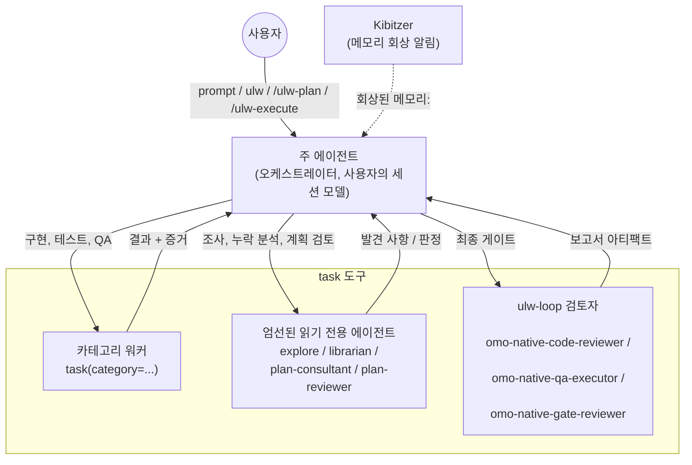

[목차](../README.md) / [오케스트레이션 시스템 가이드](README.md)

## 아키텍처

오케스트레이터는 하나입니다. 사용자 세션의 모델에서 실행되는 메인 에이전트입니다. 세션을 다른 에이전트로 전환하지 않고 `task`로 작업을
위임합니다. 결과를 받아 계획, 할 일 목록, 검증 증거를 함께 관리합니다.

### 메인 에이전트의 조율 역할

메인 에이전트는 사용자 세션에 선택된 모델로 실행됩니다. ultrawork 지시문과 계획·실행 스킬을 사용하며, 별도의 "계획 에이전트"나
"실행 에이전트"로 전환하지 않습니다. 주요 모델에 맞춘 프롬프트 프리셋이 있고 계획·실행 프롬프트는 여러 모델 계열에서 작동하도록
작성됐습니다. 자세한 내용은 [에이전트-모델 매칭](../04-에이전트-모델-매칭-가이드/01-출시-게이트가-적용된-Fable-55-준비.md#에이전트-모델-매칭-가이드)을 참고하세요.

### task를 통한 위임

각 `task` 호출에는 `category`와 `subagent_type` 중 하나만 지정합니다.

- `task(category="...")`는 **카테고리 워커**를 시작합니다. 해당 카테고리의 모델과 스킬을 적용한 새 워커 세션으로,
  구현·테스트·QA에 사용합니다. 모델은 항상 `omo.json`의 `categories.<name>.models`에서 가져옵니다.
  `category`와 `model`을 함께 전달하면 거부됩니다.
- `task(subagent_type="...")`는 지정한 이름의 에이전트를 직접 호출합니다. 내장 대상은 다음과 같습니다.
  - 읽기 전용 에이전트(프로세스 내부에서 실행되고 파일을 쓸 수 없음):
    `explore`(코드베이스에서 "X가 어디에 있나?" 검색), `librarian`(원격 저장소·공식 문서·OSS 예제 검색),
    `plan-consultant`(계획 전 누락 분석), `plan-reviewer`(계획 검토).
    `plan-consultant`와 `plan-reviewer`에는 **계획 게이트**가 적용됩니다. 사용자가 ulw-plan 워크플로를
    명시적으로 요청하고, 이 세션에서 `.omo/plans/*.md` 파일을 생성하거나 수정했으며, `/ulw-execute`를 실행하지
    않았을 때만 시작할 수 있습니다.
  - ulw-loop 검토자(보고서 파일을 작성하므로 읽기 전용이 아님):
    `omo-native-code-reviewer`(diff·테스트·위험 검토),
    `omo-native-qa-executor`(실제 시나리오 실행과 인터페이스 증거 기록),
    `omo-native-gate-reviewer`(실패한 성공 기준을 명시할 수 없으면 승인).
    이름 변경 전의 `omo-senpi-*` 이름도 계속 인식합니다.

여러 작업을 병렬로 실행할 때는 기본 방식인 `run_in_background: true`를 사용합니다. `load_skills`는 서브에이전트
프롬프트 앞에 스킬을 붙이고, `name`은 일정한 호출 이름을, `task_summary`는 결과 표시에 쓰일 한 줄 설명을 지정합니다.
`task_send`로 서브에이전트를 이어서 실행하고 `task_output`으로 상태를 확인하며 `task_cancel`로 종료할 수
있습니다. `/tasks`에는 이 세션에서 시작한 작업이 나옵니다. 일회성인 `plan-reviewer`는 `task_send`를 받지
않습니다.

전용 에이전트는 팀 멤버가 될 수 없습니다. `team_create` 대신 반드시 `task`로 호출하세요.

### Kibitzer 메모리 알림

Kibitzer는 저장된 메모리 가운데 현재 작업에 관련된 것을 찾아 알리는 읽기 전용 구성 요소입니다. 메인 에이전트 세션마다 필요한 시점에
사이드카 세션 하나가 시작되고, 메인 세션이 끝날 때까지 유지됩니다. 메인 세션의 프롬프트·도구 호출·도구 결과는 크기가 제한되고 비밀 정보가
가려진 이벤트로 전달됩니다. 도구 인수, 결과 앞부분, 에이전트 텍스트와 프롬프트는 저장 전 길이 제한과 비식별화 처리를 거칩니다.

프롬프트나 도구 호출에 아직 검토하지 않은 저장 메모리가 관련될 때만 모델 턴을 사용하며, 한 머신에서 동시에 최대 두 번 활성화됩니다.
활성화되면 워크스페이스를 `read`와 `grep`으로 확인하고, `session_entries`로 메인 세션의 기록을 살펴보고, 메모리를
`search`/`read`할 수 있습니다. 활성화 한 번당 도구 호출은 8번까지이며 모두 읽기 전용입니다. 메모리와 파일을 쓰지 않습니다.
출력은 `nudge`뿐이며 메인 에이전트에는 `recalled memory: <hint>` 알림으로 표시됩니다. 컨텍스트가 가득 차면 이미
전달했거나 거부한 내용을 반영해 초기화하고, 모델이 실패하면 잠시 중단한 뒤 다시 시도합니다. 작업 내용을 바꾸거나 유휴 세션을 깨우지 않고,
메인 에이전트에 필요한 기억만 알려줍니다. `/search`는 수동 메모리 검색 인터페이스이며
`memory.recall.enabled: false`로 Kibitzer를 끌 수 있습니다.

---

---

이전: [요약: 언제 무엇을 사용해야 하나요?](01-요약-언제-무엇을-사용해야-하나요.md) | 다음: [계획: Ultrawork Planner](03-계획-Ultrawork-Planner.md)
