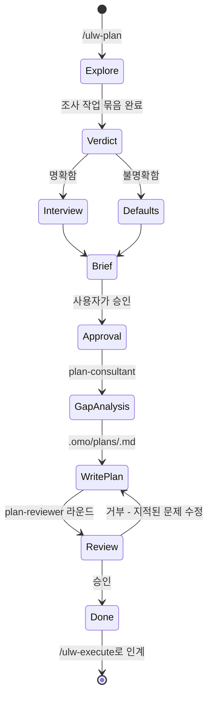

<a href="../README.md">목차</a> › <a href="README.md">오케스트레이션 시스템 가이드</a>

## 계획: Ultrawork Planner

`/ulw-plan`을 실행하면 메인 에이전트가 계획 수립을 담당하는 **Ultrawork Planner**로 작동합니다.
`ULW-PLAN MODE ENABLED!`를 표시하고, 사용자 승인 전에는 구현하지 않습니다. 이 승인은 계획 작성에만 적용되며 실제 실행은
`/ulw-execute`에서 별도로 시작한다는 점을 알립니다.

계획 모드가 켜진 동안에는 "X 해줘", "X 수정해", "그냥 해"도 "X를 계획하라"는 뜻으로 처리합니다.

### 인터뷰

계획자는 먼저 코드를 살펴봅니다. `explore`와 `librarian`으로 읽기 전용 조사를 병렬로 진행하고, 가능하다면 설계 자문용
`architect`와 `ultrabrain` 카테고리도 사용합니다. 그 결과를 보고 사용자에게 무엇을 물을지 결정합니다.

- **의도가 명확할 때**(원하는 결과가 정해졌고 선호 사항만 남았을 때): 저장소에서 답을 찾을 수 없는 결정만 이유를 붙여 사용자에게 묻습니다.
- **의도가 불명확할 때**(원하는 결과 자체가 모호할 때): 인터뷰하는 대신 권장 기본값을 정해 알리고, 고정밀 검토를 자동으로 켭니다.
- **경계에 있을 때**: 의도가 명확한 것으로 보고 질문 하나만 합니다.

사용자가 "나한테 물어봐" 또는 "인터뷰해줘"라고 요청하면 반드시 인터뷰합니다. 되돌릴 수 없거나 파괴적이거나 비용이 드는 결정은 기본값이
있더라도 항상 사용자에게 묻습니다.

### Plan Consultant 누락 분석

계획을 쓰기 전에 `plan-consultant`를 호출해 요청에 드러나지 않은 의도, 워커가 진행하지 못할 모호함, 과도한 설계나 범위 확대,
빠진 완료 기준과 예외 상황을 찾습니다. 계획자가 이미 파악한 맥락도 문서에 명시해 실행자가 추측하지 않도록 합니다.

### Plan Reviewer 고정밀 검토

`/ulw-plan`이 만드는 모든 계획은 사용자가 거절하지 않는 한 고정밀 검토를 받습니다. 한 번의 검토는 완성된 계획 파일을
`plan-reviewer`가 한 번 검사하는 단위입니다. 검토자는 승인에 무게를 두고 확인된 차단 사유가 있을 때만 거부합니다.

- 참조된 파일이 존재하고 계획의 주장을 뒷받침하는가
- 각 작업에 개발자가 바로 사용할 시작점이 있는가
- 작업들이 서로 모순되지 않는가
- QA 시나리오에 도구, 단계, 예상 결과가 명시됐는가
- 실행을 완전히 막을 정보가 빠지지 않았는가

남은 의견이 참고 사항뿐이면 승인으로 처리합니다. 거부되면 지적된 문제를 모두 수정한 뒤 다시 제출합니다. 새 차단 사유가 발견되거나 기존
사유가 해결되는 동안 검토를 이어갑니다. 새 발견도 수정도 없는데 승인하지 않으면 중단하고 사용자에게 묻습니다. 참고 사항만 남긴 승인이 나오면
검토를 끝냅니다.

호출은 정해진 계약을 따릅니다. 하네스가 `plan-reviewer` 프롬프트를 `.omo/plans/*.md` 경로 하나만 받는 표준 검토
계약으로 바꾸므로 다른 프롬프트 내용은 사용되지 않습니다.

### 계획 게이트 규칙

- `plan-consultant`와 `plan-reviewer`는 사용자가 ulw-plan 워크플로를 명시적으로 요청하고, 이 세션에서
  `.omo/plans/` 아래 계획 파일을 생성하거나 수정했으며, `/ulw-execute`를 호출하지 않았을 때만 사용할 수 있습니다.
- 단순 `ulw` 실행에서는 작업 규모와 관계없이 사용할 수 없습니다. 대신 메모장에 자체 검토를 기록합니다.
- 계획을 찾지 못한 `/ulw-execute`가 `/ulw-plan`을 자동으로 시작해도 게이트는 열리지 않습니다. 이때는 누락 분석이나 검토
  없이 계획을 작성하고 그 사실을 알립니다.

### 계획 파일

계획자는 파일 형식을 직접 만들지 않고 `scaffold-plan.mjs`를 실행합니다. 초안인 `.omo/drafts/<slug>.md`에는
세션 압축 후 재개하는 데 필요한 `intent`, `review_required`, 결정 사항, 승인 게이트가 담깁니다. 사용자가 승인하면
계획을 `.omo/plans/<slug>.md`에 저장합니다. 실행 가능한 각 항목은 0열에서 시작하는 `- [ ] N. <title>`
줄이며, 참조, 완료 기준, QA 시나리오, `Recommended task executor category:` 줄을 포함합니다.

### 적대적 대안: /hyperplan

계획자 한 명의 검토로 부족하다면 `/hyperplan`으로 계획 확정 전에 서로의 판단을 비판하는 팀을 구성할 수 있습니다. 결과물은 여전히
`/ulw-execute`에 전달할 `.omo/plans/*.md` 파일입니다.

---

다음 문서 <a href="04-실행-ulw-execute.md"><b>실행: /ulw-execute</b> →</a>

← 이전: <a href="02-아키텍처.md">아키텍처</a>
