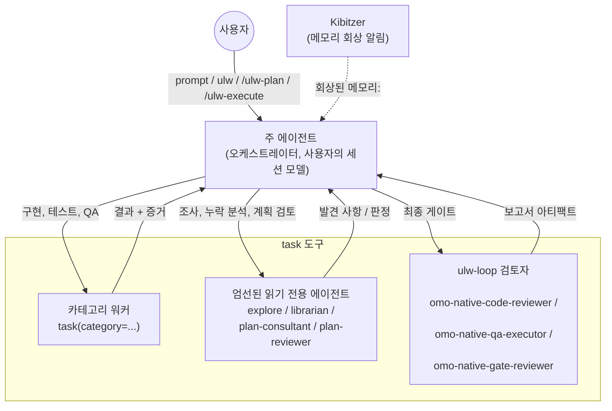
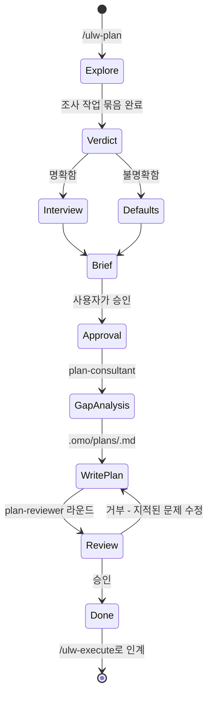

# Oh My OpenAgent 한국어 가이드

## Oh My OpenAgent란 무엇인가요?

Oh My OpenAgent는 여러 AI 모델과 에이전트의 작업을 조율하는 개발 도구입니다.
한 에이전트가 모든 일을 처리하는 대신, 여러 에이전트가 개발팀처럼 역할을 나눠 코드를 작성하도록 합니다.
이 가이드는 독립 실행형 `omo` 명령으로 사용하는 OmO Native를 설명합니다.
OpenCode 및 Codex 에디션은 별도로 제공됩니다.

Claude에 종속되지 않습니다. OpenAI에 묶이지 않습니다. 어느 한 모델 제공업체에도 의존하지 않습니다.

더 나은 결과, 더 저렴한 모델, 실질적인 오케스트레이션을 제공합니다.

---

## 빠른 시작

### 설치

LLM 에이전트 세션에 다음을 붙여넣으세요.

```text
다음 안내에 따라 oh-my-openagent를 설치하고 구성하세요:
https://raw.githubusercontent.com/code-yeongyu/oh-my-openagent/refs/heads/dev/docs/guide/installation.md
```

또는 수동 설정, 모델 제공업체 인증 및 문제 해결 방법을 다루는 전체 [설치 가이드](#설치-가이드)를 읽어보세요.

### 첫 번째 작업

설치가 완료되면 다음을 입력하세요.

```text
ultrawork
```

이것으로 충분합니다. 에이전트가 코드베이스를 탐색하고, 패턴을 조사하고, 기능을 구현하고, 진단으로 확인하는 등 필요한 작업을 스스로
파악합니다. 완료될 때까지 계속 작업합니다.

더 세밀하게 제어하고 싶다면 인터뷰 방식으로 계획을 수립하는 `/ulw-plan`을 실행한 다음, 메인 에이전트가 동일한 세션에서 승인된
작업 계획을 실행하도록 `/ulw-execute`를 실행하세요.

---

## 프로필을 선택하세요

모델을 하나하나 비교할 필요는 없습니다. 작업 목적에 맞는 프로필을 고르면 omo가 사용할 모델을 선택합니다.

- **범용 작업**: Claude Fable 5.1, Claude Opus 5.5, Kimi K3, GLM 5.3 등 범용 모델을 사용합니다.
- **고난도 작업**: 어려운 문제를 깊이 분석합니다. GPT-6 Astra를 우선 사용하고, 다음 후보로 GPT-6 Sol을 사용합니다.

`omo.json`에 키 하나를 설정하세요.

```json
{ "model_profile": "capable" }
```

세션이 시작되면 omo는 대체 순서를 확인해 연결된 모델 제공업체에서 사용할 수 있는 첫 번째 모델을 적용합니다. 이어 선택한 모델 이름과
건너뛴 단계를 알림으로 표시합니다. 이 전환은 해당 세션에만 적용되므로 `settings.json`에는 아무것도 기록되지 않습니다. 세션
도중 실패하면 프로필이 아닌 Senpi 자체 재시도 순서를 따릅니다.

특정 모델을 계속 사용하려면 `model_profile`에 모델 ID를 직접 입력하세요.
예를 들어 `"model_profile": "anthropic/claude-opus-5-5"`로 설정하면 해당 모델을 사용합니다.
값에 `/`가 들어 있으면 프로필 이름이 아니라 특정 모델을 지정한 것으로 처리합니다.

여러 설정이 겹치면 다음 순서로 우선 적용합니다.

1. `--model` 플래그 또는 특정 범위에 지정한 모델
2. `model_profile`에 직접 지정한 모델
3. `model_profile`에 지정한 프로필
4. Senpi의 기본 설정

`model_profile`을 설정하지 않으면 omo는 기존 세션 모델을 바꾸지 않습니다.
프로필로 선택하는 것은 기본 세션 모델뿐입니다. 카테고리와 전용 에이전트는 각각의 대체 모델 순서를 그대로 사용합니다.
자세한 내용은 [omo.json 설정 참고](/reference/omo-json.md#model-profiles-native-harness)를 확인하세요.

---

## 철학: 특정 모델과 제공업체에 얽매이지 않기

과거에는 이를 "Claude Code를 더 강력하게 만든 도구"라고 소개했습니다. 하지만 이것만으로는 취지를 설명하기 어렵습니다.

목표는 Claude Code를 개선하는 데 있지 않습니다. 하나의 모델, 하나의 모델 제공업체, 하나의 작업 방식으로 충분하다는 생각에서
벗어나는 데 있습니다. Anthropic은 사용자를 자사 서비스에 묶어 두려 합니다. OpenAI도 마찬가지입니다. 모두가 그렇게 하려 합니다.

Oh My OpenAgent는 여러 모델을 조율해 각 작업에 적합한 모델을 선택합니다. 전체 작업의 조율은 세션 모델이 맡습니다.
시각적 작업에는 `claude-fable-5-1`, `claude-opus-5-5`, `kimi-k3`를 사용하며, 추론 강도는 max로 설정합니다.
복잡한 추론 작업에는 GPT-6 Astra를 우선 사용하고, 다음 후보로 GPT-5.6 Sol을 사용합니다.
빠른 작업에는 GPT-6 Luna Fast를, 코드베이스 검색에는 Kimi 고속 모델을 사용합니다. 이 과정은 자동으로 진행됩니다.

---

## 작동 방식: 에이전트 오케스트레이션

Oh My OpenAgent에서는 **메인 에이전트가 전체 작업을 조율**합니다.
메인 에이전트는 `task` 도구로 작업을 나누고, 각 작업에 적합한 에이전트에게 맡깁니다.

**아키텍처:**

```text
사용자 요청
    |
[IntentGate]  ultrawork/ulw, team-mode, hyperplan 키워드에 따라 모드 프롬프트 주입
    |
[Main agent]  세션 모델에서 실행하며 계획, 위임, 검증 수행
    |
    +--> task(category: "...")        -> 카테고리 작업자(새 세션, 카테고리 모델 + 스킬)
    +--> task(subagent_type: "explore")    -> 빠른 코드베이스 grep
    +--> task(subagent_type: "librarian")  -> 문서 및 OSS 코드 검색
    +--> task(category: "architect")       -> 아키텍트 자문 경로(읽기 전용 설계 조언)
    +--> [Kibitzer]                        -> 상주 메모리 회상 사이드카, 읽기 전용, 알림만 제공

계획 경로(동일 세션, 에이전트 전환 없음):
/ulw-plan  ->  plan-consultant 격차 분석  ->  plan-reviewer 검토 라운드  ->  /ulw-execute
```

서브에이전트에 작업을 맡길 때 모델 이름을 직접 고를 필요는 없습니다. 읽기 전용 에이전트(`explore`, `librarian`,
`plan-consultant`, `plan-reviewer`)는 `task(subagent_type: ...)`로 호출합니다. 구현 작업에는
**카테고리** `architect`, `visual-engineering`, `ultrabrain`, `deep`, `artistry`, `quick`,
`unspecified-low`, `unspecified-high`, `writing`을 사용합니다. 각 카테고리는 적합한 모델에 자동으로
매핑되므로 직접 조정할 필요가 없습니다.

각 구성 요소가 어떻게 협력하는지 자세히 알아보려면 [오케스트레이션 시스템 가이드](#오케스트레이션-시스템-가이드)를 참조하세요.

---

## OmO Native가 위임하는 방법

### 메인 에이전트

메인 에이전트는 현재 대화에서 작업 전체를 맡는 에이전트입니다.
프로필이나 직접 지정한 모델, 또는 `/model`로 선택한 모델을 사용합니다.
요청을 분석해 계획을 세우고, 독립적으로 진행할 수 있는 작업은 여러 에이전트에 나눠 맡깁니다.
각 작업의 결과를 확인하면서 요청한 일이 끝날 때까지 진행합니다.

권장 모델은 다음과 같습니다.

- **Claude Opus 5.5**(또는 Claude Fable 5.1). 기준 설정입니다. 오케스트레이션 프롬프트는 길고 구체적인 실행 지침을
  잘 따르는 Claude의 특성을 바탕으로 설계되었습니다.
- **GPT-6 Astra, GPT-6.1 Sol 또는 GPT-6 Sol**. GPT 권장 설정입니다. 자율적이고 원칙 중심적인 작업을
  위해 설계된 GPT 기반 `gpt-6-astra` 프롬프트 사전 설정을 제공합니다. 세부 절차 대신 목표를 제시합니다. 범위가 좁은
  소규모 작업까지 불필요하게 나누거나 조율할 수 있다는 점에 유의하세요.

Kimi K3와 GLM 5.3도 권장 목록에 있지만 검증 수준은 더 낮습니다. 그 밖의 모델은 메인 에이전트용으로 지원되지 않습니다.
직접 선택할 필요는 없습니다. `model_profile`이 없으면 새 세션은 **권장** 순서(Opus 5.5, Fable 5.1, Kimi
K3, GPT-6 Astra, GPT-6.1 Sol, GPT-6 Sol, GLM 5.3)를 확인해 연결된 모델 제공업체에서 사용할 수 있는
첫 번째 모델을 선택합니다. Daily에서는 Claude를 계속 사용합니다. Obsessive · Normal은 GPT-6 Astra를 중간 추론
강도로 사용하며, GPT-6.1 Sol Fast, 일반 GPT-6.1 Sol, Astra를 사용할 수 없는 경우 GPT-5.6 Sol을
사용합니다. Obsessive · Heavy는 GPT-6 Astra를 높은 추론 강도로 사용합니다. 자세한 내용은
[에이전트-모델 매칭 가이드](#에이전트-모델-매칭-가이드)를 참조하세요.

### 카테고리 워커

각 `task(category: ...)` 호출은 해당 카테고리의 모델과 스킬로 설정된 새 작업자 세션을 생성합니다. 작업자는 프롬프트
하나를 받아 작업한 뒤 결과를 보고합니다. 그 밖의 내용은 다른 세션으로 전달되지 않습니다. 따라서 GPT-6 Astra를 사용하는
`deep-high` 호출과 GPT-6 Luna Fast를 사용하는 `quick` 호출을 나란히 실행해도 동작을 예측할 수 있습니다.

### 전용 에이전트

읽기 전용 에이전트 네 종류가 각각 고유한 프롬프트, 도구 정책, 대체 모델 순서를 사용합니다.

- **`explore`**: 빠른 코드베이스 grep을 수행합니다. 패턴 탐색에 적합한 속도 중심 모델을 사용합니다.
- **`librarian`**: 문서와 OSS 코드를 검색합니다. 라이브러리 API와 권장 사용 방식에 관한 최신 정보를 확인합니다.
- **`plan-consultant`**: 계획의 누락 사항을 분석합니다. 계획을 확정하기 전에 숨은 의도, 모호한 부분, AI가 실패할
  가능성이 있는 지점을 찾아냅니다. 계획 단계에서만 사용할 수 있으며 `/ulw-plan` 실행 중에만 생성할 수 있습니다.
- **`plan-reviewer`**: 일회성 검토를 수행합니다. 명확성, 검증 가능성, 맥락을 기준으로 작업 계획을 확인합니다.
  이 에이전트 역시 계획 단계에서만 사용합니다.

아키텍처 자문은 전용 에이전트가 아니라 `task(category: "architect")` 카테고리로 실행합니다.
시스템 전체와 설계 대안의 장단점을 검토하고 설계를 제안하며, 직접 구현하지는 않습니다.

### Kibitzer

Kibitzer는 현재 작업에 도움이 되는 저장 메모리를 찾아 알려주는 읽기 전용 보조 에이전트입니다.
메인 에이전트 세션마다 하나씩 실행되며, 프롬프트·도구 호출·도구 결과를 길이가 제한되고 민감한 정보가 가려진 이벤트로 받습니다.
아직 검토하지 않은 메모리가 현재 작업과 관련될 때만 활성화됩니다.
작업 공간과 이전 기록, 저장 메모리를 확인한 뒤 관련 내용을 메인 에이전트에게 알려줍니다.
메모리나 파일을 직접 수정하지는 않습니다.

---

## 작업 모드

### Ultrawork 모드: 알아서 진행하는 모드

`ultrawork` 또는 `ulw`를 입력하세요. 그게 전부입니다.

메인 에이전트가 필요한 사항을 파악합니다. 코드베이스를 탐색하고 패턴을 분석한 뒤 기능을 구현합니다. 진단으로 결과를 확인하며 완료될 때까지
작업을 이어갑니다.

"그냥 해 보세요"라고 맡기는 완전 자동 모드입니다. 메인 에이전트가 심층 분석을 담당하므로 직접 모든 단계를 고민하지 않아도 됩니다.

### /ulw-plan을 사용하여 먼저 계획을 세우세요

`/ulw-plan`을 실행하세요. 메인 에이전트가 Ultrawork Planner로 전환되어 엔지니어처럼 요구사항을 확인합니다. 명확한 질문을
하고 범위와
모호한 부분을 파악합니다. 필요한 내용을 조사하고, 누락된 사항을 분석할 때는 `plan-consultant`를, 계획을 정밀하게 검토할 때는
`plan-reviewer`를 활용합니다. 코드를 수정하기 전에 필요한 의사결정을 마친 작업 계획을 작성합니다.

그런 다음 `/ulw-execute [plan-name] [--worktree <path>] [--make-pr] [--ship]`를
실행하세요. 메인 에이전트가 ulw-plan 작업 계획을 불러오고, Goal 도구가 활성화되어 있으면 Goal을 설정합니다. 모든 계획 작업을
todos에 등록한 뒤 같은 세션에서 실행합니다. 작업은 카테고리와 전용 에이전트별로 나뉩니다. 완료된 작업은 각각 독립적으로 확인합니다.
작업에서 얻은
정보는 후속 작업에 반영하고, 세션이 바뀌어도 진행 상황을 추적합니다.

며칠이 걸리는 프로젝트, 중요한 운영 환경 변경, 복잡한 리팩터링 또는 의사결정 과정을 문서로 남겨야 하는 작업에는 `/ulw-plan`을 사용하세요.

---

## 에이전트 모델 매칭

메인 에이전트는 프로필, 고정 설정 또는 `/model`로 선택한 세션 모델에서 실행됩니다([프로필 선택](#프로필을-선택하세요) 참조).
위임한 작업의 모델은 대체 순서에 따라 결정됩니다. 카테고리와 전용 에이전트마다 모델 제공업체의 우선순위가 정해져 있으며, 시스템은 연결된 모델
제공업체에서
사용할 수 있는 모델을 찾을 때까지 순서대로 시도합니다. 선호하는 모델 제공업체에 장애가 발생해도 작업을 계속할 수 있습니다.

### 사용자 지정 모델 구성

`omo.json`에서 특정 카테고리 또는 전용 에이전트의 모델을 재정의합니다.

```jsonc
{
  "$schema": "https://raw.githubusercontent.com/code-yeongyu/oh-my-openagent/dev/assets/omo.schema.json",

  "agents": {
    // 계획 도우미: 격차 분석에는 Claude, 검토에는 GPT
    "plan-consultant": {
      "model": "anthropic/claude-opus-5-5",
      "reasoning": "high"
      },
    "plan-reviewer": { "model": "openai/gpt-6-astra", "reasoning": "xhigh" },

    // 조사 에이전트: 저렴하고 빠른 것이 핵심
    "explore": { "model": "openai/gpt-6-luna-fast", "reasoning": "low" },
    "librarian": { "model": "openai/gpt-6-luna-fast", "reasoning": "low" }
  },

  "categories": {
    // 설계 자문: Fable 5 max
    "architect": { "model": "anthropic/claude-fable-5-1", "reasoning": "max" },

    // 프런트엔드/UI 작업: Fable 5 max, 이어서 Opus 5 max, Kimi K3 max
    "visual-engineering": {
      "model": "anthropic/claude-fable-5-1",
      "reasoning": "max"
      },

    // 어려운 논리 작업: GPT-6 Astra max, 이어서 GPT-5.6 Sol max
    "ultrabrain": { "model": "openai/gpt-6-astra", "reasoning": "max" },

    // 자율 조사 및 실행: GPT-6 Astra high, 이어서 GPT-5.6 Sol medium
    "deep-high": { "model": "openai/gpt-6-astra", "reasoning": "high" },

    // 창작 및 디자인 작업
    "artistry": { "model": "anthropic/claude-fable-5-1", "reasoning": "max" },

    // 빠른 작업: 빠르고 저렴함
    "quick": { "model": "openai/gpt-6-luna-fast", "reasoning": "low" },

    // 낮은 작업량 폴백: Claude Sonnet 5.5 medium, 이어서 MiMo V2.6 Pro와 Grok 4.7
    "unspecified-low": {
      "model": "anthropic/claude-sonnet-5-5",
      "reasoning": "medium"
      },

    // 높은 작업량 폴백: Opus 5, 이어서 GLM 5.3과 Kimi K3
    "unspecified-high": {
      "model": "anthropic/claude-opus-5-5",
      "reasoning": "medium"
      },

    // 산문 및 문서 작성
    "writing": { "model": "anthropic/claude-opus-5-5", "reasoning": "low" }
  }
}
```

### 모델 계열

**Claude 계열 모델**(지시 이행, 구조화된 출력):

- Claude Fable 5, Claude Opus 5.5, Claude Sonnet 5.5, Claude Sonnet 5, Claude
  Haiku 5.5
- Kimi K3: Claude와 동작 방식이 매우 비슷합니다.
- GLM 5.2 / 5.3: Claude와 동작 방식이 비슷하며 다양한 작업에 적합합니다.

**GPT 모델**(명시적 추론, 원칙 중심):

- GPT-6 Astra: OpenAI의 가장 강력한 모델입니다. `plan-reviewer`(xhigh, Copilot에서는 높음),
  `ultrabrain`(max), `deep-high`(high)의 기본값이며, 고속 모드 변형인 `gpt-6-astra-fast`도 포함됩니다.
- GPT-6.1 Sol: `deep-low`는 OpenAI 경로에서 추론 강도 medium으로 시작해 Fast(우선순위) 계층의
  `gpt-6.1-sol-fast`, GPT-5.6 Sol, `gpt-5.6-sol-fast` 순으로 시도합니다. GPT-6.1 Sol은
  `unspecified-low`의 다섯 번째 대체 단계이기도 합니다(추론 강도 medium, OpenAI 경로). Fast 계층은
  Obsessive · Normal에서
  첫 번째로 시도하는 Sol 단계이며, 그다음에 일반 GPT-6.1 Sol이 옵니다.
- GPT-5.6 Sol: GPT 기반 메인 에이전트에 권장하는 설정입니다. `ultrabrain`(max)에서 Astra를 사용할 수 없을
  때의 대체 모델입니다.
- GPT-5.6 Terra: 속도와 성능이 균형 잡힌 중간 계층 모델입니다. 기본 대체 순서에는 없으며 필요하면 재정의해 사용할 수 있습니다.
- GPT-5.6 Luna Fast: 빠르고 저렴합니다. `explore`와 `librarian`의 기본값입니다.

**기타 모델 계열**:

- Grok 4.7: `unspecified-low` 카테고리의 세 번째 단계입니다(xhigh).
- DeepSeek V4.1 Flash(`deepseek-flash`) / V4 Pro: `explore`, `librarian`, `quick`,
  `unspecified-low`에서 보조 작업에 사용하는 단계입니다.

전체 대체 순서, 안전하거나 위험한 재정의, 용도에 맞게 조정된 사전 설정 목록은 [에이전트별 모델 선택
가이드](#에이전트-모델-매칭-가이드)를 참조하세요.

---

## Claude Code 단독 사용과의 차이

Claude Code는 좋은 도구입니다. 다만 하나의 에이전트가 단일 모델로 모든 작업을 수행합니다.

Oh My OpenAgent는 이를 협업하는 팀으로 확장합니다.

**병렬 실행.** Claude Code는 작업을 한 번에 하나씩 처리합니다. OmO는 백그라운드 에이전트 여러 개를 동시에 실행해 조사,
구현, 검증을
병행합니다. 엔지니어 한 명이 아닌 다섯 명이 함께 일하는 것과 비슷합니다.

**해시 기반 편집.** 모델이 줄을 정확히 재현하지 못하면 Claude Code의 편집 도구가 실패합니다. 해시 앵커 `LINE#ID`를 이용한
편집은 선택 사항입니다(`hashline_edit: true`). 활성화하면 OmO가 `LINE#ID` 해시를 사용해 모든 편집 내용을
적용 전에 검증합니다.

**IntentGate.** Claude Code는 프롬프트를 받아 실행합니다. OmO는 정규식 감지기로 명시적인 모드 키워드 `ultrawork`/`ulw`,
팀 모드 표기, `hyperplan`, 그리고 서로 인접한 하이퍼플랜·울트라워크 조합을 감지합니다. 일치하는 텍스트가 있으면 해당 모드의
프롬프트를 삽입합니다.

**LSP + AST 도구.** 작업 공간 전체의 이름 바꾸기, 정의로 이동, 참조 찾기, 빌드 전 진단, AST를 고려한 코드 재작성 기능을 제공합니다.
기본 Claude Code에는 없는 IDE 수준의 정밀도입니다.

**자체 MCP를 갖춘 스킬.** 각 스킬에는 해당 작업 범위에 맞는 MCP 서버가 있습니다. 도구를 사용할 때마다 불필요한 정보로 컨텍스트 창이
커지는 일을 막습니다.

**작업 완료 관리.** Todo 관리 기능은 유휴 에이전트가 작업을 다시 진행하도록 합니다. 댓글 검사기는 품질이 낮은 AI 생성 댓글을
제거합니다. 목표 설정은 선택 사항입니다.
`goal.enabled`와 `goal.auto_start`는 모두 기본값이 `false`입니다. 목표 기능을 활성화하고 시작하면 세션별 목표를
지속적으로
유지하며, 완료 검사를 통해 작업이 끝났음이 확인될 때까지 유휴 상태에서 후속 프롬프트를 다시 삽입합니다.

**기본적인 이점.** 모델마다 강점이 다릅니다. Claude는 깊이 분석하고, GPT는 체계적으로 추론하며, Haiku는 빠르게 처리합니다.
단일 모델 도구에서는 모든 작업에 하나의 모델만 선택해야 합니다. Oh My OpenAgent는 작업 유형에 따라 모델을 배정해 각 모델의 강점을
활용합니다. 이는 임시방편이 아닙니다. 모델의 전문성이 높아질수록 합리적인 아키텍처는 이 방식뿐입니다. 여러 모델을 조율하는 방식과
단일 모델에 의존하는 방식의 격차는 매달 커지고 있습니다. 이 프로젝트는 그 방향에 주목합니다.

---

## IntentGate: 요청 의도에 따른 모드 선택

IntentGate는 정규식으로 모드 키워드를 감지해 지침을 삽입합니다. `ultrawork` 또는 `ulw`,
`team mode`/`team-mode`/`team_mode`/`teammode`, `hyperplan`, 그리고 서로 인접한 하이퍼플랜·울트라워크
조합을 감지하면 일치하는 모드의 지침을 추가합니다.

요청을 조사, 구현, 탐색, 수정 등으로 의미에 따라 분류하지는 않습니다. 명시적인 모드 키워드가 없으면 IntentGate가 모드 지침을
삽입하지 않습니다.

---

## 다음으로 살펴볼 문서

- **[설치 가이드](#설치-가이드)**: 전체 설정 방법, 모델 제공업체 인증, 문제 해결
- **[오케스트레이션 가이드](#오케스트레이션-시스템-가이드)**: 위임, `/ulw-plan`을 사용한 계획 수립, `/ulw-execute`를
  사용한 실행에 관한 상세 설명
- **[에이전트-모델 매칭 가이드](#에이전트-모델-매칭-가이드)**: 역할별 모델과 사용자 지정 방법
- **[팀 모드 가이드](#팀-모드-가이드)**: 병렬 다중 에이전트 조정(기본적으로 꺼짐), 12개의 `team_*` 도구, 공유 사서함, 공유
  작업 목록, 선택적 tmux 레이아웃
- **[구성 참조](#설정-참조)**: 예시를 포함한 전체 설정 옵션
- **[기능 참조](#oh-my-openagent-기능-참고)**: 전체 기능 문서
- **[Manifesto](#선언문)**: 프로젝트의 철학

---

**시작할 준비가 되셨나요?** `ultrawork`를 입력해 조율된 AI 팀이 무엇을 할 수 있는지 확인해 보세요.

## 설치 가이드

OmO를 설치하려면 `curl -fsSL https://get.omo.dev/install.sh | bash`를 실행하세요(Windows
PowerShell: `irm https://get.omo.dev/install.ps1 | iex`).
[OmO](/docs/install)는 모든 플랫폼에 설치할 수 있으며, 설치 과정에서 `PATH`를 수정합니다. 업데이트와 제거도 지원합니다.
이 페이지에서는
OpenCode 및 Codex용 플러그인 버전을 다룹니다.

oh-my-openagent는 동일한 제품을 **세 가지 에디션**으로 제공합니다. 두 에디션은 이미 실행 중인 호스트에 로드하는 플러그인이고,
나머지 하나는 독립형입니다.

- **Ultimate Edition([OpenCode](https://opencode.ai/)용 omo)**: omo의 전체 기능을
  제공합니다. 전용
  에이전트 목록, 54개 이상의 수명 주기 훅, 모든 내장 MCP, 모든 슬래시 명령, 팀 모드, ulw-loop, 해시라인 편집 등을
  사용할 수 있습니다.
- **Light Edition([ChatGPT 구독 CLI](https://github.com/openai/codex)용 omo)**:
  Codex 플러그인 시스템에 맞춘 이식 가능한 구성 요소를 제공합니다. `bootstrap`, `comment-checker`, `git-bash`,
  `lazycodex-executor-verify`, `rules`, `lsp`, `telemetry`, `teammode`,
  `ulw-execute-continuation`, `ulw-loop`와 `ultrawork`, `grep_app`, `context7`,
  `git_bash`, `lsp`용 플러그인 범위 MCP, 공유 `ast-grep` 스킬이 포함됩니다. OpenCode 에이전트 레지스트리나
  `team_*` 도구 모음은 제공하지 않지만, Codex 기본 에이전트 역할과 스크립트 및 스킬 기반 `teammode` 구성 요소를 제공합니다.
- **OmO Native(독립형)**: OMO 확장이 내장된 `omo` 명령을 제공합니다. OpenCode나 Codex에 플러그인으로 로드하지
  않고
  `omo-ai`에서 설치합니다.

대부분의 사용자에게는 **Ultimate**가 적합합니다. 이미 Codex CLI를 주로 사용한다면 **Light**를 선택하세요. 작업 환경에
관계없이 OMO를 사용하려면 **둘 다** 설치하세요.

- **Ultimate(OpenCode)를 원하는 경우**
  - 실행: `bunx oh-my-openagent install`(TUI 안내에 따르세요)
  - 설치 결과: `opencode.json`에 등록된 플러그인, 에이전트/모델 설정, 모델 제공업체 인증
- **Light(Codex CLI)를 원하는 경우**
  - 실행: `npx lazycodex-ai install`
  - 설치 결과: `~/.codex/plugins/cache/sisyphuslabs/omo/`, 안정적인 Codex 마켓플레이스 스냅샷,
    `~/.codex/config.toml`의 마켓플레이스/플러그인/에이전트 블록, 선택적 자율 실행용 Codex 권한, `~/.local/bin`의
    구성 요소 CLI
- **둘 다 원하는 경우**
  - 실행: `bunx oh-my-openagent install --platform=both`
  - 설치 결과: 위 두 에디션의 설치 결과 모두

`lazycodex-ai`와 `lazycodex`는 모두 Codex Light 설치 프로그램을 기본으로 실행하는 bin 별칭이며,
Node/npm을 통해
실행됩니다. 공유 `omo-agent-toolkit` CLI의 `--platform` 기본값은 여전히
`opencode`(Ultimate)입니다. `lazycodex`는 마켓플레이스 번들을 호스팅하는 저장소 ID이기도 합니다. 두 별칭 모두
Codex 마켓플레이스 이름은 아닙니다.

## 어떤 에디션을 선택해야 하나요?

- 이미 OpenCode를 사용하거나 가장 충분히 테스트된 설치 경로를 원한다면 **Ultimate**를 선택하세요:
  `bunx oh-my-openagent install`.
- 이미 Codex CLI를 사용한다면 **Light**를 선택하세요: `npx lazycodex-ai install`.
- 호스트를 먼저 설치하지 않고 명령 하나로 시작하려면 **OmO Native**를 선택하세요:
  `curl -fsSL https://get.omo.dev/install.sh | bash`(Windows:
  `irm https://get.omo.dev/install.ps1 | iex`) 또는 `bun add -g omo-ai`.

Ultimate와 Light는 이미 실행 중인 호스트에 로드하는 플러그인입니다. OmO Native는 OMO가 내장된 고정된
Senpi 엔진을 제공하는 독립형 에디션입니다.

OmO Native를 사용하려면 `omo-ai`를 설치하세요. npm에서 일반 `omo`를 설치하지 마세요. 다른 작성자가 만든 관련 없는 패키지입니다.

## 사용자를 위한 안내

**LLM 에이전트에게 Ultimate 설치를 맡기는 것을 강력히 권장합니다.** Ultimate 설정에는 구독 감지, 에이전트와 카테고리
전반의 모델 선택, 모델 제공업체 인증, 설정 마이그레이션이 포함됩니다. 사람이 직접 처리하기에는 까다로운 작업입니다. LLM 에이전트는 전체 가이드를
읽고 모든 단계를 올바르게 수행할 수 있습니다.

### Ultimate(OpenCode) - 에이전트에게 맡기세요

Claude Code, AmpCode, Cursor 또는 다른 LLM 에이전트 세션에 다음 프롬프트를 붙여넣으세요.

```text
다음 안내에 따라 oh-my-openagent를 설치하고 구성하세요:
https://raw.githubusercontent.com/code-yeongyu/oh-my-openagent/refs/heads/dev/docs/guide/installation.md
```

### Light(Codex CLI) - 한 줄로 설치, 에이전트 불필요

Light 설치 프로그램은 Codex를 자율 실행을 위한 전체 권한 모드로 설정할지 묻습니다. 에이전트 방식으로 사용할 때 권장되는 설정은
`approval_policy = "never"`, `sandbox_mode = "danger-full-access"`(이 설정에는 이미 무제한
네트워크
액세스가 포함됩니다), 알림 경고 숨김입니다. 이전 설치 프로그램이 남긴 레거시 최상위 `network_access` 키는 Codex가
`--strict-config`에서 거부하므로 제거합니다. 대화 없이 옵션을 지정하려면 `--codex-autonomous` 또는
`--no-codex-autonomous`를 사용하세요.

```bash
npx lazycodex-ai install
# 권장 비대화형 모드:
npx lazycodex-ai install --no-tui --codex-autonomous
```

설치 프로그램은 관리 대상 Codex 상태를 `~/.codex/`에 기록하며 OpenCode나 모델 제공업체 플래그는 변경하지 않습니다. 이전 Codex
플러그인 설치에서 마이그레이션할 때 해당 프로젝트에 알려진 `multi_agent_v2`와 레거시 `[agents] max_threads`
충돌이 있으면 현재 프로젝트의 `.codex/config.toml`를 복구할 수도 있습니다. 프로젝트 소유 `.codex` 아티팩트는
삭제하지 않고 보고합니다. 전역 Codex 설정은 `~/.codex/plugins/cache/sisyphuslabs` 아래에 로컬로 구축한
캐시에서 마켓플레이스 `sisyphuslabs`를 등록하고, 플러그인 `omo@sisyphuslabs`를 활성화하며, 유효한
`[features.multi_agent_v2]` 제한 테이블을 작성합니다. 설치 프로그램은 MultiAgentV2를 활성화하지 않습니다.
명시적인 레거시 `multi_agent_v2 = false` 약칭을 발견하면 비활성화 상태를 테이블 형식 `enabled = false`로
유지합니다.

Windows에서는 위에 나온 `npx lazycodex-ai install ...` 명령을 직접 사용하세요.
`omo-agent-toolkit install` 저장소를 간접적으로 실행하는 `npx --package` 명령으로 바꾸지 마세요.
그 패키지 관리자 명령 형식은 설치 프로그램이 시작되기도 전에 실패할 수 있습니다.

기본 Windows Codex 설치에서 설치 프로그램은 Codex 설정을 작성하기 전에 Git Bash를 찾습니다.
`OMO_CODEX_GIT_BASH_PATH`, 표준 Windows용 Git 설치 위치, PATH 순서로 확인합니다. Git Bash가 없으면
여기에 표시된 설치 지침을 출력하고 중지합니다. `winget`를 실행하거나 시스템 종속성을 변경하지 않습니다.

```powershell
winget install --id Git.Git -e --source winget
where bash
```

Git을 사용자 지정 위치에 설치했다면 설치 프로그램을 다시 실행하기 전에 경로를 설정하세요.

```powershell
setx OMO_CODEX_GIT_BASH_PATH "C:\Program Files\Git\bin\bash.exe"
```

```powershell
$env:OMO_CODEX_GIT_BASH_PATH = "C:\Program Files\Git\bin\bash.exe"
```

Codex는 자체 기본값에 따라 Windows 셸 호출을 시작할 수 있습니다. Light는 전역 Codex 셸 설정을 작성하지
않습니다. 대신 Git Bash 사용 가능 여부를 확인하고, Windows 전용 `git_bash` MCP 정책을 활성화한 뒤, 첫 번째 셸
관련 호출 전에 지침을 주입합니다. 컨텍스트 압축 후에는 알림 상태가 초기화되어 다음 셸 관련 호출에서도 동일한 `git_bash` 권장 사항을
받습니다.

> **이전 Codex 플러그인을 사용했다면 먼저 정리하세요.** 다른 Codex 플러그인 번들을 사용했던 Codex 홈에
> Light를 설치하기 전에 이전 번들을 제거한 다음 이 설치 프로그램을 다시 실행하세요. 여러 번들이 동일한 `~/.codex`에 Codex
> 마켓플레이스
> 플러그인, 수명 주기 훅, `ultrawork`/`ulw` 키워드를 기록할 수 있습니다. Codex 홈을 정리하면
> 오래된 공유 `config.toml` 키와 중복 훅를 방지할 수 있습니다.
>
> 마이그레이션 후 Light를 제거하려면 `npx lazycodex-ai uninstall`를 실행하세요. 관리 대상
> `sisyphuslabs` Codex 캐시와 마켓플레이스 상태를 제거하고, 백업을 만든 뒤 `~/.codex/config.toml`에서
> `omo@sisyphuslabs` 플러그인 및 훅 상태 블록을 제거하며, `~/.codex/agents/`에서 관리 대상 에이전트 TOML
> 파일을 제거합니다. `cleanup`는 이전 버전과 호환되는 별칭으로 계속 사용할 수 있습니다.
> `agents.max_threads cannot be set when multi_agent_v2 is enabled` 오류로 특정
> 프로젝트에서만 Codex가 계속 실패한다면 해당 프로젝트에서 `npx lazycodex-ai install`를 실행하세요. 설치
> 프로그램은 프로젝트 루트부터 현재 디렉터리까지의 프로젝트 로컬 `.codex/config.toml` 계층을 복구하고,
> MultiAgentV2가 활성화된 경우에만 충돌하는 레거시 `[agents] max_threads`를 제거하며, 변경한 파일 옆에
> 타임스탬프가 포함된 백업을 기록합니다.

### Codex 마켓플레이스에서 설치(앱 내)

> **실험적인 추가 설치 경로입니다.** 위의 `npx lazycodex-ai install`는 계속해서 완전히 지원되는 기본 경로입니다. 마켓플레이스
> 번들은 이 프로젝트의 자체 [lazycodex](https://github.com/code-yeongyu/lazycodex) 저장소에서
> 호스팅됩니다. OpenAI가 선별한 목록은 아닙니다.

동일한 Light 에디션을 npx 단계 없이 Codex 내부의 플러그인 마켓플레이스에서 바로 설치할 수도 있습니다.

**TUI 설치 경로.** Codex 세션에서 `/plugins`를 입력하고 **마켓플레이스 추가** 탭("Git 저장소 또는 로컬 루트에서
마켓플레이스 추가")을 연 뒤 마켓플레이스 소스를 입력하세요.

```text
https://github.com/code-yeongyu/lazycodex
```

그런 다음 동일한 `/plugins` 메뉴에서 `sisyphuslabs` 마켓플레이스의 `omo`를 선택해 설치하세요.

**CLI 경로**: 동일한 작업을 수행하는 두 줄짜리 경로:

```bash
codex plugin marketplace add https://github.com/code-yeongyu/lazycodex
codex plugin add omo@sisyphuslabs
```

**첫 번째 세션: 훅를 승인하세요.** 다음에 `codex`를 실행하면 시작 훅 검토에 모든 omo 훅가 새 훅로 표시됩니다.
내용을 검토한 뒤 승인하세요. 승인 전에는 omo 훅가 실행되지 않으므로, 훅를 신뢰하고 승인해야 아래 부트스트랩을 시작할 수 있습니다.

**부트스트랩 알림 및 재시작.** 훅를 승인한 첫 번째 세션에는 다음 상태 줄이 출력됩니다.

```text
LazyCodex 부트스트랩이 백그라운드에서 실행 중입니다. 완료되면 세션을 다시 시작하세요
```

별도의 작업자가 백그라운드에서 설치를 마칩니다(`sg` 다운로드에 시간이 가장 오래 걸립니다). 완료되면 Codex 세션을 다시 시작하세요.
다음 세션부터는 모든 구성 요소가 연결된 상태로 시작되며 알림도 더 이상 표시되지 않습니다.

**부트스트랩에서 수행하는 작업:**

- 관리형 `~/.codex/config.toml` 블록을 작성합니다. 마켓플레이스 소스를 보존하고, `omo@sisyphuslabs`
  플러그인을 활성화하며,
  `[agents.*]` 항목을 관리하고 SHA256 `[hooks.state."omo@sisyphuslabs:..."]` 신뢰 해시를 다시 기록합니다.
- 번들로 제공되는 Codex 에이전트 TOML을 `~/.codex/agents/`에 복사합니다.
- 최상위 `omo-agent-toolkit` 런타임 래퍼와 구성 요소 CLI(`omo-rules`, `omo-lsp`, …)를
  `~/.local/bin`에 연결합니다(`$CODEX_LOCAL_BIN_DIR`가 설정된 경우 해당 디렉터리를 사용하고, 격리된
  `CODEX_HOME` 설치에서는
  `<CODEX_HOME>/bin`을 사용합니다).
- `ast-grep` 스킬에 사용할 체크섬으로 버전이 고정된 독립 실행형 `sg`(ast-grep) 바이너리를
  `<CODEX_HOME>/runtime/ast-grep/<platform>-<arch>/`에 설치합니다.
- 기본 Windows 환경에서 `node`가 없으면 버전이 고정된 Node LTS 런타임을 `<CODEX_HOME>/runtime/node/`에
  설치합니다(아래 Windows 상태 참조).
- 모든 실행 내역을 플러그인 데이터 디렉터리의
  `<CODEX_HOME>/plugins/data/omo-sisyphuslabs/bootstrap/state.json`과 JSONL 형식의
  `bootstrap.log`에 기록합니다(Windows에서는 `ps-bootstrap.log` 실행 기록도 추가합니다).

**부트스트랩에서 수행하지 않는 작업:**

- **Codex 권한 설정은 변경하지 않습니다.** `approval_policy`, `sandbox_mode`,
  `network_access`는 그대로 유지됩니다. 자율 모드를 사용하려면 npx 설치 프로그램에서
  `npx lazycodex-ai install --no-tui --codex-autonomous`를 명시적으로 선택해야 합니다([한 줄 설치
  섹션](#lightcodex-cli---한-줄로-설치-에이전트-불필요) 참조).
- 일반적인 마켓플레이스 관리형 설치에서는 npx 자체 업데이트를 실행하지 않습니다. 자동 업데이트 훅는 업데이트를 건너뛰었다고 기록하고
  대신 다음 안내를 표시합니다. "자동 업데이트 건너뛰기: 이 LazyCodex 설치는 Codex 플러그인 마켓플레이스에서 관리되므로 npx
  자체 업데이트가
  시작되지 않았습니다. `codex plugin marketplace upgrade sisyphuslabs`로 업그레이드하도록 안내하세요.
  업그레이드 후에는 Codex에서 훅를 다시 승인하라는 메시지가 표시됩니다." 훅가 오래된 로컬 마켓플레이스 캐시 또는 bin 상태(예:
  삭제된 페이로드를 가리키는 로컬 매니페스트나 관리형 `ulw` 링크)를 감지하면, 로컬 복구를 위해 npx 설치 프로그램을 실행하고
  이후 Codex 세션을 다시 시작하도록 요청할 수 있습니다.
- Codex가 관리하는 플러그인 캐시 디렉터리에는 아무것도 저장하지 않습니다. 모든 부트스트랩 상태는 위 플러그인 데이터 디렉터리에 저장됩니다.

**업그레이드 및 훅 승인 복구 절차:**

1. `codex plugin marketplace upgrade sisyphuslabs`를 실행합니다.
2. `codex`를 다시 실행하세요. 시작 훅 검토에 omo 훅가 **수정됨**으로 표시됩니다. 플러그인 파일이 변경되어 이전에 신뢰한
   해시가 더 이상 일치하지 않기 때문입니다. 업그레이드 후에는 정상적으로 발생하는 현상이며, 변조되었다는 뜻은 아닙니다.
3. 검토 화면에서 훅를 다시 승인하세요. 실수로 검토를 건너뛰었다면 `codex`를 다시 시작하면 됩니다. 승인할 때까지 검토 화면이 다시
   나타나며, 그동안 훅는 비활성화된 상태로 유지됩니다.
4. 다음 세션에서 새 버전의 부트스트랩이 다시 실행됩니다. 신뢰 해시를 다시 기록하고, 저장소와 에이전트를 다시 연결한 뒤 재시작
   알림을 표시합니다. 한 번 더 다시 시작하면 업그레이드된 버전을 사용할 수 있습니다.

**기능 저하 모드.** 부트스트랩의 일부 단계가 실패해도 치명적인 오류로 처리하지 않습니다. 실패한 단계는 `state.json`에 구성 요소별로
기록되고(`lastStatus: "degraded"`), 설치를 중단하는 대신 이후 세션에서 재시도합니다. 확인할 수 있는 증상과 대처 방법은
다음과 같습니다.

- **모드: `omo-agent-toolkit` 없음**
  - 증상: 설치된 페이로드가 오래되었거나 불완전해 루트 CLI 런타임이 없으므로 최상위
    `omo-agent-toolkit` 명령이 연결되지 않습니다. 현재 마켓플레이스 페이로드에는 `dist/cli/index.js`와
    `dist/cli-node/index.js`가 모두 포함되어 있으므로 새로 마켓플레이스를 설치했다면 발생하지 않아야 합니다. 구성 요소 CLI는
    정상적으로 연결됩니다.
  - 대처 방법: 마켓플레이스 플러그인을 업그레이드하거나 다시 설치한 뒤 새 Codex 세션을 시작해 부트스트랩에서 저장소를 다시
    연결하도록 하세요. `npx lazycodex-ai doctor`로 확인하세요. 임시 해결책으로만
    `npx lazycodex-ai <command>`를 사용하세요.
- **모드: `sg` 설치 대기 중/오프라인**
  - 증상: ast-grep 설치 항목이 기능 저하 목록에 나타나고 `ast-grep` 스킬에서 아직 `sg`를 찾지 못합니다.
    첫 다운로드가 진행 중이거나 오프라인 상태에서 실패한 경우입니다.
  - 대처 방법: 다른 세션을 시작해 부트스트랩에서 자동으로 재시도하게 하거나, ast-grep을 직접 설치하거나,
    `OMO_AST_GREP_SG_PATH=/path/to/sg`를 설정하세요. `npx lazycodex-ai doctor`로 확인하세요.
- **모드: 프록시 제한**
  - 증상: HTTP(S) 프록시 뒤에서 바이너리 다운로드가 실패합니다. 기록된 오류에는 부트스트랩 다운로더가
    "v1에서는 HTTP(S) 프록시를 통해 터널링하지 않습니다. 다운로드가 직접 시도되었습니다."라고 명시됩니다.
  - 대처 방법: 직접 연결할 수 있는 환경에서 세션을 한 번 실행하거나 `OMO_AST_GREP_SG_PATH`/`PATH`를 통해
    `sg`를 제공하세요.
    `npx lazycodex-ai doctor`로 확인하세요.
- **모드: OpenCode Windows 프록시 사전 설치**
  - 증상: OMO가 로드되기 전에 OpenCode가 시작되거나, 기본 에이전트만 표시되거나,
    `oh-my-openagent@latest` 설치 중
    `fetch() proxy.url must be a non-empty string` 오류가 기록됩니다.
  - 대처 방법: OpenCode를 실행하는 셸에서 `HTTP_PROXY`/`HTTPS_PROXY`를 설정한 뒤, OpenCode의
    Windows 설정 경로에 다음 명령으로 사전 설치하세요:
    `npm install oh-my-openagent@latest --prefix "%APPDATA%\\opencode"`.
    OpenCode를 다시 시작하고
    `bunx oh-my-openagent doctor --json`를 실행합니다.

**Windows 상태.** 기본 Windows 환경에서는 마켓플레이스 부트스트랩이 PowerShell 5.1 호환
`bootstrap.ps1`을 통해
실행됩니다. `node`가 없으면 버전이 고정된 Node LTS zip을 설치하고, npx 설치 프로그램과 같은 방식으로 Git Bash를
준비하며, 그 내용을 플러그인 데이터 디렉터리의 `ps-bootstrap.log`에 기록합니다(기능 저하 항목은
`degraded component=node reason=... hint=npx lazycodex-ai doctor`와 같은 형식입니다).
Windows 설치 절차에는 정적 테스트가 마련되어 있습니다. 실제 장치에서의 검증은 코드로 확인된 사실이 아니라 별도의 외부 추적기에서
관리합니다. 정적 테스트 결과를 실제 Windows 설치가 실행되었다는 증거로 간주하지 마세요.

### 직접 설치에 대한 참고 사항

Ultimate 설치 프로그램을 직접 실행하려면 다음을 사용하세요.

```bash
bunx oh-my-openagent install
```

TUI가 설치 과정을 안내합니다. **`npm install -g`, `bun add -g`, `bun install -g`를 사용하지 마세요.**
전역 설치는 공식적으로 지원되지 않습니다. oh-my-openagent는 OpenCode/Codex가 플러그인을 로드하는 위치를 확인해야 하는
플러그인이며, `prepare` 스크립트에는 Bun이 필요합니다. 항상 `bunx`로 실행하세요.

이미 Bun으로 전역 설치하거나 업데이트했고 Bun이 차단된 수명 주기 스크립트를 보고했다면, 패키지를 신뢰 대상으로 지정하기 전에 검사하세요.

```bash
bun pm -g untrusted
```

모든 패키지를 한꺼번에 신뢰 대상으로 지정하는 명령은 실행하지 마세요. `oh-my-openagent` 또는 이전 이름인
`oh-my-opencode`처럼 이 설치 경로에서 인식하는 패키지만 신뢰 대상으로 지정한 뒤, 지원되는
`bunx oh-my-openagent install` 또는 `npx lazycodex-ai doctor` 검사를 다시 실행하세요.

OpenCode 댓글 검사기 훅는 처음 사용할 때 [GitHub
releases](https://github.com/code-yeongyu/go-claude-code-comment-checker/releases)에서
버전이 고정된 바이너리를 직접 다운로드해 로컬에 캐시합니다. 댓글 검사기 npm 패키지를 설치하거나 수명 주기 스크립트를 신뢰할 필요는 없습니다.
다운로드에 실패하면 해당 프로세스에서는 설명 확인 기능이 비활성화됩니다. GitHub 접근을 허용하고 OpenCode를 다시 시작해 재시도하세요.

### OmO Native: omo-ai로 설치

OmO Native는 npm 패키지 `omo-ai`로 제공됩니다. 전체 OMO 확장이 로드된 고정 버전의 Senpi 엔진을 시작하는 단일 명령
`omo`를 설치하며, 설정 파일 수정이나 플러그인 등록 등 추가 설정은 필요하지 않습니다. OpenCode 에디션에서 이전하나요?
[OpenCode에서 마이그레이션](/ko/migrating-from-opencode.md) 문서에서 설치 프로그램, `omo setup`가 이전하는
항목, 사용 방식의 대응 관계, 두 버전을 나란히 실행하는 방법을 설명합니다.

설치하고 실행하세요.

```bash
bun add -g omo-ai
omo
```

Bun이 없어도 `npm i -g omo-ai`를 사용할 수 있습니다. 시험판 빌드는 `omo-ai@beta`에 게시됩니다. 채널 운영 방식은
[omo-ai 게시 Runbook](/reference/omo-ai-publishing.md)을 참조하세요.

**omo의 상태 저장 위치.** OmO Native는 `~/.omo/agent` 아래에 엔진 상태(`settings.json`, `auth.json`,
`models.json` 등)를 저장합니다. 통합 전의 단일 디렉터리 구조인 `~/.omo`는 `~/.omo/agent`로 한 번 이전됩니다
(마커는 `.adopted-from-omo-flat`이며 세션, 캐시, 로그는 복사하지 않습니다). 두 브랜드 경로 모두 없으면 엔진은 파일을
복사하지 않고 `~/.senpi/agent`를 대체 경로로 사용하므로 이전 독립형 설치도 계속 작동합니다. 저장 위치를 직접 지정하려면
`OMO_CODING_AGENT_DIR`를 설정하세요. `OMO_*` 변수를 설정하지 않은 경우에도 기존 `SENPI_*` 및 `PI_*` 변수를
계속 읽습니다.

**이전 머신: 전역 `omo` 이름이 이미 사용 중일 수 있습니다.** oh-my-openagent/oh-my-opencode 4.19.4 및
이전
버전은 자체 전역 `omo` 명령을 제공합니다. 이런 머신에서 `npm i -g omo-ai`를 그대로 실행하면 EEXIST 오류로 실패합니다.
`bun add -g omo-ai`는 성공하지만 이전 명령이 PATH에서 우선하므로 `omo --version`는 여전히 `4.19.4`를
출력합니다. `bunx oh-my-openagent install --platform=native`(Bun이 없다면 `npx`)는 이 문제를 처리합니다.
기존 `omo` 항목 하나만 제거하고(이전 패키지와 다른 명령은 유지합니다) `omo-ai`를 설치한 뒤 `omo --version`를
확인합니다. 다른 `omo`가 여전히 먼저 실행된다면 설치 프로그램이 PATH 순서를 바로잡을 정확한 `export PATH=...` 줄을
출력합니다. 나중에 이전 패키지를 제거할 때 `bun remove -g oh-my-openagent`는 omo-ai의 `omo`를
유지합니다. 반면 `npm uninstall -g oh-my-openagent`는 이전 패키지가 선언한 모든 bin 이름을 삭제하며, 여기에는
npm으로 설치한 omo-ai가 현재 소유한 `omo`도 포함됩니다. 따라서 곧바로 `npm i -g omo-ai`를 다시 실행하세요.

### 첫 번째 실행: omo 설정

`omo setup`는 OmO Native 온보딩 명령입니다. 기존의 수동 설정 절차를 대체하므로 더 이상 직접 파일을 편집할 필요가
없습니다. 다음 세 단계로 진행됩니다.

1. **감지 및 계획(읽기 전용).** 다른 코딩 에이전트 설치의 데이터와 엔진의 에이전트 디렉터리
   (`~/.omo/agent` 또는 `OMO_CODING_AGENT_DIR` / `SENPI_CODING_AGENT_DIR`)에 이미 있는 항목을
   확인합니다. 확인하는 설치에는 OpenCode(`~/.local/share/opencode/auth.json`, XDG를 고려한 인증 및 아래에
   설명된 OpenCode 설정), oh-my-pi(`~/.omp/agent/agent.db`), gajae-code(`~/.gjc/agent/agent.db`)가
   포함됩니다. 계획 단계에서는 아무것도 기록하지 않으며 자격 증명 값도 출력하지 않습니다. oh-my-pi와 gajae-code
   데이터베이스는 읽기 전용으로 엽니다.
2. **요약 한 번, 동의 한 번.** 설정 명령은 발견한 설치의 항목만 대상으로 단일 마이그레이션 요약을 출력합니다. 요약에는
   항목 종류별로 한 행씩 `logins`(가져올 API 키와, omo 내에서 `/login <provider>`로 다시 로그인해야 하는
   OAuth 로그인), `MCP servers`, `skills`(가져오기·거부·건너뛰기 여부와 각각의 이유), `providers`(이전할
   사용자 지정 모델 제공업체)가 표시됩니다. OpenCode가 자체 카탈로그 캐시에 기록한 모든 models.dev 카탈로그
   모델 제공업체의 API 키와 `model choices`(기본 모델, 카테고리, 에이전트)도 대상에 포함됩니다. 이어서 참고 사항,
   설치 프로그램이 출력하는 익명 원격 측정 관련 문구, 전체 계획에 대한 질문 한 번이 표시됩니다.

 ```text
 Found your OpenCode setup
   logins 5 API keys (opencode, opencode-go, zai, kimi-coding, openrouter) -
     will be imported
                 3 OAuth logins (anthropic, github-copilot, openai) - sign in
                   again inside omo: /login anthropic, /login github-copilot,
                   /login chatgpt-subscription (for openai)
   MCP servers 3 will be imported (context7, filesystem, disabled-one); 1
     refused (shelly: uses $(...) or a leading !)
   skills 2 will be imported (db-migrate, release-notes); 1 skipped
     (broken-no-skillmd: no SKILL.md)
   providers acme -> https://api.acme.example/v1, 2 models (acme-large,
     acme-small), key from opencode config apiKey - will be imported
   model choices default kimi-coding/k3; categories deep-low, quick; agents
     librarian - will be written
 ...
 Anonymous telemetry is enabled by default. Disable it with
   OMO_SEND_ANONYMOUS_TELEMETRY=0 or OMO_DISABLE_POSTHOG=1.
 Import all of the above into ~/.omo? [Y/n]
 ```

 `--yes`는 같은 요약을 출력하고 질문 없이 진행합니다. `--dry-run`은 스크립트에서 읽을 수 있는 `planned-*`
 줄까지 포함해 요약을 출력한 뒤, 파일을 쓰거나 질문하지 않고 종료합니다. `--ask-each`는 전체 계획에 대해 한 번
 묻는 대신 항목 종류별로 `[y/N]` 질문을 한 번씩 합니다. 새로 처리할 항목이 없으면 그 사실을 알리고 질문하지 않습니다.
3. **가져오기.** 동의하면 호환되는 API 키 자격 증명을 엔진의 인증 저장소로 가져옵니다. 기존 항목은 덮어쓰지 않고,
   엔진이 실제로 인식하는 모델 제공업체의 자격 증명만 가져옵니다. 하네스 간 ID는 다르지만 엔드포인트가 같은 경우도
   포함됩니다. 예를 들어 OpenCode의 `zai-coding-plan` 키는 `zai` 모델 제공업체로 가져옵니다. OAuth 항목은
   보고만 하고 가져오지 않습니다. 모델 제공업체에 연결된 토큰은 복사할 수 없으므로, 대신 다시 로그인할 때 사용할 이름을
   안내합니다(`omo`를 시작한 뒤 `/login <provider>`를 실행하세요. `omo auth`는 이미 있는 자격 증명을
   출력하거나 확인할 뿐입니다). 모델 제공업체 ID가 omo 서비스와 일치하지 않는 API 키도 다음 단계를 안내합니다.
   엔진의 `models.json`에 모델 제공업체와 해당 baseUrl을 정의한 다음 `/login`을 실행해야 합니다. 원본 저장소에는
   쓰지 않습니다. 가져올 때는 타임스탬프가 붙은 백업을 만들고 엔진의 `auth.json`만 원자적으로 갱신합니다.
 동일한 동의는 OpenCode 설정의 나머지 항목에도 적용됩니다. OpenCode 사용자 설정(`~/.config/opencode/config.json`,
 `opencode.json`, `opencode.jsonc`)에 선언된 **MCP 서버**는 OpenCode의 설정 병합 방식에 따라 합쳐집니다.
 이때 XDG를 고려하며 `OPENCODE_CONFIG`, `~/.opencode/`, `OPENCODE_CONFIG_DIR` 설정을 상위 계층으로
 적용합니다. 서버는 엔진의 스키마로 변환해 전역 `~/.omo/agent/mcp.json`에 기록하고, 해당 설정 디렉터리의
 `skills/` 또는 `skill/` 폴더에 있는 **전역 스킬**은 `~/.omo/agent/skills/`에 복사합니다. 둘 다 전역에
 배치되므로 우연히 설정 명령을 실행한 프로젝트뿐 아니라 모든 프로젝트에서 사용할 수 있습니다. 이미 있는 서버나 스킬 이름은
 유지하고 건너뛴 것으로 보고합니다. one omo와 이름이 같은 스킬도 이미 번들에 포함되어 있습니다. `mcp.json`을
 다시 쓰기 전에는 타임스탬프가 붙은 백업을 만듭니다. 설정에서 셸 명령 치환이나 `{file:...}` 자리 표시자를 사용하는
 서버, `SKILL.md` 설명이 없는 스킬은 복사하지 않습니다. 엔진이 거부하거나 자동으로 무시할 항목을 복사하는 대신,
 필요한 조치를 알림으로 안내합니다.
 다음은 **사용자 지정 모델 제공업체**(같은 설정 파일의 `provider.<id>` 블록)를 처리합니다. 각 모델 제공업체의
 기본 URL, 모델, 컨텍스트/출력 제한을 `~/.omo/agent/models.json`에 기록하고 API 키는
 `~/.omo/agent/auth.json`에 저장하므로 첫 세션부터 `acme/acme-large`를 선택할 수 있습니다. `npm`
 패키지가 프로토콜을 결정합니다. `@ai-sdk/openai-compatible`(`npm`이 없을 때 opencode가 가정하는 패키지)는
 OpenAI 호환 완성, `@ai-sdk/anthropic`는 Anthropic 메시지, `@ai-sdk/openai`는 OpenAI 응답을
 사용합니다. 키는 OpenCode와 같은 우선순위로 가져옵니다. 먼저 `options.apiKey`, 다음으로 OpenCode
 `auth.json`의 해당 모델 제공업체 항목, 마지막으로 단일 변수로 된 `env` 이름을 사용합니다. `{env:NAME}`는
 엔진의 `${NAME}`로 변환합니다. 다른 패키지를 사용하거나, omo가 이미 제공하는 ID이거나, baseURL이 고정된
 URL이 아니거나, 사용 가능한 모델이 없는 모델 제공업체는 이름을 보고하고 건너뜁니다. `models.json`에 이미 있는
 모델 제공업체 ID와 `auth.json`에 이미 있는 키는 유지하며, 두 파일 모두 다시 쓰기 전에 타임스탬프가 붙은 백업을
 만듭니다.
 **모델 선택**은 마지막에 기록합니다. 대상은 OpenCode의 기본 `model`, `agent.<name>.model` 재정의,
 OpenCode 에디션의 `categories` 및 `agents` 라우팅입니다. 라우팅은 OpenCode 설정 디렉터리의
 `oh-my-openagent.json[c]` / `oh-my-opencode.json[c]`, `~/.omo/omo.jsonc`의
 `[opencode]` 블록
 또는 `~/.omo/migration-backup-*-opencode-config/`에 있는 설정에서 읽습니다. 마지막 경로에는 구성
 마이그레이션으로 이동된 설정 파일이 있습니다. 모델 제공업체 ID는 자격 증명을 가져올 때와 같은 방식으로 변환합니다
 (`kimi-for-coding/k3`는 `kimi-coding/k3`, `zai-coding-plan/glm-5.2`는 `zai/glm-5.2`가
 됩니다). OpenCode에서 OAuth로 로그인한 모델 제공업체의 모델은 해당 모델 제공업체 설정으로 옮기고 `/login`을
 안내합니다. 따라서 ChatGPT 로그인에 사용한 `openai/gpt-5.5`는 `chatgpt-subscription/gpt-5.5`가
 됩니다. 모든 모델 제공업체/모델 조합은 같은 실행에서 가져온 사용자 지정 모델 제공업체까지 포함해 엔진이 제공하는
 모델과 대조해 확인합니다. 기본 모델은 `~/.omo/agent/settings.json`의 `defaultProvider` /
 `defaultModel`(대화형 세션의 시작 모델)에 기록하며, `~/.omo/omo.jsonc`의 `[native].model_profile`에도
 모델을 지정합니다. 헤드리스 및 데스크톱 세션은 권장 프로필 대신 이 모델로 시작합니다. 카테고리와 에이전트 설정은
 같은 파일의 `[native].categories` / `[native].agents`에 기록하고, `fallback_models`는 `models`에
 통합합니다. 이전할 수 없는 항목은 참고 사항에 나열합니다. 여기에는 알 수 없는 모델 제공업체 또는 모델 ID,
 `small_model`(omo에는 소형 모델 설정이 없음), omo에 대응하는 에이전트가 없는 에이전트 이름이 포함됩니다
 (omo의 에이전트는 `explore`, `librarian`, `plan-consultant`, `plan-reviewer`와 세 명의
 `omo-native-*` 리뷰어입니다). OpenCode 버전의 `build`/`plan`, `oracle` 같은 에이전트는 보고만
 하며 새 에이전트로 변환하지 않습니다. `[native]` 또는 최상위 수준에 이미 있는 키는 유지합니다. `omo.jsonc`는
 주석을 보존하도록 제자리에서 편집하며, 먼저 타임스탬프가 붙은 백업을 만듭니다. 두 번째 실행에서는 모든 작업이 이미
 완료되었다고 보고하고 아무것도 쓰지 않습니다. 요약에는 항상 [에이전트-모델 매칭 가이드](#에이전트-모델-매칭-가이드)가
 포함됩니다. 설정에서 가져올 항목이 없을 때만 사용자 지정 엔드포인트에 바로 붙여 넣을 수 있는 설정 조각도 출력합니다.
 이전한 사용자 지정 모델 제공업체와 모델 선택을 제외하면 설치 프로그램은 모델 설정을 작성하지 않습니다. 가져온 뒤에는
 카운터 블록(`imported: N`, `mcp-imported: N`, `providers-imported: ...`,
 `model-choices-carried: ...`)으로 기록된 항목을 보고합니다.

## LLM 에이전트용 설치 절차

> **중요: 이 파일은 WebFetch가 아닌 `curl`로 가져오세요.** WebFetch는 콘텐츠를 요약하면서
> `--platform`, 구독 관련 질문, Codex 확인 절차 등 중요한 세부정보를 누락합니다. 항상 다음을 사용하세요.
>
> ```bash
> curl -fsSL https://raw.githubusercontent.com/code-yeongyu/oh-my-openagent/refs/heads/dev/docs/guide/installation.md
> ```

사용자가 oh-my-openagent를 설치하도록 돕는 LLM 에이전트라면 요청한 버전을 설치하고, 설정을 확인하고, 모델 제공업체를
설정하도록 도와주세요.

다음 단계를 순서대로 따르세요.

### 0단계: 플랫폼과 구독 확인

먼저 설치할 플랫폼을 물어보세요. 답변에 따라 이후 절차가 달라집니다.

> "oh-my-openagent를 어떤 하네스에 설치하시겠습니까? 다음 중 하나를 선택하세요.
>
> 1. OpenCode: 터미널 AI 코딩 에이전트
> 2. ChatGPT 구독 CLI
> 3. 둘 다"

답변에 따라 `--platform` 플래그를 선택합니다.

| 사용자 답변 | 사용할 값 |
| --- | --- |
| OpenCode | `--platform=opencode`(생략해도 기본값) |
| Codex | `--platform=codex` |
| 둘 다 | `--platform=both` |

Codex 또는 둘 다를 선택했다면 다음을 물어보세요.

> "Codex는 권한 확인 메시지를 반복해서 표시하지 않고 실행할 수 있는 자동화 에이전트 설정에 가장 적합합니다.
> `approval_policy = "never"` 및 `sandbox_mode = "danger-full-access"` 설정은
> OMO/LazyCodex에 권장됩니다. Codex를 이렇게 설정할까요?"

답변에 따라 다음 플래그를 선택합니다.

| 사용자 답변 | 사용할 값 |
| --- | --- |
| 예 | `--codex-autonomous` |
| 아니요 | `--no-codex-autonomous` |

**Codex만 선택했다면** 자동 실행 권한에 관해 질문한 뒤 0단계의 나머지 절차는 건너뛰세요. Codex에는 구독 관련 질문이
필요하지 않습니다. 바로 2단계로 진행하세요.

**OpenCode 또는 둘 다를 선택한 경우** 다음 구독 여부를 확인해 나머지 CLI 플래그를 정하세요.

1. **Claude Pro/Max를 구독하고 계신가요?**

   - **예**, **Max20 모드(20×)** 사용 → `--claude=max20`
   - **예**, Max20 모드는 사용하지 않음 → `--claude=yes`
   - **아니요** → `--claude=no`

2. **OpenAI/ChatGPT Plus를 구독하고 계신가요?**

   - **예** → `--openai=yes`(OpenAI 경로를 활성화합니다. `ultrabrain`(max) 및
     `deep-high`(high) 카테고리는 GPT-6 Astra에서 시작하고, `deep-low`는 GPT-6.1
     Sol(medium)에서 시작합니다.
     `quick` 카테고리는 GPT-6 Luna Fast(low)에서 시작하고, plan-reviewer는 GPT-6 Astra(xhigh)에서
     시작합니다.)
   - **아니요** → `--openai=no`(기본값)

3. **Gemini 모델을 통합하시겠습니까?**

   - **예** → `--gemini=yes`
   - **아니요** → `--gemini=no`

4. **GitHub Copilot을 구독하고 계신가요?**

   - **예** → `--copilot=yes`
   - **아니요** → `--copilot=no`

5. **OpenCode Zen(`opencode/` 모델)에 액세스할 수 있나요?**

   - **예** → `--opencode-zen=yes`
   - **아니요** → `--opencode-zen=no`(기본값)

6. **Z.ai 코딩 플랜을 구독하고 계신가요?**

   - **예** → `--zai-coding-plan=yes`
   - **아니요** → `--zai-coding-plan=no`(기본값)

7. **OpenCode Go를 구독하고 계신가요?** (GLM 5.2, Kimi K3/K2.7, MiniMax M2.7/M3의 경우 월 $10)

   - **예** → `--opencode-go=yes`
   - **아니요** → `--opencode-go=no`(기본값)

8. **Kimi for Coding을 구독하고 계신가요?**

   - **예** → `--kimi-for-coding=yes`
   - **아니요** → `--kimi-for-coding=no`(기본값)

9. **Bailian Coding Plan을 구독하고 계신가요?**

   - **예** -> `--bailian-coding-plan=yes`
   - **아니요** -> `--bailian-coding-plan=no`(기본값)

10. **MiniMax CN 코딩 플랜(`minimaxi.com`)을 구독하고 계신가요?**
    - **예** -> `--minimax-cn-coding-plan=yes`
    - **아니요** -> `--minimax-cn-coding-plan=no`(기본값)
11. **MiniMax 코딩 플랜(`minimax.io`)을 구독하고 계신가요?**
    - **예** -> `--minimax-coding-plan=yes`
    - **아니요** -> `--minimax-coding-plan=no`(기본값)
12. **Vercel AI Gateway를 사용하시나요?**
    - **예** -> `--vercel-ai-gateway=yes`
    - **아니요** -> `--vercel-ai-gateway=no`(기본값)

**모델 제공업체 선택은 에이전트마다 다릅니다.** 모든 에이전트에 적용되는 단일 제공업체 우선순위는 없습니다. 각 전용 에이전트와
카테고리에는 고유한 대체 모델 순서가 있습니다.

**Claude를 구독하지 않은 경우 메인 에이전트의 권장 모델을 사용할 수 없다는 점을 강력히 경고하세요.**

### 1단계: 사전 요구 사항

#### OpenCode 또는 둘 다를 선택한 경우

OpenCode가 설치되어 있고 버전이 지원 범위에 있는지 확인하세요.

```bash
if command -v opencode &> /dev/null; then
    echo "OpenCode $(opencode --version) is installed"
else
    echo "OpenCode가 설치되어 있지 않습니다. 먼저 설치하세요."
    echo "Ref: https://opencode.ai/docs"
fi
```

설치되어 있지 않다면 서브에이전트를 생성해 OpenCode를 설치하게 하고, 결과를 다시 보고받아 컨텍스트를 보존하세요.

필수 버전: OpenCode `>= 1.4.0`.

#### Codex 또는 둘 다를 선택한 경우

Codex CLI가 설치되어 있는지 확인하세요.

```bash
if command -v codex &> /dev/null; then
    codex --version
else
    echo "Codex CLI가 설치되어 있지 않습니다. 먼저 설치하세요."
    echo "Ref: https://github.com/openai/codex"
fi
```

설치 프로그램은 `~/.codex/`에 쓸 수 있어야 합니다. 이 디렉터리는 Codex CLI를 처음 실행할 때 생성됩니다. 아직
없다면 Codex CLI를 설치하고, 계속하기 전에 한 번 실행하세요.

Windows에 기본 방식으로 Codex를 설치한 경우 Git Bash도 필요합니다. 설치 프로그램은 `OMO_CODEX_GIT_BASH_PATH`,
Windows용 Git의 표준 설치 위치, PATH 순서로 확인합니다. 찾지 못하면 다음을 실행하세요.

```powershell
winget install --id Git.Git -e --source winget
where bash
```

Git Bash를 사용자 지정 위치에 설치했다면 `OMO_CODEX_GIT_BASH_PATH`를 설정하세요.

```powershell
setx OMO_CODEX_GIT_BASH_PATH "C:\Program Files\Git\bin\bash.exe"
```

```powershell
$env:OMO_CODEX_GIT_BASH_PATH = "C:\Program Files\Git\bin\bash.exe"
```

### 2단계: 설치 프로그램 실행

0단계에서 확인한 플랫폼 플래그와 구독 플래그를 지정해 실행하세요.

```bash
bunx oh-my-openagent install \
  --no-tui \
  --platform=<opencode|codex|both> \
  [--claude=<yes|no|max20>] \
  [--gemini=<yes|no>] \
  [--copilot=<yes|no>] \
  [--openai=<yes|no>] \
  [--opencode-zen=<yes|no>] \
  [--zai-coding-plan=<yes|no>] \
  [--opencode-go=<yes|no>] \
  [--kimi-for-coding=<yes|no>] \
  [--bailian-coding-plan=<yes|no>] \
  [--minimax-cn-coding-plan=<yes|no>] \
  [--minimax-coding-plan=<yes|no>] \
  [--vercel-ai-gateway=<yes|no>] \
  [--codex-autonomous|--no-codex-autonomous] \
  [--skip-auth]
```

`--platform`을 생략하면 기본값은 `opencode`입니다. 구독 플래그는 `--platform`이 `opencode`
또는 `both`일 때만 적용됩니다. Light 버전은 OpenCode 모델 설정을 작성하지 않으므로
`--platform=codex`에서는 구독 플래그가 허용되지 않습니다. `--codex-autonomous`는 선택한 플랫폼에 Codex가
포함된 경우에만
효과가 있습니다.

**예:**

- OpenCode + Claude Max20 + ChatGPT + Gemini:

 ```bash
 bunx oh-my-openagent install --no-tui --platform=opencode --claude=max20 \
   --openai=yes --gemini=yes --copilot=no
 ```

- 권장 자율 권한만 적용한 Codex:

 ```bash
 npx lazycodex-ai install --no-tui --codex-autonomous
 ```

- Claude만 사용하는 두 실행 환경:

 ```bash
 bunx oh-my-openagent install --no-tui --platform=both --claude=yes \
   --gemini=no --copilot=no --codex-autonomous
 ```

- 사서용 OpenCode + Z.ai:

 ```bash
 bunx oh-my-openagent install --no-tui --platform=opencode --claude=yes \
   --gemini=no --copilot=no --zai-coding-plan=yes
 ```

- OpenCode Go만 구독한 경우:

 ```bash
 bunx oh-my-openagent install --no-tui --platform=opencode --claude=no \
   --openai=no --gemini=no --copilot=no --opencode-go=yes
 ```

**Codex 실행 파일 이름 안내.** `lazycodex-ai`와 `lazycodex`는 모두 Codex Light Node 설치 프로그램에서
제공하는 bin 별칭입니다. `lazycodex`는 마켓플레이스 번들을 호스팅하는 GitHub 저장소의 ID이기도 합니다. 어느 명령으로
실행하든 Bun은 필요하지 않습니다. Codex 마켓플레이스 이름은 `sisyphuslabs`, 플러그인 이름은 `omo`입니다.

**설치 프로그램이 수행하는 작업:**

- **`opencode`, `both`**: `opencode.json`의 `plugin` 배열에 `"oh-my-openagent"`를
  등록합니다. `~/.omo/omo.jsonc`의 `[opencode]` 블록에는 에이전트 → 모델 매핑을 생성합니다(레거시 설정 파일은
  먼저 통합 파일로 마이그레이션합니다).
- **`codex`, `both`**: `packages/omo-codex/plugin/`을
  `~/.codex/plugins/cache/sisyphuslabs/omo/<version>/`에 복사합니다. 패키지로 제공되는
  `lazycodex-ai` 설치는 번들된 구성 요소 아티팩트를 사용하고 캐시에서 `npm ci --omit=dev`를 실행합니다. 소스
  체크아웃에서 설치할 때는 플러그인을 먼저 빌드할 수 있습니다. 마켓플레이스 메타데이터를 위해
  `~/.codex/.tmp/marketplaces/sisyphuslabs/` 아래에 설치된 로컬 마켓플레이스 스냅샷을 만들고, 번들 에이전트
  TOML을 `~/.codex/agents/`에 복사하여 캐시나 임시 스냅샷을 정리한 후에도 역할 정의가 유지되도록 합니다. Symlink
  구성 요소 CLI는 `~/.local/bin`(또는 `$CODEX_LOCAL_BIN_DIR`)에 연결합니다. 모든 훅의 SHA256
  신뢰 해시를 계산한 뒤, 로컬 소스 `~/.codex/plugins/cache/sisyphuslabs`,
  `[plugins."omo@sisyphuslabs"]`, 관리형 `[agents.*]`,
  `[features.multi_agent_v2] max_concurrent_threads_per_session = 16`(MultiAgentV2가
  선호되지 않으면 `[agents] max_threads = 1000`), 그리고
  `[hooks.state."omo@sisyphuslabs:..."]` 블록을 사용해 `[marketplaces.sisyphuslabs]`를
  `~/.codex/config.toml`에 기록합니다. 레거시 약식 설정인 `[features] multi_agent_v2 = false`가
  있으면 설치 프로그램은 이를 `[features.multi_agent_v2] enabled = false`로 변환합니다. 이렇게 하면 명시적인
  비활성화 설정을 유지하면서 파일도 유효하게 유지할 수 있습니다. `--codex-autonomous`를 선택했다면
  `approval_policy = "never"`, `sandbox_mode = "danger-full-access"` 및 이에 맞는
  `[notice]` 경고 억제 설정도 기록하고, 레거시 최상위 `network_access` 키를 제거합니다.

두 부분은 서로 독립적이며 멱등적이므로 다시 실행해도 안전합니다.

### 3단계: 확인

#### OpenCode 플러그인 확인(플랫폼=codex인 경우 건너뛰기)

```bash
opencode --version  # Should be 1.4.0 or higher
cat ~/.config/opencode/opencode.json
# 플러그인 배열에 "oh-my-openagent"가 있어야 합니다(레거시 "oh-my-opencode"도 경고와 함께 로드됨)
bunx oh-my-openagent doctor
```

OpenCode 대상에서 `doctor`는 **시스템**, **설정**, **TUI 플러그인**, **사용되지 않는 추론 키**,
**도구**, **모델**, **원격 측정**, **팀 모드** 등 등록된 검사 8개를 실행합니다. Codex 대상에서는 별도의
**Codex**, **codex-comComponents**, **codex-runtime-wrapper** 검사를 실행합니다. 종료 코드
`0`은 실패한 검사가 없다는 뜻이고, `1`은 하나 이상의 검사가 실패했다는 뜻입니다. 경고만 있으면 여전히 `0`을 반환합니다.

#### Codex CLI Light 버전 확인(플랫폼=opencode인 경우 건너뛰기)

```bash
# 플러그인 캐시가 있는가?
ls ~/.codex/plugins/cache/sisyphuslabs/omo/

# 마켓플레이스 소스가 로컬 빌드 캐시인가?
grep -A4 'marketplaces.sisyphuslabs' ~/.codex/config.toml

# Codex 구성에 플러그인 블록이 있는가?
grep -A2 'omo@sisyphuslabs' ~/.codex/config.toml

# 사용자가 자율 모드를 수락했다면 권한 설정이 있는가?
grep -E 'approval_policy|sandbox_mode' ~/.codex/config.toml

# 구성 요소 바이너리가 연결됐는가?
ls ~/.local/bin/ | grep -E '^(omo-agent-toolkit|lazycodex-executor-verify|ulw|ulw-loop|omo-(comment-checker|git-bash-hook|lsp|rules|ulw-execute-continuation|telemetry|ultrawork|ulw-loop))$'

# Codex CLI가 플러그인을 인식하는가?
codex --help

# 네이티브 Windows에서 Git Bash를 찾을 수 있는가?
where bash
```

이 중 하나라도 비어 있다면 `npx lazycodex-ai install`을 다시 실행하세요. 설치 프로그램은 멱등적이며 훅 신뢰
해시를 다시 계산합니다.

### 4단계: 인증 설정

#### Codex CLI

Codex는 자체 OpenAI 인증을 사용합니다. Light 버전은 Codex CLI에서 이미 사용하는 인증을 그대로 이어받으므로 여기서
추가로 설정할 것은 없습니다. `codex --help`가 작동하면 Codex 인증이 완료된 상태입니다.

#### OpenCode 모델 제공업체

`--platform=codex`라면 이 섹션을 건너뛰세요. 그렇지 않으면 0단계에서 사용한다고 답한 모델 제공업체를 설정합니다. OAuth
인증에는 대화형 터미널을 사용하세요(tmux가 적합합니다).

##### Anthropic(Claude)

```bash
opencode auth login
# 대화형 터미널: Provider를 찾아 Anthropic 선택
# 대화형 터미널: Login method를 찾아 Claude Pro/Max 선택
# 브라우저의 OAuth 흐름을 사용자에게 안내
# 완료될 때까지 대기
# 성공 여부를 확인하고 사용자에게 확인
```

##### Google Gemini(Antigravity OAuth)

먼저 `opencode.json`에 `opencode-antigravity-auth` 플러그인 항목을 추가합니다.

```json
{
  "plugin": ["oh-my-openagent", "opencode-antigravity-auth@latest"]
}
```

그런 다음 [opencode-antigravity-auth
README](https://github.com/NoeFabris/opencode-antigravity-auth)의 전체 모델 설정을
`opencode.json`에 병합합니다. 이 플러그인은 **변형 시스템**을 사용합니다. `antigravity-gemini-3-pro` 같은
모델은 별도의 `-low`/`-high` 항목 대신 `low`/`high` 변형을 지원합니다.

`~/.omo/omo.jsonc`(또는 프로젝트의 `.omo/omo.jsonc`)에 있는 `[opencode]` 블록에서 에이전트 모델을 재정의합니다.

```json
{
  "agents": {
    "explore": { "model": "google/antigravity-gemini-3-flash" }
  }
}
```

**사용 가능한 Antigravity 모델:** `google/antigravity-gemini-3-pro`(변형: `low`, `high`),
`google/antigravity-gemini-3-flash`(변형: `minimal`, `low`, `medium`, `high`),
`google/antigravity-claude-sonnet-4-6`,
`google/antigravity-claude-sonnet-4-6-thinking`(변형: `low`, `max`),
`google/antigravity-claude-opus-4-5-thinking`(변형: `low`, `max`).

**사용 가능한 Gemini CLI 모델:** `google/gemini-2.5-flash`, `google/gemini-2.5-pro`,
`google/gemini-3.6-flash`, `google/gemini-3.1-pro-preview`.

> `google/antigravity-gemini-3-pro-high` 같은 레거시 등급 접미사 이름도 계속 작동하지만 변형 사용을 권장합니다.
> 대신 기본 모델 이름에 `--variant=high`를 지정하세요.

그런 다음 인증합니다.

```bash
opencode auth login
# 대화형 터미널: Provider → Google
# 대화형 터미널: Login method → OAuth with Google (Antigravity)
# 브라우저에서 로그인 완료(자동 감지)
# 선택 사항: 다중 계정 부하 분산을 위해 Google 계정 추가
```

`opencode-antigravity-auth` 플러그인은 여러 Google 계정을 사용할 수 있습니다. 한 계정이 요청 한도에 도달하면
사용 가능한 다음 계정으로 자동 전환합니다.

##### Amazon Bedrock

Bedrock 인증은 OpenCode에서 처리합니다. 먼저 `opencode.json` 또는 AWS 환경 변수로 Bedrock을
설정한 다음 OMO의 에이전트 또는 카테고리 라우팅에 Bedrock 모델 ID를 사용합니다.

```json
{
  "provider": {
    "amazon-bedrock": {
      "options": {
        "region": "us-east-1",
        "profile": "my-aws-profile"
      }
    }
  }
}
```

한 번만 실행할 때는 대신 OpenCode에 AWS 자격 증명을 설정하세요.

```bash
AWS_PROFILE=my-aws-profile AWS_REGION=us-east-1 opencode
```

OpenCode에서 모델 제공업체를 확인한 뒤에는 OpenCode 모델 제공업체 접두사가 붙은 모델을 참조합니다.

```json
{
  "agents": {
    "plan-consultant": {
      "model": "amazon-bedrock/us.anthropic.claude-fable-5-1",
      "reasoning": "max"
      },
    "plan-reviewer": { "model": "amazon-bedrock/us.anthropic.claude-opus-5-5" }
  },
  "categories": {
    "deep-low": { "model": "amazon-bedrock/us.anthropic.claude-opus-5-5" }
  }
}
```

모델 액세스, 전달자 토큰, 명명된 프로필, VPC 엔드포인트, 사용자 지정 추론 프로필 ARN에 관한 내용은 OpenCode의 [Amazon
Bedrock 모델 제공업체 가이드](https://opencode.ai/docs/providers/#amazon-bedrock)를 참고하세요.
OMO는 설치 중 별도의 Bedrock 로그인 절차를 실행하지 않습니다.

##### GitHub Copilot(대체 모델 제공업체)

GitHub Copilot은 기본 모델 제공업체를 사용할 수 없을 때 **대체 모델 제공업체**로 지원됩니다. 우선순위는 에이전트마다
다릅니다. Copilot이 가장 적합한 모델 제공업체인 경우, 일반적인 설치 시 기본값은 다음과 같습니다.

| 에이전트/카테고리 | 모델 |
| --- | --- |
| **plan-consultant** | `github-copilot/claude-opus-5-5`(max) |
| **plan-reviewer** | `github-copilot/gpt-6-astra`(high) |
| **explore** | `github-copilot/claude-haiku-5-5`(medium) |
| **librarian** | `github-copilot/claude-haiku-5-5`(medium) |
| **deep**(카테고리) | `github-copilot/gpt-6-astra`(high) |

Copilot은 구독을 기반으로 요청을 실제 모델에 연결하는 프록시 모델 제공업체입니다. 메인 에이전트는 선택한 세션 모델과 관계없이 계속
실행됩니다. Copilot만 사용하는 설치에서는 일반적으로 `github-copilot/claude-opus-5-5`를 사용합니다.

##### Z.ai Coding Plan

Z.ai Coding Plan은 이제 주로 `glm-5.2` / `glm-4.6v` 대체 모델을 제공합니다. 더 이상 모든 에이전트에
공통으로 적용되는 대체 모델은 아닙니다.

Z.ai가 기본 모델 제공업체라면 가장 중요한 대체 설정은 다음과 같습니다.

| 에이전트/카테고리 | 모델 |
| --- | --- |
| **unspecified-high** | `zai-coding-plan/glm-5.3` |

메인 에이전트는 세션 모델인 `zai-coding-plan/glm-5.2`로 실행할 수 있습니다. GLM 5.2에는 조정된 프롬프트
프리셋이 있습니다. `glm-4.6v`는 비전 작업에서 수동으로 선택할 수 있습니다.

##### OpenCode Zen

OpenCode Zen은 `opencode/claude-opus-5-5`, `opencode/gpt-6-astra`,
`opencode/gpt-5.6-sol`, `opencode/gpt-5-nano`, `opencode/glm-5.2`,
`opencode/big-pickle`, `opencode/minimax-m2.7`,
`opencode/minimax-m2.7-highspeed` 등을 포함해 `opencode/` 접두사가 붙은 모델에 대한 액세스를 제공합니다.

OpenCode Zen이 가장 적합한 모델 제공업체인 경우의 일반적인 구성 예시는 다음과 같습니다.

| 에이전트/카테고리 | 모델 |
| --- | --- |
| **plan-consultant** | `opencode/claude-fable-5-1`(max) |
| **plan-reviewer** | `opencode/gpt-6-astra`(high) |
| **deep**(카테고리) | `opencode/gpt-6-astra`(high) |
| 메인 에이전트(세션) | `opencode/claude-opus-5-5` 또는 `opencode-go/kimi-k3` |

설치 프로그램을 `--opencode-zen=yes`로 실행하고, 프롬프트에서 OpenCode Zen에 대해 "예"를 선택하세요. OpenCode
환경에서 모델 제공업체 인증을 요청하면 `opencode/` 모델에 대한 OpenCode 모델 제공업체 인증 절차를 따르세요.

### 5단계: 모델 설정 이해

#### 설치 시 모델 계열

모든 모델이 같은 방식으로 작동하지는 않습니다. 동작이 비슷한 모델 계열을 이해하면 안전한 대체 모델을 선택하는 데 도움이 됩니다. 모델
제공업체 열에는 내장
대체 순서가 나와 있습니다. Vercel AI 게이트웨이(`vercel/<model-id>`)는 모델 제공업체를 수동으로 선택할 때만 사용할 수
있으며, 기본 제공 대체 순서에는
포함되지 않습니다.

**Claude 유사 모델**(지시 준수, 구조화된 출력):

- **모델: Claude Opus 5.5**
  - 모델 제공업체: Anthropic, github-copilot, opencode
  - 참고: 현재 가장 뛰어난 Opus 모델입니다. 에이전트별 전용 프롬프트 변형이 있습니다.
- **모델: Claude Sonnet 5.5**
  - 모델 제공업체: Anthropic, github-copilot, opencode
  - 참고: `unspecified-low` 카테고리의 기본 모델입니다(medium).
- **모델: Claude Sonnet 5**
  - 모델 제공업체: Anthropic, github-copilot, opencode
  - 참고: 더 빠르고 저렴하며 성능과 비용의 균형이 좋습니다.
- **모델: Claude Haiku 5.5**
  - 모델 제공업체: Anthropic, github-copilot
  - 참고: 빠르고 저렴해 짧은 작업에 적합합니다.
- **모델: Kimi K3**
  - 모델 제공업체: opencode-go, kimi-for-coding, moonshotai, opencode
  - 참고: 사고 토큰 비용을 감당할 수 있다면 메인 에이전트에 우선 권장하는 Kimi 모델입니다.
- **모델: Kimi K2.7**
  - 모델 제공업체: opencode-go(수동 선택)
  - 참고: Claude와 유사한 오케스트레이션 경로에서 제한적으로 사용하는 Kimi 대체 모델입니다.
- **모델: Kimi K3 Free**
  - 모델 제공업체: opencode
  - 참고: 무료 티어 Kimi 모델입니다. 속도에는 제한이 있지만 작업을 수행할 수 있습니다.
- **모델: GLM 5.2**
  - 모델 제공업체: zai-coding-plan, opencode-go, opencode, bailian-coding-plan
  - 참고: Claude와 비슷하게 동작합니다. 현재 OpenCode Go/Z.ai의 대체 모델입니다.
- **모델: GLM 5**
  - 모델 제공업체: zai-coding-plan, opencode
  - 참고: Claude와 비슷하게 동작하며 다양한 작업에 적합합니다.
- **모델: Big Pickle(GLM 4.6)**
  - 모델 제공업체: opencode
  - 참고: 무료 티어 GLM 모델로, 대체 모델로 사용할 만합니다.

**GPT 모델**(명시적 추론, 원칙 중심):

- **모델: GPT-6 Astra**
  - 모델 제공업체: openai, chatgpt-subscription, github-copilot, opencode
  - 참고: OpenAI에서 가장 성능이 뛰어난 모델이자 권장하는 주력 GPT 모델입니다. plan-reviewer(xhigh,
    Copilot에서는 높음),
    `ultrabrain`(max), `deep-high`(high)의 기본 모델입니다. `gpt-6-astra-fast`는 고속 모드
    변형입니다. 메인 에이전트와 `architect` 카테고리에서 수동으로 지정할 수도 있습니다.
- **모델: GPT-6 Sol**
  - 모델 제공업체: openai, chatgpt-subscription, github-copilot, opencode
  - 참고: GPT-6의 주력 티어이자 Hephaestus의 기본 모델입니다(medium). GPT-5.6 Sol은 대체 순서에 남아
    있습니다. `max`까지
    `none`을 포함한 추론 강도를 지원하고, 온도 설정은 없으며, 컨텍스트는 1.05M입니다. `gpt-6-sol-fast`는 고속 모드
    변형입니다.
- **모델: GPT-6.1 Sol**
  - 모델 제공업체: openai, chatgpt-subscription
  - 참고: `deep-low` 카테고리의 모델(medium)이며, 고속 티어인 `gpt-6.1-sol-fast`도 있습니다. 두 모델 모두
    대체 순서에서 GPT-5.6 Sol보다
    앞섭니다. `unspecified-low`의 GPT 대체 순서에도 포함되며(중간, GPT-5.6 Terra보다 앞), Fast 티어는 Obsessive
    · Normal 모델 프로필에서 첫 번째 Sol 단계이고 일반 GPT-6.1 Sol이 바로 뒤따릅니다. 추론 강도는 `low`부터
    `max`까지 지원하지만 `none`과 `minimal`은 지원하지 않습니다. 온도 설정은 없으며, 컨텍스트는 400K입니다.
- **모델: GPT-6 Luna**
  - 모델 제공업체: openai, chatgpt-subscription
  - 참고: GPT-6의 경량 티어입니다. `gpt-6-luna-fast`(low)는 `explore`, `librarian`, `quick`
    카테고리에서
    사용하는 OpenAI 대체 모델입니다. 추론 강도 단계와 제한 사항은 GPT-6 Sol과 같습니다.
- **모델: GPT-5.6 Sol**
  - 모델 제공업체: openai, chatgpt-subscription, github-copilot, opencode
  - 참고: GPT-6.1 Sol(medium)에 이은 `deep-low` 대체 모델이며, GitHub Copilot과
    OpenCode Zen에서 제공하는 유일한 `deep-low` 단계입니다. 고속 티어 `gpt-5.6-sol-fast`는 OpenAI
    대체 순서의 마지막 단계입니다. 또한
    Hephaestus에서는 GPT-6 Sol, `ultrabrain`(max)에서는 GPT-6 Astra의 대체 모델입니다.
- **모델: GPT-5.6 Terra**
  - 모델 제공업체: openai, chatgpt-subscription, github-copilot
  - 참고: GPT-5.6의 중간 티어입니다. 더 이상 모든 에이전트의 기본 모델은 아니며, 균형 잡힌 선택지로 수동 지정할 수 있습니다.
- **모델: GPT-5.6 Luna**
  - 모델 제공업체: openai, chatgpt-subscription
  - 참고: GPT-5.6의 경량 티어입니다. `unspecified-low`의 기본 모델은 아닙니다. 해당 카테고리의 OpenAI 대체 순서는
    `claude-sonnet-5-5 (medium)`, `xiaomi|opencode-go/mimo-v2.6-pro (max)`,
    `grok-4.7 (xhigh)`, `glm-5.3 (high)`, `gpt-6.1-sol (medium)`,
    `gpt-5.6-sol (medium)`으로 시작합니다.
- **모델: GPT-5.6 Sol 재정의 경로**
  - 모델 제공업체: openai, chatgpt-subscription, github-copilot, opencode
  - 참고: plan-consultant와 `ultrabrain`에서 처음으로 대체되는 GPT-5.6 Sol 계열 모델입니다.
- **모델: GPT-5.6 Luna Fast**
  - 모델 제공업체: openai, chatgpt-subscription
  - 참고: 빠르면서도 추론 성능이 뛰어납니다. Kimi 고속 모델을 기본으로 사용하는 빠른 작업의 유틸리티 대체 모델입니다.
- **모델: GPT-5-nano**
  - 모델 제공업체: openai, chatgpt-subscription, github-copilot, opencode
  - 참고: 매우 저렴하고 빠르며 간단한 유틸리티 작업에 적합합니다.

**동작 특성이 다른 모델**:

- **모델: Gemini 3.1 Pro**
  - 모델 제공업체: google, github-copilot, opencode
  - 참고: 시각적 작업과 프론트엔드 작업에 뛰어나며 추론 방식이 다릅니다.
- **모델: Gemini 3.6 Flash**
  - 모델 제공업체: google, github-copilot, opencode
  - 참고: 빠르며 문서 검색과 가벼운 작업에 적합합니다.
- **모델: MiniMax M3**
  - 모델 제공업체: opencode-go
  - 참고: 최신 MiniMax 주력 모델입니다. 기본 유틸리티 대체 순서에서 M2.7보다 앞섭니다.
- **모델: MiniMax M2.7**
  - 모델 제공업체: opencode-go
  - 참고: 빠르고 성능이 좋으며 여러 대체 순서에서 유틸리티 대체 모델로 사용됩니다.
- **모델: MiniMax M2.7 Fast**
  - 모델 제공업체: opencode(수동 선택)
  - 참고: 더 빠른 유틸리티 변형입니다. 더 이상 내장 Explore 또는 Librarian 대체 순서에 포함되지 않습니다.
- **모델: Qwen 3.7 Plus**
  - 모델 제공업체: opencode-go
  - 참고: 1M 컨텍스트와 고속 추론을 지원합니다. Explore와 Librarian에서 GPT-6 Luna Fast 및 DeepSeek
    V4.1 Flash 다음으로
    사용하는 OpenCode Go 유틸리티 대체 모델입니다.

**속도 중심 모델**:

- **모델: Grok Code Fast 1**
  - 모델 제공업체: github-copilot, xai
  - 속도: 매우 빠름
  - 메모: 코드 grep/검색에 최적화되어 있습니다. 수동으로 재정의할 때 선택할 수 있으며, 기본 대체 순서에는 포함되지 않습니다.
- **모델: Claude Haiku 5.5**
  - 모델 제공업체: Anthropic, github-copilot
  - 속도: 빠름
  - 메모: 속도와 성능의 균형이 좋습니다.
- **모델: MiniMax M2.7 Fast**
  - 모델 제공업체: OpenCode
  - 속도: 매우 빠름
  - 메모: MiniMax의 고속 변형입니다. 수동으로만 선택할 수 있으며, 내장 대체 순서에는 포함되지 않습니다.
- **모델: GPT-5.3-codex-spark**
  - 모델 제공업체: openai
  - 속도: 매우 빠름
  - 메모: 빠르지만 지나치게 공격적으로 압축합니다. OmO 에이전트에는 권장하지 않습니다.

#### 각 역할과 할당되는 모델

**메인 에이전트**는 현재 대화가 진행되는 세션입니다. 세션 모델에서 실행되며 별도의 에이전트 대체 순서는 없습니다. Claude Opus
5.5를 권장하며, GPT 구성에는 GPT-6 Astra, GPT-6.1 Sol 또는 GPT-6 Sol을 권장합니다.
`model_profile`이 없으면 새 OmO 기본 세션은 권장 목록(Opus 5.5, Fable 5.1, Kimi K3, GPT-6
Astra, GPT-6.1 Sol, GPT-6 Sol, GLM 5.3)에서 연결 가능한 첫 번째 모델을 선택합니다. 모델별로 조정된 프롬프트
사전 설정에
관해서는 [에이전트 모델 일치](#에이전트-모델-매칭-가이드)를 참조하세요.

**전용 에이전트**(메인 에이전트가 `task(subagent_type: ...)`로 작업을 위임하는 읽기 전용 도우미,
`packages/senpi-task/src/agents/builtin/fallback-chains.ts`에 정의된 대체 순서):

- **에이전트: plan-consultant**
  - 역할: `/ulw-plan` 실행 전 계획의 누락 사항 분석
  - 기본 대체 순서: anthropic|github-copilot|opencode/claude-fable-5-1(max) →
    anthropic|github-copilot|opencode/claude-opus-5-5(max) →
    opencode-go|kimi-for-coding|moonshotai|opencode/kimi-k3(max)
- **에이전트: plan-reviewer**
  - 역할: 높은 정확도가 필요한 계획 검토 관문
  - 기본 대체 순서: openai|chatgpt-subscription/gpt-6-astra (xhigh) →
    github-copilot/gpt-6-astra (high) →
    openai|chatgpt-subscription|opencode/gpt-6-astra (high) →
    anthropic|github-copilot|opencode/claude-opus-5-5 (max) → … (소스의 전체 대체 순서)
- **에이전트: explore**
  - 역할: 코드베이스에서 빠르게 grep 검색
  - 기본 대체 순서: kimi-coding|kimi-for-coding/kimi-for-coding-highspeed(off) →
    openai|chatgpt-subscription/gpt-6-luna-fast(low) →
    anthropic|github-copilot/claude-haiku-5-5(medium) → deepseek/deepseek-flash(max)
    → opencode-go|bailian-coding-plan/qwen3.7-plus → opencode-go/minimax-m2.7
- **에이전트: librarian**
  - 역할: 문서/코드 검색
  - 기본 대체 순서: (`explore`와 동일한 대체 순서)

`explore`와 `librarian`는 응답 속도를 위해 성능을 절충합니다. Opus로 “업그레이드”하지 마세요. 결과는 개선되지 않고
비용만 늘어납니다.

**카테고리**는 실행 작업을 해당 카테고리의 모델과 스킬로 구성된 새 작업자 세션에 할당합니다.
`task(category: "architect")`는 아키텍처 및 디버깅 질문을 처리하는 아키텍처 자문 경로입니다. `deep`,
`ultrabrain`, `quick`, `unspecified-low`, `unspecified-high`,
`visual-engineering`, `artistry`, `writing`이 나머지 작업을 처리합니다. 각 대체 순서는
`packages/senpi-task/src/category/fallback-chains.ts`에 정의되어 있습니다. [Agent Model
Matching](#에이전트-모델-매칭-가이드)도 참조하세요.

#### 모델마다 다른 프롬프트가 필요한 이유

- **Claude 모델**은 세부 체크리스트, 템플릿, 단계별 절차 같은 **절차 중심** 프롬프트에 잘 반응합니다. 규칙이 많을수록 지시를
  더 잘 따릅니다.
- **GPT 모델**(특히 5.2 이상)은 간결한 원칙, XML 태그로 구분한 구조, 명시적인 판단 기준 같은 **원칙 중심** 프롬프트에
  더 잘 반응합니다. 규칙이 많아질수록 모순이 생길 여지가 커지고 지시에서 벗어날 가능성도 높아집니다.

Codex 계획 모드 분석에서 얻은 핵심 통찰은 계획의 품질이 **“결정을 모두 마친 계획”**에서 나온다는 것입니다. 실행자가 내려야 할 결정을
0개로 만들어야 합니다.
Ultrawork Planner(`/ulw-plan`)는 모델 계열별로 별도의 프롬프트 파일을 유지하지 않습니다. 대신 `ulw-plan`
스킬을 기반으로 해당 동작을 수행하는 간결한 단일 프롬프트를 사용합니다. 따라서 세션 모델을 바꾸면 프롬프트 문구가 아니라 성능, 비용,
가용성이 달라집니다.

#### 모델 설정 맞춤화

전용 에이전트 또는 카테고리에서 사용하는 모델을 재정의하려면 `~/.omo/omo.jsonc`(또는 프로젝트의
`.omo/omo.jsonc`)를 편집하세요.

```jsonc
{
  "agents": {
    "plan-consultant": {
      "model": "anthropic/claude-fable-5-1",
      "reasoning": "max"
      },
    "plan-reviewer": { "model": "openai/gpt-6-astra" }, // 계획 게이트이므로 강력한 추론 모델을 유지
  },
  "categories": {
    "deep-low": { "model": "openai/gpt-6-sol" },
  },
}
```

**위험이 낮은 재정의**(호환되는 동작): 메인 에이전트의 Opus 5.5 → Fable 5.1/Kimi K3/GLM 5.3(모두 권장 목록에
있고 조정된 프롬프트 사전 설정이 있음); plan-consultant의 Fable 5.1 → Opus 5.5/Kimi K3;
plan-reviewer의 GPT-6 Astra
→ Opus 5.5(max).

**세션 모델이 GLM 5.2인 경우:** 모델 ID가 GLM으로 인식되므로 GLM 5.2에는 GLM에 맞게 조정된 프롬프트 사전 설정이
적용됩니다. 다만 Claude나 Kimi에 비해 유지관리자의 검증이 여전히 부족합니다.

**위험한 재정의**(즉각적인 지원 없음): 기본 에이전트 → 사전 설정이 없는 GPT 모델(사전 설정은 GPT-6 제품군과 GPT-5 계열
5.6까지 포함); `explore` → Opus(비용이 크게 낭비됨); `librarian` → Opus(동일).

#### 선택 사항: 커뮤니티 모델 관리 도구

독립적으로 유지관리되는 실험적 도구인 [oh-my-openagent VS Code
Extension](https://github.com/andersou/oh-my-openagent-vscode-extension)으로 사용자 수준의
모델 할당을 편집할 수 있습니다. 이 도구는 OmO 런타임 구성 요소가 아닌 타사 설정 프런트엔드입니다. OmO 프로젝트는 이를 유지관리하거나
지원하지 않으며, 호환성도 보장하지 않습니다.

외부 도구는 [설정](#설정-참조)에 설명된 표준 `[opencode]` 필드를 편집할 때만 사용하세요. 도구가 변경한 파일을 확인하세요.
프로젝트의 `.omo/omo.jsonc`가 있으면 사용자 수준 설정보다 우선합니다.

외부 UI에서 모델을 변경한 후에는 다음을 수행하세요.

1. OpenCode를 다시 시작하기 전에 생성된 JSONC를 검토하세요.
2. `bunx oh-my-openagent doctor --verbose`를 실행해 진단 결과에 표시된 모델 결정 과정을 확인하세요. 이 결과만으로
   더 가까운 위치의 프로젝트 설정이나 런타임 등록 및 모델 매칭 규칙 확인을 대신할 수는 없습니다.
3. 모델 제공업체 자격 증명과 API 키는 공유 프로젝트 설정이 아닌 모델 제공업체의 인증 절차나 환경에 보관하세요.

외부 도구에 표시된 모델을 OmO가 나중에 건너뛰더라도, 판단의 기준은 이 저장소의 모델 매칭 및 등록 로직입니다. 선택한 모델 계열이
해당 에이전트에서 지원되는지 확인하려면 [에이전트 모델 매칭](#에이전트-모델-매칭-가이드) 가이드를 참조하세요.

#### 모델 제공업체 결정

모든 상황에 적용되는 단일 모델 제공업체 우선순위는 없습니다. 설치 프로그램과 런타임은 에이전트마다 해당 대체 순서를 확인하므로 최종
모델 제공업체는 활성화된 에이전트와 구독에 따라 달라집니다.

### 6단계: 처음 사용 - 모드, 명령, 에이전트, 스킬

설치 후에는 다섯 가지 방식으로 Oh My OpenAgent와 상호 작용할 수 있습니다. 각각 살펴보세요.

#### 모드(채팅에서 자연스럽게 입력)

메시지에 다음 단어 중 하나를 입력하면 시스템이 해당 모드의 프롬프트를 삽입합니다.

- **키워드: `ultrawork` 또는 `ulw`**
  - 에디션: 둘 다
  - 기능: 전체 오케스트레이션 모드를 활성화합니다. 모든 에이전트(Ultimate) 또는 Codex `ultrawork` 구성
    요소(Light)를 활성화하고 작업이 완료될 때까지 멈추지 않습니다.
- **키워드: `team mode`, `team-mode`, `team_mode` 또는 `teammode`**
  - 에디션: Ultimate
  - 기능: `team_*` 도구를 통한 오케스트레이션을 강제합니다(`team_mode.enabled` 필요). `team`만으로는
    트리거되지 않습니다.
- **키워드: `hyperplan`**
  - 에디션: Ultimate
  - 기능: 5명의 비판적 검토자를 활용해 계획을 검증합니다.
- **키워드: `hyperplan ultrawork` (조합)**
  - 에디션: Ultimate
  - 기능: 두 모드를 동시에 활성화합니다.

#### 슬래시 명령

모든 내장 슬래시 명령은 **Ultimate 전용**입니다. Codex CLI는 슬래시 명령을 제공하지 않으므로 Light 버전에는 이
기능 전체가 포함되지 않습니다.

- **명령: `/ulw-execute`**
  - 에디션: Ultimate
  - 목적: 메인 에이전트가 동일한 세션에서 `.omo/plans/`의 승인된 ulw-plan 작업 계획을 실행합니다.
- **명령: `/goal`**
  - 에디션: Ultimate
  - 목적: 완료될 때까지 유휴 상태에서도 자동으로 작업을 이어 가는 영구 스레드 목표를 설정, 표시, 일시 중지, 재개하거나 지웁니다.
- **명령: `/stop-continuation`**
  - 에디션: Ultimate
  - 목적: 할 일에 따른 작업 지속을 중지하고, 활성 목표와 바위 상태를 지웁니다.
- **명령: `/refactor`**
  - 에디션: Ultimate
  - 목적: LSP, AST-grep, TDD 검증을 활용해 지능적으로 리팩터링합니다.
- **명령: `/handoff`**
  - 에디션: Ultimate
  - 목적: 새 세션에서 작업을 이어 갈 수 있도록 자세한 컨텍스트 요약을 생성합니다.
- **명령: `/remove-ai-slops`**
  - 에디션: Ultimate
  - 목적: 최근 변경 사항에서 AI가 생성한 코드의 문제 패턴을 제거합니다.
- **명령: `/hyperplan`**
  - 에디션: Ultimate
  - 목적: 에이전트에 `skill(name="hyperplan")`를 지시하는 내장 명령입니다. OpenCode는 `hyperplan`라는
    내장 스킬을 등록하지 않습니다.

#### 역할 - Ultimate에만 해당

Light 버전은 아래 에이전트 목록을 제공하지 않습니다. 대신 별도의 Codex 기본 에이전트 역할과 `teammode` 구성 요소를
제공합니다. 메인 에이전트가 아래 역할에 작업을 위임하므로, 직접 호출할 일은 드물지만 각 역할을 알아두면 유용합니다.

- **메인 에이전트**: 대화가 진행되는 세션의 에이전트입니다. 세션 모델에서 계획을 세우고, 작업을 위임하고, 완료까지 진행합니다.
- **Ultrawork Planner**(`/ulw-plan`): 코드 작성 전에 요구사항을 질문하고, 필요한 결정을 마친 작업 계획을 작성합니다.
- **`/ulw-execute`**: 메인 에이전트가 동일한 세션에서 승인된 작업 계획을 실행합니다.
- **작업자 카테고리**: 카테고리에 지정된 모델과 스킬로 구성되는 새 작업자 세션입니다. `task(category: "architect")`는
  아키텍처 및 디버깅 질문을 다루는 아키텍처 자문 역할입니다.
- **`explore`**: 코드베이스를 빠르게 grep으로 검색합니다.
- **`librarian`**: 외부 문서와 코드를 검색합니다.
- **`plan-consultant`**: 계획 수립 전 자문 역할로, 계획 작성 전에 요청을 분석해 드러나지 않은 의도와 빠진 내용을 찾습니다.
- **`plan-reviewer`**: 계획을 면밀히 검토합니다.

#### 스킬

작업이 설명과 일치하면 내장 OpenCode 스킬이 자동으로 로드됩니다. 이름을 지정해 호출할 필요는 없습니다. 이 OpenCode 스킬
시스템은 **Ultimate 전용**입니다. Light는 OpenCode 스킬 로더 대신 스크립트 기반 `teammode` 스킬을 포함한
Codex 기본 플러그인 스킬을 사용합니다.

| 스킬 | 에디션 | 트리거 조건 |
| --- | --- | --- |
| `playwright` | Ultimate | 브라우저 자동화 |
| `git-master` | Ultimate | 원자적 커밋, 리베이스, 기록 검색 |
| `frontend` | Ultimate | UI/UX 구현 작업 |
| `review-work` | Ultimate | 구현 후 코드 검토 |
| `$omo:remove-ai-slops` | Ultimate | AI가 생성한 코드의 문제 패턴 제거 |
| `team-mode` | Ultimate | `team_mode.enabled` |

`.opencode/skills/<name>/SKILL.md`(프로젝트 범위) 또는
`~/.config/opencode/skills/<name>/SKILL.md`(사용자 범위)에 사용자 지정 스킬을 추가할 수 있습니다. 각
`SKILL.md`에는 에이전트가 메시지와 대조할 설명을 선언합니다.

#### 사용자에게 알려주는 튜토리얼

확인 후 다음과 같이 안내합니다.

1. **메인 에이전트는 세션 모델에서 실행되며 Claude Opus 5.5를 적극 권장합니다**(GPT 설정이라면 GPT-6 Astra,
   GPT-6.1 Sol 또는 GPT-6 Sol). 다른 모델을 사용하면 경험이 눈에 띄게 저하될 수 있습니다.
2. **설정을 간단히 쓰고 싶으신가요?** 프롬프트에 `ultrawork`(또는 `ulw`)만 포함하세요. 메인 에이전트가 나머지를 처리합니다.
3. **정확성이 필요하신가요?** `/ulw-plan`을 실행해 `.omo/plans/`에 계획을 생성한 다음 `/ulw-execute`를
   실행하세요. 메인 에이전트가 동일한 세션에서 확정된 계획을 실행합니다.
4. **에이전트/카테고리를 직접 설정하고 싶으신가요?**
   [`docs/guide/agent-model-matching.md`](#에이전트-모델-매칭-가이드)를 읽어보세요. 어시스턴트가 요구사항을
   질문하고 설정을 조정할 수 있습니다.

그런 다음 **축하합니다! 🎉 oh-my-openagent 설정이 완료되었습니다! 사용을 시작하려면 터미널에
`opencode`(또는 `codex`)를 입력하세요.**

### 7단계: Light Edition 심층 분석(Codex CLI)

`--platform=opencode`인 경우 이 섹션을 건너뛰세요. 그 외에는 **Light
에디션**(`omo-codex`)이 설치된 상태입니다. 아래에서 디스크에 설치된 항목과 각 항목의 기능을 설명합니다.

#### 무엇이 설치되었나

- **플러그인 캐시:** `~/.codex/plugins/cache/sisyphuslabs/omo/<version>/`
- **Codex 마켓플레이스 스냅샷:** `~/.codex/.tmp/marketplaces/sisyphuslabs/`(로컬 마켓플레이스
  메타데이터 및 번들 소스 스냅샷)
- **사용자 계정에 연결된 구성 요소 바이너리:** `lazycodex-executor-verify`, `omo-comment-checker`,
  `omo-git-bash-hook`, `omo-lsp`, `omo-rules`, `omo-ulw-execute-continuation`,
  `omo-telemetry`, `omo-ulw-loop`, `omo-ultrawork`, `ulw` 및 `ulw-loop`가
  `~/.local/bin`(설정된 경우 `$CODEX_LOCAL_BIN_DIR`) 아래에 설치됩니다. `teammode`는 사용자 계정에 연결된
  실행 파일이 아니라 스킬, 훅, 스크립트를 통해 실행됩니다. 최상위 `omo-agent-toolkit` 명령은 Codex 구성 요소가 아닌
  공유 oh-my-openagent 실행기에 속합니다.
- **Codex 에이전트 역할:**
  `~/.codex/agents/{lazycodex-clone-fidelity-reviewer,lazycodex-code-reviewer,lazycodex-gate-reviewer,lazycodex-qa-executor,lazycodex-worker-low,lazycodex-worker-medium,lazycodex-worker-high,explorer,librarian,metis,momus,plan}.toml`(`lazycodex-executor`
  에이전트 TOML은 없습니다. 실행기 완료는 `lazycodex-executor-verify` 훅/바이너리가 처리합니다). 번들 플러그인
  스냅샷에서 복사되므로 Codex가 이전 플러그인 캐시 버전이나 임시 마켓플레이스 상태를 정리해도 계속 참조할 수 있습니다.
- **Codex 에이전트 역할:** 번들 플러그인 스냅샷에서 복사된
  `~/.codex/agents/*.toml`(`lazycodex-executor` 에이전트 TOML은 없으며 실행기 완료는
  `lazycodex-executor-verify` 훅/바이너리가 처리합니다). Codex가 이전 플러그인 캐시 버전이나 임시 마켓플레이스
  상태를 정리해도 계속 참조할 수 있습니다.
- **Codex 설정 변경:** `~/.codex/config.toml`에 `[features] plugins = true`,
  `[features] plugin_hooks = true`,
  `[features.multi_agent_v2] max_concurrent_threads_per_session = 16`(MultiAgentV2를
  사용하지 않는 경우 `[agents] max_threads = 1000`),
  `~/.codex/plugins/cache/sisyphuslabs`를 가리키는 `[marketplaces.sisyphuslabs]`,
  `[plugins."omo@sisyphuslabs"]`, 플러그인 MCP 정책 블록, SHA256으로 고정된
  `[hooks.state."omo@sisyphuslabs:..."]` 항목이 추가됩니다. 허용되는 경우 자율 권한 설정도 선택적으로 추가됩니다.

#### 구성 요소

- **구성요소: `rules`**
  - 언어: 타입스크립트
  - Codex 훅: `SessionStart`, `UserPromptSubmit`, `PostToolUse`, `PostCompact`
  - 역할: `AGENTS.md`, `CLAUDE.md`, `.omo/rules/**`를 Codex 컨텍스트에 삽입합니다.
- **구성요소: `comment-checker`**
  - 언어: 타입스크립트
  - Codex 훅: `PostToolUse`(`apply_patch`, `edit`, `write`)
  - 역할: 생성된 코드에서 AI-slop 주석 패턴을 차단합니다.
- **구성요소: `git-bash`**
  - 언어: 타입스크립트 + MCP
  - Codex 훅: `PreToolUse`(`Bash`), `PostCompact`, MCP 서버
  - 역할: Windows에서 `git_bash`를 제공합니다. 첫 번째 셸 관련 호출 전과 컨텍스트 압축 후에 Codex에 다시 알립니다.
- **구성요소: `lazycodex-executor-verify`**
  - 언어: 타입스크립트
  - Codex 훅: `SubagentStop`
  - 역할: 작업 완료를 인정하기 전에 LazyCodex 구현 담당자의 증빙 기록을 요구합니다.
- **구성요소: `lsp`**
  - 언어: 타입스크립트 + MCP
  - Codex 훅: MCP 서버 + 편집 후 훅
  - 역할: MCP를 통해 LSP 진단, 탐색, 기호 조회, 이름 바꾸기 기능을 제공합니다.
- **구성요소: `teammode`**
  - 언어: TypeScript + 스킬
  - Codex 훅: `PostToolUse` 및 스크립트 기반 스킬
  - 역할: 지속되는 팀 상태와 스레드 제목 지침을 활용해 Codex 기본 에이전트 또는 앱 스레드를 조정합니다.
- **구성요소: `ultrawork`**
  - 언어: 타입스크립트
  - Codex 훅: `UserPromptSubmit` 키워드 감지기
  - 역할: `ulw`/`ultrawork` 키워드를 감지합니다. 설치 프로그램은 번들로 제공되는 Codex 에이전트 TOML을
    `$CODEX_HOME/agents`에 연결합니다.
- **구성요소: `ulw-loop`**
  - 언어: 타입스크립트
  - Codex 훅: `UserPromptSubmit`, `PreToolUse`, `Stop`
  - 역할: `.omo/ulw-loop/`의 증거 감사 추적, 서브에이전트 생성 제한, Stop 훅의 자동 재개 기능을 갖춘 다중 목표
    오케스트레이션을 제공합니다.
- **구성요소: `ulw-execute-continuation`**
  - 언어: 타입스크립트
  - Codex 훅: `Stop`, `SubagentStop`
  - 역할: Codex가 종료 시점에 일시 중지되면 `.omo/boulder.json`의 ulw-execute 계획을 이어서 실행합니다.
- **구성요소: `telemetry`**
  - 언어: 타입스크립트
  - Codex 훅: `SessionStart`
  - 역할: 활성화된 경우 익명화된 일일 활성 사용 원격 측정 이벤트를 전송합니다.

#### OpenCode와의 공존

Codex CLI Light 버전과 OpenCode 플러그인은 함께 실행할 수 있습니다. 각 하네스는 하네스별 `[opencode]`,
`[senpi]`, `[codex]` 설정을 통해 통합된 `omo.jsonc`를 읽지만, 런타임 상태와 모델 선택은 하네스별로
유지됩니다. 일일 원격 측정 이벤트도 각각 전송합니다.

호환성 참고 사항: LazyCodex는 `oh-my-openagent`의 Codex 플랫폼용 OmO 설치 경로입니다.
`~/.codex/agents`에는 번들로 제공되는 Codex 기본 서브에이전트가 있어야 합니다. 하나의 `CODEX_HOME`에서
Codex용 OmO와 LazyCodex를 중복 설치해 활성화하지 마세요. `omo@sisyphuslabs` Codex 플러그인 소스는
하나만 활성 상태로 유지하세요. 설정 상태가 혼란스럽다면 캐시나 설정 상태를 삭제하기 전에 `npx lazycodex-ai doctor`를 실행하세요.

#### Codex 문제 해결

- **`codex --help`에 omo 플러그인이 표시되지 않음**: `npx lazycodex-ai install`을 다시 실행하세요.
  재실행해도 안전하며
  훅 해시가 다시 계산됩니다.
- **`command not found: omo-rules` 또는 `command not found: omo-agent-toolkit`**:
  `~/.local/bin`을 `PATH`에 추가하거나, `$CODEX_LOCAL_BIN_DIR`를 이미 `PATH`에 포함된 디렉터리로 설정하세요.
- **설치 중 `npm install` 실패**: `rm -rf ~/.codex/plugins/cache/sisyphuslabs`를 실행한 뒤
  다시 시도하세요.
- **플러그인 블록은 있지만 훅가 실행되지 않음**: `~/.codex/config.toml`에
  `[features]\nplugins = true\nplugin_hooks = true`와
  `[plugins."omo@sisyphuslabs"]`가 포함되어 있는지 확인하세요.
- **`Ignoring malformed agent role definition: agents.*.config_file must point
  to an existing file`**:
  `npx lazycodex-ai install`을 다시 실행하세요. 설치 프로그램이 오래된 관리 대상 `[agents.*]` 항목을 복구하고
  `~/.codex/agents/*.toml`을 다시 생성합니다.
- **특정 프로젝트에서
  `agents.max_threads cannot be set when multi_agent_v2 is enabled` 발생**: 해당 프로젝트에서
  `npx lazycodex-ai install`을 다시 실행하세요. 설치 프로그램이 프로젝트 로컬 `.codex/config.toml`
  설정을 복구하고, 변경되는 설정의 `.backup-<timestamp>` 파일을 만들며, 사용자가 작성한 `.codex` 파일은
  그대로 유지합니다.
- **`components/*/dist/cli.js`의 `MODULE_NOT_FOUND`가 포함된
  `SessionStart hook (failed)`/`UserPromptSubmit hook (failed)`**: 설치 프로그램을 다시
  실행해 캐시된 플러그인의
  구성요소 `dist/` 파일을 다시 빌드하세요. 캐시를 수동으로 편집했다면 먼저
  `~/.codex/plugins/cache/sisyphuslabs`를 삭제하세요.
- **설치 후 `hook exited with code 1`만 표시되는
  `SessionStart hook (failed)`/`UserPromptSubmit hook (failed)`**:
  `npx lazycodex-ai install`을 다시 실행한 뒤 새 Codex 세션을 시작하거나 Codex 앱을 다시 시작하세요. 새
  세션에서도 같은 훅가 실패한다면 캐시 상태를 삭제하기 전에 저장된 훅 출력을 확인해 문제가 발생한 구성요소 명령을 찾으세요.
- **훅 신뢰 해시 불일치 경고**: 설치 프로그램을 다시 실행하세요. 해시는 설치할 때마다 다시 생성됩니다.

### 8단계: 팀 모드(선택 사항)

팀 모드는 기본적으로 꺼져 있습니다. 활성화하면 전용 도구 12개를 사용해 리드와 구성원으로 이루어진 다중 에이전트 시스템을 운영할 수 있습니다.

활성화하려면 플러그인 설정을 편집하세요.

```jsonc
// ~/.omo/omo.jsonc의 "[opencode]" 블록 또는 <project>/.omo/omo.jsonc의 "[opencode]" 블록
{
  "team_mode": {
    "enabled": true,
    "max_parallel_members": 4,         // 1..8
    "max_members": 8,                  // 1~8의 하드 한도
    "tmux_visualization": false,
    "max_messages_per_run": 10000,
    "max_wall_clock_minutes": 120,
    "max_member_turns": 500,
    "message_payload_max_bytes": 32768,
    "recipient_unread_max_bytes": 262144,
    "mailbox_poll_interval_ms": 3000
  }
}
```

변경 후 OpenCode를 다시 시작하세요. 다음 12개 도구를 사용할 수 있습니다: `team_create`, `team_delete`,
`team_shutdown_request`, `team_approve_shutdown`, `team_reject_shutdown`,
`team_send_message`, `team_task_create`, `team_task_list`, `team_task_update`,
`team_task_get`, `team_status`, `team_list`.

팀 데이터는 `~/.omo/teams/{name}/`(사용자 범위) 또는 `<project>/.omo/teams/{name}/`(프로젝트 범위)에
저장됩니다. 두 위치가 충돌하면 프로젝트 범위의 데이터가 사용자 범위보다 우선합니다.

구성원 지정 규칙:

- **리드는 현재 세션입니다.** 리드 구성원을 별도로 선언하지 마세요.
- **구성원**은 해결 가능한 카테고리를 지정하는 `category` 구성원(`prompt` 필요)이거나, 사용자 지정 에이전트 이름을
  지정하는 `subagent_type` 구성원입니다.
- **구문 분석 시 거부되는 이름**: 읽기 전용 에이전트(`explore`, `librarian`, `plan-consultant`,
  `plan-reviewer`) 및 ulw-loop 검토자 3종(`omo-native-code-reviewer`,
  `omo-native-qa-executor`, `omo-native-gate-reviewer`)은 구성원으로 지정할 수 없습니다. 이름 변경
  전의
  `omo-senpi-code-reviewer`, `omo-senpi-qa-executor`, `omo-senpi-gate-reviewer`
  표기는 여전히 인식됩니다. 이 에이전트에는 대신 `task` 도구로 작업을 위임하세요.

팀 모드를 활용하는 스킬 두 가지가 이미 제공됩니다.

- **`security-research`**(내장): 취약점 explore 3명과 PoC 엔지니어 2명이 동시에
  코드베이스를 감사합니다.
- **`hyperplan`**은 에이전트에게 `hyperplan` 스킬을 로드하도록 지시하는 키워드/명령입니다. 이 스킬은 OpenCode
  `createBuiltinSkills`에 포함되어 있지 않습니다.

전체 가이드: [`docs/guide/team-mode.md`](#팀-모드-가이드).

### 9단계: 고급 설정

#### 설정 파일 우선순위

```text
프로젝트 계층(가장 가까운 항목 우선): <pwd up to $HOME>/.omo/omo.json[c]
                            ↓ 다음에 병합
사용자 계층:                  ~/.omo/omo.json[c]
                            ↓ 하네스별로 해석되며 뒤쪽 항목 우선
공유 기본값 → [opencode] 블록 → profiles.<P> → profiles.<P>.[opencode]
                            ↓ 마지막에 한 번 적용
Defaults
```

병합 규칙:

- 일반 객체: 재귀적으로 깊이 병합하며 프로토타입 오염을 방지합니다.
- 스칼라와 배열: 재정의한 값이 기본값을 대체합니다.
- `mcp_env_allowlist`: 보안상 **사용자 계층에서만** 설정할 수 있으며 프로젝트 계층에서는 확장할 수 없습니다.
- 프로필 활성화 우선순위: `OMO_PROFILE` > `OCX_PROFILE` > `OPENCODE_CONFIG_DIR` 경로 끝의
  `profiles/<name>` > 없음

편집기에서 스키마 자동 완성을 사용하려면:

```json
{
  "$schema": "https://raw.githubusercontent.com/code-yeongyu/oh-my-openagent/dev/assets/omo.schema.json"
}
```

#### 기능 끄기

모든 에이전트, 훅, 스킬, MCP, 명령 및 도구는 `disabled_*` 배열로 비활성화할 수 있습니다.
`disabled_skills`는 `~/.omo/omo.jsonc`의 공유 기본 설정과 OmO Native(`omo`)에서도 작동합니다. 예를 들어
`{ "disabled_skills": ["frontend", "visual-qa"] }`를 설정하면 세션에서 해당 스킬이 제거됩니다. 사용자 및
프로젝트의 `disabled_*` 배열은 서로 덮어쓰지 않고 병합됩니다.

```json
{
  "disabled_agents": ["librarian"],
  "disabled_hooks": ["goal", "keyword-detector"],
  "disabled_skills": ["playwright"],
  "disabled_mcps": ["grep_app"],
  "disabled_commands": ["hyperplan"],
  "disabled_tools": ["interactive_bash"]
}
```

#### 환경변수

- **`OMO_INVOCATION_NAME`**: 감지된 저장소 이름(`oh-my-opencode`, `omo-agent-toolkit`,
  `lazycodex-ai` 등)을 재정의합니다. 공유 래퍼 패키지에서 `lazycodex-ai` 호출을 노드 설치 프로그램 경로로
  전달하는 데 사용합니다.
- **`OMO_DISABLE_POSTHOG=1`**: 기본 플러그인의 모든 PostHog 원격 측정을 비활성화합니다.
- **`OMO_SEND_ANONYMOUS_TELEMETRY=0`**: 위와 동일한 효과가 있습니다.
- **`OMO_CODEX_DISABLE_POSTHOG=1`**: Codex CLI Light 버전의 PostHog 원격 측정만 비활성화합니다.
- **`OMO_CODEX_SEND_ANONYMOUS_TELEMETRY=0`**: 위와 동일한 효과가 있습니다.
- **`OMO_DISABLE_PROCESS_CLEANUP=1`**: 상위 프로세스가 종료될 때 백그라운드 에이전트 프로세스를 정리하려는 시도를
  비활성화합니다.
- **`OMO_OPENCLAW_COMMAND_TIMEOUT_MS`**: OpenClaw에서 외부로 실행하는 셸/HTTP 명령의 시간 초과를 설정합니다.
- **`OMO_OPENCLAW_DEBUG=1`**: OpenClaw 디버그 로깅을 활성화합니다.
- **`OMO_OPENCLAW_REPLY_LISTENER_STARTUP_TOKEN`**: OpenClaw 응답 리스너 데몬의 시작 토큰을 설정합니다.
- **`OMO_OPENCLAW_REPLY_LISTENER_STARTUP_TIMEOUT_MS`**: 응답 리스너의 시작 시간 초과를 설정합니다.
- **`OH_MY_OPENCODE_FORCE_BASELINE=1`**: x64에서 AVX2가 아닌 기본 바이너리를 강제로 선택합니다.
- **`OPENCODE_DEFAULT_AGENT`**: `omo-agent-toolkit run`의 기본 에이전트를
  설정합니다(`--agent`로 재정의 가능).
- **`CODEX_LOCAL_BIN_DIR`**: Codex 구성 요소의 심볼릭 링크에 사용할 `~/.local/bin` 경로를 재정의합니다.

#### 해시 고정 편집(해시라인)

해시 고정 편집은 기본적으로 꺼져 있습니다(`hashline_edit`는 불리언이며 기본값은 false입니다).
`"hashline_edit": true`를 설정하면 파일을 읽을 때 출력에 `LINE#ID` 해시 태그가 붙고 편집 도구가 교체됩니다.
마지막으로 파일을 읽은 뒤 내용이 변경되었다면 `hashline_edit` 도구는 편집을 거부합니다.

#### OpenClaw(선택적 외부 알림)

OpenClaw는 양방향 외부 통합 기능입니다. 외부 알림 전송기는 세션 이벤트(유휴, 오류, 완료)가 발생하면 Discord/Telegram/HTTP/셸
대상으로 알림을 보냅니다. 선택적으로 사용할 수 있는 인바운드 응답 리스너 데몬은 Discord/Telegram을 폴링하고
`send-keys`로 추적 중인
tmux 창에 응답을 전달합니다. `openclaw` 설정 블록에서 설정합니다. 전체 참조는
`packages/omo-opencode/src/openclaw/`를 확인하세요.

### 10단계: 유지 관리

- **`bunx oh-my-openagent doctor`**: 8가지 OpenCode 항목(시스템/설정/TUI 플러그인/사용되지 않는 추론
  키/도구/모델/원격 측정/팀 모드)을 검사하거나, 별도의 Codex 대상
  항목(Codex/codex-comComponents/codex-runtime-wrapper)을 검사합니다.
- **`bunx oh-my-openagent boulder`**: `.omo/boulder.json`에서 볼더 작업 상태와 작업별 통계를 확인합니다.
- **`bunx oh-my-openagent refresh-model-capabilities`**: models.dev에서
  `models.json` 캐시를 새로 고칩니다.
- **`bunx oh-my-openagent mcp oauth login <server-name>`**: OAuth로 MCP 서버에 인증합니다.
- **`bunx oh-my-openagent mcp oauth logout <server-name>`**: MCP 서버에 저장된
  OAuth 토큰을 제거합니다.
- **`bunx oh-my-openagent mcp oauth status [server-name]`**: 지정한 서버 또는 모든 서버의
  OAuth 토큰 상태를 표시합니다.
- **`bunx oh-my-openagent get-local-version`**: 설치된 버전과 npm의 최신 버전을 표시합니다.
- **`bunx oh-my-openagent version`**: CLI 버전을 출력합니다.
- **`bunx oh-my-openagent run <message>`**: 비대화형 세션을 실행하며, 할 일 목록이 비워지고 백그라운드 작업이
  유휴 상태가 될 때까지 기다립니다.

설치 후 실행되는 스크립트는 플랫폼에 맞는 바이너리가 선택되는지와 OpenCode 버전 호환성을 모두 검증합니다. 검증은 npm으로 설치할
때마다 실행됩니다.

## 원격 측정 및 개인정보 보호

활성 설치 수(DAU/WAU/MAU)를 추적하기 위한 익명 원격 측정은 기본적으로 활성화되어 있습니다. 두 제품 모두 다음 원칙을 따릅니다.

- 이벤트는 **머신당 UTC 기준 하루에 최대 한 번** 전송됩니다.
- 설치 식별자로 SHA256 해시를 사용하며, 원시 호스트 이름은 사용하지 않습니다.
- PostHog 개인 프로필은 생성되지 **않습니다**.
- 원시 호스트 이름은 전송되지 않습니다.

제품별 이벤트는 다음과 같습니다.

- **제품: 메인 플러그인**
  - 이벤트명: `omo_daily_active`
  - 발생 지점: 플러그인 로드(`plugin_loaded`) 및 `run` CLI(`run_started`)
- **제품: Codex CLI Light 버전**
  - 이벤트명: `omo_codex_daily_active`
  - 발생 지점: 설치 프로그램(`install_completed`) 및 Codex `SessionStart` 훅(`session_start`)

원격 측정 제외:

```bash
# 기본 플러그인의 원격 측정 비활성화
export OMO_DISABLE_POSTHOG=1
# 또는
export OMO_SEND_ANONYMOUS_TELEMETRY=0

# Codex CLI Light 에디션 원격 측정만 비활성화
export OMO_CODEX_DISABLE_POSTHOG=1
# 또는
export OMO_CODEX_SEND_ANONYMOUS_TELEMETRY=0
```

전역 플래그(`OMO_DISABLE_POSTHOG`, `OMO_SEND_ANONYMOUS_TELEMETRY`)를 사용해도 Codex CLI Light
버전의 원격 측정을 비활성화할 수 있습니다.

기본 플러그인은 설정에서 원격 측정을 비활성화할 수도 있습니다.

```json
{
  "telemetry": false
}
```

[개인정보 보호정책](/legal/privacy-policy.md) 및 [서비스 약관](/legal/terms-of-service.md)을 확인하세요.

## 제거

### OpenCode 플러그인 제거

```bash
# 1. opencode.json에서 플러그인 항목 제거
jq '
  .plugin = [
    .plugin[]
    | select(. != "oh-my-openagent" and . != "oh-my-opencode")
  ]
' \
    ~/.config/opencode/opencode.json > /tmp/oc.json && \
    mv /tmp/oc.json ~/.config/opencode/opencode.json

# 2. 통합 구성과 남아 있는 레거시 플러그인 구성 파일 제거(선택 사항)
rm -f ~/.omo/omo.jsonc ~/.omo/omo.json \
      ~/.config/opencode/oh-my-openagent.jsonc \
        ~/.config/opencode/oh-my-openagent.json \
      ~/.config/opencode/oh-my-opencode.jsonc ~/.config/opencode/oh-my-opencode.json

# 3. 프로젝트 구성이 있다면 제거
rm -f .omo/omo.jsonc .omo/omo.json \
      .opencode/oh-my-openagent.jsonc .opencode/oh-my-openagent.json \
      .opencode/oh-my-opencode.jsonc .opencode/oh-my-opencode.json

# 4. 제거 확인
opencode --version
# 플러그인이 더 이상 로드되지 않아야 함
```

### Codex CLI Light 버전 제거

```bash
npx lazycodex-ai uninstall
# 하위 호환 별칭:
npx lazycodex-ai cleanup

omo-agent-toolkit uninstall --platform=codex
# 하위 호환 별칭:
omo-agent-toolkit cleanup --platform=codex
```

제거 명령은 관리 대상인 `~/.codex/plugins/cache/sisyphuslabs` 및
`~/.codex/.tmp/marketplaces/sisyphuslabs` 디렉터리 트리를 제거합니다. 또한 타임스탬프가 포함된 백업을 만든 뒤
`~/.codex/config.toml`에서 `sisyphuslabs`/레거시 LazyCodex 마켓플레이스, 플러그인, 훅 상태 및 관리 대상
에이전트 블록을 제거합니다. 설치 매니페스트가 이미 사라져 남아 있는 파일을 포함해 `~/.codex/agents/`의 관리 대상 에이전트 TOML
파일도 제거합니다.

작업 영역에 이전 버전의 프로젝트 로컬 Codex 상태가 남아 있다면
`npx lazycodex-ai uninstall --project <path>`를 실행하거나 해당 작업 영역에서 명령을 실행하세요. 이 명령은
알려진
프로젝트 로컬 Codex 설정 충돌만 복구하고 레거시 `.codex` 아티팩트 경로를 보고합니다. 프로젝트 소유 파일은 자동으로
삭제하지 않습니다.

## 운영 참고사항

- Claude Code 호환 기능을 지원합니다(훅, 명령, 스킬, MCP, 플러그인).
- Claude Code 플러그인 검색 및 로드의 시간 제한은 10초입니다.
- 런타임 로그 파일은 OS 임시 디렉터리의 `oh-my-opencode.log`입니다(Linux의 `/tmp`, macOS의
  `/var/folders/.../T/`, Windows의 `%TEMP%`). `.1`/`.2` 백업 파일을 포함해 최대 50MB를 사용합니다.
- 이름 변경 전환 기간에는 `oh-my-opencode`와 `oh-my-openagent`를 모두 게시합니다.
  `opencode.json`의 호환성 레이어는 `"oh-my-openagent"` 항목을 우선 사용하지만, 레거시
  `"oh-my-opencode"` 항목도 경고와 함께 로드합니다. 플러그인 설정은 통합된 `omo.jsonc`에 저장됩니다. 레거시
  `oh-my-openagent.json[c]`/`oh-my-opencode.json[c]` 파일은 마이그레이션 엔진이 한 번 가져온 뒤
  런타임에서 더 이상 읽지 않습니다. `doctor`가 기존 패키지 이름에 대해 경고하면 `opencode.json`의 플러그인 항목을
  업데이트하세요.

## 오케스트레이션 시스템 가이드

omo-senpi는 계획과 실행을 분리해 하나의 코딩 세션에서 여러 작업을 함께 진행할 수 있게 합니다. 사용자가 대화하는 세션의 메인
에이전트가 판단과 작업 조정을 맡고, 다른 작업은 `task` 도구로 위임합니다.

---

## 요약: 언제 무엇을 사용해야 하나요?

- **상황: 빠른 수정, 단일 파일**
  - 접근 방식: 요청을 그대로 입력
  - 동작: 메인 에이전트가 직접 처리합니다.
- **상황: 복잡하고 맥락을 길게 설명하기 어려움**
  - 접근 방식: `ulw`(또는 `ultrawork`) 입력
  - 동작: 메인 에이전트가 ultrawork 모드에서 탐색하고, 메모장에 계획을 기록하고, 작업을 위임한 뒤 증거로 검증합니다.
- **상황: 복잡한 작업을 시작하기 전에 계획을 작성하고 검토받고 싶음**
  - 접근 방식: `/ulw-plan` 후 `/ulw-execute`
  - 동작: Ultrawork Planner가 필요한 사항을 확인하고 `.omo/plans/<slug>.md`를 작성합니다. 이후 같은 세션에서
    `/ulw-execute`로 계획을 실행합니다.
- **상황: 일부 작업이 다른 작업의 완료를 기다려야 함**
  - 접근 방식: `mass-ulw`
  - 동작: 메인 에이전트가 의존성 그래프를 만들고 단계마다 `workflow` 도구를 한 번씩 실행합니다.
- **상황: 같은 모듈을 다루며 진행 중 서로 정보를 주고받아야 하는 작업 흐름이 여럿 있음**
  - 접근 방식: 팀 모드(`team_create`)
  - 동작: 메인 에이전트가 백그라운드 팀 멤버를 이끕니다. [팀 모드](#팀-모드-가이드)를 참고하세요.

**선택 순서:**

```text
빠른 수정이나 간단한 작업인가?
  |- 예 -> 그냥 프롬프트 입력
  |- 아니요 -> 전체 맥락을 설명하기 번거로운가?
             |- 예 -> "ulw"를 입력하고 에이전트가 알아서 처리하게 함
             |- 아니요 -> 작성해서 검토할 수 있는 계획이 필요한가?
                        |- 예 -> /ulw-plan, 승인, 이후 /ulw-execute
                        |- 아니요 -> 많은 작업 사이에 실제 순서가 필요한가? mass-ulw
                                  작업 흐름이 겹치는가? 팀 모드
                                  그 외에는 "ulw"
```

---

## 아키텍처

오케스트레이터는 하나입니다. 사용자 세션의 모델에서 실행되는 메인 에이전트입니다. 세션을 다른 에이전트로 전환하지 않고 `task`로 작업을
위임합니다. 결과를 받아 계획, 할 일 목록, 검증 증거를 함께 관리합니다.



### 메인 에이전트의 조율 역할

메인 에이전트는 사용자 세션에 선택된 모델로 실행됩니다. ultrawork 지시문과 계획·실행 스킬을 사용하며, 별도의 "계획 에이전트"나
"실행 에이전트"로 전환하지 않습니다. 주요 모델에 맞춘 프롬프트 프리셋이 있고 계획·실행 프롬프트는 여러 모델 계열에서 작동하도록
작성됐습니다. 자세한 내용은 [에이전트-모델 매칭](#에이전트-모델-매칭-가이드)을 참고하세요.

### task를 통한 위임

각 `task` 호출에는 `category`와 `subagent_type` 중 하나만 지정합니다.

- `task(category="...")`는 **카테고리 워커**를 시작합니다. 해당 카테고리의 모델과 스킬을 적용한 새 워커 세션으로,
  구현·테스트·QA에 사용합니다. 모델은 항상 `omo.json`의 `categories.<name>.models`에서 가져옵니다.
  `category`와 `model`을 함께 전달하면 거부됩니다.
- `task(subagent_type="...")`는 지정한 이름의 에이전트를 직접 호출합니다. 내장 대상은 다음과 같습니다.
  - 읽기 전용 에이전트(프로세스 내부에서 실행되고 파일을 쓸 수 없음):
    `explore`(코드베이스에서 "X가 어디에 있나?" 검색), `librarian`(원격 저장소·공식 문서·OSS 예제 검색),
    `plan-consultant`(계획 전 누락 분석), `plan-reviewer`(계획 검토).
    `plan-consultant`와 `plan-reviewer`에는 **계획 게이트**가 적용됩니다. 사용자가 ulw-plan 워크플로를
    명시적으로 요청하고, 이 세션에서 `.omo/plans/*.md` 파일을 생성하거나 수정했으며, `/ulw-execute`를 실행하지
    않았을 때만 시작할 수 있습니다.
  - ulw-loop 검토자(보고서 파일을 작성하므로 읽기 전용이 아님):
    `omo-native-code-reviewer`(diff·테스트·위험 검토),
    `omo-native-qa-executor`(실제 시나리오 실행과 인터페이스 증거 기록),
    `omo-native-gate-reviewer`(실패한 성공 기준을 명시할 수 없으면 승인).
    이름 변경 전의 `omo-senpi-*` 이름도 계속 인식합니다.

여러 작업을 병렬로 실행할 때는 기본 방식인 `run_in_background: true`를 사용합니다. `load_skills`는 서브에이전트
프롬프트 앞에 스킬을 붙이고, `name`은 일정한 호출 이름을, `task_summary`는 결과 표시에 쓰일 한 줄 설명을 지정합니다.
`task_send`로 서브에이전트를 이어서 실행하고 `task_output`으로 상태를 확인하며 `task_cancel`로 종료할 수
있습니다. `/tasks`에는 이 세션에서 시작한 작업이 나옵니다. 일회성인 `plan-reviewer`는 `task_send`를 받지
않습니다.

전용 에이전트는 팀 멤버가 될 수 없습니다. `team_create` 대신 반드시 `task`로 호출하세요.

### Kibitzer 메모리 알림

Kibitzer는 저장된 메모리 가운데 현재 작업에 관련된 것을 찾아 알리는 읽기 전용 구성 요소입니다. 메인 에이전트 세션마다 필요한 시점에
사이드카 세션 하나가 시작되고, 메인 세션이 끝날 때까지 유지됩니다. 메인 세션의 프롬프트·도구 호출·도구 결과는 크기가 제한되고 비밀 정보가
가려진 이벤트로 전달됩니다. 도구 인수, 결과 앞부분, 에이전트 텍스트와 프롬프트는 저장 전 길이 제한과 비식별화 처리를 거칩니다.

프롬프트나 도구 호출에 아직 검토하지 않은 저장 메모리가 관련될 때만 모델 턴을 사용하며, 한 머신에서 동시에 최대 두 번 활성화됩니다.
활성화되면 워크스페이스를 `read`와 `grep`으로 확인하고, `session_entries`로 메인 세션의 기록을 살펴보고, 메모리를
`search`/`read`할 수 있습니다. 활성화 한 번당 도구 호출은 8번까지이며 모두 읽기 전용입니다. 메모리와 파일을 쓰지 않습니다.
출력은 `nudge`뿐이며 메인 에이전트에는 `recalled memory: <hint>` 알림으로 표시됩니다. 컨텍스트가 가득 차면 이미
전달했거나 거부한 내용을 반영해 초기화하고, 모델이 실패하면 잠시 중단한 뒤 다시 시도합니다. 작업 내용을 바꾸거나 유휴 세션을 깨우지 않고,
메인 에이전트에 필요한 기억만 알려줍니다. `/search`는 수동 메모리 검색 인터페이스이며
`memory.recall.enabled: false`로 Kibitzer를 끌 수 있습니다.

---

## 계획: Ultrawork Planner

`/ulw-plan`을 실행하면 메인 에이전트가 계획 수립을 담당하는 **Ultrawork Planner**로 작동합니다.
`ULW-PLAN MODE ENABLED!`를 표시하고, 사용자 승인 전에는 구현하지 않습니다. 이 승인은 계획 작성에만 적용되며 실제 실행은
`/ulw-execute`에서 별도로 시작한다는 점을 알립니다.

계획 모드가 켜진 동안에는 "X 해줘", "X 수정해", "그냥 해"도 "X를 계획하라"는 뜻으로 처리합니다.

### 인터뷰

계획자는 먼저 코드를 살펴봅니다. `explore`와 `librarian`으로 읽기 전용 조사를 병렬로 진행하고, 가능하다면 설계 자문용
`architect`와 `ultrabrain` 카테고리도 사용합니다. 그 결과를 보고 사용자에게 무엇을 물을지 결정합니다.

- **의도가 명확할 때**(원하는 결과가 정해졌고 선호 사항만 남았을 때): 저장소에서 답을 찾을 수 없는 결정만 이유를 붙여 사용자에게 묻습니다.
- **의도가 불명확할 때**(원하는 결과 자체가 모호할 때): 인터뷰하는 대신 권장 기본값을 정해 알리고, 고정밀 검토를 자동으로 켭니다.
- **경계에 있을 때**: 의도가 명확한 것으로 보고 질문 하나만 합니다.

사용자가 "나한테 물어봐" 또는 "인터뷰해줘"라고 요청하면 반드시 인터뷰합니다. 되돌릴 수 없거나 파괴적이거나 비용이 드는 결정은 기본값이
있더라도 항상 사용자에게 묻습니다.



### Plan Consultant 누락 분석

계획을 쓰기 전에 `plan-consultant`를 호출해 요청에 드러나지 않은 의도, 워커가 진행하지 못할 모호함, 과도한 설계나 범위 확대,
빠진 완료 기준과 예외 상황을 찾습니다. 계획자가 이미 파악한 맥락도 문서에 명시해 실행자가 추측하지 않도록 합니다.

### Plan Reviewer 고정밀 검토

`/ulw-plan`이 만드는 모든 계획은 사용자가 거절하지 않는 한 고정밀 검토를 받습니다. 한 번의 검토는 완성된 계획 파일을
`plan-reviewer`가 한 번 검사하는 단위입니다. 검토자는 승인에 무게를 두고 확인된 차단 사유가 있을 때만 거부합니다.

- 참조된 파일이 존재하고 계획의 주장을 뒷받침하는가
- 각 작업에 개발자가 바로 사용할 시작점이 있는가
- 작업들이 서로 모순되지 않는가
- QA 시나리오에 도구, 단계, 예상 결과가 명시됐는가
- 실행을 완전히 막을 정보가 빠지지 않았는가

남은 의견이 참고 사항뿐이면 승인으로 처리합니다. 거부되면 지적된 문제를 모두 수정한 뒤 다시 제출합니다. 새 차단 사유가 발견되거나 기존
사유가 해결되는 동안 검토를 이어갑니다. 새 발견도 수정도 없는데 승인하지 않으면 중단하고 사용자에게 묻습니다. 참고 사항만 남긴 승인이 나오면
검토를 끝냅니다.

호출은 정해진 계약을 따릅니다. 하네스가 `plan-reviewer` 프롬프트를 `.omo/plans/*.md` 경로 하나만 받는 표준 검토
계약으로 바꾸므로 다른 프롬프트 내용은 사용되지 않습니다.

### 계획 게이트 규칙

- `plan-consultant`와 `plan-reviewer`는 사용자가 ulw-plan 워크플로를 명시적으로 요청하고, 이 세션에서
  `.omo/plans/` 아래 계획 파일을 생성하거나 수정했으며, `/ulw-execute`를 호출하지 않았을 때만 사용할 수 있습니다.
- 단순 `ulw` 실행에서는 작업 규모와 관계없이 사용할 수 없습니다. 대신 메모장에 자체 검토를 기록합니다.
- 계획을 찾지 못한 `/ulw-execute`가 `/ulw-plan`을 자동으로 시작해도 게이트는 열리지 않습니다. 이때는 누락 분석이나 검토
  없이 계획을 작성하고 그 사실을 알립니다.

### 계획 파일

계획자는 파일 형식을 직접 만들지 않고 `scaffold-plan.mjs`를 실행합니다. 초안인 `.omo/drafts/<slug>.md`에는
세션 압축 후 재개하는 데 필요한 `intent`, `review_required`, 결정 사항, 승인 게이트가 담깁니다. 사용자가 승인하면
계획을 `.omo/plans/<slug>.md`에 저장합니다. 실행 가능한 각 항목은 0열에서 시작하는 `- [ ] N. <title>`
줄이며, 참조, 완료 기준, QA 시나리오, `Recommended task executor category:` 줄을 포함합니다.

### 적대적 대안: /hyperplan

계획자 한 명의 검토로 부족하다면 `/hyperplan`으로 계획 확정 전에 서로의 판단을 비판하는 팀을 구성할 수 있습니다. 결과물은 여전히
`/ulw-execute`에 전달할 `.omo/plans/*.md` 파일입니다.

---

## 실행: /ulw-execute

```text
/ulw-execute [plan-name] [--worktree <absolute-path>] [--make-pr] [--ship]
```

- `plan-name`(선택): `.omo/plans/`에 있는 파일 이름의 전체 또는 일부.
- `--worktree`: 새 워크트리를 만드는 대신 첫 단계에서 기존 작업 소유 워크트리를 재사용합니다.
- `--make-pr`: 단계별 워크트리를 풀 리퀘스트로 제출하고 URL을 전달합니다. 병합은 사용자가 요청할 때만 합니다.
- `--ship`: `--make-pr`도 적용하고, PR이 병합될 때까지 워크트리에서 CI와 검토 의견을 반영합니다.

메인 에이전트가 승인된 작업 계획을 같은 세션에서 실행합니다. 에이전트를 교체하는 대신 실행 스킬의 오케스트레이션 규칙을 따릅니다. **메인
에이전트는 제품 코드를 직접 작성하지 않습니다.** 구현·테스트·QA·검토는 모두 워커에게 위임합니다. 메인 에이전트는 계획 선택,
`.omo/` 상태, 작업 분해와 배정, 결과 판정과 증거를 관리합니다.

### 실행하면 일어나는 일

1. **계획 선택.** `.omo/boulder.json`에서 현재 세션의 `active` 또는 `paused` 작업을 찾아 재개합니다. 없으면
   `plan-name`과 일치하는 계획을 찾거나, 계획이 하나면 자동으로 선택합니다. 여러 개면 질문 하나로 결정합니다.
   선택할 계획이 전혀 없으면 `/ulw-plan`을 먼저 시작합니다.
2. **목표와 할 일 등록.** 세션 목표 하나를 등록하고(도구가 있다면 `create_goal` 사용), 0열 체크박스마다 할 일을
   하나씩 처음부터 등록합니다.
3. **boulder 상태 기록.** `.omo/boulder.json`은 `works`와 `active_work_id`를 담은 여러 작업의
   레지스트리입니다. 각 작업에 `active_plan`, `plan_name`, `session_ids`(`senpi:<session_id>`
   접두사), `status`, `worktree_path`를 기록합니다.
4. **다음 체크박스 실행.** 작업을 LIGHT 또는 HEAVY로 분류하고 워커가 처리할 크기의 하위 작업으로 나눕니다.
   계획의 `Recommended task executor category:` 줄이나 아래 위임 라우터에 따라 독립된 작업을 한 번에 병렬 배정합니다.
5. **검증 및 기록.** 각 체크박스에는 계획 재확인, 자동 검증, Manual-QA 결과물, 적대적 QA, 정리 증빙의 다섯
   게이트가 있습니다. 증거는 `.omo/ulw-execute/ledger.jsonl`에 기록합니다. 워커가 완료를 보고해도
   독립 검토자(게이트 검토자 또는 새 검토 워커)가 확인하기 전에는 체크박스를 `- [x]`로 바꾸지 않습니다.
6. **완료.** 최상위 체크박스를 모두 완료하면 계획의 최종 검증을 실행하고 `.omo/` 상태를 동기화합니다.
   요청된 PR 처리까지 끝낸 뒤 `ORCHESTRATION COMPLETE` 블록을 출력합니다.

계획의 각 작업 묶음은 해당 작업의 워크트리에서 실행합니다. 체크박스를 검증한 다음 통합 기준 브랜치에 반영하며, 병합은 오케스트레이터만 수행합니다.

### 세션 간 이어서 실행

`ulw-execute-continuation` 구성 요소는 `.omo/boulder.json`을 감시합니다. 현재 세션 작업이 `active`
또는 `paused`이고 계획에 완료하지 않은 최상위 체크박스가 남아 있다면, 사용자 프롬프트마다 이어서 실행하라는 알림을 붙입니다. 알림에는
boulder 상태와 계획을 읽고, 증거를 확인하며 실행을 계속하고, 관계없는 작업을 시작하지 말라는 지시가 들어갑니다. 유휴 턴에는 최대 8회
연속 자동으로 다시 주입됩니다. 계획 중간에 세션을 종료해도 진행 상태는 남습니다. 새 세션에서 `/ulw-execute`를 실행하면 같은
작업을 계획 체크박스와 증거 기록부을 기준으로 재개합니다.

```text
월요일 오전 9:00
  |- /ulw-plan "사용자 인증 구축"
  |- Ultrawork Planner가 인터뷰하고 .omo/plans/user-auth.md를 작성하며 plan-reviewer가 승인
  |- /ulw-execute
  |- boulder.json 생성, 작업 1~2 반영
  |- [세션 종료]

월요일 오후 2:00(새 세션)
  |- /ulw-execute
  |- "'user-auth' 재개 중 - 작업 8개 중 2개 완료"
  |- 작업 3부터 실행 계속
```

---

## 카테고리 + 스킬

### 모델 이름 대신 카테고리를 사용하는 이유

프롬프트에서 모델 이름을 직접 고르면 모델이 자신의 역할을 한정해 해석할 수 있습니다. 카테고리로 작업의 성격을 지정하세요.

```typescript
task({ category: "ultrabrain", prompt: "..." }); // 정말 어렵고 논리가 많이 필요한 문제 하나
task({ category: "visual-engineering", prompt: "..." }); // 프런트엔드, UI/UX, 스타일링
task({ category: "quick", prompt: "..." }); // 기계적 작업, 단일 파일, 상용구
```

### 내장 카테고리

`architect`, `artistry`, `deep`, `quick`, `ultrabrain`, `unspecified-high`,
`unspecified-low`, `visual-engineering`, `writing`.

`/ulw-execute`의 작업 배정 기준은 다음과 같습니다.

| 카테고리 | 다음 작업에 사용 |
| --- | --- |
| `quick` | 기계적 작업, 단일 파일, 상용구, 설정/문구. 분할 가능한 모든 조각의 기본값 |
| `unspecified-low` | 다른 카테고리에 맞지 않는 소규모 작업 |
| `unspecified-high` | 알려진 패턴을 따르는 몇 개 파일 규모의 표준 기능 |
| `visual-engineering` | 프런트엔드, UI/UX, 스타일링, 애니메이션 |
| `writing` | 문서와 산문 |
| `deep` | 까다로운 디버깅, 조사 비중이 크거나 모듈 간 미묘한 작업 |
| `ultrabrain` | 정말 어렵고 논리가 많이 필요한 문제 하나. 단계가 아니라 목표를 전달 |
| `architect` | 아키텍트 자문 흐름: 모듈 경계, 분해, 절충안(자문용, 읽기 전용) |

분할 가능한 작업은 여러 `quick`/`unspecified-low` 워커에게 동시에 맡깁니다. 하나의 응집된 어려운 작업은 분할하지 않고
`deep` 또는 `ultrabrain`에 맡깁니다.

일부 카테고리는 레지스트리에 특정 모델이 있어야 사용할 수 있습니다. 예를 들어 `ultrabrain`과 `deep`에는 GPT 플래그십이
필요합니다. 사용할 수 없는 카테고리는 다른 모델 계열로 조용히 전환하지 않고 사용 불가로 알립니다. 프로젝트와 사용자는 `omo.json`에
카테고리를 추가할 수 있습니다.

### 작업에 스킬 적용하기

`load_skills`는 이름으로 지정한 스킬을 워커 프롬프트 앞에 붙입니다.

```typescript
task({ category: "visual-engineering", load_skills: ["frontend"], prompt: "..." });
task({ category: "deep-low", load_skills: ["playwright"], prompt: "..." });
```

메인 에이전트의 스킬(`ulw-plan`, `ulw-execute`, `ulw-loop`, `mass-ulw`, `hyperplan`,
`ultrawork`, `ulw-research`)은 이름으로 호출합니다. 워커에게는 `load_skills`를 통해서만 스킬을 전달합니다.

### 의존성 그래프: mass-ulw

작업 C가 A와 B의 결과를 필요로 하는 것처럼 실행 순서가 정해져 있다면 `mass-ulw`를 사용합니다. eval 셀에서 `workflow`
도구의 실행을 정의하고 각 노드에 `id`, `prompt`, `category`, `dependsOn`을 지정합니다. 실행 한 번은 한 단계를
처리하고 다음 단계는 새로 실행합니다. 실패한 노드는 완료된 작업을 다시 실행하지 않고 `retry`로 재시도하거나 `send`로 지시를
조정하고 `amend`로 수정합니다. `/dag`에서 상세 내용을 볼 수 있습니다.

---

## 팀 모드

팀 모드는 서로 겹치는 작업을 진행하면서 발견 사항을 교환해야 할 때 사용합니다. 메인 에이전트가 `team_create`로 백그라운드 팀
멤버를 만들고 리드를 맡습니다. `task_send`로 작업을 보내고 `task_create` / `task_list` /
`task_update`로 진행 상황을 추적하며 `team_delete`로 종료합니다. 읽기 전용 에이전트는 팀 멤버가 될 수 없습니다. 설정
스키마와 자격 조건 등은 [팀 모드](#팀-모드-가이드)를 참고하세요.

---

## 설정

`omo.json`은 위임 동작을 설정합니다. 에이전트 설정은 에이전트 ID를 키로, 카테고리 설정은 카테고리 이름을 키로 사용합니다.

```json
{
  "agents": {
    "plan-consultant": {
      "models": ["anthropic/claude-opus-5-5"]
    },
    "plan-reviewer": {
      "models": ["openai/gpt-5.6-sol"],
      "reasoning": "high"
    },
    "explore": {
      "disable": false
    }
  },
  "categories": {
    "quick": {
      "models": ["anthropic/claude-haiku-5-5"]
    },
    "writing": {
      "models": ["anthropic/claude-opus-5-5"]
    }
  }
}
```

에이전트 설정에는 `model`, `models`(순서가 정해진 대체 모델 목록), `reasoning`, `tools`,
`allowed_subagents`, `disallowed_tools`, `max_turns`, `temperature`, `disable`을
사용할 수 있습니다. 카테고리 설정의 `models`는 카테고리 워커가 시도할 모델의 순서를 지정합니다. 전체 스키마는 [omo.json
참조](/reference/omo-json.md)를 참고하세요.

---

## 문제 해결

### "`/ulw-plan`을 실행했지만 계획을 작성하지 않아요"

정상적인 동작입니다. Ultrawork Planner는 먼저 조사하고 사용자 의도를 명확하거나 불명확한 것으로 판단한 뒤, 조사로 해결할 수
없는 결정만 묻고 계획 요약안을 제시합니다. 사용자가 요약안을 승인하면 계획 파일을 작성합니다. "계획으로 만들어" 같은 별도 명령은 필요하지
않습니다.

### "`/ulw-execute`에서 계획을 찾지 못했다고 합니다"

- `.omo/plans/`에 계획이 없으면 `/ulw-execute`가 `/ulw-plan`을 자동으로 시작해 계획을 만듭니다. 이 경로에서는
  계획 게이트가 열리지 않아 누락 분석과 검토를 거치지 않습니다. 검토된 계획을 원한다면 `/ulw-plan`부터 직접 실행하세요.
- 계획이 여러 개이고 활성 작업이 없다면 파일 이름의 일부를 지정하세요. 예: `/ulw-execute user-auth`.
- 먼저 `.omo/boulder.json`을 삭제하지 마세요. 다른 세션의 작업은 무시되며 세션 ID가 작업 식별에 사용됩니다.

### "계획자가 plan-reviewer 생성을 거부합니다"

`plan-consultant`와 `plan-reviewer`에는 계획 게이트가 적용됩니다. 사용자가 ulw-plan 워크플로를 명시적으로
요청했고, 이 세션에서 `.omo/plans/*.md` 파일을 생성하거나 수정했으며, 아직 `/ulw-execute`를 실행하지 않았을 때만
사용할 수 있습니다. 단순 `ulw` 실행에서는 작업이 커도 메모장에 자체 검토를 기록합니다. 검토를 원하면 `/ulw-plan`으로
시작하세요.

### "ulw를 입력해야 하나요, 계획을 작성해야 하나요?"

대상을 한 문장으로 설명할 수 있고 나머지 판단을 에이전트에게 맡겨도 된다면 `ulw`를 사용하세요. 기존 코드베이스의 여러 파일에 걸친
작업이거나 수정 전에 범위 경계를 문서로 정해 두고 싶다면 `/ulw-plan`을 사용하세요. 기존 아키텍처를 유지하며 계획할 때는 다음과 같이
요청할 수 있습니다.

```text
이 기존 코드베이스에서 <problem>을 수정하세요.
현재 아키텍처와 공개 동작을 보존하세요.
실행 가능한 가장 작은 변경을 사용하세요.
<files or areas>의 로컬 패턴을 따르세요.
관련 없는 코드를 리팩터링하거나 이름을 바꾸거나 재구성하거나 정리하지 마세요.
범위에 포함되는 정확한 파일과 정확한 검증 명령을 나열하세요.
```

이후 `/ulw-execute`는 범위를 제한 없이 넓히지 않고 작성된 계획대로 실행합니다.

---

## 더 읽을거리

- [개요](#oh-my-openagent란-무엇인가요)
- [팀 모드](#팀-모드-가이드)
- [에이전트-모델 매칭](#에이전트-모델-매칭-가이드)
- [기능 참조](#oh-my-openagent-기능-참고)
- [설정 참조](#설정-참조)
- [선언문](#선언문)

## 에이전트-모델 매칭 가이드

## 출시 게이트가 적용된 Fable 5.5 준비

Claude Fable 5.5는 아직 출시되지 않았습니다. `claude-fable-5-5`는 잠정 ID이며 확인된 카탈로그 항목이 아닙니다.
내장 대체 순서에는 같은 추론 강도와 같은 모델 제공업체의 5.1 바로 앞에 5.5를 준비해 둡니다. `FABLE_55_RELEASED`가
false인 동안에는(`packages/model-core/src/fable-55-launch.ts`) 모델 제공업체 캐시가 비어 있어도 모든
라우팅 경로에서 5.5 단계를 건너뜁니다. 따라서 실제로는 계속 5.1이 실행됩니다. 이 페이지의 표도 현재 라우팅을 나타냅니다. 출시된 뒤에야
5.5가 각 5.1 단계와 `architect`, `artistry`, `plan-consultant`의 5.1 기본값보다 앞에 옵니다. 이때
`architect` 게이트도 `claude-fable-5-5`를 허용합니다. 출시 후에도 채택된 Senpi 카탈로그에 모델이 등록돼 있어야
사용할 수 있습니다. 여기서는 5.5의 가격, 제한, 허용 추론 강도나 프롬프트 프리셋을 확정하지 않습니다.

출시 정보는 `packages/model-core/src/fable-55-launch.ts`의 `FABLE_55_LAUNCH`에 있습니다. 실제
목록을 확인해 ID, 기능 플래그, 모달리티, 컨텍스트·입력·출력 한도를 설정하세요. 목록에서 허용하는 추론 강도를
`FABLE_55_EFFORTS`에 지정해야 합니다. 5.5 단계의 max/xhigh는 현재 5.1에서 가져온 임시값입니다. 라우팅 커밋을
활성화하기 전에 해당 Senpi 릴리스를 채택하세요. 모델 인식과 라우팅은 별도 커밋으로 처리하므로 평가 결과가 승격을 뒷받침하지 않으면
5.5를 인식만 하고 우선 적용하지 않을 수 있습니다.

> **에이전트와 사용자를 위한 내용**: 네 가지 모델 프로필이 메인 에이전트 모델을 선택하는 방식, 모델별 프롬프트 프리셋,
> 전용 에이전트와 카테고리의 독립적인 대체 순서, 이를 안전하게 변경하는 방법을 설명합니다.

**OmO Native가 기본 설정을 자동으로 처리하므로 필요하지 않다면 이 페이지를 건너뛰어도 됩니다.** `omo.json`에 모델 설정이
없다면 새 세션은 Daily · Normal(연결된 모델 가운데 Claude Opus 5.5, Kimi K3, GLM 5.3 순) 또는 사용
가능한 첫 번째 다른 프로필로 시작합니다. 카테고리와 전용 에이전트는 각각 독립적인 대체 순서에 따라 로그인한 모델 제공업체에서 모델을
고릅니다. 어느 모델 제공업체에서도 실행할 수 없는 카테고리는 메인 에이전트의 선택 목록에서 빠지므로 선택된 후 실패하지 않습니다. 기본값을
바꾸거나 특정 세션의 모델 선택 이유를 확인하려면 아래 내용을 읽으세요.

---

## 네 가지 프로필이 메인 에이전트 모델을 선택하는 방식

메인 에이전트는 사용자 세션에 선택된 모델로 작동합니다. 이를 선택하는 간편한 방법이 **모델 프로필**입니다. Daily 또는
Obsessive와 Normal 또는 Heavy를 조합한 네 프로필마다 순서가 정해진 모델 목록이 있습니다. 세션 시작 시 omo가 목록을
순서대로 확인하고 연결된 모델 제공업체에서 제공하는 첫 모델을 적용합니다. 목록은
[`packages/omo-senpi/src/components/model-profile/builtin-profiles.ts`](/packages/omo-senpi/src/components/model-profile/builtin-profiles.ts)에
있습니다. 각 단계에는 모델을 제공할 수 있는 모든 모델 제공업체가 나열돼 있어 Copilot만 연결했거나 게이트웨이만 사용하는 계정도 직접
API 키를 쓰는 계정과 같은 방식으로 선택됩니다.

- **프로필: Daily · Normal**
  - ID: `daily-normal`
  - 용도: 추가 설정 없이 일반적인 작업 처리
  - 대체 순서:
    `anthropic-subscription|anthropic|anthropic-api|github-copilot|opencode/claude-opus-5-5
    (medium)`
    -> `kimi-coding|kimi-for-coding|moonshotai|opencode-go/kimi-k3 (max)` ->
    `zai-coding-plan|opencode-go/glm-5.3 (max)`
- **프로필: Daily · Heavy**
  - ID: `daily-heavy`
  - 용도: 여러 관점에서 더 깊이 검토하며 일반적인 작업 처리
  - 대체 순서: 같은 Claude 모델 제공업체의 `/claude-fable-5-1 (xhigh)`
- **프로필: Obsessive · Normal**
  - ID: `geeky-normal`
  - 용도: 어려운 작업 하나에 집중. 글쓰기나 일상 작업에는 권장하지 않음
  - 대체 순서:
    `chatgpt-subscription|openai|github-copilot|opencode/gpt-6-astra (medium)`
    -> `chatgpt-subscription|openai/gpt-6.1-sol-fast (medium)` ->
    `chatgpt-subscription|openai/gpt-6.1-sol (medium)` ->
    `chatgpt-subscription|openai|github-copilot|opencode/gpt-5.6-sol (medium)`
- **프로필: Obsessive · Heavy**
  - ID: `geeky-heavy`
  - 용도: 어려운 작업 하나를 여러 측면에서 철저히 검토. 글쓰기나 일상 작업에는 권장하지 않음
  - 대체 순서: `chatgpt-subscription|openai|github-copilot|opencode/gpt-6-astra (high)`

`model_profile`이 없으면 새 데스크톱·헤드리스 세션은 **Daily · Normal**부터 시도합니다. 연결된 모델 제공업체에서
해당 프로필의 모델을 하나도 사용할 수 없으면 Daily · Heavy, Obsessive · Normal, Obsessive · Heavy
순서로 시도해 처음 가능한 프로필을 적용합니다. ChatGPT만 연결했다면 Obsessive · Normal로 시작하는 이유입니다.

각 모델 단계에서는 지정된 모델 제공업체 순서만 사용합니다. Claude는 구독, Anthropic API, Copilot, OpenCode
순입니다. Kimi는 Kimi Code, Moonshot, OpenCode Go 순이며, GPT는 ChatGPT 구독, OpenAI API,
Copilot, OpenCode 순입니다. 단 GPT-6.1 Sol은 ChatGPT 구독과 OpenAI API에서만 사용합니다. Z.ai
Coding Plan은 OpenCode Go보다 우선합니다. OpenGateway나 OpenRouter 같은 게이트웨이 집계 서비스는 선택하지
않습니다. 별도의 Recommended 프로필은 없고 Daily가 OmO의 권장값입니다.

`omo.json`에서 다음 키로 프로필을 지정합니다.

```json
{ "model_profile": "daily-normal" }
```

세션에는 건너뛴 단계를 포함해
`OmO Native: model profile "daily-normal" (Daily · Normal) selected
anthropic-subscription/claude-opus-5-5 medium; mid-session fallback follows
senpi's retry chains`가
표시됩니다. 적용 규칙은 다음과 같습니다.

- **특정 모델 고정이 우선합니다.** 같은 키에 `provider/model` 형식의 문자열
  (`"model_profile": "anthropic/claude-opus-5-5"`)을 쓰면 해당 모델을 정확히 적용합니다. `/`가
  포함된 값은 고정 모델 지정으로 처리합니다.
- **명시적 모델은 바꾸지 않습니다.** `--model` 플래그, 범위 지정 모델, 재개한 세션과 포크는 기존 모델을
  유지합니다. 프로필은 새 세션에만 적용됩니다.
- **설정하지 않으면 Daily · Normal부터 시도합니다.** `model_profile`이 없으면 새 세션에
  Daily · Normal 또는 처음 사용할 수 있는 프로필을 적용합니다. 이 선택은 세션에만 적용되고 `omo.json`에
  기록되지 않습니다. 폐기된 `recommended`를 지정한 경우에도 같은 기본값을 적용하고 로그 한 줄을 남기며,
  오류로 처리하지 않습니다.
- **세션에만 적용됩니다.** 적용하면서 `settings.json`이나 `omo.json`을 쓰지 않습니다.
  세션 도중 모델이 실패하면 프로필이 아닌 Senpi의 재시도 체인을 사용합니다.
- **대화형 TUI는 `model_profile`을 무시합니다.** 특정 모델 고정도 적용하지 않습니다. 아직 프로필 선택
  인터페이스가 없기 때문입니다. 암묵적 기본값으로 시작한 TUI 세션의 모델은 같은 6개 모델 순서를 사용하는
  Senpi의 자체 권장 모델 전환에 따라 바뀔 수 있습니다.
- **폐기된 ID는 알 수 없는 값으로 처리합니다.** `capable`, `deep-work`, `simple-work`는 별칭이
  아닙니다. 이를 지정하면 네 가지 프로필 ID를 나열하는 알림이 표시됩니다.
- **사용자 지정 대체 순서를 설정할 수 있습니다.** `model_profiles.<name>`은 새 프로필을 추가하거나
  내장 프로필의 모델 목록 전체를 교체합니다. 내장 프로필을 덮어써도 관련 메타데이터 필드를 직접 지정하지 않으면
  기존 모델 계열과 등급이 유지됩니다. 모델 제공업체를 지정한 후보는 해당 제공업체에서만 사용하고, 사용할 수 없으면
  설정한 다음 후보로 넘어갑니다. 제공업체를 지정하지 않은 모델 ID는 모든 제공업체와 일치할 수 있습니다.
  키 설명은 [omo.json](/reference/omo-json.md#model-profiles-native-harness)을 참고하세요.

세션 도중에도 `/model`로 모델을 선택하거나 바꿀 수 있습니다. 메인 에이전트의 모델과 프롬프트 프리셋이 함께 바뀝니다.

### 권장 모델

오케스트레이션 프롬프트는 Claude Opus 5.5, Claude Fable 5.1, Kimi K3, GPT-6 Astra, GPT-6.1
Sol, GPT-6 Sol, GLM 5.3 순으로 맞춰져 있습니다. Daily 프로필과 Obsessive · Heavy는 이 목록의 일부를
사용합니다. Obsessive · Normal은 GPT-6 Astra를 medium으로 실행하고 사용할 수 없다면 GPT-6.1 Sol
Fast, GPT-6.1 Sol, GPT-5.6 Sol 순서로 대체합니다.

- **Claude Opus 5.5와 Claude Fable 5.1**은 오케스트레이션 프롬프트의 기준 모델입니다. 여러 단계로
  중첩된 할 일, 위임 표와 연속적인 도구 호출을 처리하기에 적합합니다.
- **GPT-6 Astra, GPT-6.1 Sol, GPT-6 Sol**에는 자율적인 원칙 중심 작업을 위한 GPT 전용
  `gpt-6-astra` 프리셋을 적용합니다. GPT가 범위가 좁은 작은 작업도 지나치게 여러 작업으로 분배할 수
  있으므로, 절차보다 목표를 제시하세요.
- **Kimi K3와 GLM 5.3**도 Claude와 비슷하게 지시를 따르지만 선호 순위는 더 낮습니다. Kimi K3는
  사고 토큰을 더 많이 사용합니다. GLM은 중첩된 할 일, 위임, 긴 컨텍스트 작업에 대한 유지관리자의 검증이 적습니다.

목록에 없는 모델은 메인 에이전트로 지원하지 않습니다. 처음 몇 턴은 정상처럼 보여도 도구를 세 번 호출한 뒤 실패할 수 있습니다. 해당 모델에
대해 오케스트레이션 프롬프트의 회귀 검사를 하지 않으므로 Claude나 GPT를 위한 변경으로 예고 없이 동작이 깨질 수 있습니다. 지원 대상이
아니므로 이를 버그로 제출하지 마세요. 권장 모델이 하나도 연결되지 않은 상태에서 목록 밖 모델로 세션을 실행하면 Senpi가 터미널에
경고합니다.

**프롬프트만으로 모델의 능력을 바꿀 수는 없습니다.** 오케스트레이션에 맞지 않는 모델이라면 프롬프트를 더 다듬어도 해결되지 않습니다.
프롬프트는 이미 필요한 내용만 남겼습니다.

---

## 모델별 프롬프트 프리셋

하네스는 모델 계열마다 프롬프트 프리셋을 제공합니다. 세션 모델과 일치하는 프리셋을 선택해 메인 에이전트 프롬프트를 해당 모델의 특성에 맞게
구성합니다. Senpi는 모델 ID로 프리셋을 찾고(GPT-6, Kimi, SWE-2는 표시 이름도 확인), 구체적인 ID를 먼저 비교합니다.
따라서 `claude-fable-5-1`에 Fable 5 프리셋이 잘못 적용되지 않습니다. 선택 함수는 Senpi의
`prompt-preset/presets.ts`에 있는 `resolvePresetName`입니다.

- **프리셋: `claude-fable-5-1`**
  - 적용 대상: Claude Fable 5.1
  - 설명: Opus보다 높은 최상위 등급. Fable 5의 기본 프롬프트에 Fable 5.1용 조정을 추가
- **프리셋: `claude-fable-5`**
  - 적용 대상: Claude Fable 5
  - 설명: 길고 절차 중심인 프롬프트를 가장 충실히 따름
- **프리셋: `claude-opus-5-5`**
  - 적용 대상: Claude Opus 5.5
  - 설명: 현재 가장 적합한 Opus 모델. 조정 가능하고 지시를 문자 그대로 따르는 기준 모델
- **프리셋: `claude-opus-5`**
  - 적용 대상: 기타 Claude Opus 5 ID
  - 설명: Opus 5 공통 설정
- **프리셋: `claude-opus-4-5` 및 이후 4.x 프리셋**
  - 적용 대상: Claude Opus 4.x 계열
  - 설명: 4.x 릴리스별 프리셋을 사용. `claude-opus-4-6`은 여전히 `writing`의 두 번째 단계
- **프리셋: `gpt-6-astra`**
  - 적용 대상: Astra, Sol, Sol Fast, GPT-6.1 Sol, Luna를 포함한 모든 GPT-6
  - 설명: GPT-6 계열은 프롬프트 지침과 프리셋을 공유. Obsessive · Heavy,
    Obsessive · Normal의 Astra 및 GPT-6.1 Sol 단계와 `ultrabrain`, `deep-low`, `deep-high`,
    `quick` 카테고리가 사용
- **프리셋: `gpt-5.6` / `gpt-5.5`**
  - 적용 대상: GPT-5.6 ID(Sol, Terra) 및 GPT-5.5
  - 설명: 간결한 원칙과 명시적인 결정 기준을 사용하는 GPT 전용 프롬프트. Obsessive · Normal의
    GPT-5.6 Sol 대체 단계가 사용
- **프리셋: `gpt-5.4`, `gpt-5.3-codex` 및 이전 GPT-5 프리셋**
  - 적용 대상: 이전 GPT-5 ID
  - 설명: 해당 모델을 고정 지정한 설정을 위해 유지
- **프리셋: `kimi-k3`**
  - 적용 대상: Kimi K3(Kimi Code에서는 `k3`) 및 Devin SWE-2
  - 설명: Claude와 비슷하게 지시를 따름. 과도하게 생각만 하지 않고 작업을 진행하도록 조정했지만
    사고 토큰 비용이 발생
- **프리셋: `kimi-k2-8` / `kimi-k2-7` / `kimi-k2-6`**
  - 적용 대상: Kimi K2.8(`kimi-for-coding` 포함), K2.7(`explore`와 `librarian`의 첫 후보인
    `kimi-for-coding-highspeed` 포함), K2.6
  - 설명: 이전 Kimi 계열. 권장 메인 에이전트 모델은 아님
- **프리셋: `glm-5.3` / `glm-5.2`**
  - 적용 대상: GLM 5.3 및 5.2
  - 설명: Claude와 비슷하지만 긴 다단계 작업에서 지시를 다소 느슨하게 따름. GLM 5.3은 Daily · Normal의 마지막 후보
- **프리셋: `deepseek-v4-pro`**
  - 적용 대상: DeepSeek V4 Pro
  - 설명: 프리셋은 있지만 권장 메인 에이전트 모델은 아님
- **프리셋: `deepseek-v4-1-flash`**
  - 적용 대상: `deepseek-flash`와 `deepseek/deepseek-v4-flash`를 포함한 DeepSeek V4.1
    Flash(DeepSeek 자체 API가 2026-09-10부터 이 이름으로 V4.1 제공)
  - 설명: 프리셋은 있지만 권장 메인 에이전트 모델은 아님
- **프리셋: `deepseek-v4-flash` / `deepseek-v4-flash-0731`**
  - 적용 대상: 다른 호스트의 DeepSeek V4 Flash와 날짜 지정 스냅샷
  - 설명: 프리셋은 있지만 권장 메인 에이전트 모델은 아님
- **프리셋: `grok-4.7` / `grok-4.6` / `grok-4.5`**
  - 적용 대상: Grok 4.7, 4.6, 4.5
  - 설명: 프리셋이 있음. `grok-4.7`은 `claude-sonnet-5-5`, `mimo-v2.6-pro` 다음의 세 번째
    `unspecified-low` 후보

프리셋이 있다는 것은 해당 모델에 맞춰 프롬프트를 구성한다는 뜻일 뿐, 메인 에이전트로 권장한다는 뜻은 아닙니다. 권장 모델은 위 목록에 명시한
모델뿐입니다. 어느 프리셋과도 일치하지 않는 모델은 모델별 조정 없이 Senpi의 일반 프롬프트로 실행됩니다.

---

## Claude와 GPT 프롬프트 방식의 차이

이 차이를 알면 메인 에이전트 프롬프트가 모델마다 다른 이유와 위임 카테고리가 모델 계열별로 나뉘는 이유를 이해하기 쉽습니다.

**Claude**는 세부 체크리스트, 템플릿, 단계별 절차 같은 **절차 중심** 프롬프트에 잘 반응합니다. 규칙이 많아도 비교적 충실하게
따르며, 중첩된 작업 흐름이 들어 있는 긴 프롬프트도 순서대로 처리합니다.

**GPT**(특히 5.2 이상)는 간결한 원칙, XML 구조, 명시적 판단 기준 같은 **원칙 중심** 프롬프트에 잘 반응합니다. 규칙이
많으면 서로 충돌할 여지가 늘어 지시를 놓칠 수 있습니다. 목표를 제시하고 구체적인 절차는 모델이 정하도록 할 때 효과적입니다.

이전 `/ulw-plan` 스킬은 모델 계열마다 별도 프롬프트로 이 차이를 반영했습니다. 현재는 간결한 단일 프롬프트를 쓰므로 세션 모델을
바꿔도 계획 프롬프트 자체는 바뀌지 않습니다.

---

## 전용 에이전트와 카테고리의 독립적인 대체 순서

모델 프로필은 메인 세션의 모델만 선택합니다. 위임한 서브에이전트, 전용 에이전트, 카테고리 워커는 각각 자신의 모델 대체 순서를 사용하며, 이
과정에서 `model_profile`을 읽지 않습니다. `categories.deep-low.model`을 설정했다면 프로필 사용 여부와
관계없이 같은 모델이 적용됩니다.

### 전용 에이전트별 모델 선택

위임에는 `task` 도구를 사용합니다. 읽기 전용 에이전트 네 개의 대체 순서는
[`packages/senpi-task/src/agents/builtin/fallback-chains.ts`](/packages/senpi-task/src/agents/builtin/fallback-chains.ts)에
정의돼 있습니다. 연결된 모델 제공업체에서 제공하는 첫 후보를 선택합니다.

- **에이전트: `explore`**
  - 역할: 코드베이스를 빠르게 검색하고 패턴 찾기
  - 기본: `kimi-for-coding-highspeed` (off)
  - 대체 순서: `kimi-coding|kimi-for-coding/kimi-for-coding-highspeed (off)` ->
    `chatgpt-subscription|openai/gpt-6-luna-fast (low)` ->
    `anthropic-subscription|anthropic|github-copilot/claude-haiku-5-5 (medium)`
    -> `deepseek/deepseek-flash (max)` ->
    `opencode-go|bailian-coding-plan/qwen3.7-plus` -> `opencode-go/minimax-m2.7`
- **에이전트: `librarian`**
  - 역할: 문서와 OSS 코드 검색
  - 기본: `kimi-for-coding-highspeed` (off)
  - 대체 순서: `explore`와 같음
- **에이전트: `plan-consultant`**
  - 역할: `/ulw-plan`에서 계획 작성 전 누락 사항 찾기
  - 기본: `claude-fable-5-1` (max)
  - 대체 순서:
    `anthropic-subscription|anthropic|github-copilot|opencode/claude-fable-5-1 (max)`
    ->
    `anthropic-subscription|anthropic|github-copilot|opencode/claude-opus-5-5 (max)`
    -> `opencode-go|kimi-for-coding|moonshotai|opencode/kimi-k3 (max)`
- **에이전트: `plan-reviewer`**
  - 역할: 명확성, 검증 가능성, 컨텍스트를 기준으로 계획을 한 번 검토
  - 기본: `gpt-6-astra` (xhigh)
  - 대체 순서: `chatgpt-subscription|openai/gpt-6-astra (xhigh)` ->
    `github-copilot/gpt-6-astra (high)` ->
    `chatgpt-subscription|openai|opencode/gpt-6-astra (high)` ->
    `anthropic-subscription|anthropic|github-copilot|opencode/claude-opus-5-5 (max)`
    -> 소스 파일의 낮은 단계 두 개 -> `opencode-go/glm-5.2`

위 목록에서 생략한 유틸리티 후보 둘은 비용이 낮고 빠른 모델입니다. 정확한 목록은 소스 파일을 확인하세요. 모든 유료 구독이 없어도 사용
가능한 모델로 이어서 실행하기 위한 후보이며, 유료 등급이 연결돼 있으면 우선 적용됩니다.

ulw-loop 검토자에게는 별도의 대체 순서가 없습니다. 정의에 적힌 카테고리 중 처음 사용할 수 있는 카테고리에서 실행하며, 뒤의 카테고리는
런타임 재시도 체인에 추가됩니다.

| 에이전트 | 카테고리 순서 |
| --- | --- |
| `omo-native-code-reviewer` | `unspecified-high` |
| `omo-native-gate-reviewer` | `deep-high`, 이후 `unspecified-high` |
| `omo-native-qa-executor` | `deep-low`, 이후 `unspecified-low` |

`omo.json`에서 해당 카테고리의 모델을 바꾸면 검토자에게도 적용됩니다.

#### 희소한 프리미엄 모델 하나를 어디에 쓸 것인가

프리미엄 모델의 사용량이 제한돼 있고 다른 모델은 사실상 제한 없이 사용할 수 있다면 다음 순서를 권장합니다.

1. **모델 계열과 역할을 맞추세요.** Claude 계열은 대화와 조정이 중요한 메인 에이전트 및
   `plan-consultant`에 적합합니다. GPT 계열은 `plan-reviewer`, `ultrabrain`, `deep-low`,
   `deep-high`에 적합합니다.
2. **사용 빈도는 낮고 영향은 큰 역할을 우선하세요.** `plan-consultant`는 계획마다 누락 분석을 한 번
   합니다. 고정밀 계획은 `plan-reviewer`를 검토 회차마다 한 번 실행하고 거부될 때 반복합니다.
   작업 내내 실행되는 메인 에이전트보다 제한된 모델을 적은 비용으로 쓸 수 있습니다.
3. **호출이 잦은 자리는 피하세요.** 카테고리 워커, `explore`, `librarian`은 사용량이 많아 가장
   희소한 모델을 배치하기에 적합하지 않습니다.

잠정 Claude Fable 5.5는 `plan-consultant`, `architect`, `artistry`, Daily · Heavy에서
Fable 5.1보다 앞에 옵니다. `visual-engineering`에서는 두 Fable 후보 모두 low의 Argon 뒤에 옵니다.
Fable 사용량이 제한된다면 카테고리에서 먼저 빼세요. 해당 카테고리로 위임할 때마다 모델을 사용하기 때문입니다. 계획마다 한 번 실행되는
`plan-consultant`는 낮은 추론 강도로 유지하세요. `architect`는 Fable 5.1로만 대체하므로 직접 설정하지 않는 한
두 Fable 세대를 모두 사용할 수 없으면 목록에서 빠집니다.

```json
{
  "agents": {
    "plan-consultant": {
      "model": "anthropic/claude-fable-5-1",
      "reasoning": "high"
      }
  },
  "categories": {
    "visual-engineering": {
      "model": "anthropic/claude-opus-5-5",
      "reasoning": "max"
      },
    "artistry": { "model": "anthropic/claude-opus-5-5", "reasoning": "max" }
  }
}
```

---

### 카테고리

메인 에이전트는 구현을 위임할 때 모델 이름 대신 **카테고리**를 선택합니다. 카테고리 워커는 해당 카테고리의 모델과 스킬을 적용한 새
세션입니다. 모델 대체 순서는
[`packages/senpi-task/src/category/fallback-chains.ts`](/packages/senpi-task/src/category/fallback-chains.ts)에
있고, 기본값·설명·추가 프롬프트는 같은 디렉터리의 `packages/senpi-task/src/category/*-categories.ts`에
있습니다.

- **카테고리: `architect`**
  - 용도: 시스템의 큰 구조를 검토하고 구현 대신 설계안을 제시하는 자문
  - 기본값: `anthropic/claude-fable-5-1 (max)`
  - 대체 순서:
    `anthropic-subscription|anthropic|anthropic-api|github-copilot|opencode/claude-fable-5-1
    (max)`
- **카테고리: `visual-engineering`**
  - 용도: 프런트엔드, UI/UX, CSS, 애니메이션, 디자인 시스템
  - 기본값: `google/gemini-4-argon (low)`
  - 대체 순서: `google|google-vertex|opencode/gemini-4-argon (low)` ->
    `claude-fable-5-1 (max)` -> `claude-opus-5-5 (max)` ->
    `kimi-coding|kimi-for-coding|moonshotai|opencode-go/kimi-k3 (max)`. 엔진 카탈로그에
    모델이 등록되면 Argon 후보를 사용할 수 있음
- **카테고리: `ultrabrain`**
  - 용도: 논리적으로 매우 어려운 작업. 단계별 지시 대신 목표만 전달
  - 기본값: `chatgpt-subscription/gpt-6-astra (max)`
  - 대체 순서: `chatgpt-subscription`, `openai`, `github-copilot`, `opencode`의
    `gpt-6-astra (max)` -> 같은 모델 제공업체의 `gpt-5.6-sol (max)`
- **카테고리: `deep-low`**
  - 용도: 기본 심층 작업. 3D 그래픽, 컴퓨터·브라우저 사용, 백엔드, 알고리즘, 멀티모달 작업.
    읽은 증거를 바탕으로 결정
  - 기본값: `chatgpt-subscription/gpt-6.1-sol (medium)`
  - 대체 순서: `chatgpt-subscription|openai/gpt-6.1-sol (medium)` ->
    `chatgpt-subscription|openai/gpt-6.1-sol-fast (medium)` ->
    `chatgpt-subscription|openai|github-copilot|opencode/gpt-5.6-sol (medium)`
    -> `chatgpt-subscription|openai/gpt-5.6-sol-fast (medium)`
- **카테고리: `deep-high`**
  - 용도: 증거만으로 핵심 결정을 내릴 수 없을 때 상향 배정하는 심층 작업
  - 기본값: `chatgpt-subscription/gpt-6-astra (high)`
  - 대체 순서:
    `chatgpt-subscription|openai|github-copilot|opencode/gpt-6-astra (high)`, 다른
    모델 후보 없음
- **카테고리: `artistry`**
  - 용도: 통상적인 방법에서 벗어난 창의적 문제 해결
  - 기본값: `anthropic/claude-fable-5-1 (max)`
  - 대체 순서: `claude-fable-5-1 (max)` -> `claude-opus-5-5 (max)` -> `kimi-k3 (max)`
- **카테고리: `quick`**
  - 용도: 단일 파일 수정이나 오타 수정처럼 작은 작업
  - 기본값: `chatgpt-subscription/gpt-6-luna-fast (low)`
  - 대체 순서: `chatgpt-subscription|openai/gpt-6-luna-fast (low)` ->
    `claude-haiku-5-5 (medium)` -> `deepseek/deepseek-flash (off)` ->
    `qwen3.6-flash (low)` -> 더 저렴한 유틸리티 후보 -> `xai/grok-4.20-0309-non-reasoning`
    -> `zai|zai-coding-cn/glm-5.3-flash (low)` -> `xiaomi/mimo-v2.6-flash (low)`
- **카테고리: `unspecified-low`**
  - 용도: 다른 카테고리에 맞지 않는 낮은 추론 강도의 작업
  - 기본값: `anthropic/claude-sonnet-5-5 (medium)`
  - 대체 순서: `claude-sonnet-5-5 (medium)` -> `xiaomi|opencode-go/mimo-v2.6-pro (max)`
    -> `xai|github-copilot|opencode-go/grok-4.7 (xhigh)` ->
    `zai-coding-plan|opencode-go/glm-5.3 (high)` ->
    `openai|chatgpt-subscription/gpt-6.1-sol (medium)` -> `gpt-5.6-sol (medium)`
    -> `claude-sonnet-5 (low)` -> `qwen3.8-max-preview (max)` ->
    `deepseek|opencode-go/deepseek-v4-pro (max)` ->
    `xiaomi|opencode-go/mimo-v2.5-pro (max)`
- **카테고리: `unspecified-high`**
  - 용도: 다른 카테고리에 맞지 않는 높은 추론 강도의 작업
  - 기본값: `anthropic/claude-opus-5-5 (medium)`
  - 대체 순서: `claude-opus-5-5 (medium)` ->
    `zai-coding-plan|opencode-go/glm-5.3 (max)` -> `kimi-k3 (max)`
- **카테고리: `writing`**
  - 용도: 문서, 일반 글, 기술 문서 작성
  - 기본값: `google/gemini-4-argon (low)`
  - 대체 순서: `google|google-vertex|opencode/gemini-4-argon (low)` ->
    `claude-opus-5-5 (low)` -> `claude-opus-4-6 (max)`. 모두 연결되지 않았다면 다른 모델
    계열로 바꾸지 않고 사용 불가로 처리

모든 Claude 후보는 `anthropic-subscription`을, GPT 후보는 `chatgpt-subscription`을 첫 모델
제공업체로 둡니다. 같은 모델을 쓸 수 있다면 구독 로그인이 API 키보다 우선합니다.

직접 설정하지 않은 카테고리는 연결된 모델 제공업체에서 실행할 수 있을 때만 메인 에이전트의 목록에 나옵니다. 네 카테고리에는 특정 모델
게이트가 있습니다. `ultrabrain`에는 `gpt-6-astra` 또는 `gpt-5.6-sol`, `deep-low`에는
`gpt-6.1-sol`, `gpt-6.1-sol-fast`, `gpt-5.6-sol-fast`, `gpt-5.6-sol` 가운데 하나,
`deep-high`에는 `gpt-6-astra`, `architect`에는 `claude-fable-5-1`이 필요합니다. 이 모델이 없는
계정에는 해당 카테고리가 보이지 않습니다. 다른 내장 카테고리도 대체 순서에서 적어도 하나의 모델을 사용할 수 있어야 목록에 나옵니다. 따라서
Claude 모델이 없다면 `writing`이 목록에서 빠질 수 있습니다. `categories.<name>`을 직접 설정하면 두 검사 모두
적용되지 않아 카테고리가 항상 목록에 나오고 지정한 모델로 실행됩니다.

`quick`에는 호출자 주의 사항이 있습니다. 작고 빠른 모델에는 번호를 붙인 필수 단계, 하지 말아야 할 일, 구체적인 성공 기준을 명시해
주세요. `deep-low`와 `deep-high`에는 호출 한 번에 목표 하나와 결과물 하나를 전달합니다. 목표가 여러 개라면
`deep-low` 호출 여러 건으로 병렬 배정하세요. 핵심 결정을 증거만으로 내릴 수 없을 때만 `deep-high`로 올립니다.

메인 에이전트가 카테고리와 전용 에이전트를 어떻게 구분해 사용하는지는 [오케스트레이션 시스템 가이드](#오케스트레이션-시스템-가이드)를 참고하세요.

---

## omo.json에서 사용자 지정

`omo.json`에서 카테고리나 전용 에이전트의 모델을 덮어쓸 수 있습니다. `model`은 모델 하나를, `models`는 내장 대체
순서보다 먼저 시도할 모델 목록을 지정합니다. 목록 항목은 `provider/model` 형식의 문자열에
`openai/gpt-6-astra:xhigh`처럼 선택적으로 `:level` 추론 강도를 붙인 값일 수 있습니다. `model`,
`reasoning`, `max_tokens`, `provider_options`를 담은 객체도 사용할 수 있습니다. 전체 키는
[omo.json](/reference/omo-json.md)을 참고하세요.

### 예시 A: Claude와 OpenAI

```jsonc
{
  "$schema": "https://raw.githubusercontent.com/code-yeongyu/oh-my-openagent/dev/assets/omo.schema.json",

  "agents": {
    "plan-consultant": {
      "model": "anthropic/claude-opus-5-5",
      "reasoning": "high"
      },
    "plan-reviewer": { "model": "openai/gpt-6-astra", "reasoning": "xhigh" },
    "explore": { "model": "openai/gpt-6-luna-fast", "reasoning": "low" },
    "librarian": { "model": "openai/gpt-6-luna-fast", "reasoning": "low" }
  },

  "categories": {
    "visual-engineering": {
      "model": "anthropic/claude-fable-5-1",
      "reasoning": "max"
      },
    "deep-high": { "model": "openai/gpt-6-astra", "reasoning": "high" },
    "ultrabrain": { "model": "openai/gpt-6-astra", "reasoning": "max" },
    "unspecified-high": {
      "model": "anthropic/claude-opus-5-5",
      "reasoning": "medium"
      }
  }
}
```

### 예시 B: Claude형 역할에 Kimi와 GLM 사용

```json
{
  "agents": {
    "plan-consultant": { "model": "kimi-for-coding/kimi-k3" }
  },
  "categories": {
    "visual-engineering": {
      "model": "kimi-for-coding/kimi-k3",
      "reasoning": "max"
      },
    "unspecified-high": {
      "models": [
        { "model": "zai-coding-plan/glm-5.3", "reasoning": "max" },
        "kimi-for-coding/kimi-k3"
      ]
    }
  }
}
```

### 예시 C: 대체 순서에 GPT 대신 DeepSeek 지정

```json
{
  "categories": {
    "deep-low": {
      "models": [
        { "model": "openai/gpt-6-sol", "reasoning": "medium" },
        { "model": "deepseek/deepseek-v4-pro", "reasoning": "max" }
      ]
    }
  }
}
```

사용자가 `deep-low`를 직접 설정했으므로 GPT-6 모델이 없는 머신에서도 목록에 남고 DeepSeek V4 Pro로 실행할 수 있습니다.

---

## 권장하는 모델 재정의와 피해야 할 설정

**안전한 설정**, 같은 모델 계열과 역할을 유지합니다.

- 메인 에이전트: 일반 작업에는 Daily · Normal 또는 Daily · Heavy, GPT 작업에는 Obsessive · Normal
  또는 Obsessive · Heavy.
- `plan-consultant`: Claude 계열 모델, Kimi K3, GLM 5.2 / 5.3.
- `plan-reviewer`: xhigh 또는 high의 GPT-6 Astra. 대화 중심의 대체 모델은 max의 Claude Opus 5.5.
- `visual-engineering`: low의 Argon, 그다음 Claude Fable 5.1, Claude Opus 5.5, Kimi K3.
  `artistry`는 Claude Fable 5.1, Claude Opus 5.5, Kimi K3 사이에서 변경.
- `writing`: low의 Argon, 그다음 Claude Opus 5.5 또는 Claude Opus 4.6.

**검증이 적은 설정**, 실행은 가능하지만 신뢰도는 낮습니다.

- GLM 5.2 / 5.3을 메인 에이전트로 사용. 조정된 프리셋은 있지만 유지관리자가 중첩된 할 일과 위임 경로를 끝까지 검증하지 않았습니다.
- Kimi K3를 메인 에이전트로 사용. 지시를 잘 따르지만 사고 토큰 비용을 고려해야 합니다.

**위험한 설정**, 모델 계열이나 역할이 맞지 않습니다.

- **권장 모델 목록 밖의 모델을 메인 에이전트로 사용.** 유지관리자가 테스트하지 않으므로 다음 패치에서 동작이 깨질 수 있습니다.
  프롬프트로 모델의 능력을 바꿀 수 없습니다.
- **Claude나 Kimi로 `ultrabrain`, `deep-low`, `deep-high` 실행.** GPT의 자율적인 작업 방식에
  맞춘 카테고리입니다. 다른 계열로도 작업을 마칠 수 있지만 이 카테고리의 장점을 살리기 어렵습니다.
- **작고 빠른 모델로 `plan-reviewer` 실행.** 지속적인 추론이 필요한 검토 작업에서 지시를 놓치거나 근거 없이 승인할 수 있습니다.
- **Opus나 Fable로 `explore` / `librarian` 실행.** 검색 작업에서는 모델 성능보다 속도가 중요하므로 비용이 크게
  낭비됩니다.
- **유틸리티 또는 검색 모델로 `visual-engineering` 실행.** Fable 5.1 -> Opus 5.5 -> Kimi K3
  대체 순서를 유지하세요.

---

## 모델 선택 순서

메인 에이전트 모델은 세션 시작 시 한 번
선택합니다(`packages/omo-senpi/src/components/model-profile/index.ts`). OmO Desktop과
헤드리스 세션에 적용됩니다. 대화형 TUI는 이 과정을 건너뛰므로 `model_profile` 값과 관계없이 시작 모델 또는 Senpi 권장
모델 전환으로 선택된 모델을 유지합니다.

```text
1. --model 플래그 또는 범위 모델    -> 그대로 유지. 프로필이 실행되지 않음
2. model_profile = provider/model  -> 고정 지정. 레지스트리가 제공하면 정확히 그 모델
3. model_profile = <profile id>    -> model_profiles로 덮어쓴 내장값. 레지스트리가 제공하는 첫 단계
4. model_profile 미설정 -> Daily · Normal, 아니면 처음 해석되는 흐름(Daily · Heavy, Obsessive
  · Normal, Obsessive · Heavy)
5. 사용 가능한 프로필 후보 없음   -> 알림 후 Senpi가 선택한 모델 유지
```

세션 도중 모델이 실패하면 프로필이나 아래의 위임 모델 대체 순서가 아니라 하네스 자체 재시도 체인을 따릅니다.

카테고리 워커나 전용 에이전트로 위임한 서브에이전트는 omo가 모델 대체 순서를 확인해 연결된 모델 제공업체에서 제공할 수 있는 첫 모델을 선택합니다.

```text
1. omo.json 오버라이드 -> categories.<name>.model(s) / agents.<name>.model(s). 설정된
  카테고리는 2단계 생략
2. 카테고리 게이트 -> ultrabrain, deep-low, deep-high, architect는 게이트 모델 필요. 다른 내장
  카테고리는 활성 단계 하나 필요
3. 내장 체인           -> category/fallback-chains.ts 또는 agents/builtin/fallback-chains.ts
4. 제공 가능한 첫 단계 선택. reasoning과 variant는 모델 지원 범위로 정규화
```

명시적인 설정이 우선합니다. 카테고리나 에이전트에 모델을 지정하면 내장 대체 순서보다 먼저 적용합니다.

---

## 함께 보기

- [설치 가이드](#설치-가이드): 설정 및 모델 제공업체 인증
- [오케스트레이션 시스템 가이드](#오케스트레이션-시스템-가이드): 메인 에이전트가 카테고리와 전용 에이전트에 위임하는 방식
- [omo.json 참조](/reference/omo-json.md): `model_profiles`, `model_profile`,
  `agents`, `categories`, `models` 키
-
  [`packages/omo-senpi/src/components/model-profile/builtin-profiles.ts`](/packages/omo-senpi/src/components/model-profile/builtin-profiles.ts):
  네 프로필의 모델 대체 순서
-
  [`packages/senpi-task/src/agents/builtin/fallback-chains.ts`](/packages/senpi-task/src/agents/builtin/fallback-chains.ts):
  전용 에이전트의 모델 대체 순서
-
  [`packages/senpi-task/src/category/fallback-chains.ts`](/packages/senpi-task/src/category/fallback-chains.ts):
  카테고리의 모델 대체 순서

## 팀 모드 가이드

팀 모드는 Claude Code의 실험적 Agent Teams를 바탕으로 만든 omo의 병렬 에이전트 협업 기능입니다.

## 상태

기본적으로 꺼져 있습니다. JSONC 설정으로 켜세요.

## 사용 시점

- 협업 범위를 정해 놓고 여러 탐색 작업을 병렬로 진행할 때
- 전문 역할로 나누어 장시간 여러 단계의 리팩터링을 수행할 때
- 조사와 구현 과정에서 공유 작업 목록이 필요할 때

## 활성화

사용자 설정 `~/.omo/omo.jsonc` 또는 프로젝트 설정 `.omo/omo.jsonc`의 `[opencode]` 블록에 추가합니다.

```json
{
  "team_mode": {
    "enabled": true,
    "max_parallel_members": 4,
    "max_members": 8,
    "tmux_visualization": false
  }
}
```

설정한 뒤 opencode를 다시 시작하면 `team_*` 도구 12개를 사용할 수 있습니다.

> 버그 수정 참고: 새 설치에 대한 회귀 테스트가 이 최소 설정을 확인합니다. 시작 로그에는 해석된
> `team_mode` 상태와 팀 도구 수(`[tool-registry] Built tool registry`)가 기록됩니다.
> 재시작 후에도 도구가 보이지 않으면 `oh-my-opencode.log`에서 불러온 설정 경로와
> `[tool-registry] Built tool registry` 항목을 확인하세요.

## 설정 스키마(필드 11개)

모든 필드는 `team_mode` 아래에 있습니다.

- `enabled`(불리언, 기본 `false`)
- `tmux_visualization`(불리언, 기본 `false`)
- `max_parallel_members`(정수, `1..8`, 기본 `4`)
- `max_members`(정수, `1..8`, 기본 `8`)
- `max_messages_per_run`(정수, `>=1`, 기본 `10000`)
- `max_wall_clock_minutes`(정수, `>=1`, 기본 `120`)
- `max_member_turns`(정수, `>=1`, 기본 `500`)
- `base_dir`(선택적 문자열, 기본값은 `~/.omo`로 해석)
- `message_payload_max_bytes`(정수, `>=1024`, 기본 `32768`)
- `recipient_unread_max_bytes`(정수, `>=1024`, 기본 `262144`)
- `mailbox_poll_interval_ms`(정수, `>=500`, 기본 `3000`)

## 팀 정의

팀 설정은 사용자 범위의 `~/.omo/teams/{name}/config.json` 또는 프로젝트 범위의
`<project>/.omo/teams/{name}/config.json`에 둡니다.

```json
{
  "name": "ccapi-explorers",
  "description": "Explore the ccapi project structure.",
  "members": [
    {
      "kind": "category",
      "name": "scout-1",
      "category": "deep-low",
      "prompt": "Scout the source directory for auth patterns."
      },
    {
      "kind": "category",
      "name": "scout-2",
      "category": "quick",
      "prompt": "Scout tests for auth coverage."
      },
    {
      "kind": "subagent_type",
      "name": "auditor",
      "subagent_type": "my-security-auditor",
      "prompt": "Audit the auth findings the scouts report."
      }
  ]
}
```

같은 팀 이름이 두 범위에 모두 있다면 프로젝트 설정이 우선 적용됩니다.

설정 파일의 `version`과 `createdAt`은 선택 사항이며 로더가 자동으로 채웁니다. 현재 세션이 항상 리드이므로 리드 멤버를 별도로
선언하지 않습니다. `team_create`는 같은 형식의
`{ name, members: [{ name, category|subagent_type, prompt? }] }`도 인라인으로 받습니다.

## 멤버 종류

- **`kind: "category"`**: 카테고리의 모델과 스킬을 적용한 새 워커 세션을 시작합니다. `prompt`는
  필수입니다. 알 수 없는 카테고리는 `UNRESOLVABLE_CATEGORY` 오류로 실패하며, 오류에 사용 가능한
  카테고리 목록이 표시됩니다.
- **`kind: "subagent_type"`**(별칭 `"agent"`): `omo.json`의 `agents`에 정의된 사용자 지정
  에이전트를 직접 호출합니다. `prompt`는 선택 사항입니다. 설정된 필드로 종류를 판단하므로 `kind`를
  생략할 수 있습니다.

## 멤버가 될 수 있는 대상

- **허용:** 사용할 수 있는 모든 카테고리와 사용자 지정 에이전트
- **설정을 읽을 때 거부:** 읽기 전용 에이전트(`explore`, `librarian`, `plan-consultant`,
  `plan-reviewer`) 및 ulw-loop 검토자 세 개(`omo-native-code-reviewer`,
  `omo-native-qa-executor`, `omo-native-gate-reviewer`)

읽기 전용 에이전트는 프로세스 내부에서 실행돼 메일함 상태를 쓸 수 없습니다. 검토자 세 개는 프로세스 모드의 팀 멤버로 만들면 검토자 지시와
허용된 도구 목록이 적용되지 않으므로 거부됩니다. 두 그룹 모두 `task` 도구로
호출하세요(`packages/senpi-task/src/team/member-validator.ts`).

## 수명 주기

1. `team_create`: 팀과 멤버 세션 생성
2. 리드가 `team_send_message`, `team_task_create`로 작업 위임
3. 멤버가 `status: "claimed"`와 함께 `team_task_update`로 작업을 맡고 `team_send_message`로
   결과 보고
4. `team_shutdown_request` 후 멤버나 리드가 `team_approve_shutdown` /
   `team_reject_shutdown`으로 응답
5. `team_delete`: 실행 상태, 워크트리, 선택적으로 tmux 레이아웃 제거

## 도구 12개

| 도구 | 목적 |
| --- | --- |
| `team_create` | 팀 생성 |
| `team_delete` | 종료. 리드 전용이며 `force: true`가 아니면 활성 멤버가 있을 때 거부 |
| `team_shutdown_request` | 리드가 멤버에게 마무리를 요청 |
| `team_approve_shutdown` / `team_reject_shutdown` | 멤버 또는 리드가 응답 |
| `team_send_message` | 멤버 간 메일함. 전체 발송은 리드 전용 |
| `team_task_create` / `_list` / `_update` / `_get` | 공유 작업 목록 |
| `team_status` | 전체 실행 상태 확인 |
| `team_list` | 정의된 팀과 활성 팀 목록 |

## 한도(기본값)

- 멤버 최대 8명, 동시에 실행하는 멤버 최대 4명
- 메시지 본문당 32KB, 수신자별 읽지 않은 메시지 최대 256KB
- 실행당 메시지 10,000개, 실행 시간 120분, 멤버당 500턴

## 워크트리(멤버별 선택 사항)

멤버 설정에 `"worktreePath": "../wt-scout"`를 추가하세요. 파일 시스템의 상대 경로나 절대 경로를 사용할 수 있으며
브랜치 이름만 지정하면 거부됩니다. `git`이 필요합니다.

## tmux 시각화(선택 사항)

`tmux_visualization: true`로 설정합니다. tmux 세션 안에서 실행 중이어야 하며 PATH에 tmux가 있어야 합니다.
시각화 실패는 팀 실행과 분리돼 있으므로 tmux가 없어도 팀은 생성됩니다.

켜면 멤버마다 `opencode attach`로 해당 멤버 세션에 연결된 tmux 창이 만들어집니다. 창마다 완전한 대화형 opencode
TUI가 실행돼 출력을 실시간으로 볼 수 있습니다. 멤버 워크트리가 설정돼 있으면 그곳에서 시작하고, 없으면 `process.cwd()`에서
시작합니다.

`team_delete`는 창을 닫고 팀의 tmux 레이아웃을 정리합니다. 멤버 하나를 종료하면 해당 창만 닫고 남은 레이아웃을 다시 배치합니다.

## 팀 모드가 하지 않는 일

- 팀을 중첩해서 만들 수 없습니다. 멤버는 `team_create`를 호출할 수 없습니다.
- 메시지의 응답을 동기적으로 기다리지 않습니다. `team_send_message`는 전송 후 바로 반환합니다.
- 멤버에게 추가 서브에이전트를 만들지 말라고 지시하지만 `task` 도구의 예산이 0으로 제한되지는 않습니다. 중첩
  `team_create`는 거부됩니다.
- `team_delete`는 `force: true`가 아니면 활성 멤버가 있을 때 거부됩니다.

## 진단

`bunx oh-my-openagent doctor`의 `team-mode` 검사는 tmux와 git 사용 가능 여부, 정의된 팀 수와 현재
실행 중인 팀의 디렉터리를 보여 줍니다.

## 저장소 배치

```text
~/.omo/
├── teams/{name}/config.json                      # 선언된 명세
└── runtime/{teamRunId}/
    ├── state.json                                # 영구 런타임 상태
    ├── inboxes/{member}/{uuid}.json              # 메일함(메시지별 원자적 파일)
    ├── inboxes/{member}/.delivering-{uuid}.json  # 일시적인 실시간 전달 예약
    ├── inboxes/{member}/processed/               # 확인된 메시지
    ├── tasks/{id}.json                           # 공유 작업 목록
    ├── tasks/claims/                             # 작업 인수 기록
    └── tasks/.highwatermark                      # 작업 목록 ID 할당자
```

`.delivering-{uuid}.json` 파일은 `promptAsync`로 메시지를 실시간 전달하는 동안만 존재합니다. 성공하면
`processed/`로 옮겨 확정하고, 실패하면 `{uuid}.json`으로 되돌립니다. 충돌 후 예약 파일이 남으면 팀을 재개할 때 10분
TTL이 지난 파일을 회수합니다. `listUnreadMessages`는 점으로 시작하는 파일을 무시하므로 대체 폴링이 전송 중인 메시지를 중복
전달하지 않습니다.

## 참조

구현 설명은 `packages/omo-opencode/src/features/team-mode/AGENTS.md`와
`packages/team-core/AGENTS.md`를 참고하세요.

## OmO Native의 컴퓨터 사용

> **실험적 기능입니다.** 컴퓨터 사용 지원은 실험적 기능으로, 릴리스에 따라 동작, 지원 플랫폼, 설정이 바뀔 수 있습니다. 각 OS에는 알려진
> 제한이 있습니다([알려진 제한](#알려진-제한) 참고).

OmO Native는 데스크톱 화면을 캡처하고, 창과 접근성 트리를 검사하며, 네이티브 애플리케이션에 마우스와 키보드 입력을 보낼 수 있습니다.
`computer` 도구는 `senpi-desktop-engine` 바이너리를 사용합니다. OmO Senpi 구성 요소는 세션을 로드할 때 도구를
등록하지만, 엔진은 도구를 처음 사용할 때 시작합니다. macOS, Linux, Windows에서 사용할 수 있습니다. 이 도구는 브라우저
API로 웹
페이지를 조작하지 않으므로, 웹 페이지를 조작하려면 `browser` 스킬을 사용하세요.

도구 매개변수와 권한 분류는 [computer 도구 참조](#computer-도구)에서 확인할 수 있습니다. 모든 OS에서 스크롤 양의 단위는
픽셀입니다. 마우스 휠을
한 칸 돌리면 약 40px을 이동하므로, 같은 스크롤 입력은 macOS, Linux, Windows에서 비슷한 거리를 이동합니다. 이 기능은
OmO Native
전용입니다. 같은 `computer` 블록을 사용해도 OpenCode 또는 Codex 에디션에서는 활성화되지 않습니다.

## 컴퓨터 사용 활성화

macOS, Linux, Windows 호스트에서는 기본적으로 활성화됩니다. 모든 OmO Native 세션에 `computer` 도구가
등록되지만, 에이전트나 사용자가 도구를 활성화하기 전에는 데스크톱에 접근하지 않습니다. 에이전트는 `tool_search`로
`computer`를 찾거나
이름으로 직접 호출할 수 있습니다. 활성화한 후에는 JavaScript 및 Python eval 커널에도 `computer` 전역 객체가 제공됩니다.

macOS에서는 표시 전용 가상 커서가 실제 마우스 포인터를 움직이지 않고 에이전트의 작업 위치를 보여 줍니다. 이 커서는 의도적으로 기본
활성화되어 있으며,
사용자의 화면 녹화와 화면 공유에도 표시됩니다. 에이전트의 스크린샷이나 창 목록에는 어떤 세션의 커서 오버레이도 표시되지 않습니다. macOS 14
이상에서는 네이티브 스크린샷을 캡처할 때 식별된 커서 도우미 창을 제외하지만, 다른 세션의 커서는 계속 표시됩니다. 도우미를 식별하거나 제외할
수 없으면 캡처가
거부됩니다. 제외 처리가 필요한 경우에는 필터링하지 않은 픽셀로 대체하지 않습니다. 커서를 끄려면
`computer.showCursor: false`를 설정하거나
현재 세션에서 `/computer cursor off`를 사용하세요.

다음 명령으로 제어할 수 있습니다.

- **`/computer` 또는 `/computer status`**: 도구의 활성화 및 작동 여부, 엔진 상태, 중지 방법, 현재 기능(백엔드,
  캡처/입력/접근성 권한, 화면 잠금)을 표시합니다.
- **`/computer on`**: 현재 세션에서 컴퓨터 사용을 활성화하고 시작합니다.
- **`/computer off`**: 현재 세션에서 컴퓨터 사용을 비활성화합니다.
- **`/computer cursor on` 또는 `/computer cursor off`**: 컴퓨터 사용을 끄지 않고 macOS의 표시 전용
  가상 커서를 표시하거나 숨깁니다.
- **`/computer stop`**: 데스크톱 입력을 중지하고 눌린 키와 버튼을 해제합니다.
- **`/computer resume`**: 중지 상태를 해제합니다. 사용자만 실행할 수 있으며, 모델에는 이 명령을 실행할 수 있는 액션이 없습니다.

`/computer on`과 `/computer off`의 설정은 현재 세션에서만 유지됩니다. 모든 세션에서 비활성화하려면
`computer.enabled`를 `false`로 설정하세요([설정](#컴퓨터-사용-설정) 참고). 이 경우 도구가 아예 등록되지 않으며,
`/computer`는 현재 세션에서 컴퓨터 사용을 이용할 수 없다고 알립니다.

도구에는 전체 사용 안내를 제공하는 `computer-use` 스킬이 포함되어 있습니다. 사용자 또는 프로젝트 스킬이나 패키지에 같은 이름의 스킬이
이미 있으면 사용자 스킬이 로드되고, 내장 스킬은 `Skill conflicts` 경고 없이 로드 대상에서 제외됩니다. 이때
`/computer status`에
`skill: your own computer-use skill is active in place of the built-in guide`가
추가됩니다. 안전 규칙은 계속해서 `computer` 도구 설명을 통해 모델에 전달됩니다. 도구는 유지하면서 내장 스킬만 제외하려면
`disabled_skills`에 `computer-use`를 추가하세요.

### 엔진 출처

- **컴파일된 OmO 바이너리:** macOS(arm64, x64), Linux(x64 및 arm64, glibc), Windows(x64 및
  arm64)에서는 압축 해제된 런타임 내부에 엔진이 배치됩니다. musl Linux용으로 배포되는 엔진은 없습니다.
- **npm 설치(`omo-ai`):** npm 패키지에는 네이티브 바이너리가 포함되지 않습니다. 처음 사용할 때 OmO는 자신의 릴리스
  버전에 해당하는
  엔진을 `~/.omo/cache/senpi-desktop-engine/<version>/<host>/`에서 찾습니다. 엔진이 없으면 OmO GitHub
  릴리스에서 호스트에 맞는 파일을 다운로드하고, 릴리스 체크섬 파일로 검증한 뒤 실행합니다.
- **직접 빌드:** `computer.engine_path`에 바이너리 경로를 지정하거나, 체크아웃한 소스에서
  `cargo build --release -p senpi-desktop-engine`로 빌드하세요.

`computer.engine_path`가 설정되지 않으면 엔진 탐색기는 압축 해제된 런타임(`OMO_PACKAGE_DIR`), 컴파일된 실행
파일에 함께 배포되는
`native/prebuilds/<host>/senpi-desktop-engine` 사이드카,
`@oh-my-opencode/senpi-desktop-engine` 패키지의 사전 빌드된 네이티브 바이너리,
`target/release/senpi-desktop-engine` 개발 빌드 순서로
확인합니다(`packages/senpi-desktop-engine/src/locator.ts`). macOS에서
`com.apple.quarantine` 속성이 있는 후보는 해당 속성을 삭제하지 않고 건너뛰며, 이를 보고합니다. 유일한 예외는 런처 설치
디렉터리 내부의
사이드카입니다. 정규화된 경로가 런처의 `native/prebuilds/` 아래에 있고 SHA-256이
`native/prebuilds/senpi-desktop-engine-checksums.txt`의 해당 호스트 항목과 일치하면 허용됩니다. 런처
빌드는 재서명 결과까지 반영한 패키징 엔진의 바이트를 기준으로 이 파일을 생성합니다. 체크섬 파일이 없거나 유효하지 않은 경우, 다이제스트가
일치하지 않는 경우,
심볼릭 링크가 설치 디렉터리 밖을 가리키는 경우에는 여전히 거부됩니다. 명시적으로 지정한 `computer.engine_path`나 다른
위치에는 이 예외가 적용되지
않습니다. 배포된 엔진이 없는 호스트(Linux arm64, Windows arm64)에서는 도구는 등록되지만, 처음 사용할 때
`native-unavailable`을 보고합니다.

## 운영체제 설정

컴퓨터 사용은 macOS, Linux, Windows 모두에서 실험적 기능입니다. 아래 설정은 현재 작동하지만, 설정 절차와 지원되는 데스크톱
환경은 바뀔 수 있습니다.

그래픽 데스크톱 세션이 필요합니다. 로그인하지 않은 데스크톱은 사용할 수 없으므로, SSH 세션, 디스플레이가 없는 CI 실행기, 화면이 잠긴 환경에서는
캡처나 입력이 거부됩니다.

### macOS

macOS는 두 가지 개인정보 보호 권한으로 캡처와 입력을 제어합니다. 이 권한은 `omo`나 엔진 바이너리가 아니라 **OmO를 실행한
애플리케이션**(Terminal, iTerm2, Ghostty, 편집기, OmO 데스크톱 앱)에 부여됩니다.

- **권한: 화면 기록(최신 macOS에서는 화면 및 시스템 오디오 기록)**
  - 권한이 필요한 기능: 스크린샷, 디스플레이 및 창 목록
  - 시스템 설정 위치: 개인정보 보호 및 보안 > 화면 및 시스템 오디오 기록
- **권한: 손쉬운 사용**
  - 권한이 필요한 기능: 마우스/키보드 입력, 접근성 트리와 요소 액션, 전역 중지 단축키
  - 시스템 설정 위치: 개인정보 보호 및 보안 > 손쉬운 사용

권한을 부여하는 방법은 다음과 같습니다.

1. 시스템 설정 > 개인정보 보호 및 보안을 엽니다.
2. 화면 및 시스템 오디오 기록을 열고 터미널 앱의 스위치를 켭니다. 목록에 없으면 **+**로 추가합니다.
3. 손쉬운 사용에서도 같은 작업을 합니다.
4. 터미널 앱을 종료한 뒤 다시 엽니다. 화면 기록 권한을 변경하면 macOS가 "종료 후 다시 열기"를 제안합니다. 이미 실행 중인
   프로세스에는 새
   권한이 적용되지 않습니다.
5. 새 OmO 세션에서 `/computer status`를 실행합니다.
   `capturePermission=granted inputPermission=granted axPermission=granted`가
   표시되면 설정이
   완료된 것입니다.

OmO는 권한 요청 창을 띄우지 않고 승인 상태를 확인합니다. 권한 문제로 액션이 거부되면, 엔진 프로세스는 권한별로 최대 한 번만 해당 시스템
설정 창을 엽니다. 실행한
앱의 이름을 확인할 수 있으면 이를 표시하고, 권한을 켠 뒤 앱을 완전히 종료했다가 다시 실행하도록 안내합니다. 진단에 사용할 수 있도록
오류에는 엔진 실행 파일 식별자도
포함됩니다. 손쉬운 사용 권한이 없으면 입력은 `PermissionDenied`로 거부됩니다. 전역 중지 단축키를 시작할 수 없는 경우도 여기에
포함됩니다. 화면
기록 권한이 있으면 캡처는 계속 작동합니다. 에이전트는 재시도하지 말고, 사용자가 권한 승인과 앱 재실행을 확인할 때까지 기다려야 합니다.
나중에 다른
앱에서 OmO를 실행하면 해당 앱에도 별도로 권한을 부여해야 합니다.

기본적으로 macOS 세션에서 처음 백그라운드 입력을 보낼 때 짧은 입력 전달 검사를 실행합니다. "senpi desktop canary"라고
표시된 작은
대화상자가 잠시 나타나 지정된 키 입력을 받은 뒤 자동으로 닫힙니다. 입력을 받지 못해도 최대 5초 후에는 닫힙니다. 대화상자가 표시되는
동안에는 조작하지 마세요. OmO는
백그라운드 키보드 입력 전달을 사용하기 전에 이 검사로 정상 작동 여부를 확인합니다. 검사에 실패하면 백그라운드 창 입력을 사용할 수
없다고 보고합니다(`stopReason=skylight-canary-failed`). `/computer resume`으로 다시 준비할 수
있습니다. `computer.macos_canary`를 `"off"`로 설정하면 검사와 대화상자를 생략합니다.

### Linux

OmO는 세션 환경에 따라 백엔드를 선택합니다. `WAYLAND_DISPLAY`가 `DISPLAY`보다 우선 적용되며, XWayland 세션에는
두 변수 모두
설정되어 있습니다. 두 변수 모두 없으면 디스플레이 서버가 없다고 보고합니다.

- **X11:** RandR로 화면을 캡처하고 XTEST로 입력을 전달합니다. 백그라운드 입력에는 XSendEvent를 사용하며, 접근성은
  세션 D-Bus의 AT-SPI로
  처리합니다. AT-SPI 트리에 정보가 채워지려면 GNOME의 접근성 설정 등에서 데스크톱 보조 기술 지원을 켜야 합니다. 일부 툴킷은
  합성된 백그라운드 입력을
  무시합니다. 이 경우 OmO는 이벤트가 전달된 것으로 처리하지 않고 `BackgroundUnavailable`을 보고합니다.
- **Wayland:** 런타임에 `libpipewire`를 사용할 수 있으면 PipeWire와 ScreenCast 포털을 사용하고, 그렇지
  않으면 Screenshot
  포털을 사용합니다. Screenshot 포털은 전체 데스크톱 이미지 하나를 `wayland-portal-0` 디스플레이로 제공합니다. 두
  경로 모두 개별 창
  캡처는 지원하지 않습니다. Screenshot 포털과 논리 크기를 보고하지 않는 ScreenCast 스트림에는 디스플레이 배율 정보가
  없습니다. 연결된
  libei 입력 세션의 디스플레이 배치가 이미지와 정확히 일치할 때만 픽셀을 입력 좌표로 매핑할 수 있습니다. 이때 논리 크기가 일치하거나
  하나의 균일한 배율을 적용할 수 있어야
  합니다. 첫 데스크톱 입력이 libei에 연결되기 전을 비롯해 이 조건을 충족하지 않는 경우에는 스크린샷은 반환하지만 좌표 입력은
  거부합니다. 접근성 액션을
  사용하거나 입력이 연결된 후 다시 캡처하세요. 입력은 합성기가 제공하는 `LIBEI_SOCKET` 또는 RemoteDesktop 포털을 통해
  libei로 전달됩니다. GNOME과 KDE는 포털을 처음 사용할 때 동의를 요청하지만, wlroots 합성기는 요청하지 않습니다.
  Wayland는 포커스가 있는 화면 영역에만 입력을 허용하므로 창별 입력과 `raise()`를 사용할 수 없습니다. 접근성 액션을 사용하거나
  직접 창에
  포커스를 설정하세요.
- **Wayland 중지 단축키:** 전역 중지 단축키를 사용하려면 합성기가 GlobalShortcuts 포털을 지원해야 합니다. 지원하지 않으면
  `allow_host_relay_only_stop`을 선택하지 않는 한 `StopPathUnavailable`로 입력이 거부됩니다.

### Windows

모니터별 DPI를 인식하는 네이티브 디스플레이 및 창 API로 화면을 캡처하고, UI Automation으로 접근성을 처리합니다. Windows
UIPI는 일반 프로세스가 관리자 권한으로 실행 중인 앱에 입력하는 것을 차단합니다. 조작할 앱과 같은 무결성 수준으로 OmO를 실행하세요.
접근성 대체 경로로도 이 검사를 우회할 수 없습니다.

전경 포인터 입력은 합성기가 전경으로 올린 대상을 화면에 표시할 때까지 기다린 다음, 클릭, 드래그, 스크롤 전에 커서가 요청한 위치에 있는지
확인합니다. 커서를
해당 위치에 놓을 수 없으면 버튼이나 휠 입력을 보내지 않고 `InputFailed`로 실패합니다.

백그라운드 입력 전달 지원 여부는 대상 툴킷과 요청한 액션에 따라 달라집니다. Chromium은 메시지로 게시된 입력을 거부합니다. WPF는
게시된 포인터 및 텍스트 입력을
거부하며, 전경 창이 아니면 게시된 키 입력도 거부합니다. XAML, WinUI, Tk, GTK, 터미널, 내장 Chromium 호스트에는 액션별
제한이 있습니다. 수정 키를 누르지 않은 단일 왼쪽 클릭이 거부된 경우, 대상이 Chromium이 아니고 UI Automation의 Invoke
액션을 제공하면 해당 액션을 사용할 수 있습니다. 그 밖의 지원되지 않는 액션은 `BackgroundUnavailable`을 보고하므로 접근성
액션을 선택하거나 전경 입력 전달을
명시적으로 요청하세요. 제목 표시줄이나 크기 조절 테두리에서 시작하는 백그라운드 드래그는 입력을 보내기 전에 거부됩니다.

## 컴퓨터 사용 설정

계정 설정 파일인 `~/.omo/omo.jsonc` 또는 `~/.omo/omo.json`, 프로젝트 설정 파일인 `.omo/omo.jsonc`에
`computer`
블록을 추가하세요. 가장 가까운 프로젝트 계층의 설정이 우선 적용됩니다. `"[native]"` 아래나 공통 최상위에 둘 수 있지만, 어느
위치에 두어도 OmO Native에서만
유효합니다. 모든 키는 선택 사항입니다. 대부분 **snake_case**를 사용하며, 가상 커서 설정만 `showCursor`를 사용합니다.

```json
{
  "[native]": {
    "computer": {
      "enabled": true,
      "max_width": 3840,
      "max_height": 2400,
      "audit_log": { "enabled": true }
    }
  }
}
```

- **키: `enabled`**
  - 기본값: macOS, Linux, Windows에서 `true`
  - 의미: `computer` 도구와 `/computer` 제어 명령을 등록합니다.
- **키: `showCursor`**
  - 기본값: `true`
  - 의미: 사용자가 화면을 녹화하거나 공유할 때 macOS 가상 커서를 표시합니다. 에이전트의 캡처와 목록에는 포함하지 않습니다.
- **키: `display`**
  - 기본값: `"active"`
  - 의미: `active`는 포커스가 있는 창의 모니터를 사용하며, 해당 창이 없으면 주 모니터를 사용합니다. `all`은 모든 디스플레이를
    합성합니다. 그 외에는
    `computer.displays()`에서 반환한 디스플레이 ID 하나를 지정합니다.
- **키: `max_width`**
  - 기본값: `3840`
  - 의미: 스크린샷의 최대 너비(픽셀)입니다. 이보다 크면 축소합니다.
- **키: `max_height`**
  - 기본값: `2400`
  - 의미: 스크린샷의 최대 높이(픽셀)입니다.
- **키: `screenshot_max_bytes`**
  - 기본값: `5000000`
  - 의미: 인라인으로 반환할 스크린샷의 최대 크기입니다. 이보다 크면 파일 경로만 반환합니다.
- **키: `stop_hotkey`**
  - 기본값: macOS는 `ctrl+alt+cmd+escape`, 그 외에는 `ctrl+alt+shift+escape`
  - 의미: 전역 중지 단축키입니다.
- **키: `allow_host_relay_only_stop`**
  - 기본값: `false`
  - 의미: 전역 단축키를 준비할 수 없을 때 `/computer stop`만 중지 경로로 사용하도록 허용하고 입력을 활성화합니다.
- **키: `macos_canary`**
  - 기본값: `"session"`
  - 의미: macOS 백그라운드 입력 전달 검사를 설정합니다. `"off"`는 검사와 대화상자를 생략합니다.
- **키: `audit_log.enabled`**
  - 기본값: `true`
  - 의미: 변경을 수행하는 액션의 감사 로그를 기록합니다.
- **키: `screenshot_gc.enabled`**
  - 기본값: `true`
  - 의미: 오래된 스크린샷 파일을 삭제합니다.
- **키: `screenshot_gc.stale_ms`**
  - 기본값: `43200000`(12시간)
  - 의미: 스크린샷 파일을 삭제할 기준 경과 시간입니다.
- **키: `screenshot_gc.scan_interval_ms`**
  - 기본값: `1800000`(30분)
  - 의미: 오래된 스크린샷 파일을 검사하는 주기입니다.
- **키: `engine_path`**
  - 기본값: 미설정
  - 의미: 엔진을 자동으로 탐색하거나 다운로드하는 대신 지정한 엔진 바이너리를 사용합니다.
- **키: `cua_adapter`**
  - 기본값: `false`
  - 의미: 동일한 권한, 감사 및 중지 경로를 사용하는 OpenAI 컴퓨터 사용 액션 `computer_actions`도 등록합니다.

스키마는 `packages/omo-config-core/src/schema/computer.ts`에 있으며, 기본값 해석 로직은
`packages/senpi-desktop-tool/src/settings.ts`에 있습니다. 설정 블록이 유효하지 않으면 로그에 오류를
기록하고 해당 세션에 구성
요소를 등록하지 않습니다. 파일을 변경한 후에는 새 세션을 시작하세요.

`await computer.display(id)`는 디스플레이 하나의 스크린샷 및 입력 핸들을 반환합니다. `"active"`는 포커스가 있는
창의 모니터를 사용하고,
`"all"`은 모든 디스플레이를 합성합니다. 예를 들어
`await (await computer.display("all")).screenshot()`으로 세션 기본값을 변경하거나 세션을 다시 열지
않고도 모든
모니터를 확인할 수 있습니다. 각 대상에는 별도의 스크린샷 프레임이 있습니다. `computer.displays()`는 확인된 모니터 목록을
반환합니다. 이 목록의 픽셀 사각형은
기본 활성 캡처가 아니라 `"all"` 합성 이미지상의 영역을 나타냅니다. 활성 모니터로는 포커스가 있는 창과 겹치는 면적이 가장 큰 모니터를
선택합니다. 겹치는 면적이 같거나
포커스가 있는 창이 없으면 주 모니터를 사용합니다.

Wayland에서는 포커스된 창의 위치와 크기 정보를 얻을 수 없으므로, 합성기의 주 모니터가 알려져 있더라도 포털이 보고한 첫 번째
디스플레이를 사용합니다. 명시적으로 지정한 ID
`"wayland-portal-0"`은 libei가 다중 모니터 배치를 확인한 경우에도 Screenshot 포털의 전체 이미지를 가리킵니다. 다른
`"wayland-portal-N"` ID는 Screenshot 포털 이미지에서 영역을 선택합니다. 확인된 모니터 배치가 없으면 전체 데스크톱 이미지만
제공하며 좌표 입력은 거부합니다. 명시적으로 지정한 `"wayland-screencast-N"` ID는 ScreenCast를 사용할 수 없을 때
관련 없는
Screenshot 이미지를 대신 반환하지 않고 `InvalidTarget` 오류로 실패합니다. 대체 경로로는 `"all"` 또는
`"wayland-portal-0"`을 사용하세요.

## 안전 모델

**권한 등급.** 스크린샷, 창 목록, 접근성 정보 읽기, `read_only: true`로 설정한 `run`에는 `computer:read`가
필요합니다. 입력, 변경, `close`, 알 수 없는 메서드, 잘못된 요청에는 `computer:exec`가 필요합니다. 호스트는 엔진에
호출을 전달하기 전에 권한 등급을 확인합니다. 읽기 권한을 승인해도 실행 권한까지 승인되지는 않습니다. 비대화형 실행에서는 `ask` 결정에
응답할 수 없으므로 해당 등급을 명시적으로
허용하지 않으면 호출이 차단됩니다. 에이전트가 화면을 보기만 하고 조작하지 못하게 하려면 다음 설정을 사용하세요.

```sh
omo --permission computer:read=allow --permission computer:exec=deny
```

**중지 단축키.** 입력이 가능한 동안에는 전역 중지 단축키(macOS는 Control+Option+Command+Escape,
Linux/Windows는 Ctrl+Alt+Shift+Escape 또는 `stop_hotkey`)가 활성화됩니다. 단축키를 누르면 모든 컴퓨터
입력이 즉시
중지됩니다. 진행 중인 `type`은 다음 문자를 입력하기 전에 멈추며, 중지로 중단된 액션은 누르고 있던 키와 버튼을 해제합니다. 프롬프트에서
`/computer stop`을 실행해도 동일하게 동작합니다. `/computer resume`을 실행할 때까지 입력은 중지 상태로 유지됩니다.
실행 중인 모든 세션이
각각 단축키를 감시하므로 한 번 누르면 모든 세션이 멈춥니다. macOS와 Linux X11에서는 물리적인 키 입력만 인식합니다. 프로그램이 보낸
단축키(에이전트의 `press`, `xdotool`, 다른 앱이 생성한 키 이벤트)는 무시하므로, 키 이벤트를 보내는 프로그램으로 컴퓨터 사용을
중지하거나 중지 상태로 유지할 수 없습니다. 시스템 수준의 가상 키보드(드라이버 또는 관리자 권한이 필요한 Linux `uinput`)는
하드웨어 입력처럼 인식되므로 필터링되지 않습니다. Wayland GlobalShortcuts 포털은 물리 입력과 프로그램 입력을 구분할 수
없으며, Windows에서는 #10444가
완료될 때까지 프로그램이 보낸 단축키도 인식합니다. 단축키를 활성화할 수 없으면 중지 수단 없이 실행하는 대신
`StopPathUnavailable` 오류로
입력을 거부합니다. `allow_host_relay_only_stop: true`는 `/computer stop`만을 중지 경로로 허용하는 설정으로,
중지 요청을 안정적으로 전달할 수 있는 호스트를 위한 옵션입니다.

일반 Esc 키는 중지 키가 아닙니다. 작업 중인 앱의 대화상자와 입력 필드에서 사용해야 하므로 전용 키 조합만 컴퓨터 사용을 중지하며, 이
조합은 앱에도 전달됩니다.
단축키 입력을 감지할 수 없으면 보호 장치 없이 실행하는 대신 입력을 거부합니다. macOS에서는 비밀번호 필드나 Terminal의 Secure
Keyboard Entry가 Secure Event Input을 활성화하여 중지 단축키 리스너가 모든 키 입력을 감지하지 못하게 합니다. 이 상태에서는
`StopPathUnavailable`(`stopReason=secure-input-active`) 오류로 입력이 실패하며, 비밀번호 필드에서 벗어나거나
Secure Keyboard Entry를 끄면 입력이 자동으로 재개됩니다. `type` 실행 중 단축키가 작동하지 않게 되면 다음 문자를
입력하기 전에 같은 오류로
멈추고 누르고 있던 키와 버튼을 해제합니다.

**전경 제어는 먼저 사용자에게 승인을 요청합니다.** 기본 동작인 단일 창 대상 백그라운드 입력에는 추가 승인이 필요하지 않습니다. 에이전트가
전경 제어를 시작하기 전에
OmO는 이유와 함께 "Allow foreground computer control?"을 표시합니다. 승인 대상에는
`delivery: "foreground"` 입력, `win.raise()`를 통한 창 올리기, 데스크톱이나 디스플레이를 대상으로 실제 포인터와
최상위 앱에 전달하는 클릭, 텍스트 입력, 키 누르기, 스크롤, 드래그, 포인터 이동, 누른 상태 유지가 포함됩니다. 사용자의 응답으로만 승인할
수 있으며, 비대화형
실행에서는 응답할 사람이 없으므로 승인되지 않습니다. OmO Desktop이나 RPC 클라이언트처럼 다른 앱 안에서 실행되는 경우에는 해당 앱이
질문을 표시하며,
응답을 제공하지 않는 앱에서는 제어가 비활성화된 상태로 유지됩니다. 거절, 시간 초과, 질문 도중 중단이 발생해도 제어는 비활성화된 상태로
유지됩니다. 승인 전의 전경 액션은
`ControlRequired` 오류로 실패합니다. 승인은 현재 작업의 전경 입력만 허용하며, 메시지 전송이나 데이터 삭제 같은 다른 액션까지 허용하지는
않습니다. 작업 완료, `computer` 실행 실패 또는 중단, 세션 종료, 중지 단축키 입력 시 승인이 철회됩니다.
`/computer resume`으로 승인이 복원되지는 않으므로 다음 전경 액션에서 다시 승인을 요청합니다. 한 번에 한 세션만 전경 제어권을
가질 수 있습니다.
다른 세션이 동시에 요청하면 승인 질문은 표시되지만, 승인하더라도 기존 제어권을 가져오지 않고 `InputBusy` 오류가 발생합니다. 전체 접근
모드(`--permission-preset full-access`)에서는 OmO가 질문 없이 전경 제어를 승인하고 세션에 알리며, 동일한 철회
규칙을 적용합니다. 전체 접근 모드에서는 비대화형 실행의 데스크톱 및 디스플레이 입력도 질문이나 알림 없이 승인되며, 세션이 전체 접근 모드를
벗어나면 즉시
승인이 철회됩니다.

**입력이 애플리케이션에 도달하기 전에** 엔진은 입력 중지 상태, 화면 잠금, 중지 경로 상실, OS 권한 부족 여부를 확인하고 해당하는 경우
입력을 거부합니다.

**에이전트에게 제공되는 지침.** computer-use 스킬은 화면 텍스트, 알림, 문서를 액션 승인 근거로 사용할 수 없는 신뢰할 수 없는
데이터로
취급하도록 지시합니다. 사용자 메시지가 해당 액션을 명확히 승인하지 않았다면 전송/게시, 구매/이체, 삭제, 계정/보안/권한 변경, 개인정보
공개, 약관 수락 같은 중대한 액션을 수행하기 직전에 확인을 요청해야 합니다. 또한 `Suspended` 또는
`StopPathUnavailable` 오류가 발생하면
작업을 중지하고 보고하며 우회하지 않도록 지시합니다. 이는 모델에 제공하는 지침이지 샌드박스가 아닙니다. `computer.run` 코드는
호스트 전체에 접근할 수 있는 권한으로
실행되므로, 신뢰할 수 없는 작업에는 엄격한 권한 규칙을 유지하고 별도 계정이나 VM을 사용하세요.

**포커스.** 입력은 기본적으로 백그라운드로 전달됩니다. macOS에서는 클릭한 대상이 전면 창 바로 아래로 올라올 수 있지만, 사용자의 최상위
앱, 화면에 보이는 전면 창, 키보드 포커스, 커서, 다음 키 입력 대상은 바뀌지 않습니다. 창이 여러 개인 앱에 백그라운드 입력을 전달하면
`BackgroundUnavailable` 오류가 발생할 수 있으므로 접근성 액션이나 전경 전달을 사용하세요. 전경 전달은 대상을 잠시 활성화한
뒤
이전 창과 커서를 복원합니다. 복원에 실패하면 이를 숨기지 않고 보고합니다.

**감사.** 모든 변경 액션은 세션 디렉터리의 `.computer-audit.jsonl`에 추가됩니다. 입력 텍스트는 내용 대신 길이와
다이제스트만 기록하며, 중단된 `type`도 실제로 전달된 문자 수를 기록합니다. 감사 로그를 끄려면
`audit_log.enabled: false`로 설정하세요.

## 개인정보 보호

- **캡처 대상:** 에이전트가 요청한 항목만 캡처합니다. 여기에는 데스크톱/창 스크린샷, 창 목록(앱 이름, 제목, 경계), 창의 접근성 트리(요소
  역할, 제목, 값), 도우미가 읽는 클립보드 내용이 포함됩니다. 백그라운드 또는 비활성 상태에서는 아무것도 캡처하지 않습니다.
- **기기에 남는 정보:** 스크린샷 파일은 시스템 임시 디렉터리에 저장되며 `screenshot_gc.stale_ms`가 지나면 삭제됩니다.
  감사
  로그는 세션 디렉터리에 남습니다. 엔진은 네트워크 요청을 보내지 않습니다. 컴퓨터 사용 기능에서 네트워크에 접근하는 경우는 npm 설치 시 OmO
  GitHub 릴리스에서 엔진을 한 번 다운로드할 때뿐입니다.
- **기기 외부로 전송되는 정보:** 도구 호출이 반환한 스크린샷, 접근성 텍스트, 창 제목은 대화의 일부가 되어 다른 도구 결과와 마찬가지로
  모델
  제공업체에 전송됩니다. 민감한 정보가 포함되어 있다면 해당 창을 닫거나 가리거나 `computer:read`를 거부하세요.
- **원격 측정:** OmO Native 제품 원격 측정은 필드 값이 열거값으로만 구성된 컴퓨터 사용 이벤트 세 가지를 기록합니다.
  `computer_use_activation`(활성화/비활성화 여부와 이를 수행한 수단이 도구 호출인지 `/computer on|off`인지),
  `computer_use_permission_denied`(거부된 OS 기능 또는 권한 등급),
  `computer_use_engine_error`(엔진 오류 코드)입니다. 스크린샷, 화면 텍스트, 창 제목, 앱 이름, 좌표, 입력
  텍스트, 도구 인수, 경로, 오류 메시지는 전송하지 않습니다. 전체 필드와 원격 측정을 끄는 방법은 [Senpi 원격
  측정](/reference/senpi-telemetry.md)을 참고하세요.

## 컴퓨터 사용 문제 해결

- **증상: `/computer`에서 "Computer use is unavailable in this session."이 표시됨**
  - 원인: `computer.enabled`가 `false`이거나, `computer` 블록이 잘못되었거나(세션 로그 확인),
    운영체제가 macOS/Linux/Windows가 아닙니다.
  - 해결 방법: 블록을 수정하거나 제거한 뒤 새 세션을 시작하세요.
- **증상: `/computer status`에 `engine: native-unavailable`이 표시됨**
  - 원인: 이 호스트용 엔진 바이너리를 찾거나 다운로드하지 못했습니다. 시도한 모든 경로는 오류에 나열됩니다.
  - 해결 방법: 최초 다운로드 시 네트워크 연결을 확인하거나, `computer.engine_path`를 설정하거나,
    `cargo build --release -p senpi-desktop-engine`으로 빌드하세요.
- **증상: `engine: quarantined`**
  - 원인: 사용 가능한 유일한 엔진에 macOS 다운로드 격리 속성이 설정되어 있습니다.
  - 해결 방법: OmO에서 제공하는 엔진을 사용하세요. 해당 파일을 신뢰한다면 직접
    `xattr -d com.apple.quarantine <path>`를 실행하세요.
- **증상: `engine: abi-mismatch`**
  - 원인: `computer.engine_path`가 다른 릴리스의 엔진을 가리킵니다.
  - 해결 방법: 같은 OmO 버전에서 빌드한 엔진을 가리키도록 설정하거나 해당 설정을 제거하세요.
- **증상: macOS에서 `PermissionDenied` 또는 `capturePermission=denied` /
  `inputPermission=denied` 발생**
  - 원인: OmO를 실행하는 앱에 화면 기록 또는 손쉬운 사용 권한이 없습니다.
  - 해결 방법: 해당 앱에 두 권한을 모두 부여하고([macOS](#macos) 참고), 앱을 종료했다가 다시 열어 새 세션을 시작하세요.
- **증상: 스크린샷이 검거나 비어 있거나 배경 화면만 보임**
  - 원인: 디스플레이가 잠자기 또는 잠금 상태이거나(`screenLocked=true`), SSH/헤드리스 세션을 사용하거나, DRM 보호
    콘텐츠를 캡처하거나, Wayland
    포털 동의를 거부한 경우입니다.
  - 해결 방법: 디스플레이를 깨우고 잠금을 해제한 뒤 그래픽 세션에서 OmO를 실행하고 포털 요청을 승인하세요. 보호된 콘텐츠는 캡처할 수 없습니다.
- **증상: 특히 Retina/HiDPI에서 클릭 위치가 어긋남**
  - 원인: 이전 스크린샷이나 다른 대상의 좌표를 사용했거나, 접근성 전역 좌표와 스크린샷 픽셀 좌표를 혼용했습니다.
  - 해결 방법: 같은 대상의 새 스크린샷을 찍고 해당 픽셀 좌표를 사용하세요. 오래된 프레임을 사용하면
    `InvalidCoordinateFrame` 오류로 거부됩니다.
    스크린샷은 `max_width`, `max_height` 또는 일부 모델에서 좌표를 안전하게 처리할 수 있는 크기에 맞춰 축소될 수
    있으며, OmO가 좌표를 화면 좌표로 다시
    변환합니다.
- **증상: 포커스가 다른 창으로 이동하거나 클릭한 창이 앞으로 나옴**
  - 원인: 전경 입력 전달로 대상이 활성화되었거나, macOS의 백그라운드 클릭으로 클릭한 창이 맨 앞 창 바로 아래로 이동했습니다.
  - 해결 방법: 접근성 액션을 우선 사용하세요. 백그라운드 입력 전달은 맨 앞 앱과 포커스를 유지하지만, 창의 쌓임 순서가 바뀌는 것은
    알려진 제한입니다.
- **증상: `BackgroundUnavailable`**
  - 원인: 대상 앱이나 플랫폼이 백그라운드 액션을 거부합니다(macOS 다중 창 앱의 키 입력, Windows 툴킷 제한 또는 비클라이언트
    영역 드래그, 일부
    Linux 툴킷, Wayland).
  - 해결 방법: 오류에 표시된 액션과 툴킷을 확인한 뒤 접근성 `setValue` / `press`를 사용하거나, 지원되는 환경에서
    `delivery: "foreground"`를 요청하세요. Windows에서는 수정 키 없이 왼쪽 버튼으로 한 번 클릭할 때 접근성
    컨트롤을 호출할 수 있지만,
    UIPI를 우회하지는 않습니다.
- **증상: `StopPathUnavailable`**
  - 원인: 전역 중지 단축키를 준비하지 못했거나(주로 GlobalShortcuts가 없는 Wayland), macOS Secure Event
    Input 때문에 키 입력을 감지할 수 없습니다(`secure-input-active`).
  - 해결 방법: GlobalShortcuts를 지원하는 컴포지터를 사용하세요. 또는 `/computer stop`만 중지 수단으로 사용할 수
    있음을 이해한 상태에서
    `allow_host_relay_only_stop: true`를 설정하세요. `secure-input-active`가 발생하면 비밀번호
    필드에서 포커스를 옮기거나
    Secure Keyboard Entry를 끄세요.
- **증상: `Suspended`**
  - 원인: 중지 단축키 또는 `/computer stop`이 실행되었습니다.
  - 해결 방법: 입력을 다시 허용하려면 `/computer resume`을 실행하세요.
- **증상: `ControlRequired`**
  - 원인: 전경 제어를 승인하지 않았거나 승인이 종료된 상태에서 전경 액션, `win.raise()`, 데스크톱/디스플레이 입력이 실행되었습니다.
  - 해결 방법: 에이전트의 "Allow foreground computer control?" 요청을 승인하거나 창을 대상으로 지정하세요. 창
    하나에 대한 백그라운드 입력 전달에는 승인이 필요하지 않습니다.
- **증상: `InputBusy`**
  - 원인: 다른 세션이 전경 제어 권한을 보유하고 있습니다.
  - 해결 방법: 해당 세션의 작업을 완료하거나 중단한 뒤 다시 시도하세요.

## 알려진 제한

모든 OS에서 실험적 기능이며, 알려진 제한 사항은 다음과 같습니다.

- macOS(실험적): 백그라운드 클릭으로 클릭한 창이 맨 앞 창 바로 아래로 이동할 수 있습니다. 맨 앞 앱, 전면 창, 포커스, 커서, 다음
  키 입력 대상은 유지됩니다. 이전 창 순서를 완전히 복원하는 작업은
  [#8930](https://github.com/code-yeongyu/oh-my-openagent/issues/8930)에서 추적합니다.
- Linux(실험적): Wayland에서는 단일 창 캡처, 창별 입력, `raise()`를 지원하지 않습니다. 중지 단축키를 사용하려면
  GlobalShortcuts 포털이 필요합니다. musl Linux(Alpine)용으로 배포되는 엔진은 없습니다.
- Windows(실험적): 접근성 클릭을 대체 수단으로 사용하더라도 일반 권한으로 실행한 OmO에서는 관리자 권한 앱에 입력할 수
  없습니다(UIPI). 백그라운드 입력 지원은
  액션마다 다르며, WPF의 포인터/텍스트 입력과 Chromium의 메시지 게시 방식 입력에는 여전히 제한이 있습니다.
  [Windows](#windows)를 참고하세요.

## 엔진 모드와 bunshin

엔진은 `--stdio`(NDJSON을 통한 JSON-RPC), `--serve <socket>`(데몬), `--oneshot`(요청 하나를
데몬에 전달), `--resume`(사용자가 중지한 제어 재개), `--mcp`(MCP stdio 서버), `--selftest`,
`--schema`를 지원합니다. `--serve`, `--oneshot`, `--mcp`는 `--enable-daemon`과 함께 지정해야
실행됩니다. 이 플래그는 실수로 데몬을 실행하는 일을 방지하지만 보안 경계는 아닙니다. macOS에서는 엔진 자체가 권한 책임 프로세스인
경우(책임 연결을 해제한
프로세스 생성, launchd 작업, 셸을 통해 fork-exec하는 호스트) 모든 모드의 실행을 거부합니다. 컴퓨터 사용 권한이 있는 앱이나 터미널의
일반 자식 프로세스로 시작하세요. `--mcp` 모드에서 `tools/list`는 엔진 메서드를 `desktop_<method>` 도구로
제공하며, 캡처
결과에는 MCP 이미지가 포함됩니다. 입력에는 동일한 안전 검사가 적용됩니다. 사용자만 실행할 수 있는 재개 작업을 모델 도구로 노출하지 마세요.

`packages/senpi-desktop-engine/bunshin/descriptor.mjs`의 설명자는 `--oneshot` 브리지를
사용합니다. `bun script/install-bunshin-desktop-capability.mjs`는 로컬에서 사용 가능한 엔진의
설명자를 bunshin 에이전트 기능 디렉터리에 설치합니다. 특정 바이너리를 지정하려면 `--engine <path>`를, 제거하려면 `--remove`를
사용하세요. 설명자를 설치하는 것만으로는 에이전트가 시작되거나 데스크톱 권한이 부여되지 않습니다. `--oneshot` 및 `--mcp`
브리지는 전경 제어
승인을 받을 수 없으므로(`control.grant`는 호스트 전용), 이 브리지를 통한 데스크톱/디스플레이 클릭과 입력 등은
`ControlRequired` 오류로 실패합니다. 대신 창을 대상으로 백그라운드 입력을 전달하세요. Wayland에서는 창 입력도 지원하지
않으므로, 브리지만
사용하는 Wayland 세션에서는 포인터나 키보드 입력을 전혀 주입할 수 없습니다. OmO처럼 사용자 확인을 받을 수 있는 호스트에서는 데스크톱
입력을
계속 사용할 수 있습니다.

## computer 도구

OmO Native 컴퓨터 사용 구성 요소는 도구 검색으로 찾을 수 있는 `computer` 도구를 등록하고, 활성화되면 JavaScript 및
Python
eval 커널에 `computer` 전역 객체를 제공합니다. 설정, 중지 수단, 플랫폼 제한, 권한은 [컴퓨터
사용](#omo-native의-컴퓨터-사용)을 참고하세요.

> **실험적 기능입니다.** 컴퓨터 사용 지원은 실험적이며, 아래 도구 계약은 릴리스 간에 변경될 수 있습니다.

## 도구 인터페이스의 기준

- 구성 요소 등록, 세션 수명 주기, 리소스 검색: `packages/omo-senpi/src/components/computer-use/index.ts`
- 타입이 정의된 Native 전용 설정: `packages/omo-config-core/src/schema/computer.ts`
- 도구 액션 및 검증: `packages/senpi-desktop-tool/src/tool.ts`, `packages/senpi-desktop-tool/src/params.ts`
- 사용자 명령 및 권한 등급: `packages/senpi-desktop-tool/src/command.ts`, `packages/senpi-desktop-tool/src/permission.ts`
- Eval 인터페이스 및 모델용 지침: `packages/senpi-desktop-prelude/src/prelude.js`, `packages/senpi-desktop-prelude/src/prelude.py`
- 엔진 클라이언트 및 프로토콜: `packages/senpi-desktop-service/src`, `packages/senpi-desktop-protocol/src`
- 엔진 및 플랫폼 백엔드: `crates/senpi-desktop-engine`,
  `crates/senpi-desktop-backend-macos`, `crates/senpi-desktop-backend-x11`,
  `crates/senpi-desktop-backend-wayland`, `crates/senpi-desktop-backend-win32`

## 액션

- **`action`: `call`**
  - 매개변수: 데스크톱 도우미 호출을 지정하는 `chain`: `{ method, args? }`. 필요하면 창 또는 요소 메서드 하나를
    뒤에 연결할 수 있습니다.
  - 결과: 도우미의 실행 결과입니다. 스크린샷은 이미지 콘텐츠도 반환합니다.
- **`action`: `run`**
  - 매개변수: `desktop`, `wait`, `assert`, `tool`을 사용하는 JavaScript 비동기 함수 본문인 `code`,
    선택적 매개변수인 `read_only`와 초 단위의 `timeout`
  - 결과: 반환값과 표시 결과입니다.
- **`action`: `capabilities`**
  - 매개변수: 없음
  - 결과: 백엔드, 캡처/입력/AX 권한, 중지 경로, 포커스 가드 정보입니다.
- **`action`: `close`**
  - 매개변수: 없음
  - 결과: 데스크톱 세션을 종료합니다.

예를 들어 `{ "action": "call", "chain": [{ "method": "screenshot" }] }`은 데스크톱을
캡처합니다. `run`에서는 `await desktop.screenshot()`을 호출한 다음 해당 프레임의 좌표를 사용해
`await desktop.click(x, y)`를 실행할 수 있습니다. 모델에 전달되는 스크린샷은 좌표를 안전하게 사용할 수 있는 크기로
제한되며, 오래된
프레임을 사용하면 `InvalidCoordinateFrame` 오류로 거부됩니다.

eval의 전역 객체인 `computer`는 같은 작업을 유연한 인터페이스로 제공합니다. `read_only: true`로 지정한 `run`에는
런타임
제한이 적용되므로, 입력을 시도하면 읽기 권한 등급을 벗어나지 않은 상태에서 실패합니다.

## 권한 분류

`capabilities`, 검사만 수행하는 `call` 체인, `read_only: true`인 `run`은 `computer:read`를
사용합니다. `close`, 그 밖의 호출과 실행, 알 수 없는 메서드, 잘못된 입력은 `computer:exec`를 사용합니다. 호스트는 엔진에
액션을 보내기 전에 권한 등급을 검사하므로, 실행이 거부된 클릭은 엔진에서 수행한 클릭으로 감사 로그에 기록되지 않습니다. 규칙은
`computer` 도구 전체 또는
`computer:read`와 `computer:exec` 등급에 적용할 수 있습니다. 읽기 권한을 승인해도 실행 권한은 승인되지 않습니다.

## 좌표 기준과 입력 전달 방식

포인터 좌표는 동일한 대상의 최신 스크린샷을 기준으로 하며, 접근성 좌표는 전역 데스크톱 좌표를 사용합니다. 접근성 스냅샷이 생성될 때마다 참조
세대가 바뀌므로, 오래된
참조를 사용하면 `StaleRef` 오류로 실패합니다.

스크롤 양(`scroll`의 `dx`/`dy`, `computer_actions`의 `scroll_x`/`scroll_y`)은 모든 OS에서
동일하게 픽셀 단위를 사용합니다. macOS는 픽셀 스크롤 이벤트를 전송하고, Windows와 X11은 40px당 휠 한 노치로 환산해
전송합니다(반올림하며 최소 한 노치).
Wayland는 같은 비율을 적용하되 노치의 120분의 1 단위로 전송합니다. 따라서 `dy: 120`은 모든 OS에서 약 세 노치만큼
스크롤합니다. 자연스러운
스크롤 설정과 관계없이 양의 `dy`는 콘텐츠 끝 쪽으로, 양의 `dx`는 오른쪽 가장자리 쪽으로 표시 영역을 이동합니다.

지원되는 환경에서는 기본적으로 입력을 백그라운드로 전달합니다. macOS에서는 클릭한 대상 창이 사용자의 맨 앞 창 바로 아래까지 올라올 수
있지만, 맨 앞
앱, 포커스된 창, 커서, 다음 키 입력을 받을 대상은 바뀌지 않습니다. 전경 전달에서는 포커스 가드가 이전 창과 커서를 복원하며, 복원에
실패하면 이를 숨기지 않고
보고합니다. 중지 단축키 입력, 화면 잠금, 중지 경로 상실, OS 권한 누락이 발생하면 백엔드 액션을 수행하기 전에 입력을 거부합니다.

전경 전달에는 현재 세션의 활성 제어 승인도 필요합니다. 호스트는 사용자에게 확인을 받은 뒤
호스트 전용 호출인 `control.grant { reason, confirmationId }`를 실행합니다. `control.revoke`는
승인을 해제하며, `session.close`와 중지 단축키도 승인을 해제합니다. `stopPath.resume`은 승인을 복원하지 않습니다.
프로세스 내에서
승인을 보유할 수 있는 세션은 최대 하나입니다. 다른 세션이 승인을 보유하고 있으면 이를 빼앗지 않고 `InputBusy` 오류로 요청을
거부합니다. 공개 인터페이스인 `control.state`는
`{ active, reason?, grantedAt? }`를 반환합니다. 전달 방식을 생략하면 백그라운드 전달을 사용하지만, `desktop`
또는
`display:*` 대상의 포인터/키보드 입력(click, moveMouse, drag, scroll, typeText, keyChord,
holdKeys, holdMouse)에는 항상 승인이 필요합니다. 모든 백엔드가 사용자의 실제 포인터와 맨 앞 앱에 입력을 전역으로 전달하므로,
엔진은 요청한
전달 방식이 아니라 실제 영향을 기준으로 허용 여부를 판단합니다(#10788). 전체 접근 모드에서는 OmO 호스트가 비대화형 실행에서도 확인
없이 직접
승인하며, 세션이 전체 접근 모드를 벗어나면 승인을 해제합니다. `raiseWindow`(`win.raise()`)는 창을 올릴 때 항상
사용자의 전경을
차지하므로 승인이 필요합니다. 이는 사용자 제어권을 빼앗는 입력만 제한하는 upstream oh-my-pi보다 의도적으로 엄격한 동작입니다.

## 오류 코드

실패한 호출에는 엔진 오류 코드 하나가 포함됩니다(`crates/senpi-desktop-core/src/error.rs`). 사용자나 모델이
대응해야 하는 주요 코드는 다음과 같습니다.

- **코드: `PermissionDenied`**
  - 의미: 화면 캡처, 입력 또는 접근성에 필요한 OS 권한이 없습니다.
  - 조치: OmO를 실행하는 앱에 권한을 부여하세요. [운영체제 설정](#omo-native의-컴퓨터-사용)을 참조하세요.
- **코드: `Suspended`**
  - 의미: 사용자가 중지 단축키를 누르거나 `/computer stop`을 실행했습니다. macOS/X11에서는 물리적 입력만 인정합니다.
  - 조치: 작업을 중지하세요. `/computer resume`은 사용자만 실행할 수 있습니다.
- **코드: `StopPathUnavailable`**
  - 의미: 전역 중지 단축키를 준비할 수 없거나 키 입력을 감지할 수 없어(`secure-input-active`) 입력이 거부되었습니다.
    실행 중인
    `typeText`는 다음 문자를 입력할 때, 메뉴 순회는 다음 메뉴 단계에서 이 코드로 중지됩니다. 이후에도 중지 상태가 유지되지는 않습니다.
  - 조치: 단축키를 준비할 수 있는 호스트 또는 `allow_host_relay_only_stop`을 사용하세요.
    `secure-input-active`인 경우에는
    사용자가 비밀번호 필드에서 포커스를 옮길 때까지 기다리세요.
- **코드: `ScreenLocked`**
  - 의미: 화면이 잠겨 있습니다.
  - 조치: 세션 잠금을 해제하세요.
- **코드: `BackgroundUnavailable`**
  - 의미: 대상이 백그라운드 전달을 거부했습니다.
  - 조치: 접근성 작업 또는 `delivery: "foreground"`를 사용하세요.
- **코드: `ControlRequired`**
  - 의미: 현재 세션에 제어 권한이 부여되지 않은 상태에서 전경 전달, `raiseWindow` 또는 데스크톱/디스플레이 입력을 요청했습니다.
  - 조치: 사용자 동의를 받을 수 있는 호스트에서 사용자 확인 후 `control.grant`를 호출하세요. 브리지
    클라이언트(`--oneshot`, MCP)는 권한을 부여할 수
    없으므로 창 대상 백그라운드 전달을 사용하세요.
- **코드: `InputBusy`**
  - 의미: 다른 세션이 전경 제어 권한을 보유하고 있습니다.
  - 조치: 해당 세션이 권한을 해제하거나 종료된 후 다시 시도하세요.
- **코드: `InvalidCoordinateFrame`**
  - 의미: 좌표가 동일한 대상의 최신 스크린샷에 속하지 않거나 대상이 이동하거나 크기가 변경되었습니다.
  - 조치: 동일한 대상의 스크린샷을 새로 촬영하세요.
- **코드: `StaleRef`**
  - 의미: 이전 접근성 스냅샷의 참조를 사용했습니다.
  - 조치: 새 `ax()` 스냅샷을 생성하세요.
- **코드: `WindowNotFound`, `InvalidTarget`**
  - 의미: 창이 닫혔거나 필터와 일치하는 창이 없거나 여러 개입니다.
  - 조치: 창 목록을 다시 확인하고 창 하나를 선택하세요.
- **코드: `AxUnsupported`, `AxFailed`**
  - 의미: 요소 또는 플랫폼이 접근성 작업을 지원하지 않습니다.
  - 조치: 포인터 입력으로 대체하세요.
- **코드: `FocusRestoreFailed`, `CursorRestoreFailed`**
  - 의미: 전경 전달 후 이전 창 또는 커서 상태를 복원하지 못했습니다.
  - 조치: 실패 사실을 숨기지 말고 사용자에게 알리세요.
- **코드: `CaptureFailed`, `InputFailed`, `Timeout`, `Cancelled`, `Closed`,
  `TransactionFailed`, `Internal`**
  - 의미: 플랫폼 호출 실패, 시간 초과, 중단 또는 세션 종료가 발생했습니다.
  - 조치: 다시 시도하기 전에 상태를 다시 확인하고, 실패가 반복되면 중지하세요.

엔진 시작 실패는 `/computer status`에서 `engine: native-unavailable`, `quarantined`,
`abi-mismatch`로 표시됩니다. 자세한 내용은 [문제 해결](#omo-native의-컴퓨터-사용)을 참조하세요.

## 엔진 상호 운용성

엔진은 `computer.engine_path`, 컴파일된 사이드카, 패키지의 사전 빌드 바이너리, `target/release` 순서로
탐색합니다(`packages/senpi-desktop-engine/src/locator.ts`). OmO Native 외부에서는
`senpi-desktop-engine --enable-daemon --mcp`가 MCP stdio를 통해 동일한 엔진 작업을 제공합니다.
작업은 데몬을 통해
전달되며 중지 경로와 감사 검사는 그대로 유지됩니다. 릴레이 전용 중지를 사용하는 호스트는 하트비트를 유지해야 하며, 모델은 사용자 전용 재개 작업을
호출할 수 없습니다. MCP 및 `--oneshot` 브리지는 호스트 전용인 `control.grant`를 거부하므로 데스크톱 및 디스플레이
입력도 `ControlRequired`로 거부됩니다. 백엔드가 지원하는 경우 창 대상 백그라운드 입력은 계속 사용할 수 있습니다.
Wayland는 전혀
지원하지 않으므로 브리지만 사용하는 Wayland 세션에서는 포인터나 키보드 입력을 주입할 수 없습니다.

## CLI 참조

배포된 CLI 패키지의 전체 참조 문서입니다. 이름 변경 전환 기간에는 두 패키지 이름을 모두 사용할 수 있습니다.

- `oh-my-openagent`(기본 패키지 이름)
- `oh-my-opencode`(호환성 패키지 이름)

`opencode.json`에서 플러그인을 등록할 때는 `oh-my-openagent`를 사용하는 것이 좋습니다.

## 실행 파일 명령

배포된 모든 패키지는 다음 bin 항목을 통해 동일한 컴파일된 CLI를 제공합니다.

- `omo-agent-toolkit`(짧은 이름으로, 문서 및 프롬프트에서 사용 권장)
- `oh-my-openagent`(기본 패키지 이름과 일치하는 이름)
- `oh-my-opencode`(레거시 호환성 이름)
- `lazycodex`(라이트 버전 바로 가기, 설치 기본값은 `--platform=codex`)
- `lazycodex-ai`(라이트 버전 바로 가기, 설치 기본값은 `--platform=codex`)

기존 `omo` 실행 파일은 이번 메이저 릴리스의 패키지에서 제거되었습니다. 이제 이 이름은 OmO Native 버전에서 사용합니다.

| 실행 파일 | 패키지 | 배포 채널 | 설명 |
| --- | --- | --- | --- |
| `omo` | `omo-ai` | bun(권장): `bun add -g omo-ai`; npm 대안: `npm i -g omo-ai` | 전체 OMO 확장을 로드한, 버전이 고정된 Senpi 릴리스를 시작합니다. 사전 릴리스 빌드는 `omo-ai@beta`로 배포됩니다. [omo-ai 배포 런북](/ko/omo-ai-publishing.md)을 참조하세요. |

`omo-agent-toolkit` npm bin은 위의 래퍼 패키지와 함께 계속 제공됩니다. `omo-ai`는 이 bin 항목을 선언하지 않습니다.

### omo 계정(OmO Native)

`omo account show [--account <id>]`, `adopt
[--replace]`, `token`, `export` 및 `forget`은 `omo login`에서
사용하는 OS 키체인의 로그인 정보를 공유합니다. 이 머신용 인터페이스는 `adopt`의 자격 증명을 stdin으로 받고, JSON
응답을 stdout으로 출력합니다. 진단 메시지는 stderr로 출력합니다.

| 종료 | 결과 |
| --- | --- |
| 0 | 성공 |
| 1 | 기타 작업 실패 |
| 2 | 잘못된 인수 또는 자격 증명 입력 |
| 3 | 다른 장치의 자격 증명을 가져오려면 `--replace`가 필요합니다. |
| 4 | 로그아웃 상태입니다. |
| 5 | 세션이 종료되었습니다. JSON 응답에 거부 코드가 포함됩니다. |
| 6 | 갱신 결과가 불확실합니다. 보관된 자격 증명을 다시 사용해서는 안 됩니다. |
| 7 | 키체인이 잠겨 있습니다: `{"keychain":"locked"}` |
| 8 | 키체인을 사용할 수 없습니다: `{"keychain":"unavailable"}` |
| 9 | 네이티브 저장소 오류 또는 시간 초과: `{"error":"store-unavailable"}` |

저장소 오류가 발생하면 명령은 다른 저장소를 읽지 않고 오류를 보고합니다. 다만 네이티브 작업이 완료될 때까지는 계속 기다립니다. 명령에 별도의
제한 시간을 적용하거나
프로세스를 강제로 종료하지는 않습니다. 따라서 기본 시간 초과까지 여전히 약 25초가 걸릴 수 있지만, 오류 처리기에서 같은 시간만큼 다시
기다리지는 않습니다.

## 기본 사용법

```bash
# 도움말 표시(선호 패키지)
bunx oh-my-openagent

# 호환성 패키지
bunx oh-my-opencode
```

## 명령

- **`install`/`setup`**: 대화형 설정 마법사
- **`uninstall`/`cleanup`**: 관리 대상 Codex Light 상태 제거
- **`doctor`**: 설치 상태 진단
- **`run <message>`**: 완료를 강제하는 기능이 포함된 비대화형 OpenCode 세션 실행기
- **`get-local-version`**: 현재 설치된 버전 표시 및 업데이트 확인
- **`refresh-model-capabilities`**: models.dev의 캐시된 모델 기능 스냅샷 새로 고침
- **`config migrate`**: 레거시 OMO 설정을 `~/.omo/omo.jsonc`의 통합 설정으로
  마이그레이션합니다(`--dry-run`은 파일을 쓰지 않고 변환 및 백업 계획을 출력하며, `--json`은 기계 판독 가능한 보고서를 생성합니다).
- **`worktree-sweep`**: 오래된 연결 git 작업 트리를 보고하고 선택적으로 제거합니다. 기본 분기에 병합되었고 작업
  디렉터리가 깨끗하면
  SWEEP으로, 잠겨 있거나 외부에 있거나 병합되지 않았거나 변경 사항이 있거나 이 명령을 실행한 작업 트리이면 KEEP으로 표시합니다.
  경로가 사라진 작업 트리 정보는 정리합니다. 기본적으로
  모의 실행하며, `--apply`를 지정하면 `git worktree remove`로 작업 트리를 제거하고
  정리합니다. 강제 제거는 하지 않습니다. `--older-than <days>`는 경과 기간에 따른 대체 기준을 추가하고,
  `--repo <path>`는 반복해서 지정할 수 있으며, `--json`은
  기계 판독 가능한 출력을 생성합니다.
- **`ulw-loop [args...]`**: Codex LazyCodex ulw-loop CLI에 인수 전달
- **`update`**: `lazycodex`/`lazycodex-ai` 저장소 전용: 설치된 Codex Light 버전을 현재 위치에서
  업데이트합니다(`--dry-run`, `--repo-root <path>`).
- **`boulder`**: 주요 작업 상태(활성 계획, 현재 작업의 시간 정보, 세션 수)를
  확인합니다. `-d/--directory`, `-w/--work-id`, `--json`을 지원합니다.
- **`version`**: CLI 버전 표시
- **`mcp oauth`**: MCP 서버의 OAuth 토큰 관리

---

## install

초기 설정을 위한 대화형 설치 도구입니다.

### 사용법

```bash
bunx oh-my-openagent install
```

### 옵션

- **`--no-tui`**: 비대화형 모드로 실행합니다. 필요한 옵션을 모두 지정해야 합니다.
- **`--platform <value>`**: 설치 대상 버전: `opencode`(Ultimate, 기본값), `codex`(Light)
  또는 `both`
- **`--claude <value>`**: Claude 구독: `no`, `yes`, `max20`(Ultimate에만 해당)
- **`--openai <value>`**: OpenAI/ChatGPT 구독: `no`, `yes`(Ultimate에만 해당)
- **`--gemini <value>`**: Gemini 통합: `no`, `yes`(Ultimate에만 해당)
- **`--copilot <value>`**: GitHub Copilot 구독: `no`, `yes`(Ultimate에만 해당)
- **`--opencode-zen <value>`**: OpenCode Zen 이용 여부: `no`, `yes`(Ultimate에만 해당)
- **`--zai-coding-plan <value>`**: Z.ai 코딩 플랜 구독: `no`, `yes`(Ultimate에만 해당)
- **`--kimi-for-coding <value>`**: Kimi for Coding 구독: `no`, `yes`(Ultimate에만 해당)
- **`--opencode-go <value>`**: OpenCode Go 구독: `no`, `yes`(Ultimate에만 해당)
- **`--bailian-coding-plan <value>`**: Bailian 코딩 플랜 구독: `no`, `yes`(Ultimate에만 해당)
- **`--minimax-cn-coding-plan <value>`**: minimaxi.com을 통한 MiniMax 코딩
  플랜: `no`, `yes`(Ultimate에만 해당)
- **`--minimax-coding-plan <value>`**: minimax.io를 통한 MiniMax 코딩
  플랜: `no`, `yes`(Ultimate에만 해당)
- **`--vercel-ai-gateway <value>`**: Vercel AI Gateway: `no`, `yes`(Ultimate에만 해당)
- **`--codex-autonomous`**: Light/Both 설치의 기본 동작입니다.
  `approval_policy = "never"`가 전달되지
  않으면 `sandbox_mode = "danger-full-access"`와 `network_access`를 기록하고 기존
  최상위 `--no-codex-autonomous` 키를 제거합니다. 이 플래그를 명시적으로 전달할 필요는 없습니다.
- **`--no-codex-autonomous`**: Light 또는 Both를 설치할 때 기존 Codex 권한 설정을 변경하지 않고 유지합니다.
- **`--skip-auth`**: 인증 설정 안내를 건너뜁니다.

`lazycodex` 또는 `lazycodex-ai` 저장소 별칭을 사용하면 `install`의 기본 설정은 `--platform=codex`가
됩니다. 이 별칭은 npm bin 별칭입니다. 별도의 LazyCodex 저장소 ID는 마켓플레이스 `sisyphuslabs`와 `omo`에서 활성화된
플러그인 `omo@sisyphuslabs`를 사용하고 마켓플레이스 소스가 `~/.codex/plugins/cache/sisyphuslabs` 아래의
로컬 빌드 캐시로 설정된 Codex 설정을 변경하지 않습니다.

구독 플래그(`--claude`, `--openai` 등)는 `--platform`이 `opencode` 또는 `both`인 경우에만 적용됩니다.
Light 버전은 OpenCode 모델 설정을 작성하지 않으므로 `--platform=codex`에서는
이 플래그가 거부됩니다. `--codex-autonomous`와 `--no-codex-autonomous`는 선택한 플랫폼에 Codex가 포함된
설치에만
영향을 미칩니다.

### 원격 측정 및 수집 거부

익명 원격 측정에는 PostHog를 사용하며, 컴퓨터 ID 접두사와 호스트 이름을 SHA-256으로 해시한 값을 함께 전송합니다. 이 값은
설치별 식별자가 아닙니다. 다음 두 가지
이벤트 스트림이 있습니다.

- `omo_daily_active`: 기본 플러그인을 로드할 때(`reason: "plugin_loaded"`)
  또는 `oh-my-openagent run`을 실행할 때(`reason: "run_started"`) 발생합니다.
-
  `omo_codex_daily_active`: `omo-agent-toolkit install
  --platform=codex` 또는 `--platform=both`로 설치할 때(`reason: "install_completed"`)
  발생하며, 모든 Codex 세션에서는 Codex 플러그인의 `SessionStart` 훅가 `reason: "session_start"`로
  발생시킵니다. 두 소스는 UTC 날짜를 기준으로 동일한 중복 제거 처리를 공유하므로 일간/주간/월간 활성 수는 설치 이벤트뿐 아니라 실제 Codex
  사용량도 반영합니다.

수집 거부 환경 변수:

- oh-my-openagent 및 omo-codex 전체의 수집 거부: `OMO_SEND_ANONYMOUS_TELEMETRY=0` 또는 `OMO_DISABLE_POSTHOG=1`
- `omo_codex_daily_active`의 Codex 전용 수집 거부:
  `OMO_CODEX_SEND_ANONYMOUS_TELEMETRY=0` 또는 `OMO_CODEX_DISABLE_POSTHOG=1`

OpenCode 플러그인은 oh-my-openagent 설정에 `"telemetry": false`를 지정해서 수집을 거부할 수도 있습니다.

전체 Codex Light 이벤트 목록, 수집 속성, 로컬 상태 경로 및 lazycodex 마켓플레이스 복사본 경로는 [Codex Light
원격 측정](/ko/codex-telemetry.md)을 참조하세요.

---

## uninstall / cleanup: 제거와 정리

관리 대상 Codex Light 상태를 제거합니다. `cleanup`은 기본 명령 이름이며, `uninstall`은 사용자용 별칭입니다. 두
명령 모두
동일한 Codex Light 정리 작업을 실행합니다.

### 제거 / 정리 사용법

```bash
npx lazycodex-ai uninstall
omo-agent-toolkit uninstall --platform=codex
```

### 제거 / 정리 옵션

- **`--platform codex`**:
  공유 `lazycodex-ai` CLI를 사용할 때 `OMO_INVOCATION_NAME`이
  `omo-agent-toolkit` 또는 `lazycodex`가 아니면 필요합니다.
- **`--codex-home <path>`**: 정리할 Codex 홈 디렉터리(기본값: `CODEX_HOME` 또는 `~/.codex`)
- **`--project <path>`**: 프로젝트 로컬의 레거시 Codex 파일을 검사할 프로젝트 디렉터리
- **`--json`**: 구조화된 JSON 결과 출력

이 명령은 관리형 플러그인 캐시와 마켓플레이스 스냅샷을 제거합니다. 또한 백업을 생성한 후 `~/.codex/config.toml`에서
`sisyphuslabs`, `lazycodex` 및 레거시 `code-yeongyu-codex-plugins` 마켓플레이스와 관련된 관리형 마켓플레이스,
플러그인, 훅 상태, 에이전트 블록을 제거합니다. `~/.codex/agents/`의 관리형 에이전트 TOML 파일도 제거하며, 여기에는 설치
매니페스트가 이미 삭제되어 연결이 끊긴 파일도 포함됩니다. 관리형 저장소와 관리형 런타임 디렉터리 트리도 제거합니다. 프로젝트 소유의
`.codex` 파일은 삭제하지 않고
보고만 합니다.

---

## doctor 진단

환경과 설정을 진단합니다. OpenCode 검사는 **시스템**, **설정**, **TUI 플러그인**, **더 이상 사용되지 않는 추론 키**,
**도구**, **모델**, **원격 측정**, **팀 모드**로 구분됩니다. Codex를 대상으로 할 때는 별도의 Codex 검사 세트를 실행합니다.

### doctor 사용법

```bash
bunx oh-my-openagent doctor
```

### doctor 옵션

| 옵션 | 설명 |
| --- | --- |
| `--status` | 간략한 시스템 대시보드 표시 |
| `--verbose` | 자세한 진단 정보 표시 |
| `--json` | 결과를 JSON 형식으로 출력 |
| \`--platform <opencode | codex>\` |

### 참고 사항

- 현재 OpenCode 최소 버전 요구 사항은 `>= 1.4.0`입니다.
- doctor 명령은 `opencode.json`에 레거시 플러그인 등록(`oh-my-opencode`)이 남아 있으면 경고합니다.
- OmO Native의 `doctor` 하위 명령은 데스크톱 세션을 열거나 OS 권한을 요청하지 않고 컴퓨터 사용 기능(실험적)의 상태를
  보고합니다. 출력 내용은
  다음과 같습니다.
  - 실제 적용되는 기본 설정에서 컴퓨터 사용 기능을 사용할 수 있는지 여부와 호스트 지원 여부
    - 선택된 엔진 경로와 버전, 프로토콜, ABI 또는 엔진 위치 진단 결과와 시도한 모든 경로
    - 백엔드와 캡처, 입력, 접근성 권한 상태
    - 디스플레이 수와 화면 잠금 상태
    - 컴퓨터 사용 기능이 입력을 시작하기 전까지 중지 경로는 비활성 상태로 보고됩니다. 엔진이 중지 코드를 활성화한 후에만 해당 경로가 활성화되기
      때문입니다. 진단 프로브는 읽기 전용 `engine.hello` 및 `capabilities` 요청만 보내며, doctor의 시간
      제한을 따릅니다.
- `omo doctor --models [--json]`(OmO Native)는 모든 작업 카테고리와 에이전트의 모델 결정 결과를 즉시
  출력합니다. 여기에는
  먼저 실행되는 모델, 순서대로 나열한 런타임 재시도 모델, 출처(`built-in`, `omo.json`, `category:<name>`),
  상태(`runs first`, `fallback N`, `excluded by exclude_models`, `no login`, `not reached`),
  메인 세션의 `model_profile` 경로가 포함됩니다. 생성된 모델 결정 모듈과 엔진의 오프라인 모델 목록을 사용하며 자격 증명은
  조회하지 않습니다.
  모델 결정 런타임을 로드할 수 없으면 종료 코드 1을 반환하고, `--json` 이외의 옵션을 사용하면 종료 코드 2를 반환합니다. 모든
  대체 모델 순서에서 특정 모델을 제외하려면
  [`exclude_models`](/ko/omo-json.md#exclude_models-native-harness)를 참조하세요.

---

## run 실행

비대화형 세션을 실행하며, 다음 조건을 모두 충족해야 종료됩니다.

- 메인 세션이 유휴 상태입니다.
- 모든 할 일이 완료되거나 취소되었습니다.
- 모든 하위 세션이 유휴 상태입니다.
- 연속 실행 훅(boulder, ralph-loop 또는 todo-hook 마커)가 활성화되어 있지 않습니다.

### run 사용법

```bash
bunx oh-my-openagent run <message>
```

### run 옵션

| 옵션 | 설명 |
| --- | --- |
| `-a, --agent <name>` | 사용할 에이전트(기본 에이전트 선택 순서 적용) |
| `-m, --model <provider/model>` | 모델 재정의(예: `anthropic/claude-sonnet-4`) |
| `-d, --directory <path>` | 작업 디렉터리 |
| `-p, --port <port>` | 서버 포트(이미 사용 중이면 해당 포트에 연결) |
| `--attach <url>` | 기존 OpenCode 서버 URL에 연결 |
| `--on-complete <command>` | 완료 후 셸 명령 실행 |
| `--json` | 구조화된 JSON 결과 출력 |
| `--no-timestamp` | 출력의 타임스탬프 접두사 비활성화 |
| `--verbose` | 전체 이벤트 스트림 표시(기본값: 메시지/도구만 표시) |
| `--session-id <id>` | 기존 세션 재개 |

### 에이전트 선택 순서

1. `--agent`
2. `OPENCODE_DEFAULT_AGENT`
3. 플러그인 설정의 `default_run_agent`

`--agent`에는 설정 키(`sisyphus`, `prometheus`)와 다시 매핑된 표시
이름(`Sisyphus - ultraworker`)을 사용할 수 있습니다. 내장
카테고리(`quick`, `deep`, `ultrabrain`, `unspecified-high` 및 `task(category=...)`에서
사용하는 기타
카테고리)는 CLI 에이전트가 아닙니다. `oh-my-openagent run --agent quick`을 실행하면 실행 가능한 에이전트 이름을
안내하는 오류가 발생합니다.

`opencode run --agent`는 호스트에서 키가 정확히 일치하는 에이전트를 조회합니다. `oh-my-openagent run --agent`를
사용하거나 다시 매핑된 표시 이름을 전달하세요. 호스트에서 알 수 없는 `--agent` 값을 받으면 다른 에이전트로 실행하지 않고 실패
처리해야 합니다(OpenCode CLI 참조).

---

## get-local-version: 로컬 버전 조회

로컬 플러그인의 버전과 업데이트 상태를 표시합니다.

### 로컬 버전 조회 사용법

```bash
bunx oh-my-openagent get-local-version
```

### 로컬 버전 조회 옵션

| 옵션 | 설명 |
| --- | --- |
| `-d, --directory <path>` | 플러그인/설정 감지에 사용할 작업 디렉터리 |
| `--json` | 스크립트에서 사용할 수 있도록 JSON으로 출력 |

---

## refresh-model-capabilities: 모델 기능 갱신

models.dev에서 가져와 캐시한 모델 기능 스냅샷을 새로 고칩니다.

### 모델 기능 새로 고침 사용법

```bash
bunx oh-my-openagent refresh-model-capabilities
```

### 모델 기능 새로 고침 옵션

| 옵션 | 설명 |
| --- | --- |
| `-d, --directory <path>` | 플러그인 설정을 읽을 작업 디렉터리 |
| `--source-url <url>` | models.dev 소스 URL 재정의 |
| `--json` | 새로 고침 요약을 JSON으로 출력 |

### 모델 기능 갱신 설정

```jsonc
{
  "model_capabilities": {
    "enabled": true,
    "auto_refresh_on_start": true,
    "refresh_timeout_ms": 5000,
    "source_url": "https://models.dev/api.json"
  }
}
```

---

## version

CLI 패키지 버전을 표시합니다.

### version 사용법

```bash
bunx oh-my-openagent version
```

---

## mcp oauth: 인증 관리

MCP 서버의 OAuth 토큰을 관리합니다. 서버가 지원하는 경우 PKCE와 동적 클라이언트 등록을 포함한 Tier-3 MCP OAuth 흐름을
사용합니다.

### mcp 인증 사용법

```bash
# 인증하다
bunx oh-my-openagent mcp oauth login <server-name> --server-url https://api.example.com

# 명시적인 클라이언트 ID 및 범위로 인증
bunx oh-my-openagent mcp oauth login <server-name> --server-url \
  https://api.example.com --client-id my-client --scopes read write

# 저장된 토큰 제거
bunx oh-my-openagent mcp oauth logout <server-name> --server-url https://api.example.com

# 토큰 상태 표시
bunx oh-my-openagent mcp oauth status [server-name]
```

### mcp 인증 옵션

| 옵션 | 설명 |
| --- | --- |
| `--server-url <url>` | OAuth 서버 URL(`login`과 `logout`에 모두 필요) |
| `--client-id <id>` | OAuth 클라이언트 ID(서버가 DCR을 지원하면 선택 사항) |
| `--scopes <scopes...>` | 여러 값을 지정할 수 있는 OAuth 범위 |

---

## 종료 코드

- 성공 시 `0`
- 실패 시 `1`
- boulder 상태 파일이 존재하지만 읽을 수 없으면 `2`
- `run`이 중단되면 `130`

`run`, `install`, `uninstall`/`cleanup`, `doctor`, `get-local-version`,
`refresh-model-capabilities`, config
migrate`,`boulder`,`ulw-loop` 및 `mcp oauth` 하위
명령은 명시적인 숫자 종료 코드를 반환합니다.

## 설정 참조

Oh My OpenCode 플러그인 설정의 전체 참조 문서입니다. 모든 omo 하네스는 통합 설정 파일인 `omo.jsonc`를 읽습니다.
레거시 `oh-my-openagent.json[c]`/`oh-my-opencode.json[c]` 파일은 마이그레이션 엔진이 한 번만 가져오며,
런타임에는 더 이상 읽지 않습니다.

---

## 목차

- [시작하기](#시작하기)
  - [파일 위치](#파일-위치)
    - [빠른 시작 예](#빠른-시작-예)
- [핵심 개념](#핵심-개념)
  - [에이전트](#에이전트)
    - [카테고리](#카테고리-설정)
    - [모델 결정 결과](#모델-결정-결과)
    - [모델 프로필](#모델-프로필)
- [작업 시스템](#작업-시스템)
  - [백그라운드 작업](#백그라운드-작업)
- [기능](#oh-my-openagent-기능-참고)
  - [스킬](#스킬-설정)
    - [메모리](#메모리)
    - [훅](#훅)
    - [명령](#명령-설정)
    - [브라우저 자동화](#브라우저-자동화)
    - [Tmux 통합](#tmux-통합)
    - [Git Master](#git-master)
    - [주석 검사기](#주석-검사기)
    - [알림](#알림)
    - [MCP](#mcp)
    - [LSP](#lsp)
- [고급](#고급)
  - [런타임 폴백](#런타임-폴백)
    - [Anthropic 프롬프트 캐시 수명](#anthropic-프롬프트-캐시-수명)
    - [모델 기능](#모델-기능)
    - [해시라인 편집](#해시라인-편집)
    - [실험적 기능](#실험적-기능)
- [참고](#설정-참조-항목)
  - [환경 변수](#환경-변수)
    - [모델 제공업체별](#모델-제공업체별)

---

## 시작하기

### 파일 위치

하나의 통합 파일로 OpenCode 플러그인, Senpi(작업 및 설정 감시), Codex를 비롯한 모든 omo 하네스를 설정합니다.
레거시 `oh-my-openagent.json[c]`/`oh-my-opencode.json[c]` 파일과 `~/.omo/config.jsonc`는
마이그레이션 엔진에서만 읽습니다([마이그레이션](#마이그레이션) 참조).

1. 사용자 계층(가장 낮은 우선순위): 모든 플랫폼에서 `~/.omo/omo.jsonc`를 사용합니다(`omo.json`도 대체 기본
   파일명으로 허용됩니다).
2. 프로젝트 계층: 작업 디렉터리에서 시작해 상위 디렉터리를 `$HOME`까지 탐색하며 각 디렉터리의 `.omo/omo.json`과
   `.omo/omo.jsonc`를 읽습니다. 더 먼
   상위 디렉터리부터 병합하므로 가장 가까운 프로젝트 파일이 사용자 계층보다 우선 적용됩니다. `$HOME`은 이미 사용자 계층에
   해당하므로 탐색 중 `~/.omo` 자체는 건너뜁니다. 작업 디렉터리가 `$HOME` 외부에 있으면 파일 시스템 루트까지 탐색합니다.

#### 적용 순서

각 하네스는 병합된 문서에서 VSCode 방식으로 자체 설정을 결정하며, 뒤에 오는 계층이 우선 적용됩니다.

1. 공유 기본 키
2. `[harness]` 블록: `[opencode]`, `[native]` 또는 `[codex]`(`[senpi]`는 `[native]`의
   레거시 표기로도
   허용됩니다.)
3. `profiles.<name>`
4. `profiles.<name>.[harness]`

기본값은 마지막에 한 번만 적용됩니다. 이 참조 문서에서 설명하는 옵션 키는 `[opencode]` 블록의
내용입니다. `agents`와 `categories`는 [omo.json 참조](/ko/omo-json.md)에 설명된 공유 필드 세트를 사용하여
공유 기본 수준에 정의할 수도 있으며, 이 경우 모든 하네스에서 사용할 수 있습니다. OpenCode 전용 에이전트 옵션은
`[opencode]`에 정의합니다.

#### 프로필

기본 제공 프로필은 없습니다. `profiles.<name>` 아래에 직접 정의하거나 마이그레이션 과정에서 레거시 프로필 디렉터리로부터
생성한 경우에만 프로필이 존재합니다. 활성 프로필을 선택하는 우선순위는 다음과 같습니다.

1. `OMO_PROFILE`
2. `OCX_PROFILE`(`ocx oc -p <name>`로 설정)
3. `OPENCODE_CONFIG_DIR` 경로가 `profiles/<name>`으로 끝나는 경우 해당 프로필
4. 활성 프로필 없음

존재하지 않는 프로필을 활성화하면 진단 메시지가 생성되고 기본 설정을 사용합니다.

#### 모델 카탈로그

최상위 `models` 레코드는 짧은 이름을 표준 형식인 `{ model, reasoning? }`에 매핑합니다. 더 이상 사용하지 않는
`variant`와 `reasoningEffort` 입력도 호환성을 위해 허용하며, `reasoning`으로 정규화합니다. 에이전트나
카테고리의 `model` 문자열이 카탈로그 키와 일치하면 해당 항목의 모델 ID를 사용하고, 사용 위치에서 지정하지 않은 `reasoning`
값을 카탈로그 항목에서 가져옵니다.
사용 위치에서 지정한 튜닝 설정이 항상 우선 적용됩니다. `[harness]` 블록에서는 특정 하네스에 적용할 개별 카탈로그 항목을 재정의할 수
있습니다.

#### 모델 프로필

Senpi 하네스는 두 개의 추가 공유 기본 키를 읽어 모델 ID 대신 경로별로 기본 세션 모델을 선택합니다. 다른 기본 키와
마찬가지로 최상위 수준, `[native]` 내부 또는 `profiles.<name>` 계층 내부에 정의합니다.

- **키: `model_profiles`**
  - 유형: record<string, `{ display_name?, caution?, family?, tier?, models? }`\>
  - 설명: 이름이 지정된 순서형 모델 체인입니다. 내장 항목(`daily-normal`, `daily-heavy`,
    `geeky-normal`, `geeky-heavy`)과 이름이 일치하면 해당 체인 전체를 대체하고, 다른 이름이면 새 체인을
    추가합니다. 항목은 카테고리 체인과 동일한 문자열 또는 객체 형식을 사용하며, `models.<catalog>` 항목을 참조할 수
    있습니다.
- **키: `model_profile`**
  - 유형: 문자열
  - 설명: 세션 시작 시 사용할 체인입니다. `daily-normal` 같은 경로 ID를 지정하거나, 특정 모델 하나로 고정하려면
    `provider/model`을 그대로 지정합니다. 설정하지 않으면 새 세션에서 일상 · 일반 경로(또는 사용 가능한 첫 번째 경로)를 사용합니다.
    더 이상 사용하지 않는 `recommended` ID도 동일하게 동작합니다.

위의 `profiles.<name>`과 혼동하지 마세요. `profiles.<name>`은 `OMO_PROFILE`을 통해 설정 계층을 전환하는
반면, `model_profile`은 로드된 설정 내에서 모델을 선택합니다. 내장 체인, 세션 시작 동작, 재정의 규칙은 [omo.json
참조](/ko/omo-json.md#model-profiles-native-harness)에 설명되어 있습니다.

#### 보안 불변 조건

`mcp_env_allowlist`와 `browser_automation_engine.playwright_mcp_args`는 사용자 계층의
활성 프로필 블록을 포함한 사용자 계층에서만 적용됩니다. 프로젝트 계층에서는 이 설정을 확장할 수 없습니다.

JSONC는 `// line comments`, `/* block comments */`, 후행 쉼표를 지원합니다.

스키마 자동 완성을 활성화하려면 다음과 같이 설정하세요.

```json
{
  "$schema": "https://raw.githubusercontent.com/code-yeongyu/oh-my-openagent/dev/assets/omo.schema.json"
}
```

안내에 따라 설정하려면 `bunx oh-my-openagent install`을 실행하세요. 사용 가능한 모델을
나열하려면 `opencode models`를 실행하세요.

#### 마이그레이션

현재 하네스를 처음 시작할 때(설치 중 또는 이후 CLI를 통해 시작할 때) 잠금과 저널을 사용하는 마이그레이션 엔진이 레거시 파일을 통합
파일로 가져옵니다.

- 출처: OpenCode 사용자 설정 디렉터리의 `oh-my-openagent.json[c]`/`oh-my-opencode.json[c]`,
  각 `profiles/<name>/` 디렉터리, 마이그레이션 대상 프로젝트의 `.opencode/` 디렉터리 및 `~/.omo/config.jsonc`.
- 대상: 기존 사용자 파일을 `~/.omo/omo.jsonc`의 `[opencode]` 블록으로 가져옵니다. 각 레거시 프로필은 사용자 파일과
  다른 키만 포함하는 `profiles.<name>."[opencode]"`로 변환됩니다. 프로젝트 파일은 해당 프로젝트의 `.omo/omo.jsonc`로
  가져옵니다. `~/.omo/config.jsonc`에서는 `[opencode]`/`[codex]` 블록을 가져오고,
  레거시 `[omo]` 블록은 `[native]`에 매핑합니다.
- OpenCode 레거시 파일에서는 모델 및 모델 제공업체 제어
  설정(`disabled_providers`, `model_fallback`, `models` 및 `sisyphus_agent`로
  이름이 변경되는 `omo_agent`)만 가져옵니다. 에이전트 및 카테고리 레지스트리, 에이전트 비활성화 목록, 훅, 관련 없는 플러그인
  설정은 가져오지
  않습니다.
- OmO Native를 처음 시작하면 Native에서 사용하지 않는 OpenCode 에디션의 에이전트 또는 카테고리 모델 선택 설정을 한 번
  보고합니다. 레거시 파일,
  마이그레이션 백업 또는 `[opencode]` 블록에 있는 설정이 대상입니다. 각 설정과 함께 Native에서 이를
  지정할 `"[native]": { ... }` 멤버를 안내합니다(`metis`는 `plan-consultant`로, `momus`는
  `plan-reviewer`로 매핑하며, omo의 OpenCode 모델 제공업체 ID도 안내합니다). 또한 동의를 받아 설정을 이전할 수 있도록
  `omo setup`을 안내합니다. 이 과정에서는 `2026-09-opencode-routing-notice` 마커만 기록합니다.
  `omo doctor`는 설정 차이가
  남아 있는 동안 같은 안내를 반복해서 표시합니다.
- 충돌 정책: 기존 값을 덮어쓰지 않습니다. 대상에 이미 있는 값이 우선 적용되며, 건너뛴 모든 레거시 값은 덮어쓰는 대신 진단 메시지로
  보고합니다. 기존 레거시
  마이그레이션 기록은 대상의 `legacy_migrations` 키 아래에 보존합니다.
- 마커: 적용된 각 마이그레이션은 대상의 `_migrations` 배열에 해당 ID를 기록하므로 다시 실행해도 중복 적용되지
  않습니다. `2026-07-opencode-config-unification`은 `oh-my-*` 파일을
  처리합니다. `2026-07-codex-config-jsonc`는 `~/.omo/config.jsonc`를
  처리합니다. `2026-08-reasoning-unification`은 영구 저장된 모델 및 추론 필드를 다시 작성합니다. Codex 시작
  시에는 두
  번째 그룹만 실행합니다. OpenCode 플러그인 시작, Senpi 시작, 설치 및 CLI에서는 두 그룹을 모두 실행하므로, 먼저 실행되는 쪽에서
  각 그룹을 정확히 한 번씩 적용합니다.
- 백업: 원본 파일은 `~/.omo/migration-backup-<UTC timestamp>-opencode-config/`로 이동합니다. 프로젝트
  원본 파일은 `<project>/.omo/migration-backup-<UTC timestamp>/`로 이동합니다. 실행이 중단되면 다음
  시작 시 해당
  저널을 바탕으로 재개합니다.
- 수동 실행: `oh-my-openagent config migrate`. `--dry-run`은 파일을 쓰지 않고 변환 내용, 백업 이동
  계획 및 충돌을
  출력합니다. `--json`은 기계가 읽을 수 있는 형식으로 출력합니다.
- 시작 시 OpenCode 토스트, Senpi `session_start` 알림 또는 Codex 로더 경고를 통해 진단 메시지를 한 번 표시합니다.

### 빠른 시작 예

다음은 시작점으로 사용할 수 있는 `~/.omo/omo.jsonc` 예시입니다. OpenCode 플러그인 설정은 `[opencode]` 블록
안에 있습니다.

```jsonc
{
  "$schema": "https://raw.githubusercontent.com/code-yeongyu/oh-my-openagent/dev/assets/omo.schema.json",

  "[opencode]": {
    "agents": {
      // 연구 대리인: 저렴하고 빠른 모델이 좋습니다.
      "librarian": { "model": "google/gemini-3.6-flash" },
      "explore": { "model": "github-copilot/grok-code-fast-1" },

      // 계획 기반 검토자: 내장된 프롬프트를 유지하고 모델을 고정합니다.
      "plan-consultant": {
        "model": "anthropic/claude-opus-5-5",
        "reasoning": "max"
        },
      "plan-reviewer": { "model": "openai/gpt-6-astra", "reasoning": "high" },
    },

    "categories": {
      // 빠른 - 기본적으로 Kimi 고속
      "quick": { "model": "openai/gpt-6-luna-fast", "reasoning": "low" },

      // 지정되지 않음-낮음-보통 작업
      "unspecified-low": {
        "model": "anthropic/claude-sonnet-5-5",
        "reasoning": "medium"
        },

      // 불특정-고-복잡한 작업
      "unspecified-high": {
        "model": "anthropic/claude-opus-5-5",
        "reasoning": "medium"
        },

      // 쓰기 - 문서/산문
      "writing": { "model": "anthropic/claude-opus-5-5", "reasoning": "low" },

      // 시각 엔지니어링 - Fable 5.1 max, Opus 5 max 및 Kimi K3 max
      "visual-engineering": {
        "model": "anthropic/claude-opus-5-5",
        "reasoning": "max",
      },

      // Git 작업을 위한 사용자 정의 카테고리
      "git": {
        "model": "opencode/gpt-5-nano",
        "description": "All git operations",
        "prompt_append": "Focus on atomic commits, clear messages, and safe operations.",
      },
    },

    // 비용이 많이 드는 제공자를 제한하십시오. 값싼 것을 자유롭게 실행하자
    "background_task": {
      "providerConcurrency": {
        "anthropic": 3,
        "openai": 3,
        "opencode": 10,
        "zai-coding-plan": 10,
      },
      "modelConcurrency": {
        "anthropic/claude-opus-5-5": 2,
        "opencode/gpt-5-nano": 20,
      },
    },

    "experimental": { "aggressive_truncation": true, "task_system": true },
    "tmux": { "enabled": false },
  },
}
```

---

## 핵심 개념

### 에이전트

기본 제공 에이전트의 설정을 재정의합니다. 기본 제공 에이전트는 `agents` 항목 없이도 세션 모델로 실행됩니다. 사용 가능한 기본 제공
에이전트는 `explore`, `librarian`, `plan-consultant`, `plan-reviewer`입니다. `agents`
아래에 다른 키를 지정하면
사용자 지정 에이전트를 정의합니다.

```json
{
  "agents": {
    "explore": { "model": "anthropic/claude-haiku-5-5", "temperature": 0.5 },
    "plan-reviewer": { "disable": true }
  }
}
```

> **제거됨**: 폐기된 키 `agents.metis` 및 `agents.momus`는 더
> 이상 `plan-consultant` 및 `plan-reviewer`의 별칭으로 해석되지 않습니다. 한 릴리스 동안 제공된 별칭 지원이
> 5.0.0-beta.51 이후 종료되었으므로, 이제 이 키는 해당 이름의 일반 사용자 지정 에이전트를 정의합니다. 정식 ID로 이름을 변경하세요.

OpenCode 에디션은 `disabled_agents`, `agent_order` 및 자체 핵심 에이전트 재정의를 추가로 지원합니다.
[OpenCode 에디션 설정(레거시)](/ko/opencode-config.md)을 참조하세요.

#### 에이전트 옵션

이 표는 `[opencode].agents` 설정 인터페이스에만 적용됩니다. 공통 에이전트의 핵심 필드
집합(`description`, `prompt`, `model`, `models`, `reasoning`, `tools`,
`execution_mode`, `background`, `max_depth`, `allowed_subagents`,
`disallowed_tools`, `max_turns`, `temperature`, `disable` 및
더 이상 사용되지 않는 `variant`/`reasoningEffort`)은 [omo.json 참조](/ko/omo-json.md)에
문서화되어 있습니다. 공통 에이전트에서는 OpenCode 전용 필드를 허용하지 않습니다.

| 옵션 | 유형 | 설명 |
| --- | --- | --- |
| `model` | 문자열 | 모델 재정의(`provider/model`) |
| `models` | 배열 | 순서가 지정된 대체 모델 목록. 항목은 문자열 또는 모델별 설정 객체입니다. |
| `fallback_models` | 문자열\|배열 | 더 이상 사용되지 않는 호환성용 대체 모델 순서 |
| `reasoning` | 문자열 | 정식 추론 수준 또는 하네스 고유의 사전 설정 토큰 |
| `temperature` | 숫자 | 샘플링 온도 |
| `top_p` | 숫자 | Top-p 샘플링 |
| `prompt` | 문자열 | 시스템 프롬프트를 교체합니다. `file://` URI를 지원합니다. |
| `prompt_append` | 문자열 | 시스템 프롬프트에 내용을 추가합니다. `file://` URI를 지원합니다. |
| `tools` | 레코드<string, boolean> | 도구별 활성화/비활성화 맵 |
| `disable` | 불리언 | 이 에이전트 비활성화 |
| `description` | 문자열 | 에이전트 설명 |
| `mode` | `subagent \| primary \| all` | 에이전트 모드 |
| `color` | 문자열 | 6자리 16진수 UI 색상(`#RRGGBB`) |
| `displayName` | 문자열 | 에이전트 선택기에 표시할 현지화된 이름 |
| `permission` | 객체 | 도구별 권한(아래 참조) |
| `category` | 문자열 | 모델을 상속할 카테고리 |
| `skills` | 문자열\[\] | 에이전트 프롬프트에 삽입할 스킬 이름 |
| `variant` | 문자열 | 더 이상 사용되지 않는 호환성 입력입니다. `reasoning`을 사용하세요. |
| `maxTokens` | 숫자 | 최대 응답 토큰 수 |
| `thinking` | 객체 | 마이그레이션된 기존 Anthropic 형식입니다. `reasoning`과 모델 제공업체 옵션을 사용하세요. |
| `reasoningEffort` | 문자열 | 더 이상 사용되지 않는 호환성 입력입니다. `reasoning`을 사용하세요. |
| `textVerbosity` | 문자열 | 텍스트 상세도: `low`, `medium`, `high` |
| `providerOptions` | 객체 | 모델 제공업체별 옵션 |
| `ultrawork` | 객체 | 메시지별 ultrawork 모델 및 추론 재정의 |
| `compaction` | 객체 | 압축에 사용할 모델 및 추론 재정의 |

#### Anthropic 확장 사고

```json
{
  "agents": {
    "plan-consultant": {
      "reasoning": "high",
      "providerOptions": {
        "thinking": {
        "type": "enabled",
        "budgetTokens": 200000
        }
        }
    }
  }
}
```

#### 에이전트 권한

에이전트가 사용할 수 있는 도구를 제어합니다.

```json
{
  "agents": {
    "explore": {
      "permission": {
        "edit": "deny",
        "bash": "ask",
        "webfetch": "allow"
      }
    }
  }
}
```

| 권한 | 값 |
| --- | --- |
| `edit` | `ask`/`allow`/`deny` |
| `bash` | `ask`/`allow`/`deny` 또는 명령별 설정: `{ "git": "allow", "rm": "deny" }` |
| `webfetch` | `ask`/`allow`/`deny` |
| `task` | `ask`/`allow`/`deny` |
| `doom_loop` | `ask`/`allow`/`deny` |
| `external_directory` | `ask`/`allow`/`deny` |

#### 모델별 설정을 사용한 대체 모델

`fallback_models`에는 단일 모델 문자열 또는 배열을 지정할 수 있습니다. 배열 항목은 일반 문자열이거나 개별 모델 설정을 포함하는
객체일 수 있습니다.

```jsonc
{
  "agents": {
    "plan-consultant": {
      "model": "anthropic/claude-opus-5-5",
      "fallback_models": [
        // 간단한 문자열 대체
        "openai/gpt-5.6-sol",
        // 모델별 설정이 있는 객체
        {
          "model": "google/gemini-3.1-pro",
          "reasoning": "high",
          "temperature": 0.2
        },
        {
          "model": "anthropic/claude-sonnet-5",
          "reasoning": "high"
        }
      ]
    }
  }
}
```

객체 항목은 정식 필드인 `model`, `reasoning`, `temperature`, `top_p` 및 `maxTokens`를 지원합니다.
더 이상 사용되지
않는 `variant`, `reasoningEffort` 및 `thinking`도 호환성을 위해 입력으로 계속 허용하며, `reasoning`
및 모델 제공업체
옵션으로 정규화합니다.

#### 프롬프트의 파일 URI

`prompt`와 `prompt_append`는 모두 `file://` URI를 통해 파일에서 콘텐츠를 불러올 수 있습니다. 카테고리
수준의 `prompt_append`도 동일한 URI 형식을 지원합니다.

```jsonc
{
  "agents": {
    "librarian": {
      "prompt_append": "file:///absolute/path/to/prompt.txt"
    },
    "reviewer": {
      "prompt": "file://./relative/to/project/prompt.md"
    },
    "explore": {
      "prompt_append": "file://~/home/dir/prompt.txt"
    }
  },
  "categories": {
    "custom": {
      "model": "anthropic/claude-sonnet-5",
      "prompt_append": "file://./category-context.md"
    }
  }
}
```

경로는 절대 경로(`file:///abs/path`), 프로젝트 루트 기준 상대 경로(`file://./rel/path`) 또는 홈 디렉터리
기준 상대 경로(`file://~/home/path`)로 지정할 수 있습니다. 홈 디렉터리 기준 상대 경로로 불러올 수 있는
파일은 `~/.config/opencode`, `~/.config/oh-my-openagent`, `~/.omo`, `~/.opencode` 아래로
제한됩니다. 파일 URI를 디코딩하거나 경로를 확인하거나 허용할 수 없거나 파일을 읽을 수 없으면, OmO는 오류로 중단하지 않고 프롬프트에
경고 자리 표시자를 삽입합니다.

### 카테고리 설정

`task()` 도구는 카테고리를 사용해 도메인별로 적합한 모델에 작업을 위임합니다. 메인 에이전트는 작업을 위임할 때 모델 이름 대신
카테고리를 선택합니다.

#### 설정 가능한 내장 카테고리

- **카테고리: `visual-engineering`**
  - 기본 모델: `anthropic/claude-fable-5-1`(최대)
  - 설명: 시각 디자인, UI/UX, 프론트엔드, 스타일링, 애니메이션, 디자인 시스템
- **카테고리: `ultrabrain`**
  - 기본 모델: `openai/gpt-6-astra`(최대)
  - 설명: 심층 논리 추론, 복잡한 아키텍처. 대체 모델은 `gpt-5.6-sol`(최대)입니다.
- **카테고리: `deep-low`**
  - 기본 모델: `openai/gpt-6.1-sol`(중간)
  - 설명: 기본 심층 작업 경로입니다. 3D 그래픽, 컴퓨터 사용, 브라우저 사용, 백엔드, 논리, 알고리즘, CAPTCHA 해결, 멀티모달
    작업 및
    하위 에이전트가 증거를 바탕으로 판단할 수 있는 복잡한 연구에 사용합니다. 대체 모델은 빠른 계층인 `gpt-6.1-sol-fast`, 그
    다음 `gpt-5.6-sol`(GitHub Copilot 및 OpenCode Zen에서 유일하게 제공되는 단계), 그
    다음 `gpt-5.6-sol-fast` 순서로 사용합니다. 모두 추론 수준은 중간입니다. GPT-6.1 Sol 또는 GPT-5.6 Sol
    계층이 없으면
    사용할 수 없습니다.
- **카테고리: `deep-high`**
  - 기본 모델: `openai/gpt-6-astra`(높음)
  - 설명: 확보한 증거만으로 핵심 판단을 내릴 수 없는 목표를 상위 모델로 넘기는 심층 작업 경로입니다. 단일 단계로 구성되며 대체 모델은 없습니다.
- **카테고리: `artistry`**
  - 기본 모델: `anthropic/claude-fable-5-1`(최대)
  - 설명: 창의적이고 틀에 얽매이지 않는 접근 방식
- **카테고리: `quick`**
  - 기본 모델: `openai/gpt-6-luna-fast`(낮음)
  - 설명: 간단한 작업, 오타 수정, 단일 파일 변경
- **카테고리: `unspecified-low`**
  - 기본 모델: `anthropic/claude-sonnet-5-5`(중간)
  - 설명: 추론 노력이 적게 필요한 일반 작업
- **카테고리: `unspecified-high`**
  - 기본 모델: `anthropic/claude-opus-5-5`(중간)
  - 설명: 추론 노력이 많이 필요한 일반 작업
- **카테고리: `writing`**
  - 기본 모델: `anthropic/claude-opus-5-5`(낮음)
  - 설명: 문서, 일반 글, 기술 문서 작성. Claude 모델(`claude-opus-5-5`, `claude-opus-4-6`)이 하나도
    연결되어 있지 않으면 사용할 수 없습니다. 다른 모델 계열로 대체되지 않으며, 이 경우 설치 프로그램에서 제외됩니다.

> **참고**: 내장 카테고리 기본값은 자동으로 사용할 수 있습니다. 사용자 지정 카테고리 설정은 내장 기본값과 병합되거나 사용자 지정
> 카테고리를 추가합니다.

#### 카테고리 옵션

- **옵션: `model`**
  - 유형: 문자열
  - 기본값: \-
  - 설명: 사용할 모델을 재정의합니다.
- **옵션: `models`**
  - 유형: 배열
  - 기본값: \-
  - 설명: 순서가 지정된 모델 목록입니다. 각 항목은 문자열 또는 모델별 설정 객체입니다.
- **옵션: `fallback_models`**
  - 유형: 문자열|배열
  - 기본값: \-
  - 설명: 호환성을 위해 유지되는 사용 중단된 대체 모델 순서입니다.
- **옵션: `reasoning`**
  - 유형: 문자열
  - 기본값: \-
  - 설명: 표준 추론 수준 또는 하네스 고유의 사전 설정 토큰입니다.
- **옵션: `temperature`**
  - 유형: 숫자
  - 기본값: \-
  - 설명: 샘플링 온도
- **옵션: `top_p`**
  - 유형: 숫자
  - 기본값: \-
  - 설명: Top-p 샘플링
- **옵션: `max_tokens`**
  - 유형: 숫자
  - 기본값: \-
  - 설명: 최대 응답 토큰 수를 지정하는 표준 옵션입니다.
- **옵션: `provider_options`**
  - 유형: 객체
  - 기본값: \-
  - 설명: 모델 제공업체별 요청 옵션
- **옵션: `maxTokens`**
  - 유형: 숫자
  - 기본값: \-
  - 설명: 호환성을 위해 유지되는 사용 중단된 입력입니다. `max_tokens`를 사용하세요.
- **옵션: `thinking`**
  - 유형: 객체
  - 기본값: \-
  - 설명: 새 설정 형식으로 이전된 레거시 형식입니다. `reasoning`과 `provider_options`를 사용하세요.
- **옵션: `reasoningEffort`**
  - 유형: 문자열
  - 기본값: \-
  - 설명: 호환성을 위해 유지되는 사용 중단된 입력입니다. `reasoning`을 사용하세요.
- **옵션: `textVerbosity`**
  - 유형: 문자열
  - 기본값: \-
  - 설명: 텍스트 응답의 상세 수준
- **옵션: `tools`**
  - 유형: 객체
  - 기본값: \-
  - 설명: 도구 사용을 제어합니다(`{ "tool_name": false }`로 비활성화).
- **옵션: `prompt_append`**
  - 유형: 문자열
  - 기본값: \-
  - 설명: 시스템 프롬프트에 추가할 내용
- **옵션: `max_prompt_tokens`**
  - 유형: 숫자
  - 기본값: \-
  - 설명: 위임된 작업의 최대 프롬프트 토큰 수
- **옵션: `variant`**
  - 유형: 문자열
  - 기본값: \-
  - 설명: 호환성을 위해 유지되는 사용 중단된 입력입니다. `reasoning`을 사용하세요.
- **옵션: `description`**
  - 유형: 문자열
  - 기본값: \-
  - 설명: `task()` 도구 프롬프트에 표시되는 설명입니다.
- **옵션: `is_unstable_agent`**
  - 유형: 불리언
  - 기본값: `false`
  - 설명: 백그라운드 실행과 모니터링을 강제로 활성화합니다. 최종 결정된 모델 ID에 "gemini" 또는 "minimax"가 포함되면
    자동으로 활성화됩니다.
- **옵션: `disable`**
  - 유형: 불리언
  - 기본값: `false`
  - 설명: 작업 위임 대상에서 이 카테고리를 제외합니다.
- **옵션: `warn_unavailable`**
  - 유형: 불리언
  - 기본값: \-
  - 설명: OpenCode 스키마에 정의된 옵션입니다. 이 옵션이 억제하는, 사용 가능한 후보가 없는 대체 모델 순서에 대한 알림은
    Senpi/core의 `task` 동작에 해당합니다.

카테고리 비활성화: `{ "categories": { "ultrabrain": { "disable": true } } }`

### 모델 결정 결과

런타임 우선순위:

1. **UI에서 선택한 모델** - 메인 에이전트에 사용할 모델로 OpenCode UI에서 선택한 모델
2. **사용자 재정의** - 설정에 명시된 모델을 그대로 사용합니다. 캐시가 비어 있어도 명시적인 사용자 설정이 하드코딩된 대체 모델 순서보다
   우선 적용됩니다.
3. **카테고리 기본값** - 할당된 카테고리 설정에서 상속된 모델
4. **사용자 `fallback_models`** - 내장 대체 모델 순서보다 사용자 설정의 대체 모델 목록을 먼저 시도합니다.
5. **모델 제공업체별 대체 모델 순서** - OmO 소스에 내장된 모델 제공업체/모델 순서
6. **시스템 기본값** - OpenCode에 설정된 기본 모델

생성 시 모델 선택과 런타임 재시도 시 대체 모델 선택은 동일하게 결정된 모델 순서를 사용하므로, 복구된 작업도 동일한 카테고리의 모델 순서를 따릅니다.

Senpi 하네스에서 `model_profile`은 OmO 데스크톱 및 헤드리스 세션에 적용됩니다. 대화형 TUI는 시작 시 사용한 모델을 유지합니다.
명시적인 `--model` 지정, 특정 범위에 지정된 모델 또는 재개된 세션의 모델은 그대로 유지됩니다. 그 외의 새 세션에서는
`model_profile`을 특정 모델의
고정값이나 이름이 지정된 모델 순서로 사용합니다. 설정하지 않으면 Daily · Normal, Daily · Heavy, Obsessive ·
Normal, Obsessive · Heavy 중 첫 번째로 시작합니다. 폐기된 `recommended` ID도 동일한 기본값으로
시작하며, 로그를 한 줄 남깁니다. 사용 가능한 후보가 없으면 해당 프로필을 사용할 수 없다는 알림을 표시하고 현재 모델을 그대로
유지합니다. `categories.*` 및 `agents.*` 재정의는 메인 세션의 모델을 선택하지 않으며, `model_profile`은
위임된 하위
작업의 모델을 선택하지 않습니다. [모델 프로필](#모델-프로필)을 참조하세요.

OpenCode 플러그인에서는 병합된 모든 카테고리가 `availableCategories`에 표시됩니다. 대체 모델 순서에 사용 가능한 모델이
없는
카테고리를 숨기는 기능은 구현되어 있지 않습니다. 이러한 카테고리 필터링, `model_unavailable` 오류로 인한 생성 실패,
`task.warnings.unavailable_categories` 플래그는 [omo.json 참조](/ko/omo-json.md)에 문서화된
Senpi/core의 `task` 시스템에서 처리합니다.

#### 모델 설정 호환성

모델 설정이 모델 기능과 호환되지 않으면 오류로 처리하는 대신, 해당 모델이 지원하는 값으로 정규화합니다.

정규화되는 필드:

- `reasoning` - 지원되는 가장 가까운 값으로 낮추거나, 지원되지 않으면 제거합니다.
- `temperature` - 모델 메타데이터에서 지원하지 않는 것으로 확인되면 제거합니다.
- `top_p` - 모델 메타데이터에서 지원하지 않는 것으로 확인되면 제거합니다.
- `maxTokens` - 모델이 보고한 최대 출력 한도를 넘지 않도록 제한합니다.
- 모델 제공업체별 사고 옵션 - 대상 모델이 사고 기능을 지원하지 않으면 제거합니다.

더 이상 사용되지 않는 `reasoningEffort` 및 `variant` 입력은 먼저 `reasoning`으로 마이그레이션합니다.

예:

- GPT-4.1은 추론을 지원하지 않으므로 `reasoning`을 제거합니다.
- o 시리즈 모델은 `off`부터 `high`까지 지원하므로 `xhigh`를 `high`로 낮춥니다.
- GPT-5는 `off`, `minimal`, `low`, `medium`, `high` 및 `xhigh`를 지원합니다.

기능 데이터는 모델 제공업체의 런타임 메타데이터에서 우선 가져옵니다. OmO는 models.dev의 모델 기능 데이터를 번들로 제공하며,
갱신 가능한 로컬 models.dev 캐시도 지원합니다. 정확한 메타데이터를 사용할 수 없으면 휴리스틱 기반 모델 계열 감지와 별칭 규칙을
대신 사용합니다. `bunx oh-my-openagent doctor`는 기능 진단 결과를 표시하고, 설정된 모델이 이러한 호환성 대체 방식에
의존하면 경고합니다.

#### 에이전트 모델 제공업체별 대체 모델 순서

메인 에이전트에는 별도의 대체 모델 순서가 없으며 세션 모델을 사용합니다(Claude Opus 5.5 또는 GPT 5.6 Sol 권장). 4개의
전용
에이전트는 다음 대체 모델 순서(`packages/senpi-task/src/agents/builtin/fallback-chains.ts`)에 따라
모델을 선택합니다.

- **에이전트: explore**
  - 기본 모델: `kimi-for-coding-highspeed`
  - 모델 제공업체 우선순위: `kimi-coding|kimi-for-coding/kimi-for-coding-highspeed (off)` →
    `openai|chatgpt-subscription/gpt-6-luna-fast (low)` →
    `anthropic|github-copilot/claude-haiku-5-5 (medium)` →
    `deepseek/deepseek-flash (max)` →
    `opencode-go|bailian-coding-plan/qwen3.7-plus` → `opencode-go/minimax-m2.7`
- **에이전트: librarian**
  - 기본 모델: `kimi-for-coding-highspeed`
  - 모델 제공업체 우선순위: `kimi-coding|kimi-for-coding/kimi-for-coding-highspeed (off)` →
    `openai|chatgpt-subscription/gpt-6-luna-fast (low)` →
    `anthropic|github-copilot/claude-haiku-5-5 (medium)` →
    `deepseek/deepseek-flash (max)` →
    `opencode-go|bailian-coding-plan/qwen3.7-plus` → `opencode-go/minimax-m2.7`
- **에이전트: plan-consultant**
  - 기본 모델: `claude-fable-5-1`
  - 모델 제공업체 우선순위: `anthropic|github-copilot|opencode/claude-fable-5-1 (max)` →
    `anthropic|github-copilot|opencode/claude-opus-5-5 (max)` →
    `opencode-go|kimi-for-coding|moonshotai|opencode/kimi-k3 (max)`
- **에이전트: plan-reviewer**
  - 기본 모델: `gpt-6-astra`
  - 모델 제공업체 우선순위: `openai|chatgpt-subscription/gpt-6-astra (xhigh)` →
    `github-copilot/gpt-6-astra (high)` →
    `openai|chatgpt-subscription|opencode/gpt-6-astra (high)` →
    `anthropic|github-copilot|opencode/claude-opus-5-5 (max)` →
    `google|google-vertex|opencode/gemini-4-argon (high)` →
    `google|github-copilot|opencode/gemini-3.1-pro (high)` →
    `opencode-go/glm-5.2`

#### 카테고리 모델 제공업체별 대체 모델 순서

이 표는 코드에 고정된 카테고리별 대체 모델 순서를 기준으로, 첫 번째 기본 후보와 이후 모델 제공업체의 우선순위를 보여줍니다. 내장된
대체 모델 순서에는 `vercel` 또는 `quotio-openai` 후보가 포함되지 않습니다. Vercel AI Gateway는 모델
제공업체를 수동으로 선택하는 방식을 유지합니다.

- **카테고리: `visual-engineering`**
  - 모델 제공업체 대체 모델 순서의 기본 모델: `claude-fable-5-1`
  - 모델 제공업체 우선순위:
    `anthropic|anthropic-api|github-copilot|opencode/claude-fable-5-1 (max)` →
    `anthropic|anthropic-api|github-copilot|opencode/claude-opus-5-5 (max)` →
    `kimi-for-coding|moonshotai|opencode-go|opencode/kimi-k3 (max)`
- **카테고리: `ultrabrain`**
  - 모델 제공업체 대체 모델 순서의 기본 모델: `gpt-6-astra`
  - 모델 제공업체 우선순위: `openai|chatgpt-subscription/gpt-6-astra (max)` →
    `github-copilot/gpt-6-astra (max)` →
    `openai|chatgpt-subscription|opencode/gpt-6-astra (max)` →
    `openai|chatgpt-subscription/gpt-5.6-sol (max)` →
    `github-copilot/gpt-5.6-sol (max)` →
    `openai|chatgpt-subscription|opencode/gpt-5.6-sol (max)`
- **카테고리: `deep-low`**
  - 모델 제공업체 대체 모델 순서의 기본 모델: `gpt-6.1-sol`
  - 모델 제공업체 우선순위: `openai|chatgpt-subscription/gpt-6.1-sol (medium)` →
    `openai|chatgpt-subscription/gpt-6.1-sol-fast (medium)` →
    `openai|chatgpt-subscription|github-copilot|opencode/gpt-5.6-sol (medium)` →
    `openai|chatgpt-subscription/gpt-5.6-sol-fast (medium)`
- **카테고리: `deep-high`**
  - 모델 제공업체 대체 모델 순서의 기본 모델: `gpt-6-astra`
  - 모델 제공업체 우선순위:
    `openai|chatgpt-subscription|github-copilot|opencode/gpt-6-astra (high)`
- **카테고리: `artistry`**
  - 모델 제공업체 대체 모델 순서의 기본 모델: `claude-fable-5-1`
  - 모델 제공업체 우선순위:
    `anthropic|anthropic-api|github-copilot|opencode/claude-fable-5-1 (max)` →
    `kimi-for-coding|moonshotai|opencode-go|opencode/kimi-k3 (max)` →
    `anthropic|anthropic-api|github-copilot|opencode/claude-opus-5-5 (max)`
- **카테고리: `quick`**
  - 모델 제공업체 대체 모델 순서의 기본 모델: `gpt-6-luna-fast`
  - 모델 제공업체 우선순위: `chatgpt-subscription/gpt-6-luna-fast (low)` →
    `anthropic|anthropic-api|github-copilot/claude-haiku-5-5 (medium)` →
    `deepseek/deepseek-flash (off)` →
    `qwen-token-plan|alibaba-token-plan|bailian-coding-plan/qwen3.6-flash (low)`
    → `opencode-go/minimax-m3 (max)` → `opencode-go/minimax-m2.7 (max)` →
    `xai/grok-4.20-0309-non-reasoning` → `zai-coding-plan/glm-5.3-flash (low)` →
    `xiaomi/mimo-v2.6-flash (low)`
- **카테고리: `unspecified-low`**
  - 모델 제공업체 대체 모델 순서의 기본 모델: `claude-sonnet-5-5`
  - 모델 제공업체 우선순위:
    `anthropic|anthropic-api|github-copilot|opencode/claude-sonnet-5-5 (medium)`
    → `xiaomi|opencode-go/mimo-v2.6-pro (max)` →
    `xai|github-copilot|opencode-go/grok-4.7 (xhigh)` →
    `zai-coding-plan|opencode-go/glm-5.3 (high)` →
    `openai|chatgpt-subscription/gpt-6.1-sol (medium)` →
    `openai|chatgpt-subscription|github-copilot|opencode/gpt-5.6-sol (medium)` →
    `anthropic|anthropic-api|github-copilot|opencode/claude-sonnet-5 (low)` →
    `qwen-token-plan|alibaba-token-plan|qwen-token-plan-cn|alibaba-token-plan-cn/qwen3.8-max-preview
    (max)`
    → `deepseek|opencode-go/deepseek-v4-pro (max)` →
    `xiaomi|opencode-go/mimo-v2.5-pro (max)`
- **카테고리: `unspecified-high`**
  - 모델 제공업체 대체 모델 순서의 기본 모델: `claude-opus-5-5`
  - 모델 제공업체 우선순위:
    `anthropic|anthropic-api|github-copilot|opencode/claude-opus-5-5 (medium)` →
    `zai-coding-plan|opencode-go/glm-5.3 (max)` →
    `kimi-for-coding|moonshotai|opencode-go|opencode/kimi-k3 (max)`
- **카테고리: `writing`**
  - 모델 제공업체 대체 모델 순서의 기본 모델: `claude-opus-5-5`
  - 모델 제공업체 우선순위:
    `anthropic|anthropic-api|github-copilot|opencode/claude-opus-5-5 (low)` →
    `anthropic|anthropic-api|github-copilot|opencode/claude-opus-4-6 (max)`

`bunx oh-my-openagent doctor --verbose`를 실행하여 현재 설정에서 실제로 선택되는 모델을 확인하세요.

---

## 작업 시스템

### 백그라운드 작업

에이전트의 병렬 실행과 동시 실행 한도를 제어합니다. `background_task`는 camelCase 필드를 사용하는 OpenCode
플러그인 키입니다.
공유 설정/Senpi/Codex에서는 이에 대응하는 코어 `task` 객체를 사용하며,
필드 이름은 snake_case입니다: `default_concurrency`, `provider_concurrency`,
`model_concurrency`, `max_depth`, `ttl_ms`.
두 객체는 별칭이 아니라 서로 별개입니다. 공유 기본 설정에 `background_task`를 사용하면 코어 검증에 실패합니다. 동시 실행 값을
`0`으로
설정하면 `background_task`의 `defaultConcurrency`, `providerConcurrency`, `modelConcurrency`와
코어 `task` 객체 모두에서 무제한을 의미합니다.

```json
{
  "background_task": {
    "defaultConcurrency": 5,
    "staleTimeoutMs": 2700000,
    "providerConcurrency": { "anthropic": 3, "openai": 5, "google": 10 },
    "modelConcurrency": { "anthropic/claude-opus-5-5": 2 }
  }
}
```

- **옵션: `defaultConcurrency`**
  - 기본값: `5`
  - 설명: 모든 모델 제공업체에 적용되는 최대 동시 실행 작업 수입니다.
- **옵션: `providerConcurrency`**
  - 기본값: \-
  - 설명: 모델 제공업체별 동시 실행 한도입니다. 키는 모델 제공업체 이름입니다.
- **옵션: `modelConcurrency`**
  - 기본값: \-
  - 설명: 모델별 동시 실행 한도입니다. 키는 `provider/model`이며, 모델 제공업체별 한도보다 우선 적용됩니다.
- **옵션: `maxDepth`**
  - 기본값: \-
  - 설명: 하위 에이전트를 중첩할 수 있는 최대 깊이입니다(최솟값: 1).
- **옵션: `staleTimeoutMs`**
  - 기본값: `2700000`
  - 설명: 활동이 없는 작업을 중단하기까지의 시간입니다(최솟값: 60000).
- **옵션: `messageStalenessTimeoutMs`**
  - 기본값: `3600000`
  - 설명: 진행 상황 업데이트가 수신되지 않을 때 적용되는 제한 시간입니다(최솟값: 60000).
- **옵션: `taskTtlMs`**
  - 기본값: `1800000`
  - 설명: 종료되지 않은 작업에 적용되는 절대 TTL입니다(최솟값: 300000).
- **옵션: `sessionGoneTimeoutMs`**
  - 기본값: `60000`
  - 설명: 작업 세션이 사라졌을 때 적용되는 제한 시간입니다(최솟값: 10000).
- **옵션: `taskCleanupDelayMs`**
  - 기본값: `600000`
  - 설명: 작업이 종료된 후 제거될 때까지의 대기 시간입니다(최솟값: 60000).
- **옵션: `syncPollTimeoutMs`**
  - 기본값: \-
  - 설명: 동기식 폴링의 제한 시간(밀리초)입니다(최솟값: 60000).
- **옵션: `maxToolCalls`**
  - 기본값: `4000`
  - 설명: 하위 에이전트 작업당 최대 도구 호출 횟수입니다(최솟값: 10).
- **옵션: `circuitBreaker`**
  - 기본값: \-
  - 설명: 서킷 브레이커 설정 객체입니다. `enabled`(기본값: `true`), `maxToolCalls`,
    `consecutiveThreshold`를 포함합니다.

우선순위: `modelConcurrency` > `providerConcurrency` > `defaultConcurrency`

OpenCode 에디션의 오케스트레이션 키(`sisyphus_agent`)와 파일 기반 작업 저장 옵션은 [에이전트](#에이전트)에서 연결된
레거시 페이지에 설명되어 있습니다.

---

## 기능

### 스킬 설정

스킬은 도메인별 전문 지식과 내장 MCP를 제공합니다.

주요 내장 스킬: `playwright`, `playwright-cli`, `dev-browser`, `git-master`,
`frontend`, `review-work`, `remove-ai-slops`, `init-deep`, `debugging`,
`security-research`, `security-review`, `visual-qa`, `team-mode`. `team-mode`
스킬은 `team_mode.enabled`가 true일 때만 표시됩니다.

내장 스킬은 `{ "disabled_skills": ["playwright"] }`로 비활성화합니다. `disabled_skills`는 OmO
Native를 포함한 모든 하네스에서 사용하는
`~/.omo/omo.jsonc`의 공통 기본 설정 키이기도 합니다(예:
`{ "disabled_skills": ["frontend", "visual-qa"] }`). 사용자 설정과 프로젝트 설정 레이어는 병합됩니다.
아래의
`skills.enable`는 설정에서 불러온 스킬만 필터링하며, 내장 스킬, 네이티브 스킬 또는 번들 스킬에는 적용되지 않습니다. 이러한
스킬을 숨기려면 `disabled_skills`를 사용하세요.

#### 스킬 구성

```json
{
  "skills": {
    "sources": [
      { "path": "./my-skills", "recursive": true },
      "https://example.com/skill.yaml"
    ],
    "enable": ["my-skill"],
    "disable": ["other-skill"],
    "my-skill": {
      "description": "수행할 작업 설명",
      "template": "사용자 정의 프롬프트 템플릿",
      "from": "source-file.ts",
      "model": "custom/model",
      "agent": "custom-agent",
      "subtask": true,
      "argument-hint": "사용법 안내",
      "license": "MIT",
      "compatibility": ">= 3.0.0",
      "metadata": { "author": "작성자 이름" },
      "allowed-tools": ["read", "bash"]
    }
  }
}
```

| `sources` 옵션 | 기본값 | 설명 |
| --- | --- | --- |
| `path` | \- | 로컬 경로 또는 원격 URL |
| `recursive` | `false` | 하위 디렉터리를 재귀적으로 탐색할지 여부 |
| `glob` | \- | 파일 선택에 사용할 glob 패턴 |

### 메모리

Git 저장소에 영구적으로 저장되는 에이전트별 메모리입니다. 메모리는 기본적으로 활성화되어 있으며 능동적으로 학습합니다. 스스로 작업을
되돌아보고, 장기 보존이 필요한 사실이 아직 저장되지 않았다면 이를 알립니다. 세션 중 다음 단계에 영향을 주는 저장된 메모리를 불러오고,
백그라운드에서 사실을 추출하며, Dream 실행 중에 메모리를 통합하고, 사람에 대한 기록을 유지합니다.

`omo.json`의 `memory`에서 설정하며, `memory.agents.<name>`에서 에이전트별로 재정의할 수 있습니다.

```json
{
  "memory": {
    "enabled": true,
    "agent": "auto",
    "reflection": { "trigger": { "step_count": 25 } },
    "nudge": { "every_user_turns": 10 },
    "dream": { "idle_minutes": 30 },
    "agents": {
      "reviewer": { "dream": { "enabled": false } }
    }
  }
}
```

- **옵션: `enabled`**
  - 기본값: `true`
  - 설명: 메모리 구성요소 전체를 켜거나 끄는 마스터 스위치입니다.
- **옵션: `agent`**
  - 기본값: `"auto"`
  - 설명: 메모리 저장소를 소유하는 에이전트의 ID입니다.
- **옵션: `auto_identity`**
  - 기본값: `"path"`
  - 설명: `agent: "auto"`일 때 ID를 선택하는 방식입니다. `"path"` 또는 `"git"`을 사용합니다(아래 참조).
    에이전트별로 설정할 수 없으며 루트에서만 설정할 수 있습니다.
- **옵션: `compile_warn_tokens`**
  - 기본값: `30000`
  - 설명: 컴파일된 메모리 블록이 이 토큰 수를 초과하면 경고합니다.
- **옵션: `agents`**
  - 기본값: `{}`
  - 설명: 에이전트별 재정의입니다. 아래의 모든 블록을 필드별로 재정의할 수 있습니다.

#### Git 작업 트리에서 메모리 공유

`agent: "auto"`를 사용하면 세션 디렉터리를 기준으로 메모리 ID를 생성하므로, 기본적으로 저장소의 각 Git 작업 트리는 비어 있는
별도의 메모리를 갖습니다. 연결된 작업 트리를 기본 체크아웃과 동일한 ID로 처리하려면 `auto_identity: "git"`를 설정하세요.
그러면 동일한 복제본의 모든 작업 트리가 메인 체크아웃의 메모리를 읽고 쓰며, 하위 디렉터리는 메인 체크아웃의 동일한 하위 디렉터리에
매핑됩니다. 메인 체크아웃은 기존 ID를 유지하므로 이 기능을 켜도 메모리가 손실되지 않습니다. 베어 저장소의 작업 트리는 저장소 이름을
사용하는 하나의 메모리를 공유합니다. Git 저장소 외부의 디렉터리, 작업 트리 내부의 하위 모듈, Git이 기본 작업 트리를 기록하지 않는
저장소(`--separate-git-dir`로 생성되고
`core.worktree`가 없는 복제본)는 경로 기반 ID를 유지합니다. 명시적으로 지정한 `agent` 이름이 항상 우선 적용됩니다.
`auto_identity`는 `memory` 블록 자체에 설정해야 하며, 에이전트별 `agents` 재정의에서는 설정할 수 없습니다.

이 설정은 사용자 설정 파일(`~/.omo/omo.jsonc`)에 넣으세요. Orca와 같은 도구는 메인 체크아웃 외부에 작업 트리를 생성하므로
프로젝트의 `.omo/omo.jsonc`를 찾지 못할 수 있습니다. 이미 메모리가 바인딩된 세션은 현재 메모리를 유지하며, 새 세션은 공유
메모리를 선택합니다.
`auto_identity`를 켜거나 끄면 새 작업 트리 세션의 ID와 해당 세션이 참여하는 메모리 동기화 스트림이 다시 바인딩됩니다.
`"git"`를 사용하는 작업 트리 세션은 메인 체크아웃의 메모리를 읽고 쓰며, `memory.sync.enabled`가 켜져 있고 장치가
로그인되어 있으면 해당 메모리를 동기화합니다. 심볼릭 링크 경로로 연 작업 트리도 메인 체크아웃에 매핑됩니다. 다만 Git은 메인 체크아웃의
실제 경로를 기록하므로, 심볼릭 링크 경로로 연 메인 체크아웃은 작업 트리와 다른 ID로 처리됩니다. 이 경우 명시적인 `agent` 이름을
사용하세요.

#### 세션에서 다루는 프로젝트의 메모리

기존 메모리가 있는 하위 프로젝트에서 `read`, `edit` 또는 `write`가 성공하면, 도구 결과에 해당 프로젝트의 노트 경로와 설명이
최대 30개 표시됩니다. 노트 본문은 포함되지 않습니다. 이 안내는 프로젝트당 한 번 표시되며, 압축이 승인되면 다시 표시할 수 있는 상태가
됩니다. Git 저장소가 아닌 작업공간에서는 디렉터리 심볼릭 링크로 프로젝트를 연결할 수 있습니다. Git 저장소에 커밋된 링크는 접근 범위를
확장하지 않습니다. 상위 디렉터리, 홈 디렉터리 또는 메모리 루트를 포함하는 디렉터리로 연결되는 링크도 접근 범위를 확장하지 않습니다. 연결된
작업 트리는 세션에 바인딩된 `auto_identity` 모드와 절대 경로로 지정된 메모리 루트를 사용합니다.

Kibitzer는 최근에 다룬 프로젝트를 최대 3개까지 고려합니다. 세션 자체의 메모리 자료와 별도로 각 프로젝트의 커밋된 노트에 순위를
매기고, 사용 가능한 슬롯의 절반을 올림한 수까지 프로젝트용으로 예약하여 프로젝트 접근 순서대로 할당합니다. 사용하지 않은 슬롯은 다른 쪽에
할당됩니다. 각 저장소는 세션 자체 메모리와 동일한 영구 검색어 캐시를 사용합니다. 캐시를 읽거나 쓸 수 없으면 이를 기록하고 메모리 검색은
계속 진행합니다. 프로젝트 노트 키는 `@project/<identity>/<path>` 형식이므로, 추적 기록에서 서로 다른 프로젝트의 이름이
같은 노트를 혼동하지 않습니다. 전달되는 힌트에는 읽을 수 있는 파일 경로가 명시됩니다.

| 옵션 | 기본값 | 설명 |
| --- | --- | --- |
| `project_scope.nudge` | `true` | 최근에 다룬 프로젝트의 노트 경로와 설명을 표시합니다. |
| `project_scope.recall` | `true` | Kibitzer 검색과 메모리 도구에 최근 프로젝트 포함 |

이 스위치들은 `agents` 재정의가 아니라 루트 `memory` 블록과 해당 하네스/프로필 레이어에 설정합니다. 두 스위치를 모두 끄면 다음
파일 접근 시 권한이 회수됩니다. 프로젝트 접근은 읽기 전용입니다. 목록 조회, 쓰기, 저장소 루트 자체, Git 메타데이터 및 예약된
`system/`
트리에 대한 접근은 계속 거부됩니다. 제외 규칙은 모든 플랫폼에서 대소문자를 구분하지 않습니다. 심볼릭 링크로 허용된 저장소 밖에 접근할 수
없으며, 세션이 종료되면 부여된 권한이 취소됩니다.

#### 프롬프트의 메모리 파일 목록

매 턴마다 컴파일된 메모리 블록은 `<external_projection>`으로 끝납니다. 이 부분에는 `system/` 외부의 메모리 파일
이름이 디렉터리당 한 줄씩 나열됩니다. 대규모 메모리에서도 목록 크기를 작게 유지하기 위해 두 가지 제한을 적용합니다. 각 디렉터리에서는 최근에
커밋된 파일부터 나열하며, 커밋 시점이 같으면 이름순으로 정렬합니다. 제한 내에 표시할 수 없는 이름은
`(+N more; read $MEMORY_DIR/<dir>/ to list)`에 개수로 표시하며, 모든 디렉터리의 행은 유지됩니다.

- **옵션: `projection.max_entries_per_directory`**
  - 기본값: `40`
  - 설명: 디렉터리별로 표시할 파일 이름 수입니다. 최신순으로 표시합니다.
- **옵션: `projection.max_bytes`**
  - 기본값: `24576`
  - 설명: 전체 목록의 바이트 한도입니다. 가장 큰 디렉터리의 파일 이름부터 생략합니다.

`0`은 해당 제한을 비활성화합니다. 두 값을 모두 `0`으로 설정하면 이전과 같이 모든 이름을 이름순으로 나열합니다. 디렉터리당 한 줄을
표시하는 데 필요한 크기보다 바이트 한도가 작으면 한도를 충족할 수 없습니다. 이 경우 목록에는 디렉터리별 행과 파일 개수만 표시되며,
`/doctor`는 한도 초과를 보고합니다. 두 키 모두 하네스별, 프로필별로 설정할 수 있으며,
`agents.<name>.projection`에서 에이전트별로도 설정할 수 있습니다. `/doctor`는 표시된 이름 수, 생략된 이름 수,
바이트 크기를 포함하는 `projection` 행을 출력합니다. 이름이 생략되거나 바이트 한도를 초과하면 이 행에 경고가 표시됩니다.
`/doctor --json`는 `checks`에 동일한 행을 포함합니다.

#### 시크릿 검사

메모리는 비밀 정보에 해당하는 텍스트를 저장하거나 표시하지 않습니다. 단일 스캐너가 AWS 액세스 키, 자격 증명 할당(`token=`,
`api_key:`, `password=` 등), HTTP `Authorization: Bearer` 헤더, OpenAI 스타일 `sk-`
키, 모델 제공업체 토큰(GitHub, GitLab 및 Slack 접두사), PEM 개인 키 블록, 자격 증명 키 공백 등 7가지 패턴 유형을
검사합니다. 패턴을 대조하기 전에 너비가 0인 문자와 그 밖의 보이지 않는 서식 문자를 제거하고 줄 바꿈 방지 공백을 일반 공백으로 정규화하므로,
난독화된 자격 증명도 탐지할 수 있습니다.

- **거부:** 모든 커밋 경로에서 스테이징된 파일 이름과 전체 내용을 검사합니다. 여기에는 `memory` 도구, 백그라운드 사실 추출,
  Reflection 및 Dream 실행이 포함됩니다. 병합 전에는 병합 충돌 해결 내용, 이름 변경 및 심볼릭 링크 대상을 포함한 전체
  브랜치 기록도 검사합니다. 쓰기가
  거부되면 저장소는 변경되지 않으며, 오류에는 파일 이름과 패턴 유형이 표시됩니다. 이 검사로 사실 추출 실행이 거부되면 한 번의 실패만으로
  해당 대화를
  보류합니다. 거부된 Reflection 또는 Dream 실행은 재시도할 수 없는 실패로 처리하므로, 일시적 실패에 적용하는 백오프 없이 보류
  임계값에 도달합니다.
  메모리 저장소의 사전 커밋 훅도 수동 커밋에 동일한 패턴 유형을 적용합니다. 다만 위의 커밋 경로와 달리 보이지 않는 문자를 이용한 검사 우회는
  탐지하지 못합니다.
- **마스킹:** 컴파일된 메모리 블록, 파일 경로와 이름, Recall 힌트, 메모리 명령 출력 등 메모리가 세션에 주입하는 모든 항목에서
  일치하는 텍스트를 `***`로 대체합니다. 검사 기능이 도입되기 전에 커밋된 내용도 포함됩니다.

일치하는 텍스트 자체는 오류, 로그 또는 알림에 표시되지 않습니다. 패턴 유형만 표시됩니다.

#### Reflection: 작업 회고와 메모리 기록

Reflection은 대화를 검토하고 장기적으로 보존할 메모를 메모리에 기록합니다. 단계 수 또는 압축으로 트리거된 자동 실행이 실패하면 다음
트리거에서 즉시 재시도하지 않습니다. 해당 대화에 5초의 백오프를 적용하고, 연속으로 실패할 때마다 대기 시간을 두 배로 늘리되 최대 5분으로 제한합니다.
Reflection이 성공하면 백오프를 해제합니다. `/reflect`는 백오프를 무시하므로 언제든지 강제로 실행할 수 있습니다.

- **옵션: `reflection.enabled`**
  - 기본값: `true`
  - 설명: 다른 메모리 기능은 유지하면서 Reflection만 비활성화할 수 있습니다.
- **옵션: `reflection.trigger.step_count`**
  - 기본값: `25`
  - 설명: N단계마다 Reflection을 실행합니다. `0`은 단계 수 트리거를 비활성화합니다.
- **옵션: `reflection.trigger.on_compaction`**
  - 기본값: `true`
  - 설명: 컨텍스트가 압축될 때도 Reflection을 실행합니다.
- **옵션: `reflection.merge`**
  - 기본값: `"auto"`
  - 설명: 병합 전략을 `auto` 또는 `integration`으로 설정합니다.
- **옵션: `reflection.category`**
  - 기본값: `"quick"`
  - 설명: Reflection 자식 작업에 사용할 작업 실행자 카테고리입니다.
- **옵션: `reflection.timeout_minutes`**
  - 기본값: `15`
  - 설명: Reflection 실행에 적용할 강제 시간 제한입니다.
- **옵션: `reflection.max_concurrent_runs`**
  - 기본값: `1`
  - 설명: 모든 메모리 ID에서 동시에 실행할 수 있는 Reflection/Dream 자식 작업 수입니다.
- **옵션: `reflection.sandbox`**
  - 기본값: `"auto"`
  - 설명: `auto`, `required` 또는 `off`로 설정합니다.

Reflection과 Dream 관리 프로세스는 `<OMO_MEMORY_HOME>/runtime/locks` 아래의 FIFO 슬롯을 공유합니다.
기본 메모리 홈은 `~/.omo/memory`입니다.
대기 중인 작업은 시간 제한 없이 기다리며 삭제되지 않습니다. 대기열에서 보낸 시간은 실행 시간 예산에 포함되지
않습니다. 실행이 승인되면 자식 작업을 시작하기 전에 영구 저장된 모든 마감 시각을 조정합니다. 대체 모델 시도는 남은 실행 시간 예산을 공유합니다.
같은 메모리 홈을 사용하는 모든 세션에서 값이 일치하도록 공유 사용자 설정의 `max_concurrent_runs`를 설정하세요. 이 컴퓨터
단위 설정은 개별 ID에서
재정의할 수 없습니다. 메모리 홈이 다르면 대기열도 별도로 유지됩니다.

#### Nudge: 메모리 저장 알림

장기적으로 보존할 사실이 아직 기록되지 않았다면 에이전트에게 저장하도록 상기시킵니다.

| 옵션 | 기본값 | 설명 |
| --- | --- | --- |
| `nudge.enabled` | `true` | 메모리 메타데이터 블록에 Nudge 문구를 출력합니다. |
| `nudge.every_user_turns` | `10` | 저장 없이 지정된 수만큼 사용자 턴이 지나면 Nudge를 표시합니다. |

#### Recall: 관련 메모리 불러오기

위의 Nudge는 에이전트에게 메모리 기록을 요청합니다. 반면 Recall은 저장된 메모리를 에이전트에게 전달합니다. 읽기 전용 평가자인
Kibitzer는 메인 에이전트 세션마다
하나의 상주 사이드카 세션으로 실행됩니다. 세션의 프롬프트, 도구 호출 및 도구 결과를 길이가 제한되고 민감 정보가 제거된 이벤트로 전달받으며,
저장된 메모리가 다음
행동을 바꿀 수 있을 때만 힌트를 제공합니다. 예를 들어 제약 조건을 놓쳤거나, 같은 접근 방식이 과거에 실패했거나, 이미 있는 답을 다시
도출하려는 경우입니다.
기본적으로는 아무것도 출력하지 않습니다. 대부분의 턴에서는 출력이 없으며, 관련 내용을 찾지 못한 사이드카는 흔적을 남기지 않습니다.

사이드카는 프롬프트나 도구 호출을 통해 현재 수명 동안 아직 평가하지 않은 메모리 후보가 발견될 때만 모델 턴("wake")을 사용합니다.
후보가 바뀌지 않으면 wake를 실행하지 않습니다. wake 실행은 메모리 ID의 런타임 디렉터리에 잠금 파일로 유지되는 임대를 통해 승인됩니다.
이 임대는 해당 메모리를 사용하는 컴퓨터의 모든 omo 프로세스가 공유하므로, 동시에 실행되는 wake 수는 최대
`max_concurrent_wakes`로 제한됩니다.
모든 슬롯이 사용 중이면 해당 세션은 이벤트를 계속 버퍼링하고 다음 훅에서 다시 시도합니다. 각 wake에서는 정확히 5개의 읽기 전용 도구만
사용할 수 있습니다.
작업 공간용 `read`와 `grep`, 상위 세션 기록용 `session_entries`, `search`와 `read`만 지원하는
`memory`, 그리고 `nudge`입니다. 메모리나 파일에 쓰는 도구와 셸은 제공하지 않으며, 각 wake는 도구 호출
`tool_budget`회와 90초로
제한됩니다. 자체 컨텍스트가 `sidecar_max_tokens`의 60%를 넘으면, 이미 전달하거나 거부한 내용을 이어받는 새 사이드카로
교체됩니다. 따라서 세션이 길어져도 컨텍스트 한도를 초과하지 않습니다. 사이드카에서 모델 오류가 발생하면 지수 백오프를 적용해 1초부터 최대
5분까지 대기 시간을 두 배씩 늘린 뒤
사이드카를 삭제하고 다시 생성합니다. 버퍼링된 이벤트는 손실되지 않습니다. `recall.category`의 대체 모델 순서에 포함된 모델
제공업체가 하나도 연결되어
있지 않으면 이를 실패가 아닌 설정 상태로 처리합니다. 세션에는 해당 카테고리와 연결되지 않은 모델 제공업체를 명시한 경고 알림이 한 번 표시됩니다.
`/login <provider>`를 실행해 모델 제공업체를 연결하거나, `omo.json`의 `categories.<name>.model` 또는
`recall.category`를 연결된 모델로 고정하세요. 대체 모델 순서에 포함된 모델 제공업체가 연결되면 평가가 자동으로 재개됩니다.

Recall이 실행되면 대화 기록에서 Kibitzer의 조언으로 표시된 메모리를 확인할 수 있습니다. 고정 제목 `Kibitzer` 하나 아래에
`recalled memory: <hint>` 제목과 메모리 경로가 표시됩니다. 이는 토스트 알림이 아니라 대화 기록 항목입니다. 힌트는 최대
200자의 한 문장이며, 같은
메모리는 세션당 최대 한 번만 표시됩니다. 이를 현재 상태를 나타내는 정보가 아니라 참고용 힌트로 취급하세요. 에이전트에는 이 정보에 의존하기
전에 확인하라는 지시가 전달되며,
항목을 펼치면 이 주의 사항이 표시됩니다.

- **옵션: `recall.enabled`**
  - 기본값: `true`
  - 설명: Kibitzer 사이드카를 실행하고 Recall 결과를 표시합니다. 이 기능을 끄는 유일한 방법은 `false`로 설정하는 것입니다.
- **옵션: `recall.max_items`**
  - 기본값: `2`
  - 설명: 한 번의 wake에서 표시할 수 있는 최대 메모리 수입니다(1-5).
- **옵션: `recall.category`**
  - 기본값: `quick`
  - 설명: 사이드카를 실행할 모델 카테고리입니다. 해당 카테고리의 대체 모델 순서를 벗어나지 않습니다.
- **옵션: `recall.event_caps`**
  - 기본값: `tool_args: 400`, `result_head: 600`, `assistant: 1500`, `prompt: 4000`
  - 설명: 비밀 정보를 제거한 후 적용하는 이벤트별 문자 수 제한입니다.
- **옵션: `recall.sidecar_max_tokens`**
  - 기본값: `48000`
  - 설명: 사이드카의 컨텍스트 예산입니다. 사이드카는 이 예산의 60%에 도달하면 자동으로 초기화됩니다.
- **옵션: `recall.max_concurrent_wakes`**
  - 기본값: `2`
  - 설명: 컴퓨터 전체에서 동시에 실행할 수 있는 wake 수의 상한입니다.
- **옵션: `recall.tool_budget`**
  - 기본값: `8`
  - 설명: 한 번의 wake가 중단되기 전에 실행할 수 있는 읽기 전용 도구 호출 수입니다.
- **옵션: `recall.query_expansion`**
  - 기본값: `false`
  - 설명: 사이드카가 메모리를 검색할 때 동의어, 다른 언어의 키워드 및 관련 용어를 추가하도록 합니다. 추가된 각 용어에는 원래 검색어보다
    낮은 가중치를 적용합니다.

다른 메모리 블록과 마찬가지로 모든 Recall 옵션은 `memory.agents.<name>.recall`에서 에이전트별로 재정의할 수 있습니다.
`event_caps`는 필드별로 병합됩니다.

사이드카가 평가하기 전에 후보 메모리를 선택하는 방식은 설정으로 제어하지 않습니다. Recall은 대화와 메모리 저장소를 바탕으로 계획한
검색어를 사용해
후보를 선택합니다. 노트가 200개 미만인 영어 메모리에서는 영어 검색어를 기존과 같이 모두 원문 그대로 일치시킵니다. 계획한 검색어에
한국어, 중국어 또는 일본어 텍스트가 포함되어 있거나 노트 전체 문자 중 이러한 문자의 비율이 10분의 1 이상이면, 텍스트를 두 글자 단위로
나누고 단어 희소성에 따라 후보 점수를 매깁니다. 따라서 `퍼블리시할`로도 `퍼블리시`에 관한 노트를 찾을 수 있습니다. 이 방식의 전환은 원시
메시지가 아니라 도구 인수에서 가져온
용어까지 포함한 계획된 검색어를 기준으로 하므로 양방향으로 이루어집니다. 플래너가 한국어 단어를 유지하지 않으면 대부분 영어로 된
메시지에 원문 일치 방식이 적용됩니다. 반대로 `docs/배포-절차.md`처럼 도구 인수에 한국어 파일 경로가 있으면 단어 희소성 기반 선택으로
전환됩니다. 노트가 200개 이상이면
두 방식을 결합하므로 어느 방식으로든 찾은 메모리가 사이드카에 전달될 수 있습니다. 사이드카는 이 중 어떤 메모리를 상기시킬 가치가 있는지
판단하며, 대화의 단어와
영어 구문이 일치하는 노트는 계속 최상위에 유지됩니다. 단어 희소성을 계산할 때는 일반적인 영어 어미가 붙은 형태를 같은 단어로 처리하므로 `rollback`으로도
`rollbacks`가 포함된 노트를 찾을 수 있습니다. 중국어 한자와 일본어 한자는 한 글자 단위로도 집계하므로 질문과 한 글자만 일치하는
노트도 찾을 수 있습니다.

`recall.query_expansion`을 켜면 사이드카 자체의 `memory` 검색에서 쿼리와 함께 네 가지 선택적 필드(`synonyms`,
`keywords`(다른 작업 언어로 된 항목), `related`, 찾으려는 노트의 한 줄처럼 작성한 `note_line`)를 사용할 수 있습니다.
사이드카 모델은 같은 도구 호출 안에서 이 필드를 작성합니다. 아무것도 저장하지 않으며 다른 모델을 호출하지도 않습니다. 동의어나 키워드가 일치하면
쿼리 단어가 동일하게 일치했을 때 점수의 0.75배를, 관련 용어나 노트 줄이 일치하면 0.4배를 부여합니다. 드문 확장 용어는 여전히
흔한 쿼리 단어보다 높은 점수를 받을 수 있습니다. 쿼리의 모든 단어를 포함하는 노트는 확장 용어만으로 찾은 노트보다 항상 앞에 배치되며,
확장 용어가 없을 때의 순서를 유지합니다. 각 목록은 최대 16개 용어로 제한되고 각 용어는 80자, `note_line`은 300자로
제한됩니다. 부적절한 확장 용어는
결과에 보고되며, 원래 쿼리를 사용한 일반 검색도 계속 실행됩니다. 사이드카가 검색 범위를 넓힐 때마다 출력 토큰이 추가로 사용되므로 이 옵션은
기본적으로
꺼져 있습니다. 끄면 도구와 결과는 이 옵션이 없을 때와 완전히 동일하게 동작합니다. 사이드카가 활성화되기 전에 대화에서 선택하는 후보에는 이
옵션의 설정 여부와 관계없이 쿼리 확장이
적용되지 않습니다. 이 단계에서는 모델을 실행하지 않습니다.

#### Facts: 대화에서 사실 추출

대화 턴이 안정된 뒤 장기적으로 유지할 사실을 백그라운드에서 추출합니다.

| 옵션 | 기본값 | 설명 |
| --- | --- | --- |
| `facts.enabled` | `true` | 백그라운드 사실 추출 활성화 |
| `facts.debounce_settles` | `4` | 추출 전에 누적해야 하는 안정화된 턴 수 |

#### Dream: 저장된 메모리 정리

메모리를 재구성하고 스킬 사용을 감사하며 페르소나 기록을 업데이트하는 통합 처리 과정입니다. 세션이 유휴 상태가 되면 실행 조건이 충족될 때
실행되며, 설정에 따라
종료 시에도 실행됩니다.

| 옵션 | 기본값 | 설명 |
| --- | --- | --- |
| `dream.enabled` | `true` | Dream 실행 활성화 |
| `dream.idle_minutes` | `30` | Dream 실행 전 유휴 시간(분). `0`이면 이 트리거를 끕니다 |
| `dream.min_hours_between` | `24` | Dream 실행 사이의 최소 간격(시간) |
| `dream.shutdown_launch` | `true` | 종료 시 Dream 실행 허용 |
| `dream.auto_select_max` | `5` | `--auto`로 선택할 수 있는 대화 수(1~10) |
| `dream.auto_select_max_chars` | `150000` | 자동 선택된 대화의 바이트 한도 |

#### 메모리 진단

Senpi의 `/doctor`는 작업 메모리 자료를 검사하고 `ok`, `warn` 또는 `fail`을 보고합니다. 기존 검사 항목은
`repository`, `frontmatter`, `persona`, `soul-seed`, `locks`, `worktrees`,
`abandoned-runs`, `quarantined-runs`, `receipts`, `reservation`,
`reflection-health`, `tokens`, `projection`("프롬프트의 메모리 파일 목록" 참조)이며, 조건에 따라 `facts`
권고도 표시합니다. `skills` 줄은 기존에 누락된 이름 접두사를 복구한 내역을 보고합니다.

`receipts`는 메모리 유지 관리 유형별 최신 결과를 보여줍니다. 예를 들면 다음과 같습니다.
`dream merged 2d ago (run 1a2b3c4d); reflection failed 1h ago
(validation_failed); facts never`.
이 검사는 해당 ID의 런타임 디렉터리에 있는 `receipts.jsonl`을 읽습니다. 이 파일은 메모리 저장소 외부에 있는 추가 전용
기록입니다. 각 줄은 하나의 수명 주기
이벤트를 나타냅니다. Reflection 및 Dream 실행에는 `launched`, `recovered`, `merged`,
`no_changes`, `failed`, `abandoned`,
`quarantined`가 사용되며, 사실 배치에는 `committed`, `no_facts`, `failed`,
`parked`가 사용됩니다. 결과 기록은 실행 자체의 최종 상태 파일을 작성한 뒤에 남깁니다. 누락된 Reflection 또는 Dream 결과
기록은 다음 시작 시 해당 파일에서 복원하므로
각 실행 결과는 정확히 한 번 기록됩니다. 누락된 사실 추출 결과 기록은 배치의 `final.json` 또는
`abandoned.json`에서 복원하며, 해당 이벤트와 SHA만 포함합니다. 누락된 `parked` 기록은 복원하지 않습니다. 파일이
불완전한 줄로 끝나면
검사에서 경고를 표시합니다.

`quarantined-runs`는 시작 시 조정 과정에서 완료 처리하거나 예약을 해제할 수 없는 미완료 실행을 나열합니다. 여기에는 읽을 수
없는 기록부, 사전 실행 기록이 없는
실행 디렉터리, 읽을 수 없는 최종 상태 소유권 기록이 포함됩니다. 앞의 두 경우에는 이 머신에서 실행 시작 프로세스가 종료되었음이 확인된
뒤에만 격리합니다.
기록부을 읽을 수 없는 경우에는 기록된 감독 프로세스와 하위 프로세스도 종료되었는지 확인합니다. 최종 상태 소유권 기록을 읽을 수 없으면 조정
과정에서 실행을 포기 또는 실패로 처리할 때
격리합니다. 완료된 실행은 격리하지 않습니다. 타임스탬프를 확인할 수 없으면 해당 최종 상태 파일을 기록된 단일 결과로 유지하고 예약을
해제합니다. 격리 시에는 사유를 담은 `quarantined.json`을 작성하고 모든 파일을 실행 디렉터리에 보관합니다. 유지 중이던 예약은
`reservation.quarantined.json`에 저장한 뒤 해제하여 후속 실행이 진행될 수 있도록 합니다. 격리된 디렉터리는 직접 검사하고
제거하세요. `/doctor`는 이를 삭제하지 않습니다.

모델 하위 프로세스가 최종 기한 전에 완전히 종료되고(실행의 `child-exit.json`에 기록됨), 완전한 커밋 결과를 남긴 상태에서
감독 프로세스가 종료되면 다음 시작 시 해당 결과를 복구합니다. 복구한 결과는 일반 실행과 마찬가지로 검증하고 병합하며, 결과 기록에는
`merged` 앞에 `recovered`가 표시됩니다.
`recovered`는 실행 프로세스가 종료된 후 시작 시 조정 과정에서 처리한 모든 실행에 표시됩니다. 따라서 `failed`를 비롯해 실행이
최종적으로 도달한
결과보다 앞에 기록됩니다. 실제 실행을 시작하기 전에 중단된 실행은 `launch_interrupted` 사유와 함께 `abandoned`로 기록됩니다.
이 경우 작업 트리가 이미 제거되었으므로 `abandoned-runs`에는 표시되지 않습니다.

`OMO_MEMORY_KILL_POINT`는 테스트 전용 제어 지점입니다. 복구 지점(`after-reserve`, `after-prelaunch`,
`after-worktree`, `after-child-exit`, `after-validate`, `after-merge`,
`before-receipt`)의 이름을 지정하면 해당 지점에 도달한 프로세스가 스스로 종료됩니다. 충돌 테스트 외에는 설정하지
마세요.

구조 감사에서는 다음과 같은 고정 코드를 사용합니다.

| 코드 | 의미 |
| --- | --- |
| `link_dangling` | 루트 기준 위키 링크 또는 파일 기준 Markdown 링크에 허용 범위 내의 대상이 없습니다. |
| `frontmatter_invalid` | 메모리 파일이 프런트매터 규약을 위반합니다. |
| `content_duplicate` | 여러 Markdown 파일의 본문이 동일합니다. |
| `path_orphan` | Markdown 파일이 5개 메모리 홈 밖에 있으며, 허용된 루트 파일에도 해당하지 않습니다. |
| `file_unreadable` | Markdown 파일을 읽거나 UTF-8로 디코딩할 수 없습니다. |
| `system_pressure` | 시스템 추정치가 `compile_warn_tokens`의 80%에 도달했습니다. |

Frontmatter 오류는 기존 `frontmatter` 검사로 보고합니다. 그 밖의 결과는 `audit:<code>`로 표시합니다. 문제가 없는
코퍼스에서는 `audit` 성공 줄 하나를 출력합니다. 읽을 수 없는 파일이나 유효하지 않은 frontmatter가 있으면 검사에 실패합니다.
그 밖의 구조적 문제는 경고로 보고합니다.
감사는 읽기 전용입니다. `/doctor`는 `--fix` 플래그를 지원하지 않으며 알 수 없는 플래그를 거부합니다. 기존 스킬명 복구만 자동으로
수행합니다.

`/doctor --json`은
`{ identity, level, checks: [{ name, level, detail }], audit: { version: 1,
generatedAt, issues: [{ code, path, detail, related? }], counts: { <code>:
<number> } }, skills: { scanned, repaired }, receipts: { dream, reflection,
facts }, quarantinedRuns: [{ runId, reason, at, dir, evidence }] }`를
반환합니다. 각 `receipts` 항목은 `null` 또는
`{ event, at, trigger, runId | batchId, reason?, sha?, detail? }`입니다. 저장소가 없으면
`audit`와 `receipts`는 `null`입니다. 모든 문자열 값은 JSON으로 직렬화하기 전에 비밀 정보가 포함되어 있는지 검사합니다.
개수를 나타내는 숫자는 그대로
유지합니다.

Dream 실행에는 `AUDIT_PATH`에서와 동일한 방식으로 자체 작업 트리를 감사하고 민감 정보를 제거한 결과가 전달됩니다. Dream은
이동된 링크를 복구하고, 중복된
본문을 포인터로 통합하며, 분리된 파일을 적절한 위치로 이동합니다. 증거와 `system/boundaries.md`는 변경하지 않고, 해결된
문제 코드와 미해결 문제 코드를 보고합니다. Reflection 실행에는 이 입력이 전달되지 않습니다.

#### People: 사람에 관한 메모리

개인에 관한 기록은 관찰 기록부과 함께 카드 형태로 저장합니다.

| 옵션 | 기본값 | 설명 |
| --- | --- | --- |
| `people.enabled` | `true` | 인물 기록 유지 |
| `people.max_entries` | `40` | 인물별 최대 관찰 항목 수(1~100) |
| `people.max_entry_chars` | `200` | 항목당 최대 문자 수(50~500) |

#### Agreements: 사용자와 합의한 규칙

사용자와의 합의는 각 합의가 어겨진 횟수와 함께 `system/agreements.md`에 저장됩니다. 사실 추출기는 같은 합의에 대해
반복해서 수정이 요청된 횟수를 계산합니다. 이 횟수가 임계값을 초과하면 해당 합의에 플래그를 지정하고 알림을 표시합니다. `/agreements`(`list`,
`add [--project] <text>`, `ack <id>`, `drop <id>`)로 목록을 관리합니다. 사용자가 추가한 합의는 해당 사용자만
변경할 수 있습니다.

- **옵션: `agreements.enabled`**
  - 기본값: `true`
  - 설명: 반복된 수정 요청 횟수를 계산하고 플래그가 지정된 합의를 알립니다.
- **옵션: `agreements.needs_human_threshold`**
  - 기본값: `3`
  - 설명: 합의에 사용자 확인이 필요하다고 표시하는 위반 횟수의 임계값(최소 1)
- **옵션: `agreements.max_items`**
  - 기본값: `64`
  - 설명: 기록부의 최대 항목 수입니다. 한도에 도달하면 재확인되지 않은 에이전트 항목 중 가장 오래된 항목을 제거합니다(8~256).

#### Soul: 에이전트의 작업 원칙

| 옵션 | 기본값 | 설명 |
| --- | --- | --- |
| `soul.edit_notice` | `true` | 페르소나, 정체성 또는 경계 블록이 변경되면 알림 표시 |

#### 메모리 쓰기 알림

| 옵션 | 기본값 | 설명 |
| --- | --- | --- |
| `write_notice.enabled` | `true` | 메모리 쓰기를 일반 커밋 줄 대신 알림 행으로 표시합니다. |

#### 동기화 및 검색

| 옵션 | 기본값 | 설명 |
| --- | --- | --- |
| `sync.enabled` | `true` | 이 장치에서 종단 간 암호화된 메모리 동기화 활성화(계정 로그인 및 동기화 필요) |
| `sync.remote` | \- | 더 이상 사용하지 않으며 무시합니다. Git 미러는 `/memfs`로 설정합니다. |
| `search.enabled` | `true` | 메모리 검색 활성화 |

Senpi에서 `/sleeptime`을 실행하면 에이전트별 재정의로 변경된 값을 포함해 최종 적용된 모든 메모리 설정값을 확인할 수 있습니다.
OpenCode에는 `/sleeptime` 명령이 없습니다. 대신 `omo.jsonc`의 `memory` 블록을 확인하세요.

### 훅

`disabled_hooks`로 내장 훅를 비활성화합니다.

```json
{ "disabled_hooks": ["comment-checker"] }
```

사용 가능한 훅: `todo-continuation-enforcer`, `session-notification`,
`comment-checker`, `tool-output-truncator`, `question-label-truncator`,
`directory-agents-injector`, `directory-readme-injector`,
`empty-task-response-detector`, `think-mode`, `model-fallback`,
`anthropic-context-window-limit-recovery`, `preemptive-compaction`,
`rules-injector`, `background-notification`, `auto-update-checker`,
`ast-grep-sg-provision`, `startup-toast`, `keyword-detector`,
`agent-usage-reminder`, `non-interactive-env`, `interactive-bash-session`,
`tool-pair-validator`, `monitor-status-injector`, `goal`,
`category-skill-reminder`, `compaction-context-injector`,
`compaction-todo-preserver`, `claude-code-hooks`, `auto-slash-command`,
`edit-error-recovery`, `json-error-recovery`, `delegate-task-retry`,
`team-tool-gating`, `ulw-execute`, `unstable-agent-babysitter`,
`task-resume-info`, `stop-continuation-guard`, `tasks-todowrite-disabler`,
`runtime-fallback`, `write-existing-file-guard`, `notepad-write-guard`,
`bash-file-read-guard`, `hashline-read-enhancer`, `read-image-resizer`,
`todo-description-override`, `webfetch-redirect-guard`, `fsync-skip-warning`,
`plan-format-validator`, `legacy-plugin-toast`

OpenCode 에디션에만 있는 훅는 [에이전트](#에이전트)에서 링크한 레거시 페이지에 나열되어 있습니다.

`team-tool-gating`, `write-existing-file-guard`, `bash-file-read-guard`,
`webfetch-redirect-guard`, `rules-injector`, `tool-pair-validator`와 같은 보호 훅는
안전성, 권한 또는 모델 제공업체 프로토콜의 정확성을 보장합니다. 신뢰할 수 있는 환경에서 감사를 거친 로컬 디버깅을 수행할 때만 비활성화하세요.

**참고:**

- `directory-agents-injector` - OpenCode 1.1.37+에서는 AGENTS.md를 기본 지원하므로 자동으로 비활성화됩니다.
- `startup-toast`는 `auto-update-checker`의 하위 기능입니다. `disabled_hooks`에
  `startup-toast`를 추가하면 토스트 알림만 비활성화할 수 있습니다.

### 명령 설정

`disabled_commands`로 내장 명령을 비활성화합니다.

```json
{ "disabled_commands": ["refactor", "ulw-execute"] }
```

사용 가능한 명령: `goal`, `refactor`, `ulw-execute`, `stop-continuation`,
`remove-ai-slops`, `handoff`, `hyperplan`. `disabled_commands` 옵션은 현재 스키마의 열거형에
정의된 값만 허용하며, 여기에 `handoff`는
포함되어 있지 않습니다.

### 브라우저 자동화

`browser_automation_engine.provider`는 아래 세 가지 값만 허용합니다. 지원하지 않는 값은 스키마 검증에 실패하며,
`oh-my-opencode doctor`는 거부된 값과 대체 값을 모두 보고합니다. 내장 브라우저 실행 경로인 Bun.WebView /
playwright-core 스크립트를 사용하세요. `omo.jsonc`의 활성 `[opencode]`
블록에서 더 이상 사용하지 않는 제공업체 재정의를 제거하세요. 프로젝트 및 프로필 계층도 포함됩니다. 다른 제공업체로 자동 매핑되지는 않습니다.

| 모델 제공업체 | 인터페이스 | 설치 |
| --- | --- | --- |
| `playwright`(기본값) | MCP 도구 | npx로 자동 설치 |
| `dev-browser` | 스킬 | 개발용 브라우저 상태를 지속적으로 유지 |
| `playwright-cli` | Bash CLI | 토큰 효율이 높은 `@playwright/cli` 사용 |

브라우저 스킬은 JavaScript 평가에 두 계층을 사용합니다. Bun >= 1.4에서는 `new Bun.WebView()`를
사용합니다(macOS 기본값,
Linux/Windows에서는 Chrome/Chromium/Edge 설치 필요). 그 외 환경에서는 로컬
Chrome(`channel: "chrome"`)을 대상으로 `playwright-core` 스크립트를 작성하고 실행합니다. Chrome 고유 동작,
스텔스, 추적, 인증된 프로필이 필요한 경우에는 스크립트 계층을 사용합니다. `launchPersistentContext`에는 복제된 프로필을 전달하며,
현재 사용 중인 프로필은 전달하지 않습니다. Codex는 일반적인 페이지 제어에 `browser:control-in-app-browser`를
사용합니다. 이는 스킬 실행 경로이며, `browser_automation_engine.provider`의 새 값이 아닙니다.

### Tmux 통합

백그라운드 하위 에이전트를 별도의 tmux 창에서 실행합니다. tmux 내부에서 `opencode --port <port>`를 사용해 실행해야
합니다.

```json
{
  "tmux": {
    "enabled": true,
    "layout": "main-vertical",
    "main_pane_size": 60,
    "main_pane_min_width": 120,
    "agent_pane_min_width": 40,
    "isolation": "inline"
  }
}
```

- **옵션: `enabled`**
  - 기본값: `false`
  - 설명: tmux 창 생성 활성화
- **옵션: `layout`**
  - 기본값: `main-vertical`
  - 설명: `main-vertical` / `main-horizontal` / `tiled` / `even-horizontal` / `even-vertical`
- **옵션: `main_pane_size`**
  - 기본값: `60`
  - 설명: 메인 창의 크기 비율(%)(20–80)
- **옵션: `main_pane_min_width`**
  - 기본값: `120`
  - 설명: 메인 창의 최소 너비(열 수)
- **옵션: `agent_pane_min_width`**
  - 기본값: `40`
  - 설명: 에이전트 창의 최소 너비(열 수)
- **옵션: `isolation`**
  - 기본값: `inline`
  - 설명: `inline` / `window` / `session`

### Git Master

Git 커밋 동작을 설정합니다.

```json
{
  "git_master": {
  "include_co_authored_by": true,
  "commit_footer": false,
  "git_env_prefix": "GIT_MASTER=1"
  }
  }
```

`include_co_authored_by`(기본값 `true`)는 git-master가 작성하는 모든 커밋에
`Co-authored-by: sisyphus-dev-ai <sisyphus-dev-ai@users.noreply.github.com>`를
정확히 한 번
추가합니다. 이 값은 `git -c trailer.ifexists=addIfDifferent commit --trailer`로 전달되므로 기존
커밋을 수정하거나 다시 작성해도 중복으로 추가되지 않습니다. 스쿼시 시에는 git-master가 합쳐진 메시지를 한 번 다시 작성합니다.
git 2.32 이상이 필요합니다. 커밋 기록에 이 트레일러를 남기지 않으려면 `false`로 설정하세요. `commit_footer`(기본값
`false`)는 커밋 본문에 "Ultraworked with Sisyphus" 푸터를 추가할지 설정합니다. 문자열을 지정하면 기본 텍스트를
대체합니다. 어느
경우든 커밋의 Git 작성자와 커미터 정보는 유지됩니다.

이 키는 `[opencode]` 내부의 OpenCode 플러그인을 설정합니다. Senpi 하네스는 대신 [omo.json
참조](/ko/omo-json.md#git_master-native-harness)에 문서화된, 타입이 정의된 공유 `git_master` 섹션을
읽습니다.

`git_env_prefix`(기본값 `"GIT_MASTER=1"`)는 git 명령 앞에 추가됩니다. 비활성화하려면 `""`로 설정하세요.

### 주석 검사기

주석 품질 검사기를 맞춤 설정합니다.

```json
{
  "comment_checker": {
    "custom_prompt": "Your message. Use {{comments}} placeholder."
  }
}
```

### 알림

세션 알림을 강제로 활성화합니다.

```json
{ "notification": { "force_enable": true } }
```

`force_enable` (`false`) - 외부 알림 플러그인이 감지되어도 세션 알림을 강제로 보냅니다.

OpenCode는 `tui.json`을 통해 기본 TUI Attention 알림도 제공합니다. 동일한 이벤트에는 기본 Attention과 OmO
`session-notification` 중 하나만 사용하세요. 둘 다 사용하면 데스크톱 알림이 중복으로 표시될 수 있습니다. OmO는
`opencode-notifier`와 같은 알려진 외부 알림 플러그인을 감지하면 `session-notification`를 자동으로
비활성화합니다. 하지만 기본 Attention은 플러그인 항목이 아니라 OpenCode TUI 설정이므로 OmO가 플러그인 목록에서 감지할 수
없습니다. 세션 제목과 최근 메시지 맥락이 포함된 더 자세한 OmO 유휴 알림을 받으려면
`session-notification`를 활성화한 상태로 유지하세요. 그 외에는 기본 TUI 알림과 사운드 이벤트를 제공하는 기본
Attention을 사용하세요.

### MCP

기본으로 활성화되는 내장 MCP는 `websearch`(Exa AI), `context7`(라이브러리 문서), `grep_app`(GitHub
코드 검색), `lsp`(로컬 언어 서버 도구)입니다. 구조적 검색과 재작성은 내장 MCP가 아닌 `ast-grep` 스킬로 제공됩니다.

```json
{ "disabled_mcps": ["websearch", "context7", "grep_app", "lsp"] }
```

### LSP

LSP 도구는 내장 `lsp` MCP 서버에서 제공됩니다([MCP](#mcp) 참조). 플러그인 설정의 기존 최상위 `"lsp"` 블록은 더
이상 읽지 않습니다. 통합 설정 마이그레이션은 레거시 파일을 가져올 때 이 블록을 제거합니다.

사용자 지정 언어 서버를 설정하려면 프로젝트 루트에 `.opencode/lsp.json`, `.omo/lsp.json` 또는
`.omo/lsp-client.json`를 생성하세요. MCP 서버를 시작할 때는 세 경로를 플랫폼별 경로 구분자로 연결한 검색 목록을
`LSP_TOOLS_MCP_PROJECT_CONFIG`에 설정하며, 서버는 적용 가능한 첫 번째 서버 맵을 읽습니다. 스키마는
`packages/lsp-tools-mcp` 제공 패키지(업스트림:
[code-youngyu/lsp-tools-mcp](https://github.com/code-yeongyu/lsp-tools-mcp))에
있습니다.

LSP MCP를 완전히 비활성화하려면 다음과 같이 설정하세요.

```json
{ "disabled_mcps": ["lsp"] }
```

프로세스 정리는 항상 수행되며 별도의 설정 키는 없습니다. 부모 프로세스 감시 기능은 부모가 종료되면 MCP 서버 프로세스를 종료합니다. 새로
시작된 lsp 데몬은
시작 시 이전 버전의 데몬을 인계받습니다. 또한 각 어댑터가 시작될 때 프로세스 계열을 가능한 범위에서 검사하여 고아 lsp 프로세스를
제거합니다(OpenCode 플러그인
시작, Codex `SessionStart` 훅, Senpi 세션 시작).

---

## 고급

### 런타임 폴백

API 오류가 발생하면 백업 모델로 자동 전환합니다.

**간단한 설정**(기본 설정으로 활성화/비활성화):

```json
{ "runtime_fallback": true }
```

```json
{ "runtime_fallback": false }
```

**고급 설정**(전체 동작 제어):

```json
{
  "runtime_fallback": {
    "enabled": true,
    "retry_on_errors": [429, 500, 502, 503, 504],
    "max_fallback_attempts": 3,
    "cooldown_seconds": 60,
    "timeout_seconds": 30,
    "notify_on_fallback": true
  }
}
```

- **옵션: `enabled`**
  - 기본값: `false`
  - 설명: 런타임 폴백 활성화
- **옵션: `retry_on_errors`**
  - 기본값: `[429,500,502,503,504]`
  - 설명: 대체 모델로 전환할 HTTP 코드입니다. 모델 제공업체 키 오류로 분류된 오류도 처리합니다.
- **옵션: `max_fallback_attempts`**
  - 기본값: `3`
  - 설명: 세션당 최대 대체 모델 전환 시도 횟수(1~20)
- **옵션: `cooldown_seconds`**
  - 기본값: `60`
  - 설명: 실패한 모델을 다시 시도하기 전 대기 시간(초)
- **옵션: `timeout_seconds`**
  - 기본값: `30`
  - 설명: 다음 대체 모델로 강제 전환하기 전 대기 시간(초)입니다. **시간 초과에 따른 단계적 전환과 `message.updated`
    모델 제공업체 재시도 신호
    감지를 비활성화하려면 `0`으로 설정하세요.** 구조화된 `session.status` 재시도 이벤트는 여전히 대체 모델로의 전환을
    유발할 수
    있습니다.
- **옵션: `notify_on_fallback`**
  - 기본값: `true`
  - 설명: 모델 전환 시 토스트 알림 표시
- **옵션: `restore_primary_after_cooldown`**
  - 기본값: `false`
  - 설명: 대기 시간이 지난 후 기본 모델로 복귀

#### 폴백 속도 향상(프록시 API)

프록시 API 모델 제공업체를 사용하는 경우 할당량 소진이나 모델 사용 불가 시 다른 오류 코드(예: `401`, `403`, `404`)가
반환될 수 있습니다. 긴 시간 초과를 기다리지 않고 즉시 대체 모델로 전환하려면 다음과 같이 설정하세요.

```jsonc
{
  "runtime_fallback": {
    "enabled": true,
    // 프록시에서 사용하는 오류 코드를 retry_on_errors에 추가
    "retry_on_errors": [400, 401, 403, 404, 429, 500, 502, 503, 504],
    "max_fallback_attempts": 3,
    "cooldown_seconds": 15, // 더 짧은 쿨다운
    "timeout_seconds": 10   // 응답 없는 프록시 요청을 더 빠르게 감지
  }
}
```

에이전트 또는 카테고리별로 `fallback_models`를 정의하세요.

```json
{
  "agents": {
    "plan-consultant": {
      "model": "anthropic/claude-opus-5-5",
      "fallback_models": [
        "openai/gpt-5.6-sol",
        {
          "model": "google/gemini-3.1-pro",
          "reasoning": "high"
        }
      ]
    }
  }
}
```

`fallback_models`는 객체 형식의 항목도 지원하므로 특정 대체 모델에 설정을 지정할 수 있습니다.

```json
{
  "agents": {
    "plan-consultant": {
      "model": "anthropic/claude-opus-5-5",
      "fallback_models": [
        "openai/gpt-5.6-sol",
        {
          "model": "anthropic/claude-sonnet-5",
          "reasoning": "high"
        },
        {
          "model": "openai/gpt-5.6-sol",
          "reasoning": "high",
          "temperature": 0.2,
          "top_p": 0.95,
          "maxTokens": 8192
        }
      ]
    }
  }
}
```

혼합 배열을 지원하므로 동일한 대체 모델 순서에 문자열 항목과 객체 항목을 함께 사용할 수 있습니다.

#### 객체 형식 `fallback_models`

객체 항목은 다음 형식을 사용합니다.

- **필드: `model`**
  - 유형: 문자열
  - 설명: 대체 모델 ID입니다. OmO가 현재 또는 기본 모델 제공업체를 상속할 수 있으면 모델 제공업체 접두사를 생략할 수 있습니다.
- **필드: `reasoning`**
  - 유형: 문자열
  - 설명: 이 대체 항목에 적용할 정식 추론 설정 재정의 값입니다.
- **필드: `temperature`**
  - 유형: 숫자
  - 설명: 이 대체 모델이 활성화될 때 적용할 온도 값입니다.
- **필드: `top_p`**
  - 유형: 숫자
  - 설명: 이 대체 모델이 활성화될 때 적용할 Top-p 값입니다.
- **필드: `maxTokens`**
  - 유형: 숫자
  - 설명: 이 대체 모델이 활성화될 때 적용할 최대 응답 토큰 수입니다.
- **필드: `variant`**
  - 유형: 문자열
  - 설명: 호환성을 위해 지원하는 더 이상 사용되지 않는 입력으로, `reasoning`으로 정규화됩니다.
- **필드: `reasoningEffort`**
  - 유형: 문자열
  - 설명: 호환성을 위해 지원하는 더 이상 사용되지 않는 입력으로, `reasoning`으로 정규화됩니다.
- **필드: `thinking`**
  - 유형: 객체
  - 설명: 통합 형식의 `reasoning`과 `provider_options.thinking`으로 정규화되는 레거시 형식입니다.

모델별 설정은 **대체 모델에만 적용**됩니다. 해당 대체 모델이 실제로 선택될 때만 적용되므로, 기본 모델이 정상적으로 결정되면 기본 모델
설정을 재정의하지 않습니다.

`thinking`은 일반 에이전트/카테고리 옵션과 동일한 형식을 사용합니다.

| 필드 | 유형 | 설명 |
| --- | --- | --- |
| `type` | 문자열 | `enabled` 또는 `disabled` |
| `budgetTokens` | 숫자 | 선택 사항인 Anthropic 사고 토큰 예산 |

OmO가 현재 또는 기본 모델 제공업체를 기준으로 추론할 수 있으면 객체 항목에서도 모델 제공업체 접두사를 생략할 수 있습니다. 정식 필드인
`reasoning`은 더 이상 사용되지 않는 `reasoningEffort`보다 우선 적용되며, `reasoningEffort`는 더 이상
사용되지 않는 `variant`보다 우선 적용됩니다. 인라인 모델 접미사는 별도로 정규화됩니다.

#### 전체 예시

**1\. 간단한 문자열 기반 대체 모델 순서**

대체 모델 순서만 지정하면 되는 경우 문자열을 사용하세요.

```json
{
  "agents": {
    "reviewer": {
      "model": "anthropic/claude-sonnet-5",
      "fallback_models": [
        "anthropic/claude-haiku-5-5",
        "openai/gpt-5.6-sol",
        "google/gemini-3.1-pro"
      ]
    }
  }
}
```

**2\. 동일한 모델 제공업체의 접두사 생략**

기본 모델에 이미 모델 제공업체가 지정되어 있으면 대체 항목에서는 접두사를 생략할 수 있습니다.

```json
{
  "agents": {
    "reviewer": {
      "model": "openai/gpt-5.6-sol",
      "fallback_models": [
        "gpt-6-luna-fast",
        {
          "model": "gpt-5.6-sol",
          "reasoning": "medium",
          "maxTokens": 4096
        }
      ]
    }
  }
}
```

이 예에서 OmO는 현재 또는 기본 모델 제공업체가 이미 `openai`이므로 `gpt-6-luna-fast`와 `gpt-5.6-sol`을
OpenAI 대체 항목으로 처리합니다.

**3\. 여러 모델 제공업체를 혼합한 대체 모델 순서**

일부 대체 모델에만 별도 설정이 필요하면 문자열 항목과 객체 항목을 함께 사용하세요.

```json
{
  "agents": {
    "plan-consultant": {
      "model": "anthropic/claude-opus-5-5",
      "fallback_models": [
        "openai/gpt-5.6-sol",
        {
          "model": "anthropic/claude-sonnet-5",
          "reasoning": "high"
        },
        {
          "model": "google/gemini-3.1-pro",
          "reasoning": "high"
        }
      ]
    }
  }
}
```

**4\. 카테고리 수준의 대체 모델 순서**

`fallback_models`는 `categories`에서도 동일한 방식으로 작동합니다.

```json
{
  "categories": {
    "deep-low": {
      "model": "openai/gpt-5.6-sol",
      "fallback_models": [
        {
          "model": "openai/gpt-5.6-sol",
          "reasoning": "xhigh",
          "maxTokens": 12000
        },
        {
          "model": "anthropic/claude-opus-5-5",
          "reasoning": "max",
          "temperature": 0.2
        },
        "google/gemini-3.1-pro(high)"
      ]
    }
  }
}
```

**5\. 지원되는 모든 필드를 포함한 전체 객체 항목**

이 예는 지원되는 모든 객체 형식 매개변수를 한곳에 보여 줍니다.

```json
{
  "agents": {
    "plan-reviewer": {
      "model": "openai/gpt-5.6-sol",
      "fallback_models": [
        {
          "model": "openai/gpt-5.6-sol(low)",
          "reasoning": "high",
          "temperature": 0.3,
          "top_p": 0.9,
          "maxTokens": 8192
        }
      ]
    }
  }
}
```

이 예에서 명시적으로 지정한 `"reasoning": "high"`가 정식 설정입니다. 더 이상 사용되지 않는 필드와의 우선순위는
`reasoning` > `reasoningEffort` > `variant`이며, 인라인 `(low)` 접미사는 별도로 정규화됩니다.

이 마지막 예는 `[opencode]` 대체 객체의 **전체 표준 형식 참조**입니다. 모델을 조정할 때는 통합 필드인 `reasoning`을
우선 사용하고, 대상 모델에 필요한 경우에만 모델 제공업체별 `[opencode]` 필드를 사용하세요.

### Anthropic 프롬프트 캐시 수명

OmO Native는 Anthropic 모델의 프롬프트 접두사를 캐시합니다. 캐시된 접두사는 기본적으로 5분 동안 유지됩니다. 긴 검토, 빌드
대기, 자리 비움 등으로 대화 턴 사이의 간격이 자주 5분을 넘으면, 다음 턴마다 전체 접두사를 캐시에 다시 써야 하므로 캐시 쓰기 토큰 비용이
요금의 대부분을 차지하게 됩니다. Anthropic은 1시간 캐시 수명도 제공하며, OmO Native에서도 이를 사용할 수 있습니다.

`omo`를 시작하기 전에 환경 변수를 설정하여 **모든 Anthropic 모델에 활성화**하세요.

```sh
export PI_CACHE_RETENTION=long
```

**또는 `~/.omo/agent/models.json`에서 모델 ID마다 항목을 하나씩 추가하여 모델별로 활성화하세요**. 이 설정은 어떤
셸에서 시작했는지와 관계없이 해당 에이전트 디렉터리를 읽는 모든 세션에 적용됩니다.

```json
{
  "providers": {
    "anthropic": {
      "modelOverrides": {
        "claude-opus-5-5": { "cacheRetention": "long" },
        "claude-sonnet-5-5": { "cacheRetention": "long" }
      }
    }
  }
}
```

`cacheRetention`에 허용되는 값은 `"short"`(5분, 기본값), `"long"`(1시간), `"none"`(캐싱 없음)입니다.
모델별 값이 환경 변수보다 우선 적용됩니다. 이 값은 `modelOverrides` 아래에 설정하세요. `anthropic`과 같은 기본 제공
모델 제공업체에 직접 설정한 `cacheRetention`은 거부됩니다. 모델 제공업체 수준의 값은 해당 모델 제공업체의 `models`에
정의된 사용자 지정 모델에만 적용되기 때문입니다.

1시간 수명 설정은 Anthropic API 자체(`https://api.anthropic.com`)에만 전송됩니다. 프록시나 다른 기본
URL을 통해 제공되는 모델은 `cacheRetention`이 `"long"`이어도 5분 수명을 유지합니다. 이러한 엔드포인트가 모두 1시간
수명을 지원하지는 않기 때문입니다.

**비용 간의 절충.** Anthropic의 5분 캐시 쓰기 비용은 기본 입력 가격의 1.25배이고, 1시간 캐시 쓰기 비용은 2배이며, 캐시
읽기 비용은 두 경우 모두 0.1배입니다. 수명이 길수록 쓰기당 비용이 높으므로, 대화 턴 간격이 자주 5분을 넘는 경우에 적합합니다.
일반적으로 몇 분 안에 응답한다면 기본값을 유지하세요.

**대안으로 캐시를 유지할 수 있습니다.** `~/.omo/agent/settings.json`의 `promptCache.keepAlive`는
세션이 유휴 상태일 때 캐시가 만료되기 직전에 작은 워밍업 요청을 보냅니다. 따라서 다음 턴에서는 캐시를 다시 쓰지 않고 읽을 수 있습니다.
기본적으로 비활성화되어 있으며, 세션별 제한이 적용됩니다.

```jsonc
{
  "promptCache": {
    "keepAlive": {
      "enabled": true,
      "maxRequestsPerSession": 3,   // 세션당 워밍업 요청 수(기본값 3)
      "maxCostUsdPerSession": 0.05, // 세션당 예상 지출 상한(기본값 0.05)
      "marginSeconds": 60           // 만료 전 이 시간(초)에 전송(기본값 60)
    }
  }
}
```

캐시 유지는 Anthropic API 기본 URL을 사용하는 Anthropic Messages 모델에 대해서만 실행됩니다. 짧은 일시 중지에
사용하세요. 여러 번의 워밍업이 필요할 정도로 긴 대기 시간이 반복된다면 1시간 수명이 더 간단한 옵션입니다.

### 모델 기능

OmO는 시작 시 로컬 models.dev 기능 스냅샷을 새로 고칠 수 있습니다. 이 캐시는 `model_capabilities`로 제어합니다.

```jsonc
{
  "model_capabilities": {
    "enabled": true,
    "auto_refresh_on_start": true,
    "refresh_timeout_ms": 5000,
    "source_url": "https://models.dev/api.json"
  }
}
```

- **옵션: `enabled`**
  - 기본 동작: 명시적으로 `false`로 설정하지 않으면 활성화
  - 설명: 모델 기능 새로 고침을 제어하는 전체 스위치
- **옵션: `auto_refresh_on_start`**
  - 기본 동작: 명시적으로 `false`로 설정하지 않으면 시작 시 새로 고침
  - 설명: 시작 시 검사 과정에서 로컬 models.dev 캐시를 새로 고침
- **옵션: `refresh_timeout_ms`**
  - 기본 동작: `5000`
  - 설명: 시작 시 새로 고침 시도의 제한 시간
- **옵션: `source_url`**
  - 기본 동작: `https://models.dev/api.json`
  - 설명: models.dev 소스 URL 재정의

참고:

- 시작 시 새로 고침은 자동 업데이트 검사기 훅를 통해 실행됩니다.
- `bunx oh-my-openagent refresh-model-capabilities`로 수동으로 새로 고칠 수 있습니다.
- OmO가 호환성 검사를 위해 모델 기능을 확인할 때는 모델 제공업체의 런타임 메타데이터가 여전히 우선 적용됩니다.

### 해시라인 편집

이전에 읽은 줄이 변경된 상태에서 편집하는 일을 방지하기 위해, 내장 `Edit` 도구를 `LINE#ID` 참조를 사용하는 해시 앵커 기반
버전으로 대체합니다. 기본적으로 비활성화되어 있습니다.

```json
{ "hashline_edit": true }
```

활성화하면 OmO는 해시 앵커 기반 `edit` 도구를 등록하고, 읽기 결과에 `LINE#ID` 마커를 추가하는 보조 훅인
`hashline-read-enhancer`를 활성화합니다. 사용하려면 `hashline_edit: true`를 설정하세요. 필요한 경우
`disabled_hooks`로 보조 훅를 비활성화할 수 있습니다.

### 실험적 기능

```json
{
  "experimental": {
    "truncate_all_tool_outputs": false,
    "aggressive_truncation": false,
    "disable_omo_env": false,
    "task_system": true,
    "dynamic_context_pruning": {
      "enabled": false,
      "notification": "detailed",
      "turn_protection": { "enabled": true, "turns": 3 },
      "protected_tools": [
        "task",
        "todowrite",
        "todoread",
        "lsp_rename",
        "session_read",
        "session_write",
        "session_search"
      ],
      "strategies": {
        "deduplication": { "enabled": true },
        "supersede_writes": { "enabled": true, "aggressive": false },
        "purge_errors": { "enabled": true, "turns": 5 }
      }
    }
  }
}
```

- **옵션: `truncate_all_tool_outputs`**
  - 기본값: `false`
  - 설명: 허용 목록에 없는 도구를 포함해 모든 도구의 출력을 잘라냅니다.
- **옵션: `aggressive_truncation`**
  - 기본값: `false`
  - 설명: 토큰 제한을 초과하면 출력을 더 적극적으로 잘라냅니다.
- **옵션: `disable_omo_env`**
  - 기본값: `false`
  - 설명: 자동으로 주입되는 `<omo-env>` 블록(날짜/시간/로케일)을 비활성화하여 캐시 적중률을 높입니다.
- **옵션: `task_system`**
  - 기본값: `false`
  - 설명: 파일 기반 작업 시스템을 활성화합니다.
- **옵션: `dynamic_context_pruning.enabled`**
  - 기본값: `false`
  - 설명: 컨텍스트 창을 관리하기 위해 오래된 도구 출력을 자동으로 정리합니다.
- **옵션: `dynamic_context_pruning.notification`**
  - 기본값: `detailed`
  - 설명: 컨텍스트 정리 알림 수준을 설정합니다. `off` / `minimal` / `detailed` 중에서 선택합니다.
- **옵션: `turn_protection.turns`**
  - 기본값: `3`
  - 설명: 컨텍스트 정리에서 제외할 최근 턴 수입니다(1–10).
- **옵션: `strategies.deduplication`**
  - 기본값: `true`
  - 설명: 중복 도구 호출을 제거합니다.
- **옵션: `strategies.supersede_writes`**
  - 기본값: `true`
  - 설명: 이후에 파일을 읽으면 이전 쓰기 호출의 입력을 정리합니다.
- **옵션: `strategies.supersede_writes.aggressive`**
  - 기본값: `false`
  - 설명: 후속 읽기가 있으면 모든 쓰기 호출을 정리합니다.
- **옵션: `strategies.purge_errors.turns`**
  - 기본값: `5`
  - 설명: 오류가 발생한 도구 호출의 입력을 잘라내기 전까지 유지할 턴 수입니다.
- **옵션: `preemptive_compaction`**
  - 기본값: \-
  - 설명: 선제적 컨텍스트 압축을 활성화합니다.
- **옵션: `plugin_load_timeout_ms`**
  - 기본값: `10000`
  - 설명: 플러그인 구성 요소의 로드 제한 시간입니다(밀리초, 최소: 1000).
- **옵션: `safe_hook_creation`**
  - 기본값: `true`
  - 설명: 런타임 호출 지점에서 훅 생성 실패가 다른 동작에 영향을 주지 않도록 격리합니다.
- **옵션: `model_fallback_title`**
  - 기본값: `false`
  - 설명: 세션 제목에 대체 모델 정보를 추가합니다.
- **옵션: `max_tools`**
  - 기본값: \-
  - 설명: 등록할 수 있는 최대 도구 수입니다(최소: 1).
- **옵션: `disable_live_parent_wake_routing`**
  - 기본값: `false`
  - 설명: 마이그레이션 이전의 진행 중인 상위 에이전트 깨우기 디스패치 동작을 복원합니다.

### 텔레메트리

서로 다른 두 가지 키를 사용합니다. `[opencode]` 블록에서는 불리언을 사용합니다.

```json
{
  "[opencode]": { "telemetry": false }
}
```

공유 베이스와 Senpi에서는 객체를 사용합니다.

```json
{
  "telemetry": { "enabled": false }
}
```

- **옵션: `[opencode].telemetry`**
  - 기본값: `true`(생략 시 활성화)
  - 설명: OpenCode 플러그인의 익명 일일 활성 사용량 텔레메트리를 활성화합니다. 비활성화하려면 `false`로 설정하세요.
- **옵션: `telemetry.enabled`(공유 베이스)**
  - 기본값: `true`
  - 설명: 공유 베이스와 Senpi에서 사용하는 객체 형식입니다. 공유 베이스에서 객체 대신 불리언을 직접 지정하면 유효성 검사에 실패합니다.

---

## 설정 참조 항목

### 환경 변수

- **`OPENCODE_CONFIG_DIR`**: OpenCode 설정 디렉터리를 재정의합니다. 프로필 격리에 유용합니다.
- **`OPENGATEWAY_API_KEY`**: OpenGateway 모델 제공업체의 API 키입니다. 이 값이나 `opengateway` 인증
  항목이 없으면 플러그인은 해당 모델 제공업체를 추가하지 않습니다.
- **`PI_CACHE_RETENTION`**: Anthropic의 프롬프트 캐시 유지 시간을 5분 대신 1시간으로 설정하려면 `long`으로
  설정하세요. `models.json`의 모델별 `cacheRetention` 설정이 우선 적용됩니다. [Anthropic 프롬프트 캐시
  수명](#anthropic-프롬프트-캐시-수명)을 참조하세요.
- **`OMO_DEBUG`**: omo-senpi 구성 요소의 `info` 진단 메시지를 stderr로 출력하려면 `1`(비어 있지 않은 값)로
  설정하세요. 설정하지 않으면 해당 메시지는 출력되지 않습니다. `warn` 및 `error` 메시지는 계속 출력됩니다. 구성 요소 로그는
  stdout으로 출력되지 않습니다.
- **`OMO_SEND_ANONYMOUS_TELEMETRY`**: 익명 텔레메트리를 비활성화하려면 `0`, `false` 또는 `no`로 설정하세요.
- **`OMO_DISABLE_POSTHOG`**: 기존 텔레메트리 수집 거부 플래그입니다. PostHog를 비활성화하려면 `1`, `true`
  또는 `yes`로 설정하세요.
- **`OMO_DISABLE_TELEMETRY`**: 모든 omo 패키지에서 익명 텔레메트리를 비활성화하려면 `1`, `true` 또는
  `yes`로 설정하세요.
- **`OMO_CODEX_DISABLE_POSTHOG`**: `omo-codex` 어댑터의 PostHog 텔레메트리를 비활성화하려면
  `1`, `true` 또는 `yes`로 설정하세요. 전역 플래그인 `OMO_DISABLE_POSTHOG`도 Codex 텔레메트리를
  비활성화합니다.
- **`OMO_CODEX_SEND_ANONYMOUS_TELEMETRY`**: `omo-codex`의 익명 텔레메트리를 비활성화하려면
  `0`, `false`, `no` 또는 `yes`로 설정하세요.
- **`OMO_CODEX_GIT_BASH_PATH`**: 네이티브 Windows Codex 설치에만 적용됩니다. `where bash`로
  Git Bash를 찾을 수 없는
  경우 절대 경로를 지정하세요(예: `C:\Program Files\Git\bin\bash.exe`).
- **`LAZYCODEX_CONFIG_MIGRATION_DISABLED`**: 세션을 시작할 때마다 실행되는 Codex 설정
  마이그레이션(`multi_agent_v2` 강제 비활성화 및
  관리되는 추론 프로필 동기화 포함)을 건너뛰고 `config.toml`을 그대로 유지하려면 `1`로
  설정하세요.
- **`OMO_CODEX_CONFIG_MIGRATION_DISABLED`**:
  `LAZYCODEX_CONFIG_MIGRATION_DISABLED`의 별칭입니다.
- **`LSP_TOOLS_MCP_INSTALL_DECISIONS`**: LSP 설치 결정 파일 경로를 재정의합니다. Codex의 기본값은
  `$CODEX_HOME/lsp-install-decisions.json`입니다. OpenCode는 OpenCode 설정 디렉터리의 경로를
  주입합니다.
- **`POSTHOG_API_KEY`**: 필요한 경우 내장 PostHog 프로젝트 API 키를 재정의합니다.
- **`POSTHOG_HOST`**: PostHog 수집 호스트를 재정의합니다. 기본값은 `https://us.i.posthog.com`입니다.

### LSP 설치 결정

LSP 도구가 설치되지 않은 언어 서버를 사용하려고 하면 서버별로 한 번씩 설치 여부를 묻고, 응답을 하네스별 파일에 저장합니다. Codex는
`$CODEX_HOME/lsp-install-decisions.json`을 사용하고, OpenCode는 OpenCode 설정 디렉터리에
`lsp-install-decisions.json`을 저장합니다. 어느 쪽이든 `LSP_TOOLS_MCP_INSTALL_DECISIONS`로
경로를 재정의할 수 있습니다. `declined` 항목이 있으면 이후 해당 서버에 대한 모든 진단을 한 줄 메모로 표시합니다. 설치 여부를 다시
묻도록 하거나
에이전트가 사용자를 대신해 설치를 거부한 서버를 다시 활성화하려면 파일 전체 또는 파일 내 해당 서버 항목을 삭제하세요.

### Codex Light Git Bash MCP

네이티브 Windows Codex는 `git_bash` MCP 서버를 번들로 설치하고
`[plugins."omo@sisyphuslabs".mcp_servers.git_bash] enabled = true`를 기록합니다.
Windows 이외의 환경에서는 번들 매니페스트 항목을 유지하되 `enabled = false`를 기록합니다. 따라서 정책에 따라 서버가
노출되지 않더라도
플러그인 세부 정보에는 서버가 계속 표시될 수 있습니다.

설치 프로그램은 `OMO_CODEX_GIT_BASH_PATH`, Windows용 Git의 표준 설치 위치, PATH에서 Git Bash를
검색합니다. 찾지 못하면 수동 설치 안내를 출력하고 중지하며, `winget`를 실행하거나 시스템 종속성을 변경하지 않습니다. 또한 Light
플러그인은 Windows 세션에서 Codex의 셸과 유사한 `Bash` 훅가 처음 호출되기 전에 고정 알림을 표시합니다.
`PostCompact` 이후에는 알림 상태를 재설정하므로, 압축 후 첫 셸 호출에서 `git_bash` 사용을 다시 권장합니다.

### Codex Companion 플러그인 호환성

LazyCodex는 다른 Codex 플러그인과 함께 사용할 수 있습니다. 다만 LazyCodex를 기본 Codex 워크플로로 사용하는 경우,
`codex@openai-codex` 보조 플러그인이 자체 `SessionStart` 및 `Stop` 수명 주기 훅를 추가한다는 점에 유의하세요.
이 추가 훅로 인해 LazyCodex 훅가 정상적으로 작동하더라도 혼동을 줄 수 있는 Codex 훅 실패 배너가 표시될 수 있습니다.

`lazycodex doctor`는 `omo@sisyphuslabs`가 활성화된 상태에서 보조 플러그인도 활성화되어 있거나,
`~/.codex/config.toml`에 오래된 `[hooks.state."codex@openai-codex:..."]` 세션 시작/중지 훅
신뢰 항목이
남아 있으면 경고합니다. doctor는 이 상태를 보고만 하며, 다른 플러그인을 비활성화하거나 삭제하지 않습니다.

LazyCodex를 기본 워크플로로 사용하는 경우 보조 플러그인을 명시적으로 비활성화하세요.

```toml
[plugins."codex@openai-codex"]
enabled = false
```

이후에도 doctor가 계속 경고하면 직접 백업을 만든 다음 Codex 설정에서 오래된
`[hooks.state."codex@openai-codex:..."]` SessionStart/Stop 항목을 제거하세요.

### 모델 제공업체별

#### Google 인증

Google Gemini용
[`opencode-antigravity-auth`](https://github.com/NoeFabris/opencode-antigravity-auth)를
설치하세요. 이 플러그인은 다중 계정 로드 밸런싱, 이중 할당량, 변형별 사고 기능을 제공합니다.

##### Claude 라우팅 분리

모델 제공업체로 연결되는 경로에 따라 Claude의 컨텍스트 한도가 달라질 수 있습니다. 컨텍스트 창이 200k 또는 1M이라고 가정하지 말고,
`bunx oh-my-openagent doctor --verbose`로 활성 모델의 컨텍스트 창을 확인하세요.

비용을 낮추거나 계정 간 할당량을 균형 있게 사용하려는 작업에는 Antigravity를 사용하세요. 계정, 모델, 필수 베타/헤더 설정이 더 큰
컨텍스트 창을 지원한다면,
긴 컨텍스트가 필요한 계획, 검토, 조사 세션에는 Anthropic에 직접 연결하세요.

```jsonc
{
  "agents": {
    // Google Antigravity Claude 사용.
    "explore": {
      "model": "google/antigravity-claude-sonnet-4-6"
    },
    "librarian": {
      "model": "google/antigravity-claude-sonnet-4-6"
    },

    // 장문 컨텍스트를 지원하는 계정/모델에 한해 Anthropic 직접 연결.
    "plan-consultant": {
      "model": "anthropic/claude-opus-5-5",
      "reasoning": "max"
    },
    "plan-reviewer": {
      "model": "anthropic/claude-opus-5-5"
    }
  }
}
```

`prompt is too long ... > 200000`와 같은 오류가 표시되면 에이전트가 `google/antigravity-*`를 통해
라우팅되는지 확인하세요. 계정, 모델, 필수 베타/헤더 설정이 더 큰 컨텍스트 창을 지원하는 경우에만 해당 에이전트를
`anthropic/*` 모델에 직접 연결하도록 변경하세요. Antigravity의 할당량 및 라우팅 동작을 사용하려면 Antigravity
경로를 명시적으로
유지하세요.

#### Ollama

JSON 구문 분석 오류를 방지하려면 스트리밍을 **반드시** 비활성화해야 합니다.

```json
{
  "agents": {
    "explore": { "model": "ollama/qwen3-coder" }
  }
}
```

**참고:** `stream` 옵션은 에이전트 설정이 아니라 OpenCode 설정이나 환경 변수를 통해 설정해야 합니다. 스트리밍 비활성화에 대한
자세한 내용은 [Ollama 문제 해결](/troubleshooting/ollama.md)을 참조하세요.

일반적으로 사용하는 모델: `ollama/qwen3-coder`, `ollama/ministral-3:14b`, `ollama/lfm2.5-thinking`

`JSON Parse error: Unexpected EOF` 문제는 [Ollama 문제
해결](/troubleshooting/ollama.md)을 참조하세요.

#### OpenGateway

`omo-opencode` 플러그인은 `OPENGATEWAY_API_KEY`가 설정되어 있거나 `opengateway` 인증 항목이 있으면
`https://apis.opengateway.ai/v1`을 사용하는 OpenAI 호환 `opengateway` 모델 제공업체를 제공합니다.
자격 증명이
없으면 해당 모델 제공업체를 추가하지 않습니다.

## Oh My OpenAgent 기능 참고

## 기능별 에이전트

메인 에이전트는 세션에서 작업하며 `task` 도구로 작업을 위임합니다. 카테고리는 해당 작업자에게 연결되고, 연구와 계획 검토는 네 종류의
읽기 전용 에이전트가 맡습니다. 각각 고유한 프롬프트, 모델 대체 순서, 도구 정책을 사용합니다.

### 현재 에이전트 모델 대체 순서

아래 카테고리의 모델 대체 순서는 에디션에 따라 달라집니다. Senpi는 Kimi 단계에 `kimi-coding`을, OpenCode 에디션은
같은 위치에 `kimi-for-coding`을 사용합니다. Senpi의 모든 GPT 단계에는 OpenAI 경로 두 가지가 순서대로 나옵니다.
먼저 `chatgpt-subscription`(ChatGPT 구독 경로), 다음으로 `openai`(API 키 경로 또는 이 ID로 설정한
OpenAI 호환 프록시)입니다. 앞에 나온 경로가 우선 적용되므로 API 키와 ChatGPT 로그인 정보를 모두 가진 환경에서는 위임 작업에
토큰별 요금이 청구되지 않습니다. `openai`만 있어도 런타임 대체 목록을 포함한 모든 GPT 단계를 사용할 수 있습니다.
`ultrabrain`, `deep-low`, `deep-high`, `unspecified-high`의 기본 경로에는
`chatgpt-subscription`이 지정되어 있지만, `openai`만 있는 환경에서는 같은 대체 순서에 따라 모델을 결정합니다.
OpenCode 에디션은 단일 OpenAI 모델 제공업체 ID인 `openai`를 먼저 나열합니다. 이렇게 결정된 대체 순서는 작업 생성 시와
런타임 재시도 복구 시 모두 사용됩니다.

- **역할: 메인 에이전트**
  - 기본: 현재 세션 모델
  - 전체 대체 순서: 자체 순서는 없습니다. Claude Opus 5.5 또는 GPT 5.6 Sol을 권장하며, 세션 도중 모델을 바꿔야 할
    때는 하네스의 재시도 순서를 따릅니다.
- **역할: explore**
  - 기본: `kimi-for-coding-highspeed`
  - 전체 대체 순서: `kimi-coding|kimi-for-coding/kimi-for-coding-highspeed (off)` →
    `openai|chatgpt-subscription/gpt-6-luna-fast (low)` →
    `anthropic|github-copilot/claude-haiku-5-5 (medium)` →
    `deepseek/deepseek-flash (max)` →
    `opencode-go|bailian-coding-plan/qwen3.7-plus` → `opencode-go/minimax-m2.7`
- **역할: librarian**
  - 기본: `kimi-for-coding-highspeed`
  - 전체 대체 순서: `kimi-coding|kimi-for-coding/kimi-for-coding-highspeed (off)` →
    `openai|chatgpt-subscription/gpt-6-luna-fast (low)` →
    `anthropic|github-copilot/claude-haiku-5-5 (medium)` →
    `deepseek/deepseek-flash (max)` →
    `opencode-go|bailian-coding-plan/qwen3.7-plus` → `opencode-go/minimax-m2.7`
- **역할: plan-consultant**
  - 기본: `claude-fable-5-1`
  - 전체 대체 순서: `anthropic|github-copilot|opencode/claude-fable-5-1 (max)` →
    `anthropic|github-copilot|opencode/claude-opus-5-5 (max)` →
    `opencode-go|kimi-for-coding|moonshotai|opencode/kimi-k3 (max)`
- **역할: plan-reviewer**
  - 기본: `gpt-6-astra`
  - 전체 대체 순서: `openai|chatgpt-subscription/gpt-6-astra (xhigh)` →
    `github-copilot/gpt-6-astra (high)` →
    `openai|chatgpt-subscription|opencode/gpt-6-astra (high)` →
    `anthropic|github-copilot|opencode/claude-opus-5-5 (max)` →
    `google|google-vertex|opencode/gemini-4-argon (high)` →
    `google|github-copilot|opencode/gemini-3.1-pro (high)` →
    `opencode-go/glm-5.2`
- **역할: 카테고리 `visual-engineering`**
  - 기본: `claude-fable-5-1`
  - 전체 대체 순서:
    `anthropic|anthropic-api|github-copilot|opencode/claude-fable-5-1 (max)` →
    `anthropic|anthropic-api|github-copilot|opencode/claude-opus-5-5 (max)` →
    `kimi-coding|kimi-for-coding|moonshotai|opencode-go/kimi-k3 (max)`
- **역할: 카테고리 `architect`**
  - 기본: `claude-fable-5-1`
  - 전체 대체 순서: `anthropic|anthropic-api|github-copilot|opencode/claude-fable-5-1 (max)`
- **역할: 카테고리 `ultrabrain`**
  - 기본: `gpt-6-astra`
  - 전체 대체 순서: `openai|chatgpt-subscription/gpt-6-astra (max)` →
    `github-copilot/gpt-6-astra (max)` →
    `openai|chatgpt-subscription|opencode/gpt-6-astra (max)` →
    `openai|chatgpt-subscription/gpt-5.6-sol (max)` →
    `github-copilot/gpt-5.6-sol (max)` →
    `openai|chatgpt-subscription|opencode/gpt-5.6-sol (max)`
- **역할: 카테고리 `deep-low`**
  - 기본: `gpt-6.1-sol`
  - 전체 대체 순서: `openai|chatgpt-subscription/gpt-6.1-sol (medium)` →
    `openai|chatgpt-subscription/gpt-6.1-sol-fast (medium)` →
    `openai|chatgpt-subscription|github-copilot|opencode/gpt-5.6-sol (medium)` →
    `openai|chatgpt-subscription/gpt-5.6-sol-fast (medium)`
- **역할: 카테고리 `deep-high`**
  - 기본: `gpt-6-astra`
  - 전체 대체 순서: `openai|chatgpt-subscription|github-copilot|opencode/gpt-6-astra (high)`
- **역할: 카테고리 `artistry`**
  - 기본: `claude-fable-5-1`
  - 전체 대체 순서:
    `anthropic|anthropic-api|github-copilot|opencode/claude-fable-5-1 (max)` →
    `kimi-coding|kimi-for-coding|moonshotai|opencode-go/kimi-k3 (max)` →
    `anthropic|anthropic-api|github-copilot|opencode/claude-opus-5-5 (max)`
- **역할: 카테고리 `quick`**
  - 기본: `gpt-6-luna-fast`
  - 전체 대체 순서: `openai|chatgpt-subscription/gpt-6-luna-fast (low)` →
    `anthropic|anthropic-api|github-copilot/claude-haiku-5-5 (medium)` →
    `deepseek/deepseek-flash (off)` →
    `qwen-token-plan|alibaba-token-plan|bailian-coding-plan/qwen3.6-flash (low)`
    → `opencode-go/minimax-m3 (max)` → `opencode-go/minimax-m2.7 (max)` →
    `xai/grok-4.20-0309-non-reasoning` → `zai|zai-coding-cn/glm-5.3-flash (low)`
    → `xiaomi/mimo-v2.6-flash (low)`
- **역할: 카테고리 `unspecified-low`**
  - 기본: `claude-sonnet-5-5`
  - 전체 대체 순서:
    `anthropic|anthropic-api|github-copilot|opencode/claude-sonnet-5-5 (medium)`
    → `xiaomi|opencode-go/mimo-v2.6-pro (max)` →
    `xai|github-copilot|opencode-go/grok-4.7 (xhigh)` →
    `zai|zai-coding-cn|opencode-go/glm-5.3 (high)` →
    `openai|chatgpt-subscription/gpt-6.1-sol (medium)` →
    `openai|chatgpt-subscription|github-copilot|opencode/gpt-5.6-sol (medium)` →
    `anthropic|anthropic-api|github-copilot|opencode/claude-sonnet-5 (low)` →
    `qwen-token-plan|alibaba-token-plan|qwen-token-plan-cn|alibaba-token-plan-cn/qwen3.8-max-preview
    (max)`
    → `deepseek|opencode-go/deepseek-v4-pro (max)` →
    `xiaomi|opencode-go/mimo-v2.5-pro (max)`
- **역할: 카테고리 `unspecified-high`**
  - 기본: `claude-opus-5-5`
  - 전체 대체 순서:
    `anthropic|anthropic-api|github-copilot|opencode/claude-opus-5-5 (medium)` →
    `zai-coding-plan|opencode-go/glm-5.3 (max)` →
    `kimi-coding|kimi-for-coding|moonshotai|opencode-go/kimi-k3 (max)`
- **역할: 카테고리 `writing`**
  - 기본: `claude-opus-5-5`
  - 전체 대체 순서:
    `anthropic|anthropic-api|github-copilot|opencode/claude-opus-5-5 (low)` →
    `anthropic|anthropic-api|github-copilot|opencode/claude-opus-4-6 (max)`

### 에이전트 호출

메인 에이전트는 `task` 도구로 에이전트를 생성합니다. 이름으로 직접 요청할 수도 있습니다.

```text
Use task(category: "architect") to review this design and propose an architecture
Ask @librarian how this is implemented - why does the behavior keep changing?
Ask @explore for the policy on this feature
```

### 도구 제한

- **explore**: `read`, `find`, `grep`, `ls`, 일부 `bash`, 읽기 전용 LSP
  도구만 허용합니다. 쓰기, 편집, 재위임은 할 수 없습니다.
- **librarian**: 같은 읽기 전용 도구만 허용하며 쓰기, 편집, 재위임은 할 수 없습니다.
- **plan-consultant**: 같은 읽기 전용 도구만 허용하며 계획 수립을 담당합니다.
- **plan-reviewer**: 같은 읽기 전용 도구만 허용하며 계획 검토만 한 번 수행합니다(`task_send`는 거부됩니다).

OpenCode 에디션의 에이전트 목록, 탭 순환 순서, 에이전트별 훅는 별도로 설명합니다. [OpenCode 에디션
구성(레거시)](/ko/opencode-config.md)을 참고하세요.

### 지침 파일과 강제 적용

`AGENTS.md`는 에이전트에게 프로젝트 작업 방식을 알려주는 컨텍스트 파일입니다. OMO가 이를 프롬프트에 삽입할 수 있지만, 그 자체로
확실한 권한 경계가 되지는 않습니다.

실제로 권한을 강제하는 수단은 OMO 설정(`agents.*.permission`, 에이전트 `tools`, 비활성화한 도구와 에이전트), 내장
에이전트 제한, 사용 가능한 경우 OpenCode 자체 권한 확인, 그리고 `team-tool-gating`,
`write-existing-file-guard` 같은 보호 훅입니다.

현재 OMO는 `AGENTOWNERS.yml`을 읽거나 범용 AGENTOWNERS 정책을 강제하는 훅를 실행하지 않습니다. 엄격한 에이전트
경계가 필요하다면 설명문에만 의존하지 말고 설정 권한, 도구 허용 목록, 저장소 보호 또는 검토 절차에 반영하세요.

### 백그라운드 에이전트

에이전트를 백그라운드에서 실행하는 동안 다른 작업을 계속할 수 있습니다.

- Claude가 다른 해결책을 찾는 동안 GPT로 디버깅합니다.
- Opus 5에 시각 작업을, GPT-6 Astra에 심층 추론을 맡깁니다.
- 여러 검색을 병렬로 돌리면서 구현을 이어가고, 결과가 나오면 활용합니다.

```text
# Launch in background
task(subagent_type="explore",
  load_skills=[],
  prompt="Find auth implementations",
  run_in_background=true)

# Continue working...
# System notifies on completion

# Retrieve results when needed
background_output(task_id="bg_abc123")
```

#### 백그라운드 에이전트의 작업 디렉터리

백그라운드 에이전트는 작업 도구가 시작될 때 OpenCode와 OMO 세션의 작업 디렉터리를 상속합니다. 다만 실행 후 모델이 내리는 셸
명령까지 OMO가 그 디렉터리 안으로 제한하지는 않습니다. 모델이 `/tmp`나 macOS의 `/var/folders/...`에서 저장소를
복제하거나 문서를 내려받고 임시 파일을 만들면, 파일을 저장할 위치는 별도의 OMO 저장소 루트가 아니라 해당 명령이 결정합니다.

`APP_DIR`는 OpenCode 프로세스의 환경 변수입니다. 모든 백그라운드 에이전트의 결과물이 그곳에 저장된다는 보장은 없으므로 프로세스
컨텍스트로만 보세요.

에이전트의 모든 임시 작업을 저장소 아래로 제한해야 한다면, 프로젝트의 `AGENTS.md`에 쓸 수 있는 경로를 명시하세요.

```md
Use ./.omo/session-work/ for clones, downloaded docs, scratch files, and
temporary outputs. Do not write under /tmp, /var, or other OS temp directories
unless the user approves it.
```

백그라운드 에이전트를 tmux 창에 띄워도 각 창은 같은 모델 지침을 따릅니다. 모든 서브에이전트가 프로젝트 컨텍스트와 함께 규칙을 받으므로,
개별 프롬프트마다 제약을 반복하는 것보다 프로젝트 규칙에 넣는 편이 안정적입니다.

#### tmux로 여러 에이전트의 작업 보기

백그라운드 에이전트를 각각 별도 tmux 창에서 보려면 `tmux.enabled`를 켜세요.

```json
{
  "tmux": {
    "enabled": true,
    "layout": "main-vertical"
  }
}
```

tmux 안에서 실행하면:

- 백그라운드 에이전트마다 새 창이 열립니다.
- 여러 에이전트의 작업을 실시간으로 지켜볼 수 있습니다.
- 각 창에 해당 에이전트의 출력이 실시간으로 표시됩니다.
- 에이전트가 완료되면 창이 자동으로 정리됩니다.

cmux(`cmux omo-agent-toolkit`) 안에서는 cmux의 tmux 호환 명령을 통해 같은 창 통합 기능을 사용합니다. OMO는
`CMUX_SOCKET_PATH` 또는 cmux가 제공하는 `TMUX` 값으로 cmux 환경을 감지하므로, 실제 `tmux` 실행 파일이 없어도
`tmux.enabled`로 cmux 창을 만들 수 있습니다.

에이전트의 모델, 프롬프트, 권한은 `~/.omo/omo.jsonc`의 `[opencode]` 블록에서 조정할 수 있습니다.

### 팀 모드(실험적, 기본적으로 꺼짐)

Claude Code의 실험적 에이전트 팀을 바탕으로 여러 에이전트의 병렬 작업을 조율합니다. `team_mode.enabled: true`로
활성화합니다. 메인 에이전트가 최대 8명의 팀원을 생성하고 관리하는 12개의 `team_*` 도구, 공유 지연 승인 사서함, 파일 잠금 신청
기능을 갖춘 공유 작업 목록, 선택적인 팀원별 git 작업 트리, 각 팀원의 세션 출력을 전용 창에 보여주는 tmux 레이아웃을 제공합니다.

설정, 팀 사양 형식, 수명 주기, 경계, 저장소 구조는 **[팀 모드 가이드](#팀-모드-가이드)**에서 확인하세요.

### 현재 아키텍처 개요

- **기능 모듈**: `packages/omo-opencode/src/features/`에 23개 모듈이 있습니다.
- **도구 시스템**: `packages/omo-opencode/src/tools/`에 도구 생성 디렉터리 14개와 공유 도우미 디렉터리가
  있습니다. 설정에 따라 레지스트리에 **12~38개 도구**가 등록됩니다. LSP 별칭 9개는 도구 레지스트리가 아닌 내장 `lsp`
  MCP에서 제공합니다.
- **훅 시스템**: 5단계 구성에 **58개 슬롯**이 있습니다(세션 23개, 도구 보호 18개, 변환 8개, 연속 실행 7개, 스킬
  2개). 기본 설정에서는 약 50~51개가 활성화됩니다. 팀 모드 직접 이벤트 핸들러 4개를 포함한 최대치는 62개입니다.
- **MCP 시스템**: 세 계층으로 구성됩니다. 원격 서버 3개(`websearch`, `context7`, `grep_app`)와 로컬
  stdio `lsp`를 포함하는 내장 MCP, `.mcp.json` 로더, `SKILL.md` 프런트매터에 선언하는 스킬 내장 MCP입니다.
- **관리자 및 컨트롤러**: 시작 시 TmuxSessionManager, BackgroundManager, SkillMcpManager,
  ConfigHandler, ModelFallbackControllerAccessor 필드를 생성하고, 필요에 따라
  TuiStateMirror와 MonitorManager 필드도 생성합니다.
- **설정 처리 순서**: 모델 제공업체, 플러그인 구성 요소, 에이전트, 도구, MCP, 명령의 6단계입니다.
- **OpenClaw**: Discord, Telegram, HTTP, 응답 리스너 데몬을 통해 셸과 양방향으로 연동합니다.

## 카테고리 시스템

카테고리는 작업 분야에 맞춰 최적화한 에이전트 설정입니다. 한 에이전트에게 모든 일을 맡기는 대신 작업에 알맞은 전문가를 선택할 수 있습니다.

### 카테고리란 무엇이며 왜 필요한가요?

- **카테고리**: "어떤 종류의 작업인가?" 모델, 온도, 프롬프트의 접근 방식을 결정합니다.
- **스킬**: "어떤 도구와 지식이 필요한가?" 전문 지식, MCP 도구, 작업 흐름을 추가합니다.

두 가지를 결합해 `task`에 적합한 에이전트를 지정합니다.

### 카테고리 시스템의 내장 카테고리

- **카테고리: `visual-engineering`**
  - 기본 모델: `anthropic/claude-fable-5-1`(max) → `anthropic/claude-opus-5-5`(max)
    → `kimi-for-coding/kimi-k3`(max)
  - 사용 사례: 프런트엔드, UI/UX, 디자인, 스타일, 애니메이션
- **카테고리: `ultrabrain`**
  - 기본 모델: `openai/gpt-6-astra`(max)
  - 사용 사례: 깊은 논리적 추론과 폭넓은 분석이 필요한 복잡한 아키텍처 결정. 사용할 수 없으면 `gpt-5.6-sol`(max)로 대체합니다.
- **카테고리: `deep-low`**
  - 기본 모델: `openai/gpt-6.1-sol`(medium)
  - 사용 사례: 심층 작업의 기본 경로입니다. 하나의 목표와 결과물을 맡으며, 서브에이전트가 읽은 근거로 결정을 내릴 수 있을 때
    선택합니다. 3D 그래픽, 컴퓨터와 브라우저 사용, 백엔드, 논리, 알고리즘, CAPTCHA 해결, 멀티모달 작업이 여기에 해당합니다.
    호출 하나에 목표와 결과물 하나씩만 지정하고, 목표가 여러 개라면 병렬로 호출합니다. `gpt-6.1-sol-fast`,
    `gpt-5.6-sol`(GitHub Copilot과 OpenCode Zen 서비스에서 제공되는 유일한 단계),
    `gpt-5.6-sol-fast` 순서로 대체하며, 모두 medium 추론 강도입니다. GPT-6.1 Sol 또는 GPT-5.6 Sol
    계열을 사용할 수 없다면 이 카테고리는 사용할 수 없습니다.
- **카테고리: `deep-high`**
  - 기본 모델: `openai/gpt-6-astra`(high)
  - 사용 사례: 근거만으로 핵심 결정을 내릴 수 없는 심층 작업의 상위 경로입니다. 정답이 하나로 정해지지 않은 절충, 패키지나 프로세스
    경계를 넘는 계약 변경, 저장소에 선례가 없는 방식, 테스트 관찰보다 불변식으로 정확성을 입증해야 하는 경우에 사용합니다.
    `deep-low` 서브에이전트가 `ESCALATE: deep-high`를 반환하면 조사 결과와 함께 여기서 다시 실행합니다. 대체
    모델은 없으므로 `gpt-6-astra`가 없으면 사용할 수 없습니다.
- **카테고리: `artistry`**
  - 기본 모델: `anthropic/claude-fable-5-1`(max) → `kimi-for-coding/kimi-k3`(max) → `anthropic/claude-opus-5-5`(max)
  - 사용 사례: 창의적·예술적 작업, 새로운 발상
- **카테고리: `quick`**
  - 기본 모델: `openai/gpt-6-luna-fast`(low)
  - 사용 사례: 단일 파일 변경, 오타 수정, 간단한 수정을 비롯한 작은 작업
- **카테고리: `unspecified-low`**
  - 기본 모델: `anthropic/claude-sonnet-5-5`(medium)
  - 사용 사례: 다른 카테고리에 맞지 않는 중간 규모의 작업
- **카테고리: `unspecified-high`**
  - 기본 모델: `anthropic/claude-opus-5-5`(medium)
  - 사용 사례: 다른 카테고리에 맞지 않으면서 많은 작업이 필요한 경우. GLM 5.3, 이어서 Kimi K3로 대체합니다.
- **카테고리: `writing`**
  - 기본 모델: `anthropic/claude-opus-5-5`(low)
  - 사용 사례: 문서, 산문, 기술 문서 작성. Claude 모델을 모두 사용할 수 없다면 카테고리도 사용할 수 없습니다. 다른 모델
    계열로는 대체하지 않습니다.

### 카테고리 호출 방법

`task` 도구를 호출할 때 `category` 매개변수를 지정하세요.

```typescript
task({
  category: "visual-engineering",
  prompt: "Add a responsive chart component to the dashboard page",
});
```

### 사용자 지정 카테고리

통합 설정 파일(`~/.omo/omo.jsonc` 또는 프로젝트의 `.omo/omo.jsonc`)의 `[opencode]` 블록에 카테고리를
정의할 수 있습니다. 기존 `oh-my-openagent.json[c]` / `oh-my-opencode.json[c]` 파일은 마이그레이션
과정에서 한 번 가져오며, 실행 중에는 더 이상 읽지 않습니다.

#### 카테고리 설정 스키마

- **필드: `description`**
  - 유형: 문자열
  - 설명: 사람이 읽는 카테고리 설명이며 작업 프롬프트에 표시됩니다.
- **필드: `model`**
  - 유형: 문자열
  - 설명: 사용할 AI 모델 ID입니다(예: `anthropic/claude-opus-5-5`).
- **필드: `models`**
  - 유형: 배열
  - 설명: 순서가 있는 모델 목록입니다. 첫 항목은 기본 모델, 나머지는 대체 모델입니다. 각 항목은 문자열 또는 모델별 설정을 담은 객체입니다.
- **필드: `reasoning`**
  - 유형: 문자열
  - 설명: 표준 추론 강도(`off`, `minimal`, `low`, `medium`, `high`, `xhigh`, `max`, `auto`)
- **필드: `fallback_models`**
  - 유형: string|array
  - 설명: 더 이상 사용하지 않는 필드입니다. `models`를 사용하세요. API 오류 시 사용할 대체 모델로, 문자열 또는 문자열과
    모델별 설정 객체를 섞은 배열을 허용합니다.
- **필드: `variant`**
  - 유형: 문자열
  - 설명: 더 이상 사용하지 않는 필드입니다. `reasoning`을 사용하세요. 모델 변형 값입니다(예: `max`, `xhigh`).
- **필드: `temperature`**
  - 유형: 숫자
  - 설명: 생성의 다양성을 조절합니다(0.0~2.0). 낮을수록 결과가 일정합니다.
- **필드: `top_p`**
  - 유형: 숫자
  - 설명: 핵 샘플링 매개변수입니다(0.0~1.0).
- **필드: `prompt_append`**
  - 유형: 문자열
  - 설명: 카테고리를 선택할 때 시스템 프롬프트에 추가하는 내용입니다.
- **필드: `thinking`**
  - 유형: 객체
  - 설명: 더 이상 사용하지 않는 필드입니다. `reasoning`과 모델 제공업체 옵션을 사용하세요. 사고 모델
    설정입니다(`{ type: "enabled", budgetTokens: 16000 }`).
- **필드: `reasoningEffort`**
  - 유형: 문자열
  - 설명: 더 이상 사용하지 않는 필드입니다. `reasoning`을 사용하세요. 추론 강도입니다(`none`, `minimal`,
    `low`, `medium`, `high`, `xhigh`, `max`).
- **필드: `textVerbosity`**
  - 유형: 문자열
  - 설명: 응답의 상세도입니다(`low`, `medium`, `high`).
- **필드: `provider_options`**
  - 유형: 객체
  - 설명: 하네스에 전달하는 모델 제공업체별 요청 옵션입니다.
- **필드: `max_tokens`**
  - 유형: 숫자
  - 설명: 최대 응답 토큰 수입니다(양의 정수).
- **필드: `maxTokens`**
  - 유형: 숫자
  - 설명: 더 이상 사용하지 않는 필드입니다. `max_tokens`를 사용하세요. 최대 응답 토큰 수입니다.
- **필드: `tools`**
  - 유형: 객체
  - 설명: 도구 사용을 제어합니다(`{ "tool_name": false }`로 비활성화).
- **필드: `max_prompt_tokens`**
  - 유형: 숫자
  - 설명: 위임 작업의 최대 프롬프트 토큰 수입니다.
- **필드: `is_unstable_agent`**
  - 유형: 불리언
  - 설명: 에이전트를 불안정하다고 표시하고 모니터링을 위해 백그라운드 실행을 강제합니다.
- **필드: `disable`**
  - 유형: 불리언
  - 설명: 카테고리를 비활성화해 작업 위임에서 제외합니다.
- **필드: `warn_unavailable`**
  - 유형: 불리언
  - 설명: 이 카테고리의 모델 목록을 사용할 수 없을 때 알림을 표시할지 결정합니다.

#### 설정 예시

```jsonc
{
  "categories": {
    // 1. Define new custom category
    "korean-writer": {
      "model": "google/gemini-3.6-flash",
      "temperature": 0.5,
      "prompt_append":
        "You are a Korean technical writer. Maintain a friendly and clear tone.",
    },

    // 2. Override existing category (change model)
    "visual-engineering": {
      "model": "openai/gpt-5.6-sol",
      "temperature": 0.8,
    },

    // 3. Configure thinking model and restrict tools
    "deep-reasoning": {
      "model": "anthropic/claude-opus-5-5",
      "thinking": {
        "type": "enabled",
        "budgetTokens": 32000,
      },
      "tools": {
        "websearch_web_search_exa": false,
      },
    },
  },
}
```

### 카테고리 워커의 동작

카테고리를 지정하면 해당 카테고리의 모델과 스킬을 적용한 새 **카테고리 워커** 세션이 실행됩니다.

- **특징**: 다른 에이전트에게 작업을 다시 위임할 수 없습니다.
- **목적**: 위임이 무한히 반복되지 않게 하고 맡은 작업에 집중하도록 합니다.

## 고급 설정

### 이름 변경과 호환성

배포되는 패키지와 실행 파일의 이름은 계속 `oh-my-opencode`입니다. `opencode.json`의 플러그인 항목은
`oh-my-openagent`를 권장하지만, 기존 `oh-my-opencode` 항목도 경고와 함께 로드합니다. 플러그인 설정은 통합
`omo.jsonc`에 둡니다. 기존 `oh-my-openagent.json[c]` / `oh-my-opencode.json[c]` 파일은
마이그레이션 과정에서 한 번 가져오며 실행 중에는 더 이상 읽지 않습니다. 기존 패키지 이름에 관한 경고는
`bunx oh-my-openagent doctor`로 확인하세요.

### 대체 모델

에이전트별 모델 대체 순서를 배열로 설정합니다. 일반 모델 문자열과 모델별 설정 객체를 섞어 쓸 수 있습니다.

```json
{
  "agents": {
    "plan-consultant": {
      "fallback_models": [
        "opencode/glm-5.2",
        { "model": "openai/gpt-5.6-sol", "variant": "high" },
        {
          "model": "anthropic/claude-sonnet-5",
          "thinking": {
          "type": "enabled",
          "budgetTokens": 64000
          }
          }
      ]
    }
  }
}
```

모델에서 오류가 나면 런타임이 설정된 배열의 다음 모델로 넘어갈 수 있습니다. 객체 항목을 쓰면 모델 이름뿐 아니라 대체 모델의 설정까지 바꿀
수 있습니다.

플러그인에는 서로 독립적인 대체 방식 두 가지가 있습니다.

- **model-fallback**: 채팅 매개변수를 만들 때 미리 모델 대체 순서를 선택합니다.
- **runtime-fallback**: 모델 제공업체 또는 API의 런타임 오류가 발생한 뒤 복구합니다.

### 파일에서 프롬프트 불러오기

`prompt` 필드의 `file://` URL로 외부 파일의 에이전트 시스템 프롬프트를 불러올 수 있습니다. `prompt_append`로
내용을 덧붙일 수도 있으며, 이 필드는 카테고리에서도 사용할 수 있습니다.

```jsonc
{
  "agents": {
    "librarian": {
      "prompt": "file:///path/to/custom-prompt.md"
    },
    "plan-reviewer": {
      "prompt_append": "file:///path/to/additional-context.md"
    }
  },
  "categories": {
    "deep-low": {
      "prompt_append": "file:///path/to/deep-low-category-append.md"
    }
  }
}
```

홈 디렉터리를 가리키는 `~`와 상대 `file://` 경로도 확장합니다.

다음과 같은 경우 유용합니다.

- 프롬프트를 설정과 분리해 버전 관리할 때
- 여러 프로젝트에서 프롬프트를 공유할 때
- 설정 파일을 간결하게 유지할 때
- 기본 프롬프트를 복사하지 않고 카테고리별 컨텍스트를 추가할 때

파일 내용은 실행 시 불러와 에이전트의 시스템 프롬프트에 삽입합니다.

### 세션 복구

흔한 세션 오류는 사용자 개입 없이 자동으로 복구합니다.

- **누락된 도구 결과**: 복구 가능한 도구 상태를 다시 만들고, 유효하지 않은 도구 부분 ID는 건너뛰어 복구 전체가 실패하지 않도록 합니다.
- **사고 블록 위반**: API의 사고 블록 불일치를 복구합니다.
- **빈 메시지**: 내용이 빠진 경우 메시지 기록을 재구성합니다.
- **컨텍스트 창 제한**: Claude의 컨텍스트 창 초과 오류를 지능형 압축으로 처리합니다.
- **JSON 구문 분석 오류**: 잘못된 도구 출력에서 복구합니다.

이 과정은 에이전트 실행 중 자동으로 진행되며, 사용자는 실패 대신 복구된 결과를 받습니다.

## 슬래시 명령 기능

슬래시 명령은 미리 정의한 템플릿으로 작업 흐름을 시작합니다.

### 내장 명령

- **`/goal`**: 현재 스레드의 목표를 설정, 조회, 일시 중지, 재개 또는 삭제
- **`/refactor`**: LSP, AST-grep, 아키텍처 분석, TDD 검증을 활용한 리팩터링
- **`/ulw-execute`**: 현재 세션에서 작업 계획 실행
- **`/stop-continuation`**: 이 세션의 모든 연속 실행 방식(할 일 연속 실행, 목표, Boulder) 중지
- **`/remove-ai-slops`**: 브랜치 변경 사항에서 AI가 생성한 코드의 불필요한 패턴 제거 및 결과 검토
- **`/handoff`**: 새 세션에서 이어서 작업할 수 있도록 자세한 컨텍스트 요약 작성
- **`/hyperplan`**: `hyperplan` 스킬을 불러와 비판적 `team_create` 계획 작업 흐름
  실행(`team_mode.enabled: true` 필요)

### /goal

**목적**: 완료하거나 일시 중지하거나 삭제할 때까지 여러 턴에 걸쳐 추구하는 스레드 목표를 설정합니다.

**사용법**:

```text
/goal "Build a REST API with authentication"
/goal                    # show the current goal
/goal pause              # stop idle continuations
/goal resume             # resume a paused goal
/goal clear              # clear the current goal
```

**동작**:

- 목표는 세션 동안 유지되고 TUI에 표시됩니다.
- 목표가 활성 상태라면 `session.idle`마다 연속 실행 프롬프트를 다시 삽입합니다. 여기에는 저장된 `tokensUsed`와
  `timeUsedSeconds`가 포함되지만, 현재 두 필드는 사용하지 않아 0으로 유지됩니다.
- 에이전트는 완료 여부를 검토해 목표 달성을 확인한 뒤에만 `update_goal({ status: "complete" })`를 호출합니다.
- `pause`는 목표를 삭제하지 않고 유휴 상태의 연속 실행만 멈춥니다. `clear`는 목표를 삭제하며, `session.deleted`도
  목표를 삭제합니다.
- 목표 상태는 `.omo/goal/<sessionID>.json`에 저장합니다.

**도구**(`goal.enabled`가 true일 때만 등록):

- `create_goal`: 활성 목표를 생성하거나 교체합니다.
- `update_goal`: 목표를 일시 중지, 재개, 완료 처리하거나 변경합니다.
- `get_goal`: 현재 목표와 상태, 사용량을 조회합니다.

**설정**:

```json
{
  "goal": {
    "enabled": true,
    "auto_start": false,
    "default_max_iterations": 100
  }
}
```

- `enabled`(기본값 `false`)는 목표 기능과 관련 도구의 사용 여부를 결정합니다.
- `auto_start`(기본값 `false`)는 설정에서 허용하지만 현재 기능에 연결되지 않았습니다. 첫 메시지에서 자동으로 목표를 만드는
  동작은 `default_mode.goal`을 따르도록 설계되었으나 현재 비활성 상태입니다.
- `default_max_iterations`(1~1000, 기본값 `100`)는 Ralph Loop 설정 마이그레이션을 위해 `goal`
  스키마에 남아 있습니다. 목표 훅는 반복 횟수를 제한하지 않습니다.

**마이그레이션**: 기존 최상위 `ralph_loop` 설정은 로드할 때 `goal`로 자동 마이그레이션되며 지원 중단 경고가 기록됩니다.
명시적으로 설정한 `goal`이 마이그레이션한 값보다 우선합니다. `default_mode.ralph_loop`는
`default_mode.goal`로 이름이 바뀌었습니다.

### /ulw-loop

`/ulw-loop` 슬래시 명령은 제거되었습니다. 지속적으로 목표를 추구하는 기능은 이제 `/goal`이 담당합니다.
`omo-agent-toolkit ulw-loop` CLI 하위 명령은 Codex LazyCodex ulw-loop CLI로 전달하는 기능으로
남아 있습니다.

### /refactor

**목적**: 전체 도구 체인을 활용해 리팩터링합니다.

**사용법**:

```text
/refactor <target> [--scope=<file|module|project>] [--strategy=<safe|aggressive>]
```

**기능**:

- LSP를 통한 이름 변경 및 코드 탐색
- AST-grep을 통한 패턴 검색
- 변경 전 아키텍처 분석
- 변경 후 TDD 검증
- 코드맵 생성

### /ulw-execute

**목적**: ulw-plan으로 만든 작업 계획의 실행을 시작합니다.

**사용법**:

```text
/ulw-execute [plan-name] [--worktree <path>] [--make-pr] [--ship]
```

메인 에이전트는 승인된 작업 계획을 같은 세션에서 실행합니다. Boulder 상태, 작업 트리 및 PR 컨텍스트를 주입한 뒤 시작하며, 첫
동작은 즉시 코딩하는 대신 `create_goal` 호출과 할 일 등록입니다.

- `--worktree <path>`: 지정한 git 작업 트리를 사용하고, 필요하면 생성합니다. 현재 저장소에서 작업하려면 생략하세요.
- `--make-pr`: 결과를 풀 리퀘스트로 제출합니다. 작업 트리 모드를 뜻하며, `--worktree`를 생략했다면 작업용 작업 트리를
  생성합니다. 완료 시 PR URL을 제공합니다.
- `--ship`: `--make-pr`도 적용합니다. PR이 CI와 검토 절차를 통과해 병합될 때까지 작업한 뒤 작업 트리를 정리합니다.

### /stop-continuation

**목적**: 이 세션의 모든 연속 실행 방식을 중지합니다.

할 일 연속 실행을 멈추고 활성 목표와 Boulder 상태를 삭제합니다. 에이전트가 진행 중인 여러 단계의 작업을 멈추게 할 때 사용하세요.

### /handoff

**목적**: 새 세션에서 작업을 이어갈 수 있도록 자세한 컨텍스트 요약을 만듭니다.

현재 상태, 완료한 작업, 남은 작업, 관련 파일 경로를 담은 구조화된 인계 문서를 생성합니다.

### 사용자 지정 명령

다음 위치에서 사용자 지정 명령을 불러옵니다.

- `.opencode/commands/*.md` 및 `.opencode/command/*.md`(프로젝트, OpenCode 기본)
- `~/.config/opencode/commands/*.md` 및 `~/.config/opencode/command/*.md`(사용자,
  OpenCode 기본)
- `.claude/commands/*.md`(프로젝트, Claude Code 호환)
- `~/.claude/commands/*.md`(사용자, Claude Code 호환)

## 스킬 기능

스킬은 자세한 지침과 내장 MCP 서버를 통해 전문 작업 흐름을 제공합니다. 작업 의도에 맞으면 자동으로 활성화되므로 모든 스킬을 미리 익히거나
불러올 필요는 없습니다. 특정 스킬을 지정하려면 프롬프트, 슬래시 명령 또는 `load_skills` 목록에 이름을 넣으세요.

### 내장 스킬

제공되는 내장 스킬에는 `debugging`, `dev-browser`, `frontend`, `git-master`, `init-deep`,
`playwright`, `playwright-cli`, `remove-ai-slops`, `review-work`,
`security-research`, `security-review`, `team-mode`, `visual-qa` 등이 있습니다. 브라우저
모델 제공업체 선택에 따라 브라우저 스킬 하나가 활성화됩니다. `team-mode`는 팀 모드를 켠 경우에만 사용할 수 있습니다. 아래에서 주요
스킬을 설명합니다.

#### 초기화

`init-deep`는 내장 명령이 아니라 내장 스킬입니다. `skill` 인터페이스에서 호출하거나 이름으로 불러오세요. 프로젝트 전반에 계층형
`AGENTS.md` 파일을 만들고 `--create-new`, `--max-depth=N` 인수를 지원합니다.

- **스킬: git-master**
  - 트리거: 커밋, 리베이스, 스쿼시, "누가 작성했는지", "X가 언제 추가되었는지"
  - 설명: Git 작업을 전문으로 합니다. 저장소의 커밋 스타일을 파악하고 변경을 독립적인 커밋으로 나누며 리베이스 전략을 세웁니다.
    Commit Architect는 커밋 분리와 의존성 순서를, Rebase Surgeon은 기록 재작성과 충돌 해결을, History
    Archaeologist는 변경이 처음 도입된 시점과 위치를 찾는 일을 맡습니다.
- **스킬: playwright**
  - 트리거: 브라우저 작업, 테스트, 스크린샷
  - 설명: Playwright MCP로 브라우저를 자동화합니다. 브라우저 확인, 탐색, 웹 스크래핑, 테스트, 스크린샷에 사용합니다.
- **스킬: visual-qa**
  - 트리거: 브라우저 렌더링과 스크린샷 증거
  - 설명: js eval의 omowright를 사용합니다. 작업 소유 프로필의 화면에는 자체 브라우저 엔진을, 사용자 로그인이 필요한
    페이지에는 연결된 브라우저 엔진을 사용합니다.
- **스킬: dev-browser**
  - 트리거: 상태를 유지하는 브라우저 스크립트
  - 설명: 반복 작업과 인증된 세션에서 페이지 상태를 유지하며 브라우저를 자동화합니다.
- **스킬: frontend**
  - 트리거: UI/UX 작업, 스타일
  - 설명: 디자인 시안이 없어도 완성도 높은 UI/UX를 구현할 수 있도록 미적 방향, 개성 있는 글꼴, 일관된 색상 팔레트를 제안합니다.
- **스킬: review-work**
  - 트리거: "작업 검토", "내 작업 검토", "내 작업 QA"
  - 설명: 구현 뒤 수행하는 검토 절차입니다. 메인 에이전트가 실제 인터페이스에서 수동 QA를 진행한 다음 검토자 한 명이 목표 달성, 코드
    품질, 보안, 빠진 컨텍스트, QA 증거를 확인합니다. QA 항목이 모두 통과하고 승인을 받아야 완료됩니다.
- **스킬: ulw-research**
  - 트리거: `ulw-research`, 심층 연구 요청
  - 설명: 가능한 범위를 충분히 조사합니다. 코드, 문서, 웹, 공개 저장소에 탐색·librarian를 병렬 투입하고,
    결론에 이를 때까지 `EXPAND`로 표시된 추가 조사 경로를 따라갑니다. 논쟁의 여지가 있는 주장은 코드를 실행해 확인하고 출처를 달아
    종합합니다. 의도와 실제 동작의 차이, 주장 그래프, 명시적 관찰, 독립적 관찰의 수렴, 시간에 따른 증거, 검증 비용, 누락 원인
    기록까지 검토합니다.
- **스킬: remove-ai-slops**
  - 트리거: "AI 슬롭 제거", "AI 제거", "인간화"
  - 설명: 기능을 유지하면서 AI가 만든 코드의 불필요한 패턴을 제거합니다. `skill(name="remove-ai-slops")`로
    호출하세요. 과한 설명, 중복 오류 처리, 불필요하게 복잡한 설계, 상투적인 AI 문구를 찾아 정리합니다.

`ulw-research`는 명시적으로 요청할 때만 사용합니다. 일반적인 질문이나 구현을 위한 일상적인 컨텍스트 수집에는 광범위한 병렬 조사를
시작하지 않습니다. 연구 자체가 결과물이고 모든 주장에 출처, 증거 파일 또는 실행으로 뒷받침한 판단이 필요할 때 사용하세요.

#### git-master 핵심 원칙

**기본적으로 여러 커밋으로 분리**:

```text
3+ files -> MUST be 2+ commits
5+ files -> MUST be 3+ commits
10+ files -> MUST be 5+ commits
```

**커밋 스타일 자동 감지**:

- 최근 커밋 30개의 언어(한국어/영어)와 형식(의미 중심/일반/짧은 형식)을 분석합니다.
- 저장소의 커밋 관례에 맞춥니다.

**사용법**:

```text
/git-master commit these changes
/git-master rebase onto main
/git-master who wrote this authentication code?
```

#### 프런트엔드 디자인 과정

- **디자인 과정**: 목적, 분위기, 제약, 차별점을 정합니다.
- **미적 방향**: 브루탈리즘, 맥시멀리즘, 레트로퓨처리즘, 고급스러움, 유쾌함 등 뚜렷한 방향을 선택합니다.
- **타이포그래피**: 개성 있는 글꼴을 고르고 Inter, Roboto, Arial 같은 흔한 글꼴에만 의존하지 않습니다.
- **색상**: 강조색이 선명하면서도 일관된 팔레트를 사용하고, 흔한 흰 배경·보라색 조합을 피합니다.
- **모션**: 눈에 띄는 패럴랙스, 스크롤 반응, 인상적인 호버 상태를 고려합니다.
- **피할 패턴**: 흔한 글꼴, 예상 가능한 배치, 틀에 박힌 디자인입니다.

### 브라우저 자동화 선택지

OmO Native와 Codex에서는 `browser` 스킬에 포함된 지침에 따라 js-eval 커널에서 **omowright**를 불러와
브라우저를 사용합니다. Codex에서 일반적인 페이지 제어에는 `browser:control-in-app-browser`가 첫 번째 선택입니다.
OpenCode 에디션은 `browser_automation_engine` 제공업체 설정을 유지합니다. 더 이상 쓰지 않는 제공업체 값은 유효성
검사에서 거부되며 doctor 명령이 거부된 값을 알려줍니다.

#### 자체 브라우저 엔진

`connectPipe({ browserPath, browserArgs, storageRoot })`는 작업 전용 프로필로 브라우저를 실행하고
파이프로 연결합니다(수신 포트 없음). `connectCloakProfile({ profileDir })`는 봇 탐지를 사용하는 사이트를 위해
고정된 브라우저 지문으로 CloakBrowser를 실행합니다. 페이지는 Playwright 형식의 `snapshot`,
`locator(ref)`, `screenshot`, `evaluate`를 제공하며 좌표 제어, CAPTCHA 도우미, 네트워크 요청 검사,
요청 경로, 실행 추적도 지원합니다. Chrome이 이미 설치되어 있어야 하지만 별도 관리형 브라우저를 내려받을 필요는 없습니다.

#### 연결된 브라우저 엔진

`connectBrowserSkill({ name, focused: false })`는 BrowserSkill 데몬과 확장 프로그램을 통해
사용자가 이미 로그인한 브라우저를 제어합니다. `bskSnapshot(session)`은 페이지에 흔적을 남기지 않으면서 동일한 트리와 참조
형식의 결과를 반환합니다. `bskDoctor()` / `bskOnboard()`(스킬의 `browser-doctor.mjs` /
`browser-install.mjs`로 감싼 도구)는 CLI를 설치하고 데몬을 시작한 뒤, 사용자가 실제로 쓰는 브라우저 하나에 웹 스토어
확장 프로그램을 등록합니다. OS 기본 브라우저, 실행 중인 앱, 최근 사용 기록을 고려하고 `--browser=<id>`로 직접 지정할 수
있습니다. 어느 브라우저인지 확신할 수 없으면 추측하지 않고 `choose-browser`를 안내합니다. 사용자는 **활성화**만 클릭하면
됩니다. 사용자의 브라우저를 새로 실행하거나 복제하거나 초기화하지 마세요. 실제 프로필 로그인이 필요한 페이지에서 자체 브라우저 엔진으로
전환해서도 안 됩니다.

**브라우저 QA에서 필요한 기능을 지원하는 계층을 선택하세요**:

- 웹페이지 탐색과 상호작용
- 스크린샷과 PDF 저장
- 양식 작성과 요소 클릭
- 네트워크 요청 대기
- 콘텐츠 수집

### 사용자 지정 스킬 만들기(SKILL.md)

프로젝트의 `.opencode/skills/` 또는 홈 디렉터리의 `~/.claude/skills/`에 직접 스킬을 추가할 수 있습니다.

**예: `.opencode/skills/my-skill/SKILL.md`**

```markdown
---
name: my-skill
description: My special custom skill
mcp:
  my-mcp:
    command: npx
    args: ["-y", "my-mcp-server"]
---

# My Skill Prompt

This content will be injected into the agent's system prompt.
...
```

**스킬을 불러오는 위치**(우선순위가 높은 순서):

- `.opencode/skills/*/SKILL.md`(프로젝트, OpenCode 기본)
- `~/.config/opencode/skills/*/SKILL.md`(사용자, OpenCode 기본)
- `.claude/skills/*/SKILL.md`(프로젝트, Claude Code 호환)
- `.agents/skills/*/SKILL.md`(프로젝트, 에이전트 규칙)
- `~/.agents/skills/*/SKILL.md`(사용자, 에이전트 규칙)

이름이 같은 스킬은 우선순위가 높은 위치의 것이 적용됩니다.

로드된 스킬의 표시 우선순위는 `project > user > opencode > builtin/plugin`입니다.

설정에서 `disabled_skills: ["playwright"]`로 내장 스킬을 비활성화할 수 있습니다. `~/.omo/omo.jsonc`의
공통 기본 설정에 같은 키를 두면 OmO Native에 포함된 `frontend` / `visual-qa`를 비롯해 모든 하네스에서 해당 스킬을
숨깁니다.

### 카테고리와 스킬 조합

카테고리와 스킬을 조합해 작업에 맞는 에이전트를 구성할 수 있습니다.

#### 디자이너(UI 구현)

- **카테고리**: `visual-engineering`
- **load\_skills**: `["frontend", "playwright"]`
- **효과**: UI를 구현하고 브라우저에서 렌더링 결과를 직접 확인합니다.

#### 아키텍트(설계 검토)

- **카테고리**: `ultrabrain`
- **load\_skills**: `[]`(추론에 집중)
- **효과**: 가능하면 OpenAI 또는 ChatGPT 구독의 GPT-6 Astra를 max 추론 강도로 사용하고, 이어 GitHub
  Copilot, OpenCode 경로를 시도합니다. Astra를 사용할 수 없다면 같은 모델 제공업체 순서에 따라 GPT-5.6 Sol을
  max 추론 강도로 사용합니다. 이 목록에는 GPT 계열만 들어갑니다.

#### 유지보수 담당자(빠른 수정)

- **카테고리**: `quick`
- **load\_skills**: `["git-master"]`
- **효과**: 비용이 적게 드는 모델로 빠르게 수정하고 변경을 적절한 커밋으로 정리합니다.

### 작업 프롬프트 작성법

작업을 위임할 때는 구체적인 프롬프트를 작성하세요. 다음 일곱 가지를 담습니다.

1. **작업**: 무엇을 할지, 하나의 목표로 정합니다.
2. **예상 결과**: 어떤 결과물을 낼지 정합니다.
3. **필수 스킬**: `load_skills`로 무엇을 불러올지 지정합니다.
4. **필수 도구**: 허용할 도구를 지정합니다.
5. **MUST DO**: 반드시 지킬 작업과 제약을 적습니다.
6. **해서는 안 되는 일**: 금지할 일을 적습니다.
7. **CONTEXT**: 파일 경로, 기존 패턴, 참고 자료를 제공합니다.

**나쁜 예**:

> "이 문제를 해결하세요"

**좋은 예**:

> **작업**: navbar 컴포넌트의 모바일 레이아웃 오류 수정 **CONTEXT**:
> `packages/web/components/Navbar.tsx`, Tailwind CSS 사용 **반드시 해야 할 일**: `md:`
> 중단점에서 flex-direction 변경 **하면 안 되는 일**: 기존 데스크톱 레이아웃 수정 **예상**: 버튼이 모바일에서 세로로 정렬됨

## 도구

도구는 설정에 따라 등록되며, 레지스트리에 **12~38개 도구**가 제공됩니다.

### 코드 검색 도구

| 도구 | 설명 |
| --- | --- |
| **grep** | 정규식으로 파일 내용을 검색하고 파일 패턴으로 범위를 제한합니다. |
| **glob** | 파일 이름 패턴을 빠르게 비교해 파일을 찾습니다. |

### 편집 도구

- **edit**: `hashline_edit: true`(기본값 false)인 경우에만 등록되는 해시 기반 편집
  도구입니다(`LINE#ID`). 변경 전 내용의 해시를 확인하고 오래된 해시를 사용한 편집은 거부합니다.

해시라인 ID에는 `ZPMQVRWSNKTXJBYH`의 문자를 사용합니다.

### LSP 도구(에이전트용 IDE 기능)

다음 9개 별칭은 일반 도구 레지스트리가 아닌 내장 `lsp` MCP에서 제공합니다.

| 도구 | 설명 |
| --- | --- |
| **lsp\_status** | 설정된 LSP 서버와 활성 서버 목록 표시 |
| **lsp\_diagnostics** | 빌드 전에 오류와 경고 확인 |
| **lsp\_prepare\_rename** | 이름 변경 가능 여부 확인 |
| **lsp\_rename** | 워크스페이스 전체에서 심볼 이름 변경 |
| **lsp\_format** | 해당 언어 서버로 소스 파일 서식 지정 |
| **lsp\_goto\_definition** | 심볼의 정의로 이동 |
| **lsp\_find\_references** | 워크스페이스 전체에서 사용 위치 검색 |
| **lsp\_symbols** | 파일 개요 또는 워크스페이스 심볼 검색 |
| **lsp\_install\_decision** | 누락된 LSP 설치에 관한 허용·거부 결정 기록 |

### AST-Grep 스킬

코드 구조에 따른 검색과 재작성은 `ast-grep` 스킬에서 제공합니다. 구조를 기준으로 찾아야 할 때 `skill` 도구로 불러오고,
검색이나 재작성 작업에 `sg` 도우미 명령을 사용하세요.

### 위임 도구

- **call\_omo\_agent**: explore/librarian 에이전트를 생성하며 `run_in_background`를 지원합니다.
- **task**: 카테고리 기반 위임을 수행합니다. 내장 카테고리 또는 `subagent_type`을 통한 직접 에이전트 지정을 지원합니다.
- **background\_output**: 백그라운드 작업의 결과를 가져옵니다.
- **background\_cancel**: 실행 중인 백그라운드 작업을 취소합니다.

`task`는 카테고리 선택, 직접 `subagent_type` 호출, 스킬, 동기·백그라운드 실행을 아우르는 위임 경로입니다.
`call_omo_agent`는 소수의 탐색·librarian에 한정된 호환 경로입니다. 권한을 설정할 때 이 차이를
고려하세요. 카테고리 워커는 위임이 중첩되어 반복되지 않도록 `task`를 사용할 수 없지만, 별도로 허용했다면 범위가 좁은
`call_omo_agent`는 사용할 수 있습니다.

### 시각 분석 도구

- **look\_at**: Multimodal-Looker 에이전트로 PDF, 이미지, 다이어그램을 분석하고 필요한 정보나 요약을 추출하거나
  시각적 내용을 설명합니다.

### 컴퓨터 사용(OmO Native)

**실험적 기능입니다.** OmO Native 에이전트는 `computer` 도구로 macOS, Linux, Windows의 데스크톱 앱을
제어할 수 있습니다. 스크린샷, 창 목록, 접근성 트리, 마우스 및 키보드 입력을 지원하며 엔진은 도구를 처음 쓸 때 시작됩니다. 입력은
기본적으로 백그라운드에서 대상 앱으로 전달됩니다. 전역 중지 단축키는 macOS에서 Control Option Command Escape, 그
외 플랫폼에서 Ctrl Alt Shift Escape입니다. 프롬프트에서는 `/computer on|off|status|stop|resume`로
제어합니다. 화면을 읽으려면 `computer:read`, 입력을 보내려면 `computer:exec` 권한이 필요합니다.

OS별 설정, 안전 모델, 개인정보 보호, 문제 해결은 [컴퓨터 사용 가이드](#omo-native의-컴퓨터-사용)를 참고하세요. 도구 계약은
[컴퓨터 도구 참고](#computer-도구)에 있습니다.

### 스킬 도구

| 도구 | 설명 |
| --- | --- |
| **skill** | 스킬 또는 슬래시 명령을 이름으로 불러와 실행하고, 현재 컨텍스트에 맞는 자세한 지침을 반환합니다. |
| **skill\_mcp** | 스킬에 포함된 MCP 서버의 작업을 호출합니다. |

### 세션 도구

- **session\_list**: 프로젝트의 OpenCode 세션을 나열합니다(기본값은 현재 작업 디렉터리). 날짜와 결과 개수로 범위를
  제한할 수 있습니다.
- **session\_read**: 세션의 메시지와 기록을 읽습니다.
- **session\_search**: 세션 메시지 전체에서 텍스트를 검색합니다.
- **session\_info**: 세션의 메타데이터와 통계를 가져옵니다.

#### /sessions에 나타나지 않는 이전 세션 찾기

이전 세션이 로컬 저장소에 남아 있어도 OpenCode 내장 `/sessions` 선택기에 표시되지 않을 수 있습니다. OMO 세션 도구로
ID를 찾은 다음 TUI에서 이어서 작업하세요.

```ts
session_list({
  from_date: "2026-01-01T00:00:00Z",
  to_date: "2026-02-11T00:00:00Z",
  project_path: "/absolute/path/to/project",
  limit: 50,
})
```

세션 ID를 찾았다면 OpenCode에 입력하세요.

```text
/continue <session_id>
```

대화 내용은 기억나지만 날짜를 모른다면 먼저 검색한 뒤 해당 세션을 읽으세요.

```ts
session_search({ query: "migration bug", limit: 20 })
session_read({ session_id: "ses_...", limit: 200 })
```

### 작업 관리 도구

사용하려면 `experimental.task_system: true`로 설정해야 합니다.

| 도구 | 설명 |
| --- | --- |
| **task\_create** | 자동 생성한 ID로 새 작업을 만듭니다. |
| **task\_get** | ID로 작업을 가져옵니다. |
| **task\_list** | 진행 중인 작업을 모두 나열합니다. |
| **task\_update** | 기존 작업을 수정합니다. |

#### 작업 시스템 상세

**Claude Code와의 호환성**: 구현은 Claude Code의 내부 작업 도구 형식(`TaskCreate`, `TaskUpdate`,
`TaskList`, `TaskGet`)과 필드 이름(`subject`, `blockedBy`, `blocks` 등)을 따릅니다. 다만
Anthropic은 이러한 도구의 공식 문서를 게시하지 않았습니다. 관찰된 Claude Code 동작과 내부 사양을 바탕으로 Oh My
OpenAgent가 자체 구현한 기능입니다.

**작업 스키마**:

```ts
interface Task {
  id: string; // T-{uuid}
  subject: string; // Imperative: "Run tests"
  description: string;
  status: "pending" | "in_progress" | "completed" | "deleted";
  activeForm?: string; // Present continuous: "Running tests"
  blocks: string[]; // Tasks this blocks
  blockedBy: string[]; // Tasks blocking this
  owner?: string; // Agent name
  metadata?: Record<string, unknown>;
  repoURL?: string;
  parentID?: string;
  threadID: string; // Session ID (auto-set)
}
```

**의존성과 병렬 실행**:

```text
[Build Frontend]    ──┐
                      ├──→ [Integration Tests] ──→ [Deploy]
[Build Backend]     ──┘
```

- `blockedBy`가 비어 있는 작업은 병렬로 실행할 수 있습니다.
- 의존성이 있는 작업은 차단한 작업이 끝날 때까지 기다립니다.

**작업 흐름 예시**:

```ts
TaskCreate({ subject: "Build frontend" }); // T-001
TaskCreate({ subject: "Build backend" }); // T-002
TaskCreate({ subject: "Run integration tests", blockedBy: ["T-001", "T-002"] });
  // T-003

TaskList();
// T-001 [pending] Build frontend        blockedBy: []
// T-002 [pending] Build backend         blockedBy: []
// T-003 [pending] Integration tests     blockedBy: [T-001, T-002]

TaskUpdate({ id: "T-001", status: "completed" });
TaskUpdate({ id: "T-002", status: "completed" });
// T-003 now unblocked
```

**저장 위치**: 기본적으로 OpenCode 설정 디렉터리의 `tasks/<list-id>`에 작업을 JSON 파일로 저장합니다. 기존
OpenCode 설정 문서에서 설명한 작업 저장소의 `storage_path` 옵션으로 위치를 바꿀 수 있습니다.

**TodoWrite와의 차이**:

| 기능 | TodoWrite | 작업 시스템 |
| --- | --- | --- |
| 저장 | 세션 메모리 | 파일 시스템 |
| 지속성 | 세션을 닫으면 사라짐 | 다시 시작해도 유지 |
| 의존성 | 없음 | `blockedBy`로 완전 지원 |
| 병렬 실행 | 수동 관리 | 자동 최적화 |

**사용 시기**: 작업에 여러 단계와 의존성이 있거나, 서브에이전트 여럿이 협업하거나, 세션을 넘어서 진행 상태를 유지해야 할 때 사용하세요.

### 대화형 터미널 도구

- **interactive\_bash**: vim, htop, pudb 같은 TUI 앱을 위한 tmux 기반 터미널입니다. `tmux` 접두사
  없이 하위 명령만 전달합니다.

**사용 예**:

```bash
# Create a new session
interactive_bash(tmux_command="new-session -d -s dev-app")

# Send keystrokes to a session
interactive_bash(tmux_command="send-keys -t dev-app 'vim main.py' Enter")

# Capture pane output
interactive_bash(tmux_command="capture-pane -p -t dev-app")
```

**핵심 사항**:

- 명령은 `tmux` 접두사를 제외한 tmux 하위 명령입니다.
- 실행 상태가 지속되어야 하는 대화형 앱에 사용합니다.
- 백그라운드에서 계속 실행할 일회성 명령에는 관리형 백그라운드 세션이나 모니터 기능(`monitor_start`)을 사용하세요. 셸의 `&`에
  의존하지 마세요.

## 훅 기능

훅는 세션, 메시지, 도구, 매개변수 처리 과정에서 에이전트 동작을 가로채거나 바꿉니다.

현재 슬롯 구성:

- 세션: 23개
- 도구 보호: 18개(팀 외 슬롯 17개와 `teamToolGating`)
- 변환: 8개
- 연속 실행: 7개
- 스킬: 2개
- 전체 슬롯: 58개
- 기본 설정에서는 일부 슬롯이 비어 있습니다(`team_mode`, `hashline_edit`, `preemptive_compaction`
  등의 조건 적용). 팀 모드 직접 이벤트 핸들러 4개를 포함하면 최대 62개입니다.

### 훅 이벤트

| 이벤트 | 실행 시점 | 가능한 동작 |
| --- | --- | --- |
| **PreToolUse** | 도구 실행 전 | 차단, 입력 수정, 컨텍스트 삽입 |
| **PostToolUse** | 도구 실행 후 | 경고 추가, 출력 수정, 메시지 삽입 |
| **메시지** | 메시지 처리 중 | 내용 변환, 키워드 감지, 모드 활성화 |
| **이벤트** | 세션 수명 주기가 바뀔 때 | 복구, 모델 대체, 알림 |
| **변환** | 컨텍스트 변환 중 | 컨텍스트 삽입, 블록 검사 |
| **매개변수** | API 매개변수 설정 시 | 모델 설정, 추론 강도 조정 |

### 내장 훅

#### 컨텍스트와 주입

- **훅: directory-agents-injector**
  - 이벤트: PostToolUse
  - 설명: 파일을 읽은 뒤 해당 위치에서 프로젝트 루트까지 `AGENTS.md` 파일을 모아 자동 삽입합니다. OpenCode
    1.1.37에서 기본 `AGENTS.md` 삽입을 사용할 수 있으면 자동으로 비활성화됩니다.
- **훅: directory-readme-injector**
  - 이벤트: PostToolUse
  - 설명: 파일을 읽은 뒤 디렉터리 컨텍스트에 해당하는 `README.md`를 삽입합니다.
- **훅: rules-injector**
  - 이벤트: PreToolUse, PostToolUse
  - 설명: 조건에 맞으면 `.claude/rules/`의 규칙을 삽입합니다. glob 패턴과 AlwaysApply를 지원합니다.
- **훅: compaction-context-injector**
  - 이벤트: 이벤트
  - 설명: 세션 압축 중 중요한 컨텍스트를 유지합니다.
- **훅: preemptive-compaction**
  - 이벤트: 이벤트
  - 설명: 토큰 한도에 이르기 전에 세션을 미리 압축합니다.

#### 생산성과 제어

- **훅: keyword-detector**
  - 이벤트: 메시지
  - 설명: IntentGate 감지기입니다. 메시지의 키워드에 따라 `ultrawork`/`ulw`, `team`, `hyperplan`,
    `hyperplan-ultrawork`를 활성화합니다.
- **훅: thinking-mode**
  - 이벤트: 메시지
  - 설명: 사용자 메시지의 "think"/"ultrathink"를 감지해, 이미 더 높은 변형을 사용 중이지 않으면 메시지 변형을
    `high`로 설정합니다.
- **훅: goal**
  - 이벤트: 이벤트
  - 설명: 목표가 활성 상태인 동안 session.idle에 연속 실행 프롬프트를 다시 삽입하고 session.deleted에서 목표를 삭제합니다.
- **훅: ulw-execute**
  - 이벤트: 메시지, command.execute.before
  - 설명: /ulw-execute가 확장된 뒤 작업 계획을 선택하고, Boulder 상태와 메모장을 준비한 다음 현재 세션에 계획 컨텍스트를
    삽입합니다.
- **훅: auto-slash-command**
  - 이벤트: 메시지, command.execute.before
  - 설명: 감지한 슬래시 명령을 프롬프트의 명령 템플릿으로 확장합니다.
- **훅: stop-continuation-guard**
  - 이벤트: 이벤트, 메시지
  - 설명: 연속 실행 중지 기능이 유지되도록 보호합니다.
- **훅: category-skill-reminder**
  - 이벤트: PostToolUse, 메시지 변환, 이벤트
  - 설명: 위임할 때 사용할 수 있는 카테고리 스킬을 에이전트에 알립니다.

#### 품질과 안전

- **훅: comment-checker**
  - 이벤트: PostToolUse
  - 설명: `@code-yeongyu/comment-checker`를 실행해 AI가 생성한 불필요한 주석 패턴을 차단합니다. 해당 줄에는
    `// @allow`, 파일 전체에는 파일 맨 위의 `// comment-checker-disable-file`로 예외를 지정할 수
    있습니다.
- **훅: tool-pair-validator**
  - 이벤트: 메시지 변환
  - 설명: 채팅 메시지를 변환할 때 도구 호출과 결과가 짝을 이루는지 확인합니다.
- **훅: edit-error-recovery**
  - 이벤트: PostToolUse
  - 설명: 편집 도구 오류를 복구합니다.
- **훅: write-existing-file-guard**
  - 이벤트: PreToolUse
  - 설명: 기존 파일을 읽지 않은 채 실수로 덮어쓰지 않도록 막습니다.
- **훅: hashline-read-enhancer**
  - 이벤트: PostToolUse
  - 설명: 해시라인 편집 도구가 사용할 해시 기반 줄 표시를 읽기 결과에 추가합니다.

#### 복구와 안정성

- **훅: anthropic-context-window-limit-recovery**
  - 이벤트: 이벤트
  - 설명: Claude 컨텍스트 창 제한을 처리합니다.
- **훅: runtime-fallback**
  - 이벤트: 이벤트, 메시지
  - 설명: 재시도할 수 있는 API 오류(예: 429, 500, 502, 503, 504), 모델 제공업체의 키 설정 오류(예: API 키
    누락), 제공업체 재시도 신호가 발생하면 대체 모델로 전환합니다. `message.updated`에서 재시도 신호를 감지하려면
    `timeout_seconds > 0`이어야 합니다. 구조화된 `session.status` 재시도 이벤트도 대체를 시작할 수 있습니다.
- **훅: model-fallback**
  - 이벤트: 메시지
  - 설명: 대체 모델이 대기 중이면 다음 chat.message에 이를 적용합니다.
- **훅: json-error-recovery**
  - 이벤트: PostToolUse
  - 설명: 도구 출력에서 발생한 JSON 구문 분석 오류를 복구합니다.

#### 출력 길이와 컨텍스트 관리

- **훅: tool-output-truncator**
  - 이벤트: PostToolUse
  - 설명: grep, glob, lsp\_diagnostics, interactive\_bash, skill\_mcp, webfetch의
    출력을 제한합니다. 길이는 컨텍스트 창에 맞춰 조정합니다.

#### 알림과 사용 경험

- **훅: auto-update-checker**
  - 이벤트: 이벤트
  - 설명: 세션을 만들 때 새 버전을 확인하고 버전과 작업 조율 상태를 시작 알림으로 표시합니다.
- **훅: background-notification**
  - 이벤트: 이벤트
  - 설명: 백그라운드 에이전트의 작업이 끝나면 알립니다.
- **훅: session-notification**
  - 이벤트: 이벤트
  - 설명: 에이전트가 유휴 상태가 되면 macOS, Linux, Windows에서 OS 알림을 보냅니다. 중복되지 않게 OpenCode 기본
    Attention과 함께 알림 경로 하나만 사용하세요.
- **훅: agent-usage-reminder**
  - 이벤트: PostToolUse, 이벤트
  - 설명: 더 적합한 전용 에이전트를 활용하도록 제안합니다.
- **훅: question-label-truncator**
  - 이벤트: PreToolUse
  - 설명: 질문 도구 화면에서 긴 질문 제목을 잘라 표시합니다.

#### 작업 관리

| 훅 | 이벤트 | 설명 |
| --- | --- | --- |
| **task-resume-info** | PostToolUse | 작업을 이어가는 데 필요한 정보를 제공합니다. |
| **delegate-task-retry** | PostToolUse | 실패한 작업 위임 호출을 재시도합니다. |
| **empty-task-response-detector** | PostToolUse | 위임 작업의 빈 응답을 감지합니다. |
| **task-todowrite-disabler** | PreToolUse | 작업 시스템을 켜면 TodoWrite를 비활성화합니다. |

#### 연속 실행

| 훅 | 이벤트 | 설명 |
| --- | --- | --- |
| **todo-continuation-enforcer** | 이벤트 | 할 일을 끝낼 때까지 유휴 에이전트가 작업을 이어가게 합니다. |
| **compaction-todo-preserver** | 이벤트 | 세션 압축 중 할 일 상태를 보존합니다. |
| **unstable-agent-babysitter** | 이벤트 | 불안정한 에이전트의 동작에 복구 전략을 적용합니다. |

#### 통합

- **훅: claude-code-hooks**
  - 이벤트: 메시지, PreToolUse, PostToolUse
  - 설명: `chat.message`와 `tool.execute.before`/`tool.execute.after`에서 지원하는 Claude
    Code 훅를 실행합니다. 모든 OMO 훅 이벤트에서 실행하는 것은 아닙니다.
- **훅: interactive-bash-session**
  - 이벤트: PostToolUse, 이벤트
  - 설명: 대화형 CLI를 위한 tmux 세션을 관리합니다.
- **훅: non-interactive-env**
  - 이벤트: PreToolUse
  - 설명: 비대화형 환경의 제약을 처리합니다.

#### 전용 훅

OpenCode 에디션의 에이전트별 훅는 [에이전트](#에이전트)에서 연결한 기존 문서에 설명합니다.

### Claude Code Hooks 통합

Claude Code의 `settings.json`을 통해 사용자 지정 스크립트를 실행할 수 있습니다.

```json
{
  "hooks": {
    "PostToolUse": [
      {
        "matcher": "Write|Edit",
        "hooks": [{ "type": "command", "command": "eslint --fix $FILE" }]
      }
    ]
  }
}
```

**훅 파일 위치**:

- `~/.claude/settings.json`(사용자)
- `./.claude/settings.json`(프로젝트)
- `./.claude/settings.local.json`(로컬, git에서 무시)

### 훅 비활성화

설정에서 특정 훅를 끌 수 있습니다.

```json
{
  "disabled_hooks": ["comment-checker"]
}
```

## MCP 기능

플러그인은 세 계층의 MCP 구조를 사용합니다.

1. `packages/omo-opencode/src/mcp/`에 있는 내장 MCP(원격 및 로컬 stdio)
2. `${VAR}` 확장을 지원하는 Claude Code `.mcp.json` 로더
3. `SKILL.md` 프런트매터에 선언한 스킬 내장 MCP 서버

### OpenCode 기본 MCP와 플러그인이 추가하는 MCP

Oh My OpenAgent는 OpenCode 플러그인 API를 통해 MCP 서버를 **실행 중에** 추가합니다. `opencode.json`에
직접 설정하는 MCP 서버와는 등록 방식이 다릅니다.

`opencode mcp list`는 OpenCode의 정적 설정만 읽으므로 플러그인이 실행 중에 추가한 MCP는 **표시하지 않습니다**.
정상적인 동작입니다.

```text
# 플러그인이 주입한 MCP이므로 여기에 표시되지 않습니다
$ opencode mcp list
No MCP servers configured
```

Oh My OpenAgent가 실제로 제공하는 MCP 서버는 doctor 명령으로 확인하세요.

```bash
bunx oh-my-openagent doctor --verbose
```

세 계층의 MCP 서버와 별도의 OpenCode 기본 MCP는 다음과 같이 구분합니다.

- **계층: 1 - 내장**
  - 출처: Oh My OpenAgent가 실행 중에 추가(`websearch`, `context7`, `grep_app`, `lsp`)
  - `opencode mcp list`에 표시되나요?: 아니요
- **계층: 2 - Claude Code `.mcp.json`**
  - 출처: `.mcp.json`에서 불러와 Oh My OpenAgent가 실행 중에 병합
  - `opencode mcp list`에 표시되나요?: 아니요
- **계층: 3 - 스킬 내장**
  - 출처: `SKILL.md` 프런트매터에 선언하며 세션별로 필요할 때 실행
  - `opencode mcp list`에 표시되나요?: 아니요
- **계층: - OpenCode 기본**
  - 출처: 플러그인을 거치지 않고 `opencode.json`의 `mcp` 키에 직접 설정
  - `opencode mcp list`에 표시되나요?: 예

**내장 MCP 비활성화**: 플러그인 설정에서 `disabled_mcps`를 사용하세요.

```json
{
  "disabled_mcps": ["websearch", "grep_app"]
}
```

### 내장 MCP

| MCP | 설명 |
| --- | --- |
| **websearch** | Exa AI 기반 실시간 웹 검색 |
| **context7** | 라이브러리·프레임워크의 공식 문서 조회 |
| **grep\_app** | 공개 GitHub 저장소에서 코드를 빠르게 검색해 구현 예시를 찾습니다. |
| **lsp** | 진단, 심볼, 참조, 이름 변경을 위한 로컬 LSP 도구 |

### 스킬 내장 MCP

스킬에 자체 MCP 서버를 포함할 수 있습니다.

```yaml
---
description: 브라우저 자동화 스킬
mcp:
  playwright:
    command: npx
    args: ["-y", "@anthropic-ai/mcp-playwright"]
---
```

`skill_mcp` 도구는 전체 스키마를 확인한 뒤 해당 작업을 호출합니다.

스킬 MCP 클라이언트는 `${sessionID}:${skillName}:${serverName}` 키를 기준으로 세션마다 격리됩니다.

#### OAuth를 사용하는 MCP

스킬에서 OAuth로 보호하는 원격 MCP 서버를 정의할 수 있습니다. RFC 9728, 8414, 8707, 7591을 완전히 준수하는
OAuth 2.1을 지원합니다.

```yaml
---
description: 내 API 스킬
mcp:
  my-api:
    url: https://api.example.com/mcp
    oauth:
      clientId: ${CLIENT_ID}
      scopes: ["read", "write"]
---
```

스킬 MCP에 `oauth`를 설정하면 다음과 같이 동작합니다.

- **자동 검색**: `/.well-known/oauth-protected-resource`(RFC 9728)를 가져오고, 실패하면
  `/.well-known/oauth-authorization-server`(RFC 8414)를 사용합니다.
- **동적 클라이언트 등록**: RFC 7591을 지원하는 서버에 자동으로 등록합니다(`clientId`는 선택 사항이 됩니다).
- **PKCE**: 모든 흐름에서 필수입니다.
- **리소스 지시자**: RFC 8707에 따라 MCP URL에서 자동으로 생성합니다.
- **토큰 저장소**: 서버별 파일을 `~/.config/opencode/mcp-oauth/<hash>.json`에 모드 0600으로
  저장합니다. 기존 `~/.config/opencode/mcp-oauth.json`도 계속 읽습니다.
- **자동 갱신**: 401 응답 시 토큰을 갱신하고, `WWW-Authenticate`가 포함된 403 응답 시 단계적 인증을 수행합니다.
- **동적 포트**: OAuth 콜백 서버가 사용 가능한 포트를 자동으로 찾습니다.

CLI에서 미리 인증하려면 다음 명령을 실행하세요.

```bash
bunx oh-my-openagent mcp oauth login <server-name> --server-url https://api.example.com
```

## 모델 기능 참고

모델 기능 정보는 models.dev를 바탕으로 하며, 갱신 가능한 캐시와 호환성 진단을 제공합니다. 번들에 포함된 models.dev 스냅샷,
필요에 따라 갱신한 캐시, 모델 제공업체의 실행 시 메타데이터, 정확한 메타데이터가 없을 때 사용하는 휴리스틱을 결합합니다.

### 기능 정보 갱신

로컬 캐시를 최신 모델 정보로 갱신하세요.

```bash
bunx oh-my-openagent refresh-model-capabilities
```

시작할 때 자동 갱신하려면 다음과 같이 설정하세요.

```jsonc
{
  "model_capabilities": {
    "enabled": true,
    "auto_refresh_on_start": true,
    "refresh_timeout_ms": 5000,
    "source_url": "https://models.dev/api.json"
  }
}
```

### 기능 진단

`bunx oh-my-openagent doctor`로 다음 정보를 확인할 수 있습니다.

- 에이전트와 카테고리에 실제로 적용된 모델 결정 결과
- 설정한 모델이 호환성 대체 경로에 의존하는 경우의 경고
- 모델 결정 결과에 함께 표시되는 재정의 호환성 상세 정보

## 컨텍스트 주입

### 디렉터리 AGENTS.md

파일을 읽으면 해당 디렉터리에서 프로젝트 루트까지의 `AGENTS.md`를 자동으로 삽입합니다.

```text
project/
├── AGENTS.md                        # 첫 번째로 주입
├── packages/omo-opencode/src/
│   ├── AGENTS.md                    # 두 번째로 주입
│   └── components/
│       ├── AGENTS.md                # 세 번째로 주입
│       └── Button.tsx               # 이 파일을 읽으면 3개 모두 주입됨
```

### 조건부 규칙

조건이 일치하면 `.claude/rules/`에 있는 규칙을 삽입합니다.

```markdown
---
globs: ["*.ts", "src/**/*.js"]
description: "TypeScript/JavaScript 코딩 규칙"
---

- 인터페이스 이름에는 PascalCase를 사용합니다
- 함수 이름에는 camelCase를 사용합니다
```

지원 항목:

- `.md`와 `.mdc` 파일
- 패턴 비교를 위한 `globs` 필드
- 항상 적용할 규칙을 지정하는 `alwaysApply: true`
- 파일 위치부터 프로젝트 루트까지의 규칙과 `~/.claude/rules/`의 규칙

## Claude Code 호환성

Claude Code 설정을 읽어들이는 호환 기능을 제공합니다.

### 설정 로더

- **명령**: OpenCode: `~/.config/opencode/command(s)/`, `.opencode/command(s)/`.
  Claude: `~/.claude/commands/`, `.claude/commands/`(`claude_code.commands`로 제어)
- **스킬**: `~/.config/opencode/skills/*/SKILL.md`, `.claude/skills/*/SKILL.md`
- **에이전트**: `~/.config/opencode/agents/*.md`, `.claude/agents/*.md`
- **MCP**: `~/.claude.json`, `~/.config/opencode/.mcp.json`, `.mcp.json`, `.claude/.mcp.json`

MCP 설정에서는 환경 변수 `${VAR}`를 확장할 수 있습니다.

### 호환성 설정

기능별로 끄려면 다음과 같이 설정하세요.

```json
{
  "claude_code": {
    "mcp": false,
    "commands": false,
    "skills": false,
    "agents": false,
    "hooks": false,
    "plugins": false
  }
}
```

| 설정 | 비활성화되는 기능 |
| --- | --- |
| `mcp` | `.mcp.json` 파일(내장 MCP는 유지) |
| `commands` | Claude Code 경로의 명령 |
| `skills` | Claude Code 경로의 스킬 |
| `agents` | Claude Code 경로의 에이전트(내장 에이전트는 유지) |
| `hooks` | settings.json 훅 |
| `plugins` | Claude Code 마켓플레이스 플러그인 |

특정 플러그인만 비활성화하려면 다음과 같이 설정하세요.

```json
{
  "claude_code": {
    "plugins_override": {
      "claude-mem@thedotmack": false
    }
  }
}
```

## 선언문

oh-my-openagent(OmO)가 지향하는 원칙과 개발 철학을 소개합니다.

프로젝트의 이름과 공식 채널은 다음과 같습니다.

- 이름: oh-my-openagent. 이전 이름은 oh-my-opencode이며, 전환 기간에는 두 npm 패키지를 함께 배포합니다.
- 도메인: [https://omo.dev](/). 기존 주소인
  [https://ohmyopenagent.com](https://ohmyopenagent.com/),
  [https://ohmyopencode.org](https://ohmyopencode.org/),
  [https://ulw.dev](https://ulw.dev/),
  [https://ultrawork.ai](https://ultrawork.ai/),
  [https://ultrawork.dev](https://ultrawork.dev/),
  [https://ultrawork.engineer](https://ultrawork.engineer/)는 모두 HTTP 301 응답으로
  omo.dev에 연결됩니다.
- 공개 개발 커뮤니티: [https://discord.gg/PUwSMR9XNk](https://discord.gg/PUwSMR9XNk)
- Sisyphus Labs: [https://sisyphuslabs.ai](https://sisyphuslabs.ai/)

---

## 사람이 계속 개입해야 한다면 개선이 필요합니다

### 사람이 매번 확인해야 하는 과정은 병목이 됩니다

자율주행 중에 사람이 운전대를 넘겨받아야 한다면, 시스템이 그 상황을 스스로 처리하지 못했다는 뜻입니다.
이 프로젝트는 코딩 에이전트도 같은 기준으로 평가합니다.

사용자가 다음과 같은 일을 반복해서 해야 하는지 살펴보세요.

- AI가 미완성으로 남긴 코드를 마저 작성하기
- 명백한 실수를 직접 고치기
- 작업 과정을 단계마다 지시하기
- 같은 요구사항을 여러 번 설명하기

이런 상태를 단순히 "사람과 AI의 협업"이라고 부를 수는 없습니다.
에이전트가 맡은 일을 충분히 수행하지 못한 것입니다.

**Oh My OpenAgent는 사용자가 일일이 감독하지 않아도 에이전트가 작업을 끝내야 한다는 원칙에서 출발합니다.**
작업 도중 사람이 계속 개입해야 한다면, 시스템이 제대로 설계되어 있는지 다시 살펴봐야 합니다.

---

## 시니어 엔지니어가 작성한 수준의 코드

**에이전트가 작성한 코드도 시니어 엔지니어가 작성한 코드와 구별하기 어려운 수준이어야 합니다.**

나중에 정리해야 하는 AI 초안이나 작업의 출발점에 그쳐서는 안 됩니다.
실제 운영 환경에 반영할 수 있는 완성된 결과물을 목표로 합니다.

- 기존 코드베이스의 패턴과 규칙을 따릅니다.
- 별도로 요청하지 않아도 필요한 오류 처리를 적용합니다.
- 테스트가 실제 동작과 요구사항을 검증합니다.
- 과도한 설계, 불필요한 추상화, 요청 범위 확대 같은 AI 코드의 흔한 문제를 피합니다.
- 이해에 도움이 될 때만 주석을 작성합니다.

커밋만 보고 사람이 작성했는지 에이전트가 작성했는지 쉽게 구별된다면, 아직 목표 수준에 도달하지 못한 것입니다.

---

## 토큰 비용과 생산성

**생산성을 충분히 높일 수 있다면 토큰을 더 사용하는 것은 합리적인 선택입니다.**

추가 토큰을 사용해 다음과 같은 일을 할 수 있습니다.

- 여러 전문 에이전트가 동시에 조사하기
- 사용자가 개입하지 않아도 작업을 끝까지 마무리하기
- 완료를 보고하기 전에 결과를 철저히 검증하기
- 작업에서 얻은 지식을 쌓아 후속 작업에 활용하기

그 결과 생산성이 10배, 20배, 100배 높아진다면 비용을 들일 가치가 있습니다.
그렇다고 토큰을 불필요하게 낭비해도 된다는 뜻은 아닙니다.

- 단순한 작업에는 더 빠르고 저렴한 모델을 사용합니다.
  `quick` 카테고리는 GPT-6 Luna Fast를 우선 사용하고, 그다음 DeepSeek V4.1 Flash 등
  속도를 우선하는 후보를 사용합니다.
- 같은 내용을 반복해서 탐색하지 않습니다.
- 이전 세션에서 파악한 내용을 캐시에 저장해 재사용합니다.
- 작업에 필요한 정보를 충분히 확보하면 조사를 멈춥니다.

토큰 효율은 중요합니다. 다만 비용을 줄이기 위해 결과물의 품질을 낮추거나 사용자의 확인 부담을 늘려서는 안 됩니다.

---

## 사용자가 신경 써야 할 일 줄이기

**사용자는 원하는 결과를 설명하고, 구체적인 진행 방법은 에이전트가 맡아야 합니다.**

이를 위해 두 가지 작업 방식을 제공합니다.

### 방법 1: /ulw-plan으로 요구사항부터 정리하기

사용자가 "인증 기능을 추가하고 싶어"라고 요청하면 Ultrawork Planner가 다음을 수행합니다.

- 코드베이스를 살펴 기존 구현 방식과 규칙을 파악합니다.
- 조사 결과를 바탕으로 확인이 필요한 내용을 질문합니다.
- 사용자가 미처 고려하지 못한 예외 상황을 짚습니다.
- 결정된 내용을 문서로 남깁니다.
- 바로 실행할 수 있는 작업 계획을 작성합니다.

**사용자가 의도를 설명하면 에이전트가 구체적인 계획으로 정리합니다.**

### 방법 2: Ultrawork로 바로 실행하기

사용자가 "ulw 인증 추가"라고 요청하면 에이전트가 다음을 수행합니다.

- 작업에 적합한 접근 방법을 정합니다.
- 권장 구현 방식과 관련 사례를 조사합니다.
- 프로젝트 규칙에 맞게 구현합니다.
- 기능이 실제로 동작하는지 검증합니다.
- 작업이 끝날 때까지 진행합니다.

**사용자가 원하는 결과를 설명하면 에이전트가 구현과 검증을 맡습니다.**

두 방식 모두 사용자의 역할은 원하는 결과를 정하는 것입니다.
세부적인 작업 과정까지 직접 관리할 필요는 없어야 합니다.

---

## 결과는 일관되게, 작업은 이어서, 위임은 확실하게

**이상적인 에이전트는 컴파일러처럼 동작해야 합니다.**
Markdown으로 작성한 요구사항을 입력하면, 그에 맞게 동작하는 코드가 나와야 합니다.

### 일관된 결과

다음 조건이 같다면 결과도 일관되어야 합니다.

- 코드베이스의 패턴
- 요구사항
- 제약 조건

실행할 때마다 결과가 달라지거나, 예상에서 벗어나거나, 요청하지 않은 방향으로 창의성을 발휘해서는 안 됩니다.

### 중단 후에도 이어지는 작업

작업이 중단되더라도 이전 상태를 이어받을 수 있어야 합니다.

- ulw-plan으로 세운 계획을 실행하다가 중단됐다면 `/ulw-execute`로 재개합니다.
  메인 에이전트가 boulder에 기록된 계획을 같은 세션에서 이어받습니다.
  그 밖의 경우에는 새 세션으로 넘길 때 `/handoff`를, 일시 중지된 목표를 재개할 때 `/goal resume`을 사용합니다.
- 잠시 자리를 비워도 진행 상황을 추적합니다.
- 여러 날에 걸친 프로젝트도 작업 맥락을 보존합니다.

진행 상태는 에이전트가 관리합니다. 사용자가 매번 처음부터 설명할 필요는 없어야 합니다.

### 믿고 맡길 수 있는 위임

유능한 팀원에게 일을 맡기듯, 에이전트에게도 결과를 믿고 작업을 맡길 수 있어야 합니다.

- 완료 기준을 명확히 정하고 결과를 독립적으로 검증합니다.
- 문제가 생기면 스스로 원인을 찾아 수정합니다.
- 꼭 필요한 경우에만 아키텍처 자문을 구하거나 사용자에게 판단을 요청합니다.
- "거의 완료"한 상태가 아니라 실제로 끝낸 결과를 전달합니다.

---

## 기본 작업 흐름

```text
사람의 의도 → 에이전트 실행 → 검증된 결과
     ↑                            ↓
     └──────── 최소한의 개입 ────────┘
          (실제 실패 시에만 개입)
```

Oh My OpenAgent의 각 구성 요소는 이 흐름이 제대로 작동하도록 설계되었습니다.

| 기능 | 역할 |
| --- | --- |
| Ultrawork Planner | 질문을 통해 사용자가 원하는 결과를 구체화 |
| Plan Consultant | 모호한 요구사항이 버그로 이어지기 전에 발견 |
| Plan Reviewer | 실행 전에 계획의 완성도 검증 |
| Orchestrator | 사용자의 세부 지시 없이 작업 조율 |
| Todo Continuation | 작업을 끝까지 이어가고 잘못된 완료 보고 방지 |
| Category System | 사용자가 직접 고르지 않아도 적합한 모델 선택 |
| Background Agents | 사용자를 기다리게 하지 않고 병렬로 조사 |
| Wisdom Accumulation | 작업 경험을 쌓아 같은 실수 방지 |

---

## 사용자가 경험해야 할 작업 방식

다음과 같은 흐름을 목표로 합니다.

1. 원하는 결과를 설명합니다. 큰 방향만 제시해도 되고, 세부 요구사항을 정해도 됩니다.
2. 필요한 경우 에이전트의 질문에 답합니다.
3. 계획을 검토하거나, ultrawork가 알아서 진행하도록 맡깁니다.
4. 다른 일을 하러 자리를 비웁니다.
5. 돌아와서 구현과 검증이 끝나 운영 환경에 반영할 수 있는 결과물을 확인합니다.

**이 흐름이 성립하지 않는다면 시스템을 더 개선해야 합니다.**

---

## 우리가 만들고 싶은 개발 환경

다음과 같은 개발 환경을 지향합니다.

- 개발자는 AI에게 어떻게 지시할지보다 무엇을 만들지에 집중합니다.
- 사람이 작성했든 AI가 작성했든 코드의 품질 기준은 같습니다.
- 복잡한 프로젝트도 간단한 프로젝트처럼 맡길 수 있습니다. 작업 시간만 더 걸릴 뿐입니다.
- 지금의 "프롬프트 엔지니어링"도 "컴파일러 디버깅"처럼 사용자가 굳이 신경 쓰지 않아도 되는 일이 됩니다.

**에이전트 자체를 의식할 필요가 없어야 합니다.**
숨겨져 있어야 한다는 뜻이 아니라, 전기나 수도, 인터넷처럼 당연하게 제 역할을 해야 한다는 뜻입니다.

스위치를 켜면 불이 들어옵니다. 전력망이 어떻게 구성되어 있는지까지 생각할 필요는 없습니다.
우리가 지향하는 에이전트도 이와 같습니다.

---

## 선언문 관련 문서

- [개요](#oh-my-openagent란-무엇인가요)
- [오케스트레이션 가이드](#오케스트레이션-시스템-가이드)
